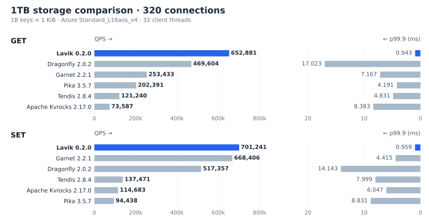

<!--
Copyright (C) 2026 EloqData Inc.

Licensed under the Apache License, Version 2.0 (the "License");
you may not use this file except in compliance with the License.
You may obtain a copy of the License at

    https://www.apache.org/licenses/LICENSE-2.0

Unless required by applicable law or agreed to in writing, software
distributed under the License is distributed on an "AS IS" BASIS,
WITHOUT WARRANTIES OR CONDITIONS OF ANY KIND, either express or implied.
See the License for the specific language governing permissions and
limitations under the License.
-->

<div align="center">

# Lavik

### In-memory performance. NVMe-backed capacity. Redis-compatible.

Lavik is built around a simple idea: use high-performance NVMe storage instead 
of DRAM for the data capacity tier, then optimize every layer of the I/O path
until disk-resident workloads reach performance territory once reserved for
in-memory services.

**Keep the Redis interface. Break the memory-capacity ceiling.**

</div>

Lavik is a Linux C++23 key-value server that speaks RESP2 and RESP3. It keeps
a compact key index in DRAM and stores data on files, raw block devices, or
SPDK NVMe namespaces, so capacity scales with storage. Networking uses kernel
TCP with io_uring by default, with an optional
[experimental DPDK backend](docs/operations/building-and-packaging.md#experimental-dpdk-networking).

## Highlights

- **Grow beyond RAM.** Keep a compact key index in memory and values on NVMe;
  serve hundreds of millions of keys from files, raw devices, or SPDK storage.
- **In-memory-class throughput.** With 10M keys, Lavik v0.2.0 reached
  **1.16M GET QPS** and **945K SET QPS**, exceeding Redis and Valkey's peak
  throughput in that test. See [full results](#in-memory-redis-and-valkey).
- **Keep your Redis tools.** RESP2/RESP3, familiar data structures, Lua,
  transactions, Pub/Sub, authentication, TLS, and RDB import/export.
- **Atomic transactions on primaries and replicas.** Multi-key commands and
  `MULTI`/`EXEC` coordinate across workers; native replication preserves
  transaction atomicity on replicas. See [replication](docs/architecture/05-replication.md).
- **Use multiple cores and scale to a cluster.** Parallel workers, replication,
  Redis Cluster routing, and [Prometheus metrics](docs/operations/metrics.md).

## Benchmark

Browse the [performance reports](perf_reports/README.md) for full results,
test configurations, and methodology. The results below use **Lavik v0.2.0**,
measured on October 21–22, 2026 (UTC).

<a id="in-memory-redis-and-valkey"></a>

### Comparison with in-memory Redis and Valkey

<a id="performance-at-a-glance"></a>

#### 2 vCPUs

**100× the data, comparable peak throughput—on the same 2-vCPU machine.**
Lavik v0.2.0 served **100M keys (95.37 GiB of values)** from NVMe on a
**2-vCPU / 16-GiB** Azure VM, reaching **216K GET ops/s and 231K SET ops/s**.
Redis 8.10.2 and Valkey 9.1.2 held **1M keys** in memory on the same VM;
all values were **1 KiB**. The chart shows throughput and p99.9 latency
across connection counts.


[2-vCPU test details and methodology](perf_reports/lavik-v0.2.0-vs-memory-databases-2026-10-21/README.md)
· [16-vCPU results](#16-vcpus)
· [Disk-backed comparisons](#disk-backed-kv-systems)

#### 16 vCPUs

The [Redis/Valkey comparison](perf_reports/lavik-v0.2.0-vs-memory-databases-2026-10-21/README.md)
tested [Lavik v0.2.0](https://github.com/eloqdata/lavik/releases/tag/v0.2.0),
Redis 8.10.2 and Valkey 9.1.2 with **10 million keys and 1 KiB values**
on an Azure Standard_L16aos_v4 VM. Lavik was also tested with **1 billion keys**.
The 10M tests use **16 client threads and 30-second windows**; the 1B test uses
**32 client threads and 60-second windows**. Both use 160/320/640/1280 connections.


At the same **10 million keys**, Lavik surpassed both Redis and Valkey in
peak GET and SET throughput, reaching **1,156,956 GET QPS** and **945,384 SET QPS**.
GET peak throughput was **18.5% higher than Redis and 26.6% higher than Valkey**;
SET was **9.4% and 19.1% higher**, respectively.

With **1 billion keys (1TB)**, Lavik reached **1,129,597 GET QPS** and
**910,356 SET QPS**—throughput comparable to Redis and Valkey holding
10 million keys in memory, with **100 times as much data**.

### Disk-backed KV systems

The [1TB storage comparison](perf_reports/lavik-v0.2.0-storage-peers-1tb-2026-10-21/README.md) tests
Lavik, Dragonfly, Garnet, Apache Kvrocks, Pika and Tendis on an Azure
Standard_L16aos_v4 VM with **1 billion keys and 1 KiB values**.
Results below use **320 connections** and **32 client threads**, with a 60-second
window per point, sorted by QPS for each command. QPS bars grow from left to right;
p99.9 latency bars grow from right to left on the same row. The full
**160/320/640/1280-connection** sweep is available in the linked report.



See also the [100-million-record YCSB comparison with Aerospike](perf_reports/lavik-v0.2.0-aerospike-ycsb-2026-10-21/README.md),
covering workloads A/B/C/D and their tail latencies.

## Installation

### Download a release

Start with a prebuilt package from [Releases](https://github.com/eloqdata/lavik/releases/latest).
Packages are available for **Linux x86_64 and ARM64 (aarch64)**. Use `minimal`
for kernel TCP and io_uring, or the standard package for DPDK/SPDK support.
See [platform requirements](#release-hardware-and-platform-requirements) below;
both variants require Linux 6.1 or newer with io_uring enabled.

For the minimal v0.1.0 release on Ubuntu 24.04:

```bash
set -e
sudo apt-get update
sudo apt-get install -y curl ca-certificates

VERSION=v0.1.0
ARCH="$(uname -m)"             # x86_64 or aarch64
PACKAGE="lavik-${VERSION}-linux-${ARCH}-minimal"
RELEASE_URL="https://github.com/eloqdata/lavik/releases/download/${VERSION}"
curl -fLO "${RELEASE_URL}/${PACKAGE}.tar.gz"
curl -fLO "${RELEASE_URL}/${PACKAGE}.tar.gz.sha256"
sha256sum --check "${PACKAGE}.tar.gz.sha256"
tar -xzf "${PACKAGE}.tar.gz"
sudo install -m 0755 "${PACKAGE}/lavik" "${PACKAGE}/lavik-meta" \
  "${PACKAGE}/lavik-ctl" /usr/local/bin/
lavik --version
```

For DPDK/SPDK, download the package without the `-minimal` suffix and install
its runtime dependencies (`libnuma1` and `libuuid1` on Ubuntu). See the
[SPDK storage guide](docs/operations/spdk-storage.md) for device setup.
Development builds are available from [Nightly](https://github.com/eloqdata/lavik/releases/tag/nightly).
After installing, continue to [Quick Start](#quick-start).

### Release hardware and platform requirements

| Package | Backends included | x86_64 CPU target | ARM64 CPU target |
|---|---|---|---|
| `lavik-<version>-linux-<arch>-minimal.tar.gz` | Kernel TCP and io_uring | Compiler default (`x86-64` with the CI toolchain) | Compiler default |
| `lavik-<version>-linux-<arch>.tar.gz` | Kernel TCP/io_uring, DPDK networking, and SPDK storage | `x86-64-v2` | `armv8-a+crc` |

Nightly uses `nightly` as the filename version so download URLs stay stable.
The archive's `VERSION` and `REVISION` files identify the source build.
Executable names are the same in both variants: `lavik`, `lavik-meta`, and
`lavik-ctl`. Minimal rejects `--network=dpdk` and `--storage=spdk` with a
configuration error; `--network=kernel` and `--storage=uring` remain available.

Neither CI variant uses `-march=native`. On x86, the standard package requires
all x86-64-v2 features, including SSE3, SSSE3, SSE4.1, SSE4.2, POPCNT,
CMPXCHG16B, and LAHF/SAHF in 64-bit mode. CPUs or VMs lacking any of these
features must use `minimal`. On ARM64, the standard package additionally
requires the CRC32 instruction extension. The requirement applies to the
package even when bypass is not selected at startup.

Prebuilt packages use these CPU targets for portability across supported
machines. To enable additional CPU optimizations available on your deployment
machine, [build from source](#build-from-source) there with
`./scripts/configure_release.sh`, which uses `-march=native`, followed by
`cmake --build build --parallel`. Performance gains
depend on the workload and toolchain; the resulting binaries may not run on
CPUs with fewer instruction-set features.

Both variants require **Linux 6.1 or newer** with usable io_uring for `lavik`
and `lavik-meta`, including when DPDK/SPDK is selected. Worker initialization
requires `IORING_SETUP_DEFER_TASKRUN`, introduced in Linux 6.1, with no fallback
to older kernels. This is the API compatibility floor, not a tested-kernel
matrix; see [Kernel requirements](docs/operations/building-and-packaging.md#kernel-requirements).
CI builds on Ubuntu 24.04; artifacts also require a compatible glibc and are
not intended for older glibc environments.
The standard package additionally needs the NUMA and UUID runtime libraries
(`libnuma1` and `libuuid1` on Ubuntu). It defaults to kernel TCP/io_uring;
DPDK/SPDK must be explicitly selected and provisioned. Its bundled DPDK network
drivers are TAP, ring, and virtio, so it does not support every physical NIC.
SPDK mode requires an SPDK-accessible NVMe device. Follow the
[SPDK storage guide](docs/operations/spdk-storage.md) for device binding,
hugepage setup, a release-package launch command, and host restoration.

See [Building and packaging](docs/operations/building-and-packaging.md)
for dependency setup, standard-package builds, and compatibility details.

### Build from source

Building locally with `-march=native` can improve peak QPS by enabling hardware
acceleration for CRC32C storage-integrity checks on supported CPUs, beyond the
conservative CPU targets used by portable release packages.

#### Build prerequisites

The standard io_uring build requires:

- Linux 6.1 or newer with io_uring enabled (`x86_64` and `aarch64` are the release-package targets)
- CMake 3.26 or newer (required by the bundled Meta dependency)
- a C++23 compiler (GCC 13+ or a recent Clang is recommended)
- Ninja, Git, and OpenSSL development headers/static libraries; GNU Make is
  additionally required by the optional bypass dependencies

On Ubuntu 24.04, install Git to obtain the source:

```bash
sudo apt-get update
sudo apt-get install -y git
```

#### Compile and install

```bash
git clone https://github.com/eloqdata/lavik.git
cd lavik
./scripts/install_build_deps.sh
git submodule update --init bycorf third_party/mimalloc
git -C bycorf submodule update --init third_party/liburing third_party/abseil

./scripts/configure_release.sh
cmake --build build --target lavik lavik-meta lavik-ctl --parallel
sudo install -m 0755 build/lavik build/lavik-meta build/lavik-ctl /usr/local/bin/
```

The dependency installer is shared with release CI. It supports Ubuntu 24.04
on x86_64 and ARM64; `--dry-run` shows the packages without installing them.
The commands above build with kernel TCP/io_uring. To include DPDK/SPDK in a
local build, run these additional commands in the same checkout:

```bash
./scripts/install_build_deps.sh --with-bypass
git -C bycorf submodule update --init third_party/spdk third_party/dpdk
git -C bycorf/third_party/spdk submodule update --init isa-l isa-l-crypto
CC=gcc-13 CXX=g++-13 ./scripts/configure_release.sh -DLAVIK_KERNEL_BYPASS=ON
cmake --build build --target lavik lavik-meta lavik-ctl --parallel
```

`LAVIK_KERNEL_BYPASS` is a configure-time option. Pass it to the configure
script, not to `cmake --build`. Both configure scripts default it to `OFF` on
every run; pass `-DLAVIK_KERNEL_BYPASS=ON` when configuring either build tree
to enable the bypass targets and dependencies.

Local release builds use `-march=native`; use the packaging script below for
portable artifacts. Bypass remains an explicit runtime choice via
`--network=dpdk` and/or `--storage=spdk`.

To create a portable archive for the current architecture, run:

```bash
./scripts/package_release.sh
```

After installing the bypass dependencies, use
`LAVIK_PACKAGE_KERNEL_BYPASS=ON ./scripts/package_release.sh` for a standard
archive with DPDK/SPDK support.

The archive contains `lavik`, `lavik-meta`, `lavik-ctl`, `LICENSE`, and notices
under `dist/`. Without the bypass option, packaging builds the `minimal` variant. Main-branch
[Ubuntu release CI](.github/workflows/release.yml) builds both variants for
x86_64 and ARM64. Download the four archives and their SHA-256 files from
[Nightly](https://github.com/eloqdata/lavik/releases/tag/nightly), which is
updated after successful builds of the latest main. CI artifacts are also
retained for 30 days.

## Quick Start

For deployment beyond the basic example below:

- [Quick startup tuning](docs/operations/quick-start-tuning.md): generate this
  machine's CPU plan and start Lavik.
- [Cluster deployment](docs/operations/cluster-deployment.md): launch the local
  Meta-managed cluster example.

For a throwaway local instance, provision a file and start the server:

```bash
mkdir -p /tmp/lavik-quickstart
fallocate -l 1G /tmp/lavik-quickstart/lavik.data

lavik \
  --data-file /tmp/lavik-quickstart/lavik.data
```

In another terminal, use any Redis-compatible client:

```bash
redis-cli PING
# PONG

redis-cli SET greeting "hello from Lavik"
# OK

redis-cli GET greeting
# "hello from Lavik"

redis-cli HSET user:42 name Ada language C++
redis-cli HGETALL user:42
```

Stop the server with `Ctrl-C`. See [Multi-Device Storage](docs/operations/multi-device-storage.md)
for persistent files, raw devices, and storage expansion.

CRC generation for new data records and value/key extents is disabled by
default. Enable it with `--record-crc` or `record-crc yes` in a Redis-style
configuration file; `--no-record-crc` or `record-crc no` disables it on the next
startup. Reads always verify CRCs that are present, including records written
under a previous startup setting. Device metadata, block headers, checkpoints,
Function catalog and replication CRCs remain enabled. Without a data CRC,
structural checks still run but arbitrary payload corruption is not detected.

## Compatibility and operational notes

Lavik supports RESP2/RESP3 clients and the Redis commands described in
[Highlights](#highlights). See the [Valkey compatibility test coverage](tests/valkey/README.md)
for the command suites exercised by the project. Operational differences include:

- A successful write is not a synchronous `fsync` fence; see the
  [storage architecture](docs/architecture/04-storage-and-recovery.md) before
  selecting failure semantics.
- Redis-style configuration files may enable automatic RDB snapshots with
  `save <seconds> <changes>` pairs; `save ""` disables them. Lavik keeps
  automatic snapshots disabled when no `save` directive is present.
- Lavik Meta manages native replication and automatic failover. See the
  [cluster deployment guide](docs/operations/cluster-deployment.md).
- A replication restart can require a full synchronization.
- Raw block and SPDK paths require exclusive device ownership.

## Contributing

See the [contributing guide](CONTRIBUTING.md) for development setup, building
and testing, formatting with pre-commit, and committing a change.

Useful references:

- [Documentation index](docs/README.md)
- [Architecture](docs/architecture/README.md)
- [Operations](docs/operations/README.md)
- [Lavik Admin](docs/operations/lavik-admin.md): bundled browser and CLI workspace
  for SSH cluster setup, version selection, multi-cluster monitoring, follower
  resizing, and key browsing
- [Prometheus metrics](docs/operations/metrics.md)
- [Network IRQ affinity tuning](docs/operations/irq-affinity-tuning.md)
- [Performance reports](perf_reports/README.md)

---

<div align="center">

### Help Lavik grow

If Lavik looks useful, please
**[star the project on GitHub](https://github.com/eloqdata/lavik)**.
It helps more Redis users and storage engineers discover the project.

[](https://github.com/eloqdata/lavik)

</div>

## License

EloqData-authored code is licensed under [Apache-2.0](LICENSE).
Third-party components retain their original copyright notices and licenses;
see [NOTICE](NOTICE) and the notices in each dependency.
