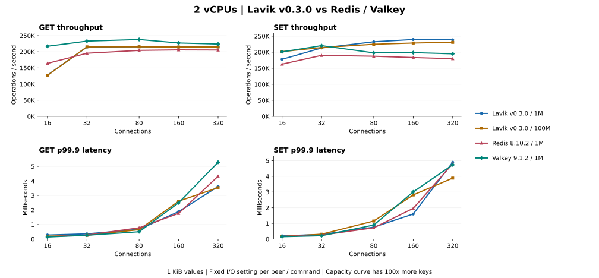
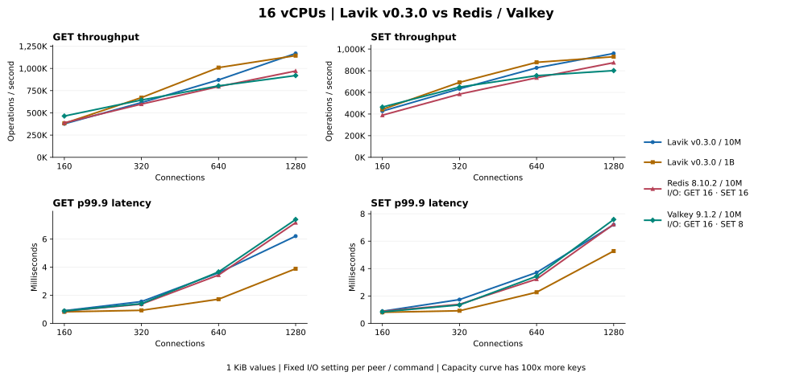
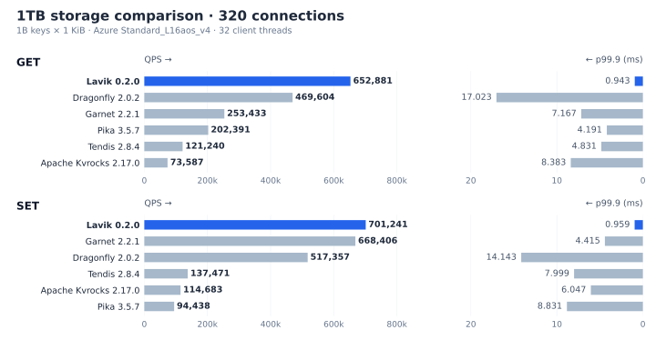

<!--
Copyright (C) 2026 EloqData Inc.

Licensed under the Apache License, Version 2.0 (the "License");
you may not use this file except in compliance with the License.
You may obtain a copy of the License at

    https://www.apache.org/licenses/LICENSE-2.0

Unless required by applicable law or agreed to in writing, software
distributed under the License is distributed on an "AS IS" BASIS,
WITHOUT WARRANTIES OR CONDITIONS OF ANY KIND, either express or implied.
See the License for the specific language governing permissions and
limitations under the License.
-->

<div align="center">

# Lavik

### 内存级性能，NVMe 存储容量，兼容 Redis。

Lavik 的核心思路很简单：用高性能 NVMe 存储替代 DRAM 承载数据容量，
再逐层优化 I/O 路径，让磁盘上的工作负载也能达到以往只有内存服务才能实现的性能。

**保留 Redis 接口，突破内存容量上限。**

</div>

其他语言：[English](README.md)

Lavik 是面向 Linux、使用 C++23 编写的键值服务器，支持 RESP2 和 RESP3。
它在 DRAM 中维护紧凑的键索引，将数据存储在文件、裸块设备或 SPDK NVMe 命名空间中，
使数据容量随存储容量扩展。网络默认使用内核 TCP 和 io_uring，也可选择
[实验性 DPDK 后端](docs/operations/building-and-packaging.md#experimental-dpdk-networking)。

<a id="highlights"></a>

## 核心特性

- **突破内存容量限制。** 内存中仅保留紧凑的键索引，值存储在 NVMe 上；
  通过文件、裸设备或 SPDK 存储承载数亿个键。
- **内存级吞吐量。** 在 1000 万个键的测试中，Lavik v0.3.0 达到
  **117 万 GET QPS** 和 **96 万 SET QPS**，超过该测试中 Redis 和 Valkey 的峰值吞吐量。
  参见[完整结果](#in-memory-redis-and-valkey)。
- **继续使用 Redis 工具。** 支持 RESP2/RESP3、熟悉的数据结构、Lua、事务、
  Pub/Sub、身份认证、TLS 和 RDB 导入/导出。
- **主节点与副本均支持原子事务。** 多键命令和 `MULTI`/`EXEC` 跨工作线程协调执行；
  原生复制在副本上保留事务原子性。参见[复制架构](docs/architecture/05-replication.md)。
- **利用多核，扩展至集群。** 支持并行工作线程、复制、Redis Cluster 路由和
  [Prometheus 指标](docs/operations/metrics.md)。

## 基准测试

完整结果、测试配置和方法见[性能报告](perf_reports/README.md)。

<a id="in-memory-redis-and-valkey"></a>

### 与内存型 Redis 和 Valkey 对比

<a id="performance-at-a-glance"></a>

#### 2 vCPU

**同一台 2 vCPU 机器，数据量增加 100 倍，峰值吞吐量依然相当。**
Lavik v0.3.0 在一台 **2 vCPU / 16 GiB** 的 Azure VM 上，使用 NVMe 承载
**1 亿个键（值共 95.37 GiB）**，达到 **21.6 万 GET ops/s 和 23.1 万 SET ops/s**。
Redis 8.10.2 和 Valkey 9.1.2 在同一台 VM 上将 **100 万个键**保存在内存中；
所有值的大小均为 **1 KiB**。下图展示不同连接数下的吞吐量和 p99.9 延迟。



[2 vCPU 测试详情与方法](perf_reports/lavik-vs-memory-databases/README.md)
· [16 vCPU 结果](#16-vcpus)
· [磁盘型 KV 系统对比](#disk-backed-kv-systems)

<a id="16-vcpus"></a>

#### 16 vCPU

[Redis/Valkey 对比测试](perf_reports/lavik-vs-memory-databases/README.md)
在 Azure Standard_L16aos_v4 VM 上，以 **1000 万个键、每个值 1 KiB** 测试了
[Lavik v0.3.0](https://github.com/eloqdata/lavik/releases/tag/v0.3.0)、
Redis 8.10.2 和 Valkey 9.1.2，并额外测试了 Lavik 在 **10 亿个键**下的表现。
1000 万键测试使用 **16 个客户端线程、30 秒测试窗口**；10 亿键测试使用
**32 个客户端线程、60 秒测试窗口**。两组均使用 160/320/640/1280 个连接。



在同样的 **1000 万个键**下，Lavik 的 GET 和 SET 峰值吞吐量均超过 Redis 和 Valkey，
达到 **1,168,681 GET QPS** 和 **959,837 SET QPS**。
GET 峰值吞吐量分别比 **Redis 高 20.3%、比 Valkey 高 27.1%**；
SET 则分别高 **9.7% 和 19.8%**。

在 **10 亿个键（1TB）**下，Lavik 达到 **1,143,839 GET QPS** 和
**929,346 SET QPS**，以 **100 倍的数据量**，实现了与 Redis 和 Valkey
在内存中保存 1000 万个键时相当的吞吐量。

<a id="disk-backed-kv-systems"></a>

### 磁盘型 KV 系统

[1TB 存储对比测试](perf_reports/lavik-storage-peers-1tb/README.md)在 Azure
Standard_L16aos_v4 VM 上，以 **10 亿个键、每个值 1 KiB** 测试了 Lavik、
Dragonfly、Garnet、Apache Kvrocks、Pika 和 Tendis。
下图使用 **320 个连接**、**32 个客户端线程**，每个测试点运行 60 秒，
各命令的结果按 QPS 排序。QPS 条形从左向右延伸，同一行的 p99.9 延迟条形从右向左延伸。
完整的 **160/320/640/1280 连接数**测试见链接中的报告。



另见[与 Aerospike 的 1 亿条记录 YCSB 对比](perf_reports/lavik-aerospike-ycsb/README.md)，
涵盖 Lavik v0.3.0 使用 io_uring 时在 A/B/C/D 工作负载下的表现及尾延迟。

## 安装

### 下载发行包

从 [Releases](https://github.com/eloqdata/lavik/releases/latest) 下载预编译包。
发行包支持 **Linux x86_64 和 ARM64（aarch64）**。使用内核 TCP 和 io_uring 时选择
`minimal`，需要 DPDK/SPDK 支持时选择标准包。
参见下文的[平台要求](#release-hardware-and-platform-requirements)；
两个版本均要求启用 io_uring 的 Linux 6.1 或更新版本。

在 Ubuntu 24.04 上安装 v0.1.0 minimal 发行包：

```bash
set -e
sudo apt-get update
sudo apt-get install -y curl ca-certificates

VERSION=v0.1.0
ARCH="$(uname -m)"             # x86_64 or aarch64
PACKAGE="lavik-${VERSION}-linux-${ARCH}-minimal"
RELEASE_URL="https://github.com/eloqdata/lavik/releases/download/${VERSION}"
curl -fLO "${RELEASE_URL}/${PACKAGE}.tar.gz"
curl -fLO "${RELEASE_URL}/${PACKAGE}.tar.gz.sha256"
sha256sum --check "${PACKAGE}.tar.gz.sha256"
tar -xzf "${PACKAGE}.tar.gz"
sudo install -m 0755 "${PACKAGE}/lavik" "${PACKAGE}/lavik-meta" \
  "${PACKAGE}/lavik-ctl" /usr/local/bin/
lavik --version
```

使用 DPDK/SPDK 时，下载不带 `-minimal` 后缀的包并安装运行时依赖
（Ubuntu 上为 `libnuma1` 和 `libuuid1`）。设备配置见
[SPDK 存储指南](docs/operations/spdk-storage.md)。
开发构建可从 [Nightly](https://github.com/eloqdata/lavik/releases/tag/nightly) 下载。
安装完成后继续阅读[快速开始](#quick-start)。

<a id="release-hardware-and-platform-requirements"></a>

### 发行包的硬件与平台要求

| 发行包 | 包含的后端 | x86_64 CPU 目标 | ARM64 CPU 目标 |
|---|---|---|---|
| `lavik-<version>-linux-<arch>-minimal.tar.gz` | 内核 TCP 和 io_uring | 编译器默认值（CI 工具链下为 `x86-64`） | 编译器默认值 |
| `lavik-<version>-linux-<arch>.tar.gz` | 内核 TCP/io_uring、DPDK 网络和 SPDK 存储 | `x86-64-v2` | `armv8-a+crc` |

Nightly 使用 `nightly` 作为文件名中的版本，保持下载 URL 稳定。
压缩包中的 `VERSION` 和 `REVISION` 文件标识构建所用源码。
两个版本的可执行文件名称相同：`lavik`、`lavik-meta` 和 `lavik-ctl`。
Minimal 会以配置错误拒绝 `--network=dpdk` 和 `--storage=spdk`；
`--network=kernel` 和 `--storage=uring` 仍可使用。

两个 CI 版本均不使用 `-march=native`。在 x86 上，标准包要求具备全部 x86-64-v2 特性，
包括 SSE3、SSSE3、SSE4.1、SSE4.2、POPCNT、CMPXCHG16B，以及 64 位模式下的 LAHF/SAHF。
缺少任何一项的 CPU 或 VM 必须使用 `minimal`。在 ARM64 上，标准包额外要求 CRC32 指令扩展。
即使启动时未选择内核旁路后端，这些要求仍然适用于整个发行包。

预编译包采用上述 CPU 目标，以便在受支持的机器间移植。
若要利用部署机器上的更多 CPU 优化，可在该机器上运行
`./scripts/configure_release.sh` [从源码构建](#build-from-source)，
该脚本使用 `-march=native`，随后执行 `cmake --build build --parallel`。
性能收益取决于工作负载和工具链；生成的二进制文件可能无法在指令集特性较少的 CPU 上运行。

两个版本中的 `lavik` 和 `lavik-meta` 均要求 **Linux 6.1 或更新版本**，且 io_uring 可用，
即使选择 DPDK/SPDK 也不例外。工作线程初始化依赖 Linux 6.1 引入的
`IORING_SETUP_DEFER_TASKRUN`，不提供旧内核回退路径。
这是 API 兼容性的最低要求，并非已测试的内核矩阵；参见
[内核要求](docs/operations/building-and-packaging.md#kernel-requirements)。
CI 在 Ubuntu 24.04 上构建；产物还要求兼容的 glibc，不面向较旧的 glibc 环境。
标准包额外需要 NUMA 和 UUID 运行时库（Ubuntu 上为 `libnuma1` 和 `libuuid1`）。
它默认使用内核 TCP/io_uring；DPDK/SPDK 必须显式选择并完成配置。
包内附带的 DPDK 网络驱动为 TAP、ring 和 virtio，因此并不支持所有物理网卡。
SPDK 模式需要可由 SPDK 访问的 NVMe 设备。设备绑定、hugepage 配置、发行包启动命令及
主机恢复步骤见 [SPDK 存储指南](docs/operations/spdk-storage.md)。

依赖安装、标准包构建和兼容性详情见[构建与打包](docs/operations/building-and-packaging.md)。

<a id="build-from-source"></a>

### 从源码构建

在本机使用 `-march=native` 构建，可在支持的 CPU 上启用 CRC32C 存储完整性校验的硬件加速，
超出可移植发行包所采用的保守 CPU 目标，从而有机会提升峰值 QPS。

#### 构建前提

常规 io_uring 构建需要：

- 启用 io_uring 的 Linux 6.1 或更新版本（发行包面向 `x86_64` 和 `aarch64`）
- CMake 3.26 或更新版本（随附的 Meta 依赖要求）
- C++23 编译器（建议 GCC 13+ 或较新的 Clang）
- Ninja、Git，以及 OpenSSL 开发头文件和静态库；可选的内核旁路依赖还需要 GNU Make

在 Ubuntu 24.04 上，先安装 Git 以获取源码：

```bash
sudo apt-get update
sudo apt-get install -y git
```

#### 编译与安装

```bash
git clone https://github.com/eloqdata/lavik.git
cd lavik
./scripts/install_build_deps.sh
git submodule update --init bycorf third_party/mimalloc
git -C bycorf submodule update --init third_party/liburing third_party/abseil

./scripts/configure_release.sh
cmake --build build --target lavik lavik-meta lavik-ctl --parallel
sudo install -m 0755 build/lavik build/lavik-meta build/lavik-ctl /usr/local/bin/
```

依赖安装脚本与发行版 CI 共用，支持 Ubuntu 24.04 上的 x86_64 和 ARM64；
`--dry-run` 可查看将安装的软件包而不执行安装。
上述命令构建内核 TCP/io_uring 版本。若要在本地构建中加入 DPDK/SPDK，
在同一个源码目录中继续执行：

```bash
./scripts/install_build_deps.sh --with-bypass
git -C bycorf submodule update --init third_party/spdk third_party/dpdk
git -C bycorf/third_party/spdk submodule update --init isa-l isa-l-crypto
CC=gcc-13 CXX=g++-13 ./scripts/configure_release.sh -DLAVIK_KERNEL_BYPASS=ON
cmake --build build --target lavik lavik-meta lavik-ctl --parallel
sudo install -m 0755 build/lavik build/lavik-meta build/lavik-ctl /usr/local/bin/
```

`LAVIK_KERNEL_BYPASS` 是配置阶段的选项，应传给配置脚本，而非 `cmake --build`。
两个配置脚本每次运行时都会默认将其设为 `OFF`；配置任一构建目录时，
都需要传入 `-DLAVIK_KERNEL_BYPASS=ON` 才能启用内核旁路目标和依赖。

本地 release 构建使用 `-march=native`；如需可移植产物，请使用下方的打包脚本。
内核旁路仍需在运行时通过 `--network=dpdk` 和/或 `--storage=spdk` 显式选择。

为当前架构生成可移植压缩包：

```bash
./scripts/package_release.sh
```

安装内核旁路依赖后，使用 `LAVIK_PACKAGE_KERNEL_BYPASS=ON ./scripts/package_release.sh`
生成支持 DPDK/SPDK 的标准包。

压缩包包含 `lavik`、`lavik-meta`、`lavik-ctl`、`LICENSE` 和相关声明，输出到 `dist/`。
不启用内核旁路选项时，打包生成 `minimal` 版本。主分支的
[Ubuntu 发行版 CI](.github/workflows/release.yml) 为 x86_64 和 ARM64 构建两个版本。
四个压缩包及其 SHA-256 文件可从
[Nightly](https://github.com/eloqdata/lavik/releases/tag/nightly) 下载，
主分支最新代码构建成功后会更新 Nightly。CI 产物也会保留 30 天。

<a id="quick-start"></a>

## 快速开始

如需超出下方基础示例的部署方式，请参阅：

- [快速启动调优](docs/operations/quick-start-tuning.md)：为当前机器生成 CPU 规划并启动 Lavik。
- [集群部署](docs/operations/cluster-deployment.md)：启动由 Meta 管理的本地集群示例。

要启动一个临时本地实例，先准备文件，再启动服务器：

```bash
mkdir -p /tmp/lavik-quickstart
fallocate -l 1G /tmp/lavik-quickstart/lavik.data

lavik \
  --data-file /tmp/lavik-quickstart/lavik.data
```

在另一个终端中，使用任意兼容 Redis 的客户端：

```bash
redis-cli PING
# PONG

redis-cli SET greeting "hello from Lavik"
# OK

redis-cli GET greeting
# "hello from Lavik"

redis-cli HSET user:42 name Ada language C++
redis-cli HGETALL user:42
```

按 `Ctrl-C` 停止服务器。持久化文件、裸设备和存储扩容的说明见
[多设备存储](docs/operations/multi-device-storage.md)。

默认不为新数据记录及值/键 extent 生成 CRC。可通过 `--record-crc` 或 Redis 风格配置文件中的
`record-crc yes` 启用；`--no-record-crc` 或 `record-crc no` 会在下次启动时禁用生成。
读取时始终校验已有的 CRC，包括在先前启动配置下写入的记录。
设备元数据、块头、检查点、Function catalog 和复制的 CRC 仍保持启用。
没有数据 CRC 时仍执行结构检查，但无法检测任意载荷损坏。

## 兼容性与运维说明

Lavik 支持 RESP2/RESP3 客户端及[核心特性](#highlights)中描述的 Redis 命令。
项目测试覆盖的命令套件见 [Valkey 兼容性测试覆盖](tests/valkey/README.md)。运维差异包括：

- 写入成功不代表已完成同步 `fsync` 持久化屏障；选择故障语义前，请阅读
  [存储架构](docs/architecture/04-storage-and-recovery.md)。
- Redis 风格配置文件可通过 `save <seconds> <changes>` 参数对启用自动 RDB 快照；
  `save ""` 会将其禁用。没有 `save` 指令时，Lavik 保持自动快照关闭。
- Lavik Meta 管理原生复制和自动故障转移。参见[集群部署指南](docs/operations/cluster-deployment.md)。
- 复制重启可能需要全量同步。
- 裸块设备和 SPDK 路径要求独占设备。

## 参与贡献

开发环境配置、构建与测试、使用 pre-commit 格式化以及提交变更的说明见
[贡献指南](CONTRIBUTING.md)。

相关资料：

- [文档索引](docs/README.md)
- [架构](docs/architecture/README.md)
- [运维](docs/operations/README.md)
- [Lavik Admin](docs/operations/lavik-admin.md)：随附的浏览器和 CLI 工作空间，
  用于通过 SSH 配置集群、选择版本、监控多个集群、调整副本数量和浏览键
- [Prometheus 指标](docs/operations/metrics.md)
- [网络 IRQ 亲和性调优](docs/operations/irq-affinity-tuning.md)
- [性能报告](perf_reports/README.md)

---

<div align="center">

### 帮助 Lavik 成长

如果 Lavik 对你有帮助，欢迎**[在 GitHub 上为项目点亮 Star](https://github.com/eloqdata/lavik)**。
这能帮助更多 Redis 用户和存储工程师发现这个项目。

[](https://github.com/eloqdata/lavik)

</div>

## 许可证

EloqData 编写的代码采用 [Apache-2.0](LICENSE) 许可证。
第三方组件保留其原有的版权声明和许可证；参见 [NOTICE](NOTICE) 及各依赖中的声明。
