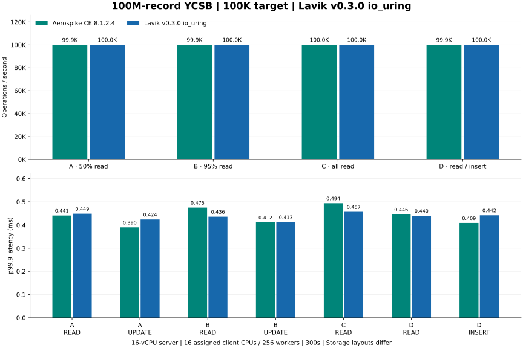
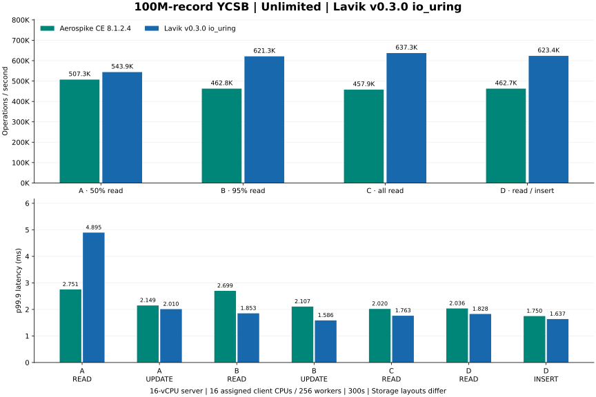

# Lavik v0.3.0 (io_uring) and Aerospike: YCSB throughput and tail latency

**English** | [简体中文](README.zh-CN.md)

The complete **A/B/C/D × 100K/unlimited** comparison contains **16 formal 300-second windows**. Each database independently loads **100M records of 10 × 128 B fields**. All measured and warmup phases have zero errors. Lavik v0.3.0 uses the io_uring storage backend.

Unlimited A/B/C/D throughput exceeds Aerospike by **+7.22%** / **+34.25%** / **+39.19%** / **+34.72%**, respectively. A READ p99.9 is **4.895 ms** for Lavik versus **2.751 ms** for Aerospike; higher throughput still carries a tail-latency tradeoff. These are single-window observations.

The client VM has **32 vCPUs**; this matrix assigns YCSB **CPUs 0–15**, with 256 workers. Aerospike uses all 16 server CPUs; Lavik uses 12 workers and four CPUs for system tasks and NIC IRQs. Operation cells show **operation QPS; p99 / p99.9 (ms)**.

## 100K target



| Workload | Operation | Aerospike CE 8.1.2.4 | Lavik v0.3.0 · io_uring |
| --- | --- | --- | --- |
| A | Total QPS | 99,851 | 99,963 |
| A | READ | 49,924; 0.337 / 0.441 | 49,979; 0.338 / 0.449 |
| A | UPDATE | 49,927; 0.290 / 0.390 | 49,984; 0.312 / 0.424 |
| B | Total QPS | 99,912 | 99,955 |
| B | READ | 94,922; 0.362 / 0.475 | 94,957; 0.334 / 0.436 |
| B | UPDATE | 4,990; 0.313 / 0.412 | 4,998; 0.327 / 0.413 |
| C | Total QPS | 99,956 | 99,960 |
| C | READ | 99,956; 0.381 / 0.494 | 99,960; 0.359 / 0.457 |
| D-Uniform | Total QPS | 99,875 | 99,958 |
| D-Uniform | READ | 94,876; 0.350 / 0.446 | 94,966; 0.329 / 0.440 |
| D-Uniform | INSERT | 4,999; 0.312 / 0.409 | 4,992; 0.324 / 0.442 |

## Unlimited



| Workload | Operation | Aerospike CE 8.1.2.4 | Lavik v0.3.0 · io_uring |
| --- | --- | --- | --- |
| A | Total QPS | 507,269 | 543,901 |
| A | READ | 253,635; 1.365 / 2.751 | 271,934; 1.672 / 4.895 |
| A | UPDATE | 253,634; 1.182 / 2.149 | 271,968; 0.728 / 2.010 |
| B | Total QPS | 462,756 | 621,264 |
| B | READ | 439,629; 1.264 / 2.699 | 590,203; 0.714 / 1.853 |
| B | UPDATE | 23,127; 1.099 / 2.107 | 31,060; 0.632 / 1.586 |
| C | Total QPS | 457,859 | 637,276 |
| C | READ | 457,859; 1.284 / 2.020 | 637,276; 0.665 / 1.763 |
| D-Uniform | Total QPS | 462,741 | 623,412 |
| D-Uniform | READ | 439,597; 1.259 / 2.036 | 592,239; 0.702 / 1.828 |
| D-Uniform | INSERT | 23,144; 1.098 / 1.750 | 31,173; 0.646 / 1.637 |

## Environment and method

| Item | Configuration |
| --- | --- |
| Server | Azure Standard_L16aos_v4; Japan East zone 2; AMD EPYC 9V74; 8 physical / 16 logical CPUs; 128 GiB |
| Client | Standard_F32als_v6; 32 vCPUs; Java 17; YCSB affinity 0–15 |
| OS | Ubuntu 24.04; Linux 7.0.0-1017-azure |
| Lavik storage | 6 × 1,919,850,381,312 B full raw NVMe devices (~11.52 TB); io_uring |
| Aerospike storage | Same six NVMe; RAID0, 512 KiB stripe; one fully zeroed 1,099,494,850,560 B raw partition (~1.10 TB) |
| Database | Lavik v0.3.0; dcb2dda96452610b9aa2625ff2a26abb3303f9b5; Aerospike CE 8.1.2.4-4 |
| YCSB | eloqdata/YCSB a47bf01c4f197d2ff2eecbbebd9743da5a1cae47; LAVIK.HREPLACE |
| A / B / C / D | 50% read + 50% update / 95% read + 5% update / 100% read / 95% read + 5% insert |
| Final records | Aerospike 108,544,472; Lavik 110,951,860 |
| Measured | 2026-11-16 (UTC) |

**Physical capacity and layout differ between products**, although the starting logical dataset is identical. This compares the documented deployment configurations, not an isolated storage-engine effect.

- Independently load 100M records per database, stop cleanly, recover, and verify exact record counts plus all-field hashes for eight distributed samples. The initial field payload is 119.21 GiB.
- Run Aerospike then Lavik; each uses C/A/B/D, 100K then unlimited. Every cell has a separate 1M-operation warmup JVM followed by a fresh 256-worker JVM measuring 300 seconds. The 2B-operation cap is non-binding. Initial JIT/ramp-up remains included.
- D is a **Uniform variant, not standard YCSB D's latest distribution**. Reads stay in the original 100M keys; warmup/measured insert IDs start at 2B/4B for 100K and 6B/8B for unlimited. The disjoint ranges avoid collisions. Time-bounded D produces different final record counts.
- Read and update all ten fields. Lavik uses HGETALL / LAVIK.HREPLACE / HMSET; Aerospike uses all-bin reads / REPLACE_ONLY / CREATE_ONLY. Both bindings use 10,000 ms timeouts with Aerospike Java 3.1.2 / Jedis 3.9.0.
- Lavik uses six full raw devices, shutdown checkpointing and the 12+4 CPU/IRQ policy. Every phase reconciles client/server counts, record growth and IRQ policy; formal windows have zero errors and zero sampled server CPU steal, and final recovery checks pass.
- QPS is successful operations divided by actual YCSB runtime. Percentiles come from complete-window ordinary HDR histograms, not averaged progress percentiles; Intended histograms remain in logs. Equal worker counts do not imply equal TCP connection counts.
- Each condition has one formal window, in fixed order; no confidence intervals are claimed. CPU allocation, caches, flushing and persistence differ; successful responses do not imply equal synchronous durability. Raw logs, parameters and checksums are archived separately; reproduction commands follow below.

## Run commands

These Bash commands use the measured settings; adapt paths, addresses and NIC PCI identity to the deployment. For Aerospike, prepare one fully zeroed raw RAID0 partition as described above, exposed as `aerospike-device`. After its matrix, stop Aerospike and dismantle the scratch RAID; prepare the six dedicated empty NVMe devices for Lavik and replace `/dev/YOUR_NVME_1` through `/dev/YOUR_NVME_6` with their verified paths. Run databases sequentially and load each once. Preserve the original host policy for Aerospike, then apply Lavik isolation; restore the original values afterward.

### Aerospike configuration

Save as `/opt/bench020/ycsb/aerospike.conf`:

```conf
# Single-node YCSB device namespace. Performance settings use server defaults.
service {
    cluster-name ycsb-default-20261116
}
logging {
    console {
        context any info
    }
}
network {
    service {
        address YOUR_SERVER_PRIVATE_IP
        port 3000
    }
    heartbeat {
        address 127.0.0.1
        mode mesh
        port 3002
    }
    fabric {
        address 127.0.0.1
        port 3001
    }
    admin {
        address 127.0.0.1
        port 3003
    }
}
namespace ycsb {
    replication-factor 1
    storage-engine device {
        device /opt/bench020/ycsb/aerospike-device
    }
}
```

### Start the databases

Start Aerospike first. After its complete matrix, stop Aerospike, apply the CPU/IRQ isolation below, then start Lavik. Create the required log and runtime directories before starting.

```bash
sudo mkdir -p /opt/aerospike
sudo cp -a /opt/bench020/aerospike-package/opt/aerospike/usr /opt/aerospike/

sudo systemd-run \
  --unit aerospike-ycsb-default-20261116.service \
  --collect \
  -p TimeoutStopSec=300 \
  -p StandardOutput=append:/opt/bench020/ycsb/aerospike-server.stdout \
  -p StandardError=inherit \
  -p SendSIGKILL=no \
  -p LimitNOFILE=100000 /opt/bench020/aerospike-package/usr/bin/asd \
  --config-file /opt/bench020/ycsb/aerospike.conf \
  --foreground
```

```bash
sudo systemd-run \
  --unit lavik-ycsb-tuned-20261116.service \
  --collect \
  -p TimeoutStopSec=300 \
  -p StandardOutput=append:/opt/bench020/ycsb/hreplace-server.stdout \
  -p StandardError=inherit \
  -p SendSIGKILL=no \
  --slice=lavik-bench.slice \
  -p AllowedCPUs=0-11 \
  -p CPUAffinity=0-11 \
  -p LimitNOFILE=65535 /opt/bench020/downloads/lavik-v0.3.0-linux-x86_64/lavik \
  --bind YOUR_SERVER_PRIVATE_IP \
  --port 16379 \
  --metrics-port 19100 \
  --threads 12 \
  --shutdown-checkpoint \
  --data-file /dev/YOUR_NVME_1 \
  --data-file /dev/YOUR_NVME_2 \
  --data-file /dev/YOUR_NVME_3 \
  --data-file /dev/YOUR_NVME_4 \
  --data-file /dev/YOUR_NVME_5 \
  --data-file /dev/YOUR_NVME_6 \
  --log-dir /opt/bench020/ycsb/lavik-server-logs
```

### Lavik CPU/IRQ isolation

irqbalance was inactive on this host. These commands combine with the service settings above to implement 12+4 isolation.

```bash
# Server, only after Aerospike has stopped; dedicated 16-logical-CPU test host.
sudo systemctl set-property --runtime system.slice AllowedCPUs=12-15
sudo systemctl set-property --runtime user.slice AllowedCPUs=12-15
sudo systemctl set-property --runtime init.scope AllowedCPUs=12-15
printf 'f000\n' | sudo tee /sys/devices/virtual/workqueue/cpumask

# This PCI identity must match the benchmark NIC on the current boot.
sudo python3 - <<'PYCODE'
from pathlib import Path
import os
vfs = list(Path('/sys/class/net/eth0').glob('lower_*'))
assert len(vfs) == 1
pci = (vfs[0].resolve() / 'device').resolve().name
irqs = [line.split(':', 1)[0].strip()
        for line in Path('/proc/interrupts').read_text().splitlines() if pci in line]
assert len(irqs) == 17, irqs
for i, irq in enumerate(irqs):
    Path('/proc/irq', irq, 'smp_affinity_list').write_text(str(12 + i % 4) + '\n')
# Migrate existing userspace threads; leave kernel threads to their own policy.
for stat in Path('/proc').glob('[0-9]*/task/[0-9]*/stat'):
    try:
        raw = stat.read_text()
        comm = raw[raw.index('(')+1:raw.rindex(')')]
        flags = int(raw[raw.rindex(')')+2:].split()[6])
        if flags & 0x04000000 or comm.startswith('kworker/'):
            continue
        os.sched_setaffinity(int(stat.parent.name), {12, 13, 14, 15})
    except (OSError, ProcessLookupError):
        pass
PYCODE
```

### YCSB load, warmup and measurement

```bash
# On the client: Java 17 and the custom YCSB distribution are installed.
# Run the complete load/recovery/matrix for Aerospike first, then for Lavik.
DB=aerospike                       # use DB=lavik for the second database
if [ "$DB" = aerospike ]; then
  YCSB_ROOT=/opt/bench020/ycsb-aerospike-dist
  BINDING=aerospike
  DB_ARGS=(-p as.host=YOUR_SERVER_PRIVATE_IP -p as.namespace=ycsb -p as.timeout=10000)
else
  YCSB_ROOT=/opt/bench020/ycsb-redis-dist
  BINDING=redis
  DB_ARGS=(-p redis.host=YOUR_SERVER_PRIVATE_IP -p redis.port=16379 -p redis.scanindex=none
           -p redis.timeout=10000)
fi
mkdir -p results
COMMON=(-s -threads 256 -P "$YCSB_ROOT/workloads/workloada"
  -p fieldlength=128
  -p writeallfields=true
  -p measurement.interval=both
  -p hdrhistogram.percentiles=50,95,99,99.9,99.99)

# Fresh load: run once on an empty database.
taskset -c 0-15 /usr/bin/python3 "$YCSB_ROOT/bin/ycsb" load "$BINDING" "${COMMON[@]}" "${DB_ARGS[@]}" \
  -p recordcount=100000000 \
  > "results/$DB-load.log" 2>&1
```

After loading, verify exactly 100,000,000 successful INSERTs, server record counts and field lengths. Stop cleanly, restart with the same launch command, and confirm recovered samples before running the matrix below. Stop with `sudo systemctl stop aerospike-ycsb-default-20261116.service` or `sudo systemctl stop lavik-ycsb-tuned-20261116.service`; do not recreate or clear the storage between load and recovery. Wait until all 4096 Aerospike master partitions are ready, or Lavik recovery is complete with the expected DBSIZE.

```bash
# Run after load/recovery verification; retain this client shell's variables.
if [ "$DB" = lavik ]; then
  DB_ARGS+=(-p redis.updatecommand=lavik.hreplace)
fi
for workload in C A B D; do
  case "$workload" in
    A) MIX=() ;;
    B) MIX=(-p readproportion=0.95 -p updateproportion=0.05) ;;
    C) MIX=(-p readproportion=1 -p updateproportion=0) ;;
    D) MIX=(-p readproportion=0.95 -p updateproportion=0 -p insertproportion=0.05) ;;
  esac
  for target in 100000 0; do
    RATE=()
    if [ "$target" -gt 0 ]; then RATE=(-target "$target"); fi
    for phase in warmup measured; do
      LIMIT=(-p operationcount=1000000)
      if [ "$phase" = measured ]; then
        LIMIT=(-p operationcount=2000000000 -p maxexecutiontime=300)
      fi
      RECORDS=(-p recordcount=100000000)
      if [ "$workload" = D ]; then
        if [ "$target" -gt 0 ]; then start=2000000000; else start=6000000000; fi
        if [ "$phase" = measured ]; then start=$((start + 2000000000)); fi
        RECORDS=(-p "recordcount=$start" -p insertcount=100000000)
      fi
      taskset -c 0-15 /usr/bin/python3 "$YCSB_ROOT/bin/ycsb" run "$BINDING" \
        "${COMMON[@]}" "${DB_ARGS[@]}" "${RATE[@]}" "${LIMIT[@]}" "${RECORDS[@]}" \
        -p requestdistribution=uniform "${MIX[@]}" \
        > "results/$DB-$workload-$target-$phase.log" 2>&1
    done
  done
done
```
