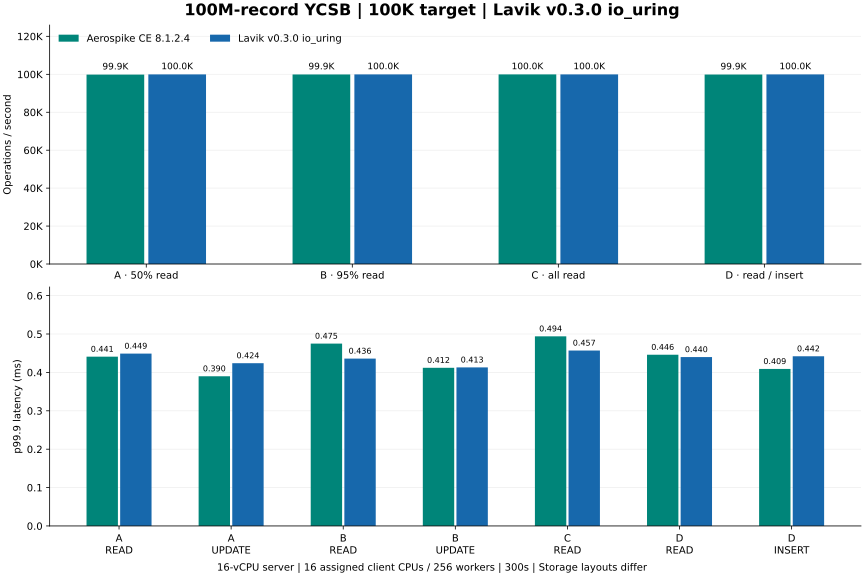
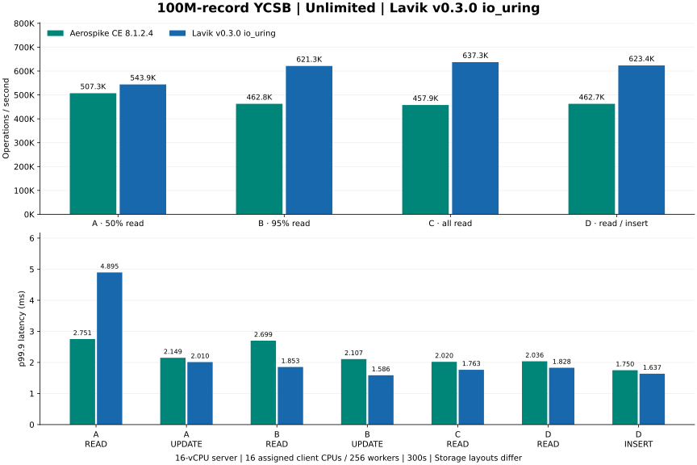

# Lavik v0.3.0（io_uring）与 Aerospike：YCSB 吞吐和尾延迟

[English](README.md) | **简体中文**

完整 **A/B/C/D × 100K/不限速** 对照，共 **16 个正式 300 秒窗口**。每个数据库独立装载 **100M 条记录，每条 10 × 128 B 字段**。正式和预热阶段均为零错误。测试使用 Lavik v0.3.0 的 io_uring 存储后端。

不限速 A/B/C/D 吞吐相对 Aerospike 分别为 **+7.22%** / **+34.25%** / **+39.19%** / **+34.72%**。A READ p99.9 为 Lavik **4.895 ms**、Aerospike **2.751 ms**；吞吐提高仍伴随尾延迟取舍。以下为单窗口观测。

客户端虚机为 **32 vCPU**，本矩阵 YCSB 绑定 **CPU 0–15**、使用 256 个 worker。Aerospike 可使用全部 16 个服务端 CPU；Lavik 使用 12 worker，另外四个 CPU 承担系统任务和 NIC IRQ。操作行显示 **操作 QPS；p99 / p99.9（ms）**。

## 100K 限速



| Workload | Operation | Aerospike CE 8.1.2.4 | Lavik v0.3.0 · io_uring |
| --- | --- | --- | --- |
| A | Total QPS | 99,851 | 99,963 |
| A | READ | 49,924; 0.337 / 0.441 | 49,979; 0.338 / 0.449 |
| A | UPDATE | 49,927; 0.290 / 0.390 | 49,984; 0.312 / 0.424 |
| B | Total QPS | 99,912 | 99,955 |
| B | READ | 94,922; 0.362 / 0.475 | 94,957; 0.334 / 0.436 |
| B | UPDATE | 4,990; 0.313 / 0.412 | 4,998; 0.327 / 0.413 |
| C | Total QPS | 99,956 | 99,960 |
| C | READ | 99,956; 0.381 / 0.494 | 99,960; 0.359 / 0.457 |
| D-Uniform | Total QPS | 99,875 | 99,958 |
| D-Uniform | READ | 94,876; 0.350 / 0.446 | 94,966; 0.329 / 0.440 |
| D-Uniform | INSERT | 4,999; 0.312 / 0.409 | 4,992; 0.324 / 0.442 |

## 不限速



| Workload | Operation | Aerospike CE 8.1.2.4 | Lavik v0.3.0 · io_uring |
| --- | --- | --- | --- |
| A | Total QPS | 507,269 | 543,901 |
| A | READ | 253,635; 1.365 / 2.751 | 271,934; 1.672 / 4.895 |
| A | UPDATE | 253,634; 1.182 / 2.149 | 271,968; 0.728 / 2.010 |
| B | Total QPS | 462,756 | 621,264 |
| B | READ | 439,629; 1.264 / 2.699 | 590,203; 0.714 / 1.853 |
| B | UPDATE | 23,127; 1.099 / 2.107 | 31,060; 0.632 / 1.586 |
| C | Total QPS | 457,859 | 637,276 |
| C | READ | 457,859; 1.284 / 2.020 | 637,276; 0.665 / 1.763 |
| D-Uniform | Total QPS | 462,741 | 623,412 |
| D-Uniform | READ | 439,597; 1.259 / 2.036 | 592,239; 0.702 / 1.828 |
| D-Uniform | INSERT | 23,144; 1.098 / 1.750 | 31,173; 0.646 / 1.637 |

## 环境与测量方法

| Item | Configuration |
| --- | --- |
| Server | Azure Standard_L16aos_v4; Japan East zone 2; AMD EPYC 9V74; 8 physical / 16 logical CPUs; 128 GiB |
| Client | Standard_F32als_v6; 32 vCPUs; Java 17; YCSB affinity 0–15 |
| OS | Ubuntu 24.04; Linux 7.0.0-1017-azure |
| Lavik storage | 6 × 1,919,850,381,312 B full raw NVMe devices (~11.52 TB); io_uring |
| Aerospike storage | Same six NVMe; RAID0, 512 KiB stripe; one fully zeroed 1,099,494,850,560 B raw partition (~1.10 TB) |
| Database | Lavik v0.3.0; dcb2dda96452610b9aa2625ff2a26abb3303f9b5; Aerospike CE 8.1.2.4-4 |
| YCSB | eloqdata/YCSB a47bf01c4f197d2ff2eecbbebd9743da5a1cae47; LAVIK.HREPLACE |
| A / B / C / D | 50% read + 50% update / 95% read + 5% update / 100% read / 95% read + 5% insert |
| Final records | Aerospike 108,544,472; Lavik 110,951,860 |
| Measured | 2026-11-16 (UTC) |

**两产品的物理容量及布局不同**，虽然起始逻辑数据一致。这是所列部署配置的比较，不能把差异全部归因于存储引擎。

- 每个数据库独立装载 100M 条记录，正常停止并恢复，再核对精确记录数和八条样本的全部字段哈希。初始字段净载荷为 119.21 GiB。
- 先 Aerospike 后 Lavik，每个数据库按 C/A/B/D、每种先 100K 后不限速。每点先用独立 JVM 预热 1M 次操作，再新建 JVM，以 256 worker 测量 300 秒；20 亿次操作上限不会提前触发。初始 JIT 与升速时间包含在窗口中。
- D 为 **Uniform 变体，不是标准 YCSB D 的 latest 分布**。读取原始 100M 键；100K 的预热/正式插入起始 ID 为 2B/4B，不限速为 6B/8B，互不重叠。D 按时间运行，因此最终记录数随吞吐不同。
- 每次读取/更新全部十个字段。Lavik 使用 HGETALL / LAVIK.HREPLACE / HMSET；Aerospike 使用全 bin 读取 / REPLACE_ONLY / CREATE_ONLY。两端超时均为 10,000 ms，客户端为 Aerospike Java 3.1.2 / Jedis 3.9.0。
- Lavik 使用六个整盘 raw 设备、停机 checkpoint 和 12+4 CPU/IRQ 策略。每阶段核对请求数、服务端计数、记录增长和 IRQ；正式窗口零错误、服务端采样 steal 为零，结束后重启校验通过。
- QPS 为成功请求数除以 YCSB 实际运行时间。百分位数来自完整窗口普通 HDR 直方图，不平均进度百分位数；Intended histogram 另存日志。worker 数相同不代表 TCP 连接数相同。
- 每条件一个正式窗口，顺序固定、不提供置信区间。CPU 分配、缓存、刷盘和持久化语义不同；成功响应不代表相同同步持久化保证。原始日志、参数和校验清单单独归档；下方给出复现命令。

## 运行命令

以下 Bash 命令使用实测参数；地址、路径和 PCI 标识按实际主机替换。Aerospike 使用上表的完全清零 RAID0 raw 分区（`aerospike-device`）。完成其矩阵后停止服务、拆除测试 RAID，将六块专用空 NVMe 交给 Lavik，替换 `/dev/YOUR_NVME_1` 至 `/dev/YOUR_NVME_6`。两数据库顺序运行、分别装载。Aerospike 使用原主机策略，之后应用 Lavik 隔离；结束后恢复主机策略。

### Aerospike 配置

保存为 `/opt/bench020/ycsb/aerospike.conf`：

```conf
# Single-node YCSB device namespace. Performance settings use server defaults.
service {
    cluster-name ycsb-default-20261116
}
logging {
    console {
        context any info
    }
}
network {
    service {
        address YOUR_SERVER_PRIVATE_IP
        port 3000
    }
    heartbeat {
        address 127.0.0.1
        mode mesh
        port 3002
    }
    fabric {
        address 127.0.0.1
        port 3001
    }
    admin {
        address 127.0.0.1
        port 3003
    }
}
namespace ycsb {
    replication-factor 1
    storage-engine device {
        device /opt/bench020/ycsb/aerospike-device
    }
}
```

### 数据库启动

先执行 Aerospike 命令。完成其全部测试后停止 Aerospike，应用下一节的 CPU/IRQ 隔离，再执行 Lavik 命令。启动前确保配置中的日志与运行目录已创建。

```bash
sudo mkdir -p /opt/aerospike
sudo cp -a /opt/bench020/aerospike-package/opt/aerospike/usr /opt/aerospike/

sudo systemd-run \
  --unit aerospike-ycsb-default-20261116.service \
  --collect \
  -p TimeoutStopSec=300 \
  -p StandardOutput=append:/opt/bench020/ycsb/aerospike-server.stdout \
  -p StandardError=inherit \
  -p SendSIGKILL=no \
  -p LimitNOFILE=100000 /opt/bench020/aerospike-package/usr/bin/asd \
  --config-file /opt/bench020/ycsb/aerospike.conf \
  --foreground
```

```bash
sudo systemd-run \
  --unit lavik-ycsb-tuned-20261116.service \
  --collect \
  -p TimeoutStopSec=300 \
  -p StandardOutput=append:/opt/bench020/ycsb/hreplace-server.stdout \
  -p StandardError=inherit \
  -p SendSIGKILL=no \
  --slice=lavik-bench.slice \
  -p AllowedCPUs=0-11 \
  -p CPUAffinity=0-11 \
  -p LimitNOFILE=65535 /opt/bench020/downloads/lavik-v0.3.0-linux-x86_64/lavik \
  --bind YOUR_SERVER_PRIVATE_IP \
  --port 16379 \
  --metrics-port 19100 \
  --threads 12 \
  --shutdown-checkpoint \
  --data-file /dev/YOUR_NVME_1 \
  --data-file /dev/YOUR_NVME_2 \
  --data-file /dev/YOUR_NVME_3 \
  --data-file /dev/YOUR_NVME_4 \
  --data-file /dev/YOUR_NVME_5 \
  --data-file /dev/YOUR_NVME_6 \
  --log-dir /opt/bench020/ycsb/lavik-server-logs
```

### Lavik CPU/IRQ 隔离

irqbalance 在本机未运行。以下操作与前述服务启动参数共同实现 12+4 隔离。

```bash
# Server, only after Aerospike has stopped; dedicated 16-logical-CPU test host.
sudo systemctl set-property --runtime system.slice AllowedCPUs=12-15
sudo systemctl set-property --runtime user.slice AllowedCPUs=12-15
sudo systemctl set-property --runtime init.scope AllowedCPUs=12-15
printf 'f000\n' | sudo tee /sys/devices/virtual/workqueue/cpumask

# This PCI identity must match the benchmark NIC on the current boot.
sudo python3 - <<'PYCODE'
from pathlib import Path
import os
vfs = list(Path('/sys/class/net/eth0').glob('lower_*'))
assert len(vfs) == 1
pci = (vfs[0].resolve() / 'device').resolve().name
irqs = [line.split(':', 1)[0].strip()
        for line in Path('/proc/interrupts').read_text().splitlines() if pci in line]
assert len(irqs) == 17, irqs
for i, irq in enumerate(irqs):
    Path('/proc/irq', irq, 'smp_affinity_list').write_text(str(12 + i % 4) + '\n')
# Migrate existing userspace threads; leave kernel threads to their own policy.
for stat in Path('/proc').glob('[0-9]*/task/[0-9]*/stat'):
    try:
        raw = stat.read_text()
        comm = raw[raw.index('(')+1:raw.rindex(')')]
        flags = int(raw[raw.rindex(')')+2:].split()[6])
        if flags & 0x04000000 or comm.startswith('kworker/'):
            continue
        os.sched_setaffinity(int(stat.parent.name), {12, 13, 14, 15})
    except (OSError, ProcessLookupError):
        pass
PYCODE
```

### YCSB 灌入、预热和正式测量

```bash
# On the client: Java 17 and the custom YCSB distribution are installed.
# Run the complete load/recovery/matrix for Aerospike first, then for Lavik.
DB=aerospike                       # use DB=lavik for the second database
if [ "$DB" = aerospike ]; then
  YCSB_ROOT=/opt/bench020/ycsb-aerospike-dist
  BINDING=aerospike
  DB_ARGS=(-p as.host=YOUR_SERVER_PRIVATE_IP -p as.namespace=ycsb -p as.timeout=10000)
else
  YCSB_ROOT=/opt/bench020/ycsb-redis-dist
  BINDING=redis
  DB_ARGS=(-p redis.host=YOUR_SERVER_PRIVATE_IP -p redis.port=16379 -p redis.scanindex=none
           -p redis.timeout=10000)
fi
mkdir -p results
COMMON=(-s -threads 256 -P "$YCSB_ROOT/workloads/workloada"
  -p fieldlength=128
  -p writeallfields=true
  -p measurement.interval=both
  -p hdrhistogram.percentiles=50,95,99,99.9,99.99)

# Fresh load: run once on an empty database.
taskset -c 0-15 /usr/bin/python3 "$YCSB_ROOT/bin/ycsb" load "$BINDING" "${COMMON[@]}" "${DB_ARGS[@]}" \
  -p recordcount=100000000 \
  > "results/$DB-load.log" 2>&1
```

灌入完成后核验恰好 100,000,000 次成功 INSERT、服务端记录数及字段长度，干净停止再用同一启动命令恢复，核验样本内容一致后运行下方矩阵。Aerospike 使用 `sudo systemctl stop aerospike-ycsb-default-20261116.service`，Lavik 使用 `sudo systemctl stop lavik-ycsb-tuned-20261116.service`；不要在灌入与恢复之间重建或清空存储。恢复就绪需确认 Aerospike 全部 4096 个主分区可用，Lavik 恢复完成且 DBSIZE 正确。

```bash
# Run after load/recovery verification; retain this client shell's variables.
if [ "$DB" = lavik ]; then
  DB_ARGS+=(-p redis.updatecommand=lavik.hreplace)
fi
for workload in C A B D; do
  case "$workload" in
    A) MIX=() ;;
    B) MIX=(-p readproportion=0.95 -p updateproportion=0.05) ;;
    C) MIX=(-p readproportion=1 -p updateproportion=0) ;;
    D) MIX=(-p readproportion=0.95 -p updateproportion=0 -p insertproportion=0.05) ;;
  esac
  for target in 100000 0; do
    RATE=()
    if [ "$target" -gt 0 ]; then RATE=(-target "$target"); fi
    for phase in warmup measured; do
      LIMIT=(-p operationcount=1000000)
      if [ "$phase" = measured ]; then
        LIMIT=(-p operationcount=2000000000 -p maxexecutiontime=300)
      fi
      RECORDS=(-p recordcount=100000000)
      if [ "$workload" = D ]; then
        if [ "$target" -gt 0 ]; then start=2000000000; else start=6000000000; fi
        if [ "$phase" = measured ]; then start=$((start + 2000000000)); fi
        RECORDS=(-p "recordcount=$start" -p insertcount=100000000)
      fi
      taskset -c 0-15 /usr/bin/python3 "$YCSB_ROOT/bin/ycsb" run "$BINDING" \
        "${COMMON[@]}" "${DB_ARGS[@]}" "${RATE[@]}" "${LIMIT[@]}" "${RECORDS[@]}" \
        -p requestdistribution=uniform "${MIX[@]}" \
        > "results/$DB-$workload-$target-$phase.log" 2>&1
    done
  done
done
```
