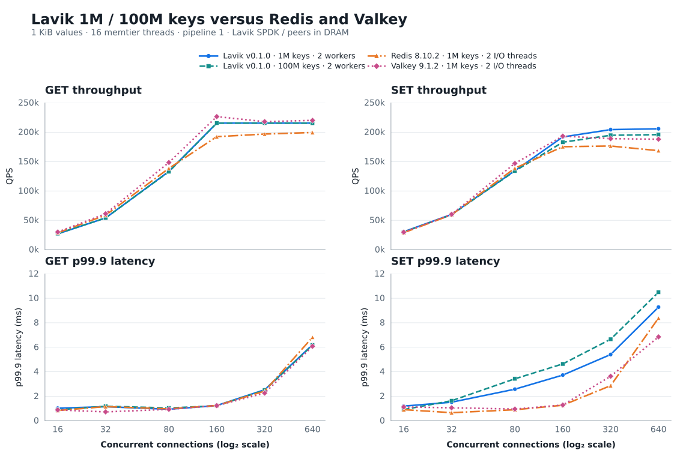
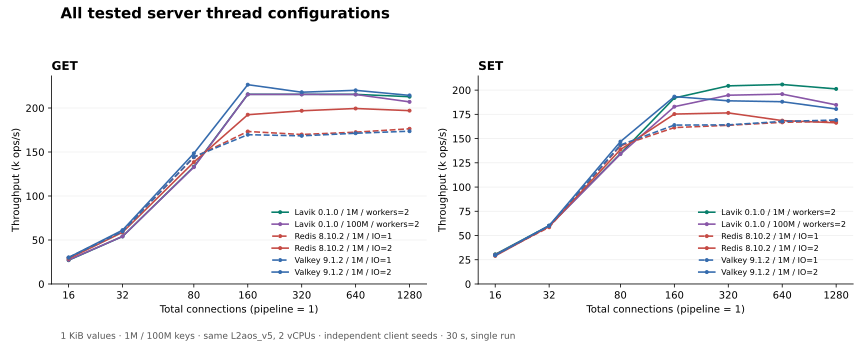

# Lavik on 2 vCPUs: latest Redis / Valkey and a 100M-key capacity test

English | [简体中文](README.zh-CN.md)

Test date: 2026-10-13. All four curves are measured on the same Azure L2aos_v5: Lavik at 1M keys, Lavik at 100M keys, Redis 8.10.2 at 1M keys, and Valkey 9.1.2 at 1M keys. Every value is 1 KiB.

**Lavik successfully loaded 100,000,000 keys, totaling 95.37 GiB of logical value payload, approximately six times the nominal 16 GiB RAM.** Exact DBSIZE was unchanged before and after the configuration, all formal GET points had zero misses, and all 84 formal points passed offline validation. With 100 times the data, peak GET throughput is essentially unchanged and peak SET throughput retains 95.2% of the 1M-key result.

## Throughput and tail latency

At 100M keys, Lavik reached peak GET / SET rates of 215,463 / 195,879 ops/s, retaining 100.0% / 95.2% of its 1M-key peaks. These are independently selected peak points at potentially different loads; matched-concurrency results follow below.

| Command | Product / keys | Workers or IO threads | Peak connections | Peak ops/s |
|---|---|---|---|---|
| GET | Lavik 0.1.0 / 1M | 2 | 160 | 215,521 |
| GET | Lavik 0.1.0 / 100M | 2 | 320 | 215,463 |
| GET | Redis 8.10.2 / 1M | 2 | 640 | 199,444 |
| GET | Valkey 9.1.2 / 1M | 2 | 160 | 226,514 |
| SET | Lavik 0.1.0 / 1M | 2 | 640 | 205,820 |
| SET | Lavik 0.1.0 / 100M | 2 | 640 | 195,879 |
| SET | Redis 8.10.2 / 1M | 2 | 320 | 176,491 |
| SET | Valkey 9.1.2 / 1M | 2 | 160 | 193,305 |

Redis and Valkey each test IO=1 and IO=2. For each command, the main plot uses the setting with the higher peak; it does not splice settings point by point. Both Lavik datasets use two workers.

At 1M keys, Lavik's peak GET throughput is **8.1%** higher than Redis, and its peak SET throughput is **16.6%** higher than Redis and **6.5%** higher than Valkey. Valkey records the highest GET peak among the three at **226,514 ops/s**. At 100M keys, Lavik still reaches **215,463 / 195,879 ops/s** for GET / SET.

At the same 160 connections, Lavik at 1M keys records SET throughput of 191,909 ops/s with 3.727 ms p99.9, versus Valkey at 193,305 ops/s with 1.279 ms p99.9. Lavik reaches its higher SET peak at 640 connections. Throughput and tail latency at every connection count appear below.

The main charts show 16–640 connections. The complete measured sweep, including 1280 connections, is retained in the tables and all-configuration chart below.



## Matched-concurrency comparison

Cells show **ops/s / p99.9 ms**, using the same fixed thread settings as the main plots.

| Command | Connections | Lavik 0.1.0 / 1M | Lavik 0.1.0 / 100M | Redis 8.10.2 / 1M | Valkey 9.1.2 / 1M |
|---|---|---|---|---|---|
| GET | 16 | 27,000 / 1.023 | 27,350 / 0.887 | 28,782 / 0.831 | 30,119 / 0.879 |
| GET | 32 | 54,045 / 1.143 | 54,040 / 1.183 | 58,729 / 1.151 | 61,175 / 0.719 |
| GET | 80 | 133,263 / 0.935 | 132,749 / 1.039 | 138,448 / 0.967 | 148,442 / 0.927 |
| GET | 160 | 215,521 / 1.239 | 215,434 / 1.215 | 192,381 / 1.239 | 226,514 / 1.231 |
| GET | 320 | 215,506 / 2.527 | 215,463 / 2.495 | 196,845 / 2.415 | 217,955 / 2.255 |
| GET | 640 | 215,515 / 6.207 | 215,341 / 6.175 | 199,444 / 6.815 | 220,110 / 6.079 |
| GET | 1280 | 212,841 / 14.207 | 206,966 / 15.167 | 197,000 / 15.871 | 214,338 / 14.591 |
| SET | 16 | 30,588 / 1.191 | 30,046 / 0.911 | 28,968 / 0.903 | 29,855 / 1.119 |
| SET | 32 | 60,089 / 1.511 | 59,590 / 1.631 | 59,436 / 0.655 | 60,230 / 1.055 |
| SET | 80 | 134,454 / 2.575 | 133,977 / 3.423 | 138,636 / 0.895 | 146,877 / 0.951 |
| SET | 160 | 191,909 / 3.727 | 182,929 / 4.639 | 175,288 / 1.263 | 193,305 / 1.279 |
| SET | 320 | 204,388 / 5.407 | 194,731 / 6.655 | 176,491 / 2.863 | 188,953 / 3.631 |
| SET | 640 | 205,820 / 9.279 | 195,879 / 10.495 | 168,555 / 8.383 | 188,035 / 6.847 |
| SET | 1280 | 201,238 / 18.175 | 184,738 / 27.007 | 166,281 / 18.175 | 180,500 / 14.399 |

## Complete I/O-thread sweep

Cells show peak ops/s (connections at that point). All 84 raw points are retained.

| Product | IO threads | GET | SET |
|---|---|---|---|
| Redis 8.10.2 / 1M | 1 | 176,390 (1280) | 167,913 (1280) |
| Redis 8.10.2 / 1M | 2 | 199,444 (640) | 176,491 (320) |
| Valkey 9.1.2 / 1M | 1 | 173,638 (1280) | 169,158 (1280) |
| Valkey 9.1.2 / 1M | 2 | 226,514 (160) | 193,305 (160) |



## Memory and client diagnostics

| Product / keys | INFO used_memory (MiB) | Process RSS (MiB) |
|---|---|---|
| Lavik 0.1.0 / 1M | 98.0–98.0 | 740.4–787.2 |
| Lavik 0.1.0 / 100M | 5,303.5–5,303.5 | 5,697.3–5,733.6 |
| Redis 8.10.2 / 1M | 1,264.8–1,265.0 | 1,288.0–2,267.8 |
| Valkey 9.1.2 / 1M | 1,268.1–1,268.6 | 1,290.6–2,245.6 |

Ranges come from snapshots after formal points. INFO used_memory follows each product’s own memory accounting; Process RSS is the resident process memory reported by the operating system. Lavik’s host memory footprint also includes a **2,048 MiB hugepage reservation**. Maximum observed client CPU use is 3.345 cores out of 16 physical cores, and maximum server CPU steal in the sampled windows is 0.0000%.

## Versions and hardware

The test uses the latest stable releases as of 2026-10-13, [Redis 8.10.2](https://github.com/redis/redis/releases/tag/8.10.2) and [Valkey 9.1.2](https://github.com/valkey-io/valkey/releases/tag/9.1.2), together with the official standard x86_64 Lavik v0.1.0 binary. Lavik's source revision is `feb61224e414c5653fd09560e20c9d214db1e3ac`.

| Item | Configuration |
|---|---|
| Server | One Standard_L2aos_v5, East US zone 3; nominal 2 vCPU / 16 GiB, 15.62 GiB Linux RAM |
| CPU | AMD EPYC 9V45; **two SMT threads of one physical core**; all configurations use CPUs 0–1 |
| Client | Separate Standard_F16as_v7 in the same zone; AMD EPYC 9V45, 16 physical cores; memtier pinned to CPUs 0–15 |
| OS | Ubuntu 24.04; Linux 6.17.0-1022-azure on both hosts |
| Network | Same private VNet and availability zone, accelerated MANA VF, kernel TCP |
| Lavik storage | One dedicated 1,439,887,785,984-byte local NVMe namespace; SPDK/VFIO; 2 GiB temporary hugepages |
| Peer storage | Dataset in DRAM; AOF and automatic snapshots disabled; reset RDB used only between configurations |
| Host policy | THP `never`, overcommit 1, no swap, no added cgroup memory cap; NIC interrupts share the server CPUs |

All configurations run sequentially on **the same server VM**, sharing the same two-vCPU budget. Lavik uses local NVMe through SPDK; Redis and Valkey hold their datasets in memory.

## Test method

All four curves use independent client seeds (`--distinct-client-seed`) and random access across their respective complete datasets.

- Decimal keys `1..N`, no prefix, 1,024-byte values, no TTL. N is 1,000,000 for the three baseline curves and 100,000,000 for the additional Lavik curve. Each dataset is loaded independently from an empty server / scratch namespace.
- memtier 2.5.1, 16 client threads, pipeline 1, no rate limit, independent client seeds, uniform-random GET or overwriting SET across the entire declared key range. Total connections are 16/32/80/160/320/640/1280. Each formal point lasts 30 seconds, after a 10-second GET warmup per server configuration.
- Order: Lavik 1M, Lavik 100M, Redis IO=1 then IO=2, Valkey IO=1 then IO=2. GET precedes SET; concurrency increases within each sweep. No builds overlap measurements. One run per point gives 84 formal points across six configurations.
- Lavik uses two pinned data workers, kernel TCP and SPDK storage; busy-poll 20 µs, foreground/background budgets 1000/10 µs, background warrant 1%, SPDK completion cap 16 and foreground pre-poll 5 µs. Metrics listening is disabled.
- Defrag remains enabled during loading, warmup and measurement: `defrag-paused=no`, max active per device 8, block/record sleeps 0. Tomb Raider interval 0 disables tombstone sweeping; defrag remains enabled. State is checked around every formal point.
- Before each Lavik dataset, the disposable NVMe is checked by serial, PCI address, namespace, capacity, mount status, partitions, holders and users, then discarded. After clean shutdown, the namespace returns to the kernel and hugepage/VFIO settings are restored before the next configuration.
- Redis and Valkey use release source commits and default optimized builds with jemalloc 5.3.0. Both use `save ""`, `appendonly no`, `maxmemory 0`. One manual SAVE after each initial fill, outside every formal window, creates its baseline RDB. Each I/O configuration reloads the baseline. Measured peer writes are memory-only.
- Exact DBSIZE and five sampled value lengths are checked before and after every configuration. Check fill counts, GET hits, connection errors, runtime versions and CPU affinity.

## 100 times the data on the same small machine

Lavik keeps its index in memory and values on NVMe. Using the same **2-vCPU / 16-GiB** configuration, this test expands the dataset from 1M to **100M keys**, storing **95.37 GiB of logical value payload**, approximately six times the machine's nominal RAM. Keys and metadata are additional.

With 100 times the data, peak GET throughput changes from **215,521** to **215,463 ops/s**, remaining essentially unchanged. Peak SET throughput changes from **205,820** to **195,879 ops/s**, retaining **95.2%**. The exact key count is 100,000,000 both before and after the configuration, and every formal GET test has zero misses.

The three 1M-key curves compare Lavik, Redis and Valkey on a small machine. The Lavik 100M-key curve additionally demonstrates the capacity of the same hardware to hold a much larger dataset. **In this test, Lavik expands data capacity beyond RAM while maintaining peak throughput close to its smaller dataset.**

## Reproduction commands

Use the L2aos_v5 server and an F16as_v7 client in the same availability zone over the private network. Prepare the standard x86_64 Lavik v0.1.0 binary, Redis 8.10.2, Valkey 9.1.2 and memtier 2.5.1. Redis and Valkey use default optimized builds with jemalloc 5.3.0 and `make -j12 BUILD_TLS=yes`. The commands below use Bash.

### Start the servers

```bash
# Run on the server; replace the address and binary paths for your hosts.
SERVER_IP=10.93.0.7
LAVIK_BIN=/opt/lavik-v0.1.0-linux-x86_64/lavik
REDIS_BIN=/opt/redis-8.10.2/src/redis-server
VALKEY_BIN=/opt/valkey-9.1.2/src/valkey-server
ulimit -n 65535
sudo sysctl -w vm.overcommit_memory=1
printf 'never\n' | sudo tee /sys/kernel/mm/transparent_hugepage/enabled
```

Lavik uses an empty, dedicated NVMe namespace. Identify and bind the test device to VFIO using the [SPDK storage guide](../../docs/operations/spdk-storage.md), with `HUGEMEM=2048` and `BYCORF_DPDK_MEMORY_MB=2048`. This VM did not expose an IOMMU and used the guide's dedicated-test-host no-IOMMU configuration. Load 1M and 100M keys separately. Between them, stop Lavik cleanly, restore the NVMe driver, clear the verified scratch namespace, and rebind it before the independent load.

```bash
# Use the verified PCI address and namespace ID of your empty test NVMe.
NVME_BDF=YOUR_NVME_PCI_ADDRESS
NVME_NSID=1
sudo prlimit --memlock=unlimited:unlimited --nofile=65535:65535 \
  env BYCORF_EAL_ARGS="-a ${NVME_BDF}" BYCORF_DPDK_MEMORY_MB=2048 \
  taskset -c 0-1 "$LAVIK_BIN" \
  --storage=spdk --bind="$SERVER_IP" \
  --tomb-raider-interval-ms=0 --spdk-max-completions-per-poll=16 \
  --log-dir="$PWD/lavik-logs" \
  --data-file="spdk://${NVME_BDF}/${NVME_NSID}"
```

The command omits v0.1.0 defaults; under `taskset -c 0-1`, Lavik automatically starts two pinned workers. `BYCORF_DPDK_MEMORY_MB=2048` sets the EAL memory used by SPDK to 2 GiB; networking remains the default kernel TCP. The retained tuning options disable the default daily tombstone sweep and raise the SPDK completion cap from 8 to 16.

Test Redis and Valkey with one and two I/O threads, running only one server at a time:

```bash
# Run one product/configuration at a time. Repeat with IO_THREADS=2.
IO_THREADS=1
mkdir -p "$PWD/bench-data/redis" "$PWD/bench-data/valkey"

# Redis 8.10.2
taskset -c 0-1 "$REDIS_BIN" \
  --bind "$SERVER_IP" --port 6379 --protected-mode no --daemonize no \
  --dir "$PWD/bench-data/redis" --dbfilename dump.rdb \
  --save "" --appendonly no --maxmemory 0 --maxclients 10000 \
  --io-threads "$IO_THREADS"

# Valkey 9.1.2 (after stopping Redis)
taskset -c 0-1 "$VALKEY_BIN" \
  --bind "$SERVER_IP" --port 6379 --protected-mode no --daemonize no \
  --dir "$PWD/bench-data/valkey" --dbfilename dump.rdb \
  --save "" --appendonly no --maxmemory 0 --maxclients 10000 \
  --io-threads "$IO_THREADS"
```

### Load data and run memtier

Run Lavik 1M, Lavik 100M, Redis IO=1/2 and Valkey IO=1/2 in that order. Set `N` and `RUN` for each configuration. Confirm `DBSIZE=0` before each product's first fill. For Redis and Valkey, issue one `SAVE` after the initial fill and exit with `SHUTDOWN NOSAVE`. Start each I/O configuration from the same baseline RDB. Skip the fill on restart, validate the data, and repeat warmup and measurement. Both Lavik datasets start with an empty scratch namespace.

```bash
# Bash, on the separate 16-core client; memtier_benchmark 2.5.1.
set -euo pipefail
SERVER_IP=10.93.0.7
N=1000000                 # Use 100000000 for the large Lavik dataset.
RUN=lavik-1m              # lavik-100m, redis-io1, redis-io2, valkey-io1, valkey-io2
mkdir -p "$RUN"
ulimit -n 65535
COMMON=(--server="$SERVER_IP" --port=6379 --protocol=redis \
  --threads=16 --pipeline=1 --key-minimum=1 --key-maximum="$N" \
  --key-prefix= --data-size=1024 --hide-histogram \
  --print-percentiles=50,99,99.9,99.99 --show-config)

# Fill an empty dataset using disjoint sequential key streams: exactly N writes.
taskset -c 0-15 memtier_benchmark "${COMMON[@]}" --clients=10 \
  --requests="$((N / 160))" --ratio=1:0 --key-pattern=P:P \
  --json-out-file="$RUN/fill.json" > "$RUN/fill.txt" 2>&1

check_data() {
  test "$(redis-cli -h "$SERVER_IP" --raw DBSIZE)" = "$N"
  for key in 1 2 "$((N / 2))" "$((N - 1))" "$N"; do
    test "$(redis-cli -h "$SERVER_IP" --raw STRLEN "$key")" = 1024
  done
}
check_data

# For each memory peer only: create its baseline RDB once after the first fill.
# redis-cli -h "$SERVER_IP" SAVE

# Warmup, then GET and SET sweeps. Reuse this part after loading a baseline RDB.
taskset -c 0-15 memtier_benchmark "${COMMON[@]}" --clients=10 \
  --distinct-client-seed --test-time=10 \
  --command='GET __key__' --command-key-pattern=R --command-is-read \
  --json-out-file="$RUN/warmup.json" > "$RUN/warmup.txt" 2>&1

for kind in GET SET; do
  if [ "$kind" = GET ]; then
    COMMAND='GET __key__'; READ_FLAG=(--command-is-read)
  else
    COMMAND='SET __key__ __data__'; READ_FLAG=()
  fi
  for connections in 16 32 80 160 320 640 1280; do
    taskset -c 0-15 memtier_benchmark "${COMMON[@]}" \
      --clients="$((connections / 16))" --distinct-client-seed --test-time=30 \
      --command="$COMMAND" --command-key-pattern=R "${READ_FLAG[@]}" \
      --json-out-file="$RUN/${kind}-c${connections}.json" \
      > "$RUN/${kind}-c${connections}.txt" 2>&1
  done
done
check_data
```

After each configuration, check that all GETs hit, connection errors are zero, and DBSIZE is unchanged.
