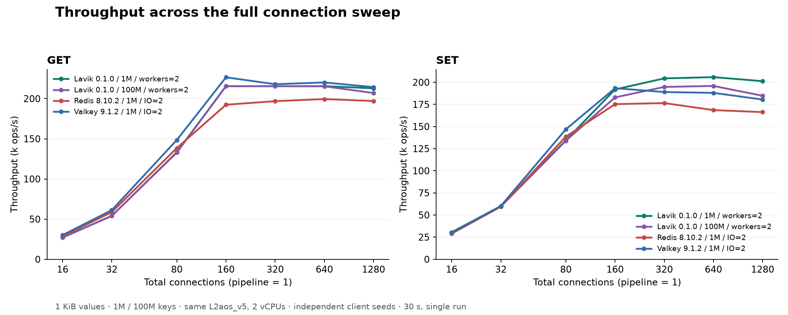
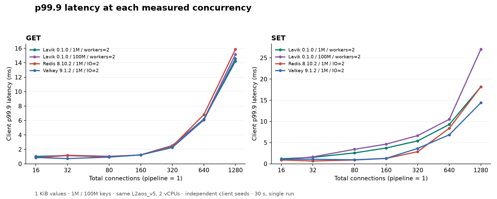
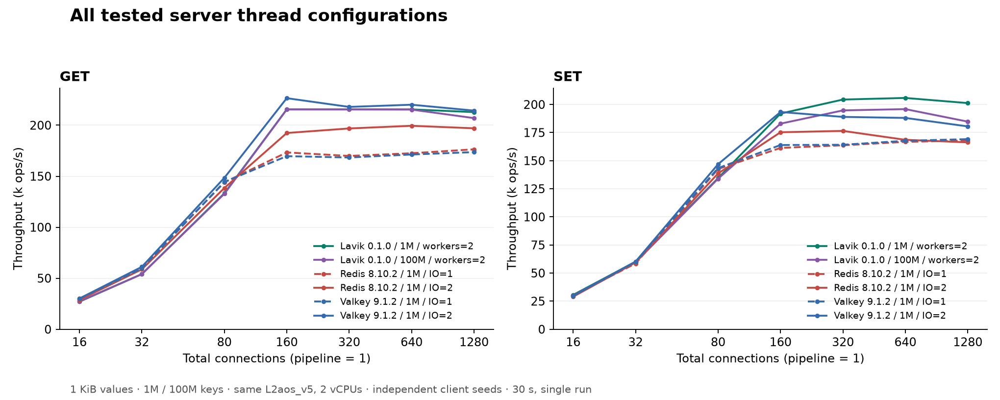

# Lavik on 2 vCPUs: latest Redis / Valkey and a 100M-key capacity test

English | [简体中文](README.zh-CN.md)

Test date: 2026-10-13. All four curves are freshly measured on the same Azure L2aos_v5: Lavik at 1M keys, Lavik at 100M keys, Redis 8.10.2 at 1M keys, and Valkey 9.1.2 at 1M keys. Every value is 1 KiB.

**Lavik successfully loaded 100,000,000 keys, totaling 95.37 GiB of logical value payload, approximately six times the nominal 16 GiB RAM.** Exact DBSIZE was unchanged before and after the configuration, all formal GET points had zero misses, and all 84 formal points passed offline validation. This is 100 times the baseline key count, not a maximum-capacity result.

## Throughput and tail latency

At 100M keys, Lavik reached peak GET / SET rates of 215,463 / 195,879 ops/s, retaining 100.0% / 95.2% of its 1M-key peaks. These are independently selected peak points at potentially different loads; matched-concurrency results follow below.

| Command | Product / keys | Workers or IO threads | Peak connections | Peak ops/s |
|---|---|---|---|---|
| GET | Lavik 0.1.0 / 1M | 2 | 160 | 215,521 |
| GET | Lavik 0.1.0 / 100M | 2 | 320 | 215,463 |
| GET | Redis 8.10.2 / 1M | 2 | 640 | 199,444 |
| GET | Valkey 9.1.2 / 1M | 2 | 160 | 226,514 |
| SET | Lavik 0.1.0 / 1M | 2 | 640 | 205,820 |
| SET | Lavik 0.1.0 / 100M | 2 | 640 | 195,879 |
| SET | Redis 8.10.2 / 1M | 2 | 320 | 176,491 |
| SET | Valkey 9.1.2 / 1M | 2 | 160 | 193,305 |

Redis and Valkey each test IO=1 and IO=2. For each command, the main plot uses the setting with the higher peak and shows its entire sweep; it does not splice settings point by point. Both Lavik datasets use two workers.

Among the three equal 1M-key datasets, the highest observed GET peak was **Valkey 9.1.2 / 1M**, and the highest SET peak was **Lavik 0.1.0 / 1M**. These are single-run observed peaks; close results require repetition to establish a stable difference. The 100M-key Lavik curve demonstrates performance at greater capacity, not a universal performance win.

The SET peak comes with a latency tradeoff: at the same 160 connections, Lavik at 1M keys records 191,909 ops/s and 3.727 ms p99.9, versus Valkey at 193,305 ops/s and 1.279 ms p99.9. Lavik reaches its higher peak at 640 connections. A higher throughput peak does not imply lower latency throughout the sweep.

## Matched-concurrency comparison

Cells show **ops/s / p99.9 ms**, using the same fixed thread settings as the main plots.

| Command | Connections | Lavik 0.1.0 / 1M | Lavik 0.1.0 / 100M | Redis 8.10.2 / 1M | Valkey 9.1.2 / 1M |
|---|---|---|---|---|---|
| GET | 16 | 27,000 / 1.023 | 27,350 / 0.887 | 28,782 / 0.831 | 30,119 / 0.879 |
| GET | 32 | 54,045 / 1.143 | 54,040 / 1.183 | 58,729 / 1.151 | 61,175 / 0.719 |
| GET | 80 | 133,263 / 0.935 | 132,749 / 1.039 | 138,448 / 0.967 | 148,442 / 0.927 |
| GET | 160 | 215,521 / 1.239 | 215,434 / 1.215 | 192,381 / 1.239 | 226,514 / 1.231 |
| GET | 320 | 215,506 / 2.527 | 215,463 / 2.495 | 196,845 / 2.415 | 217,955 / 2.255 |
| GET | 640 | 215,515 / 6.207 | 215,341 / 6.175 | 199,444 / 6.815 | 220,110 / 6.079 |
| GET | 1280 | 212,841 / 14.207 | 206,966 / 15.167 | 197,000 / 15.871 | 214,338 / 14.591 |
| SET | 16 | 30,588 / 1.191 | 30,046 / 0.911 | 28,968 / 0.903 | 29,855 / 1.119 |
| SET | 32 | 60,089 / 1.511 | 59,590 / 1.631 | 59,436 / 0.655 | 60,230 / 1.055 |
| SET | 80 | 134,454 / 2.575 | 133,977 / 3.423 | 138,636 / 0.895 | 146,877 / 0.951 |
| SET | 160 | 191,909 / 3.727 | 182,929 / 4.639 | 175,288 / 1.263 | 193,305 / 1.279 |
| SET | 320 | 204,388 / 5.407 | 194,731 / 6.655 | 176,491 / 2.863 | 188,953 / 3.631 |
| SET | 640 | 205,820 / 9.279 | 195,879 / 10.495 | 168,555 / 8.383 | 188,035 / 6.847 |
| SET | 1280 | 201,238 / 18.175 | 184,738 / 27.007 | 166,281 / 18.175 | 180,500 / 14.399 |

## Complete I/O-thread sweep

Cells show peak ops/s (connections at that point). All 84 raw points are retained.

| Product | IO threads | GET | SET |
|---|---|---|---|
| Redis 8.10.2 / 1M | 1 | 176,390 (1280) | 167,913 (1280) |
| Redis 8.10.2 / 1M | 2 | 199,444 (640) | 176,491 (320) |
| Valkey 9.1.2 / 1M | 1 | 173,638 (1280) | 169,158 (1280) |
| Valkey 9.1.2 / 1M | 2 | 226,514 (160) | 193,305 (160) |

## Memory and client diagnostics

| Product / keys | INFO used_memory (MiB) | Process RSS (MiB) |
|---|---|---|
| Lavik 0.1.0 / 1M | 98.0–98.0 | 740.4–787.2 |
| Lavik 0.1.0 / 100M | 5,303.5–5,303.5 | 5,697.3–5,733.6 |
| Redis 8.10.2 / 1M | 1,264.8–1,265.0 | 1,288.0–2,267.8 |
| Valkey 9.1.2 / 1M | 1,268.1–1,268.6 | 1,290.6–2,245.6 |

Ranges come from snapshots after formal points; INFO memory definitions differ across products. Lavik additionally reserves **2,048 MiB of hugepages**; RSS is not total memory consumption, and this is not an equal-accounting memory comparison. Maximum observed client CPU use was 3.345 cores out of 16 physical cores. Maximum server CPU steal in the enclosing windows was 0.0000%. These are diagnostics, not proof that every possible client or network bottleneck is excluded.

## Versions and hardware

The stable releases checked on 2026-10-13 are [Redis 8.10.2](https://github.com/redis/redis/releases/tag/8.10.2)
and [Valkey 9.1.2](https://github.com/valkey-io/valkey/releases/tag/9.1.2).
Valkey 9.2.0-rc1 is a prerelease and is excluded. The selection uses the highest
stable semantic version, not merely the most recently published maintenance
release of an older branch. [versions.json](versions.json) records the query
time, release dates and source revisions. Lavik remains the official standard
x86_64 v0.1.0 release, source `feb61224e414c5653fd09560e20c9d214db1e3ac`,
without rebuilding or patching it. Binary identities are in [binaries.json](binaries.json).

| Item | Configuration |
|---|---|
| Server | One Standard_L2aos_v5, East US zone 3; nominal 2 vCPU / 16 GiB, 15.62 GiB Linux RAM |
| CPU | AMD EPYC 9V45; **two SMT threads of one physical core**; all configurations use CPUs 0–1 |
| Client | Separate Standard_F16as_v7 in the same zone; AMD EPYC 9V45, 16 physical cores; memtier pinned to CPUs 0–15 |
| OS | Ubuntu 24.04; Linux 6.17.0-1022-azure on both hosts |
| Network | Same private VNet and availability zone, accelerated MANA VF, kernel TCP |
| Lavik storage | One dedicated 1,439,887,785,984-byte local NVMe namespace; SPDK/VFIO; 2 GiB temporary hugepages |
| Peer storage | Dataset in DRAM; AOF and automatic snapshots disabled; reset RDB used only between configurations |
| Host policy | THP `never`, overcommit 1, no swap, no added cgroup memory cap; NIC interrupts share the server CPUs |

All configurations run sequentially on **the same physical VM allocation**.
Redis and Valkey do not use local NVMe in timed operations. This is a fixed
hardware / CPU-budget comparison, not a cheapest-SKU or equal-cost comparison.
The initial inventories precede policy tuning; the effective policy is in
`evidence/config.json` and `evidence/post-run.json`.

## Acquisition method

This extends the [earlier 2-vCPU report](../lavik-v0.1.0-2vcpu-redis-valkey-2026-10-13/README.md).
Every curve is freshly acquired in this batch. In addition to updating peers
and adding the 100M dataset, **all timed runs now use independent client seeds**
(`--distinct-client-seed`). The older correlated-seed measurements are preserved
separately and are not mixed into these plots.

- Decimal keys `1..N`, no prefix, 1,024-byte values, no TTL. N is 1,000,000 for the three baseline curves and 100,000,000 for the additional Lavik curve. Each dataset is loaded independently from an empty server / scratch namespace.
- memtier 2.5.1, 16 client threads, pipeline 1, no rate limit, independent client seeds, uniform-random GET or overwriting SET across the entire declared key range. Total connections are 16/32/80/160/320/640/1280. Each formal point lasts 30 seconds, after a 10-second GET warmup per server configuration.
- Order: Lavik 1M, Lavik 100M, Redis IO=1 then IO=2, Valkey IO=1 then IO=2. GET precedes SET; concurrency increases within each sweep. No builds overlap measurements. One run per point gives 84 formal points across six configurations.
- Lavik uses two pinned data workers, kernel TCP and SPDK storage; busy-poll 20 µs, foreground/background budgets 1000/10 µs, background warrant 1%, SPDK completion cap 16 and foreground pre-poll 5 µs. Metrics listening is disabled.
- Defrag remains enabled during loading, warmup and measurement: `defrag-paused=no`, max active per device 8, block/record sleeps 0. Tomb Raider interval 0 follows the reference and disables tombstone sweeping, not defrag. State is checked around every formal point.
- Before each Lavik dataset, the disposable NVMe is checked by serial, PCI address, namespace, capacity, mount status, partitions, holders and users, then discarded. After clean shutdown, the namespace returns to the kernel and hugepage/VFIO settings are restored before the next configuration.
- Redis and Valkey use release source commits and default optimized builds with jemalloc 5.3.0. Both use `save ""`, `appendonly no`, `maxmemory 0`. One manual SAVE after each initial fill, outside every formal window, creates its baseline RDB. Each I/O configuration reloads the baseline. Measured peer writes are memory-only.
- Exact DBSIZE and five sampled value lengths are checked before and after every configuration. Fill counts, all formal client outputs, zero GET misses / connection errors, runtime command-error deltas, versions, CPU placement and clean exits are audited by `verify_results.py`.

## What the larger curve establishes

Lavik keeps its index in memory while values reside on storage; capacity still
depends on index memory, key shape, record overhead and device space. A 100M-key
run does not establish the maximum capacity of this SKU or prove that the full
1.44 TB namespace can be populated with 1-KiB values.

The large curve has **100 times as many keys and 95.37 GiB of logical value
payload**, approximately six times the server's nominal RAM. The three 1M
curves each have 0.954 GiB of value payload. Keys and metadata are additional.
No artificial low-memory cap is introduced. This separates a normal small
Redis/Valkey replacement comparison from a larger-than-RAM capacity observation.
The 100M line is deliberately a different dataset, not an equal-size peer test.

## Limits and evidence

Each point is a single 30-second observation, without repetitions, confidence
intervals or randomized order. Small differences are not evidence of stable
superiority. These are load-to-saturation sweeps, not fixed-rate SLA tests;
tail latency at different peak loads is not directly equivalent. The workload
excludes TTL, replication, failover, mixed commands, large collection types,
pipeline scaling and long-term SSD/defrag steady state. Local NVMe is temporary;
no host-loss or VM-deallocation durability is established.

Thread roles differ: Lavik data workers versus peer I/O threads, but every
server is limited to the same two vCPUs. Server CPU/steal/RSS columns enclose
INFO/SSH overhead and are diagnostic. RSS does not account for the entire
SPDK hugepage reservation and is not a total host-memory savings measure.
Readiness probes can receive connection refusals or LOADING during startup,
before warmup; formal rejection/failure counters must remain unchanged.

The previous batch used another allocation and correlated client seeds, so
performance changes between reports cannot be attributed solely to versions.
The 100M and 1M sets also differ in decimal key length and index working set;
this experiment does not isolate an individual cause of their performance gap.

[All 84 points](results.csv) · [Validation](validation.json) · [Versions](versions.json) · [Binary identity](binaries.json) · [Server inventory](server-inventory.json) · [Client inventory](client-inventory.json) · [Reproduction](REPRODUCE.md) · [SHA-256 manifest](SHA256SUMS)

`evidence/` preserves commands, acquisition scripts, raw memtier JSON/text,
client CPU records, server/INFO snapshots, exact counts, sample lengths, clean
exits and both device restoration sequences. Executables, generated databases,
SSH private keys and cloud credentials are excluded. The scripts retain the
original hosts and explicit scratch-device allowlist; read [REPRODUCE.md](REPRODUCE.md)
before adapting them. The offline verifier needs only Python 3.11+; figures use
Matplotlib 3.11.2 and are supplied as PNG and SVG.
