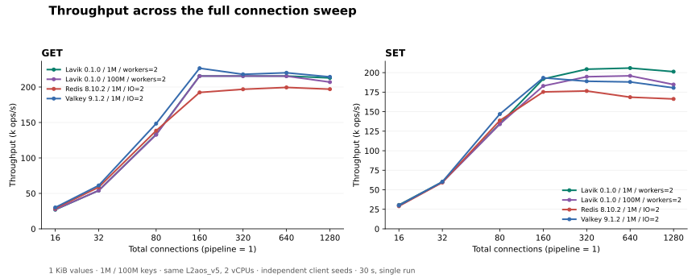
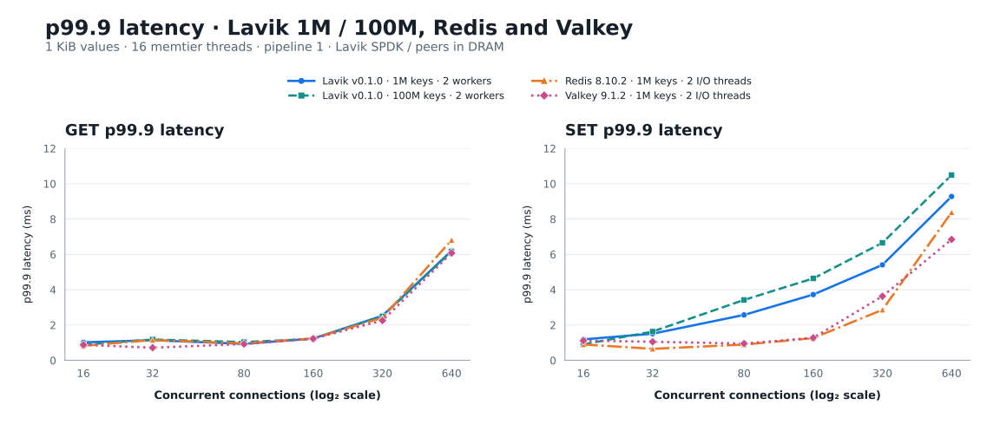

# Lavik 2 vCPU：最新版 Redis / Valkey 与 1 亿条容量测试

[English](README.md) | 简体中文

测试日期：2026-10-13。四条曲线均在同一台 Azure L2aos_v5 上测量：Lavik 100 万条、Lavik 1 亿条、Redis 8.10.2 100 万条、Valkey 9.1.2 100 万条；每条 value 为 1 KiB。

**Lavik 已完整装入 100,000,000 条数据，逻辑 value 共 95.37 GiB，约为机器标称 16 GiB 内存的六倍。** 测试前后精确 DBSIZE 一致，所有正式 GET 测试零 miss，全部 84 个测试点通过离线校验。数据量扩大 100 倍后，GET 峰值基本不变，SET 峰值保留 95.2%。

## 吞吐量与尾延迟

Lavik 1 亿条的峰值 GET / SET 分别为 215,463 / 195,879 ops/s，分别是其 100 万条峰值的 100.0% / 95.2%。下表是各自峰值，负载点不同；同并发比较见后表。

| 操作 | 产品 / key 数 | worker 或 IO 线程 | 峰值连接数 | 峰值 ops/s |
|---|---|---|---|---|
| GET | Lavik 0.1.0 / 1M | 2 | 160 | 215,521 |
| GET | Lavik 0.1.0 / 100M | 2 | 320 | 215,463 |
| GET | Redis 8.10.2 / 1M | 2 | 640 | 199,444 |
| GET | Valkey 9.1.2 / 1M | 2 | 160 | 226,514 |
| SET | Lavik 0.1.0 / 1M | 2 | 640 | 205,820 |
| SET | Lavik 0.1.0 / 100M | 2 | 640 | 195,879 |
| SET | Redis 8.10.2 / 1M | 2 | 320 | 176,491 |
| SET | Valkey 9.1.2 / 1M | 2 | 160 | 193,305 |

Redis / Valkey 各测 IO=1 和 IO=2；每个操作选峰值较高的一组 IO 设置，并展示该设置的完整并发曲线，不逐点拼接。Lavik 两组均为 2 worker。

在 100 万条数据下，Lavik 的 GET 峰值比 Redis 高 **8.1%**，SET 峰值比 Redis 高 **16.6%**、比 Valkey 高 **6.5%**。Valkey 的 GET 峰值为 **226,514 ops/s**，是三者中最高的。Lavik 扩展到 1 亿条后，GET / SET 峰值仍达到 **215,463 / 195,879 ops/s**。

同为 160 连接时，Lavik 100 万条的 SET 为 191,909 ops/s、p99.9 为 3.727 ms；Valkey 为 193,305 ops/s、p99.9 为 1.279 ms。Lavik 在 640 连接达到更高的 SET 峰值；各连接数下的吞吐量和尾延迟见下表。





## 同并发比较

单元格为 **ops/s / p99.9 ms**，线程设置与主图一致。

| 操作 | 连接数 | Lavik 0.1.0 / 1M | Lavik 0.1.0 / 100M | Redis 8.10.2 / 1M | Valkey 9.1.2 / 1M |
|---|---|---|---|---|---|
| GET | 16 | 27,000 / 1.023 | 27,350 / 0.887 | 28,782 / 0.831 | 30,119 / 0.879 |
| GET | 32 | 54,045 / 1.143 | 54,040 / 1.183 | 58,729 / 1.151 | 61,175 / 0.719 |
| GET | 80 | 133,263 / 0.935 | 132,749 / 1.039 | 138,448 / 0.967 | 148,442 / 0.927 |
| GET | 160 | 215,521 / 1.239 | 215,434 / 1.215 | 192,381 / 1.239 | 226,514 / 1.231 |
| GET | 320 | 215,506 / 2.527 | 215,463 / 2.495 | 196,845 / 2.415 | 217,955 / 2.255 |
| GET | 640 | 215,515 / 6.207 | 215,341 / 6.175 | 199,444 / 6.815 | 220,110 / 6.079 |
| GET | 1280 | 212,841 / 14.207 | 206,966 / 15.167 | 197,000 / 15.871 | 214,338 / 14.591 |
| SET | 16 | 30,588 / 1.191 | 30,046 / 0.911 | 28,968 / 0.903 | 29,855 / 1.119 |
| SET | 32 | 60,089 / 1.511 | 59,590 / 1.631 | 59,436 / 0.655 | 60,230 / 1.055 |
| SET | 80 | 134,454 / 2.575 | 133,977 / 3.423 | 138,636 / 0.895 | 146,877 / 0.951 |
| SET | 160 | 191,909 / 3.727 | 182,929 / 4.639 | 175,288 / 1.263 | 193,305 / 1.279 |
| SET | 320 | 204,388 / 5.407 | 194,731 / 6.655 | 176,491 / 2.863 | 188,953 / 3.631 |
| SET | 640 | 205,820 / 9.279 | 195,879 / 10.495 | 168,555 / 8.383 | 188,035 / 6.847 |
| SET | 1280 | 201,238 / 18.175 | 184,738 / 27.007 | 166,281 / 18.175 | 180,500 / 14.399 |

## 完整 IO 线程扫描

单元格为峰值 ops/s（该点连接数）。原始 84 点均保留。

| 产品 | IO threads | GET | SET |
|---|---|---|---|
| Redis 8.10.2 / 1M | 1 | 176,390 (1280) | 167,913 (1280) |
| Redis 8.10.2 / 1M | 2 | 199,444 (640) | 176,491 (320) |
| Valkey 9.1.2 / 1M | 1 | 173,638 (1280) | 169,158 (1280) |
| Valkey 9.1.2 / 1M | 2 | 226,514 (160) | 193,305 (160) |


## 内存与客户端诊断

| 产品 / key 数 | INFO used_memory (MiB) | Process RSS (MiB) |
|---|---|---|
| Lavik 0.1.0 / 1M | 98.0–98.0 | 740.4–787.2 |
| Lavik 0.1.0 / 100M | 5,303.5–5,303.5 | 5,697.3–5,733.6 |
| Redis 8.10.2 / 1M | 1,264.8–1,265.0 | 1,288.0–2,267.8 |
| Valkey 9.1.2 / 1M | 1,268.1–1,268.6 | 1,290.6–2,245.6 |

表中范围来自正式测试点结束后的采样。INFO used_memory 为各产品自身的内存统计，Process RSS 为操作系统记录的进程驻留内存；Lavik 的主机内存开销还包括 **2,048 MiB hugepages 预留**。客户端最高消耗 3.345 个 CPU 核（共 16 个物理核心），服务端采样窗口内最高 CPU steal 为 0.0000%。

## 版本与硬件

测试使用截至 2026-10-13 的最新稳定版 [Redis 8.10.2](https://github.com/redis/redis/releases/tag/8.10.2)、[Valkey 9.1.2](https://github.com/valkey-io/valkey/releases/tag/9.1.2)，以及官方标准 x86_64 Lavik v0.1.0 二进制。Lavik 源码提交为 `feb61224e414c5653fd09560e20c9d214db1e3ac`。

| 项目 | 配置 |
|---|---|
| 服务端 | 一台 Standard_L2aos_v5，East US 第 3 可用区；标称 2 vCPU / 16 GiB，Linux 可见内存 15.62 GiB |
| CPU | AMD EPYC 9V45；**一个物理核心的两个 SMT 线程**；所有配置均限制在 CPU 0–1 |
| 客户端 | 同可用区独立 Standard_F16as_v7；AMD EPYC 9V45，16 个物理核心；memtier 绑定 CPU 0–15 |
| 操作系统 | 两端 Ubuntu 24.04，Linux 6.17.0-1022-azure |
| 网络 | 同私有 VNet、同可用区，MANA VF 加速网络，内核 TCP |
| Lavik 存储 | 独占 1,439,887,785,984 字节本地 NVMe namespace；SPDK/VFIO；临时预留 2 GiB hugepages |
| Redis / Valkey 存储 | 数据集位于内存，关闭 AOF 与自动快照；基线 RDB 仅用于配置之间恢复数据 |
| 系统策略 | THP never、overcommit 1、无 swap、无额外 cgroup 内存限制；网卡中断共享服务端 CPU |

所有配置在**同一台服务端 VM** 上依次运行，使用相同的两个 vCPU。Lavik 通过 SPDK 使用本地 NVMe，Redis 和 Valkey 使用内存保存数据。

## 测试方法

四条曲线统一使用独立客户端随机种子（`--distinct-client-seed`），在各自完整数据集范围内随机访问。

- 十进制 key 为 `1..N`，无前缀，value 为 1,024 字节，无 TTL。三条基线曲线 N=1,000,000，新增 Lavik 曲线 N=100,000,000。每个数据集均从空服务端或清空后的测试 namespace 独立加载。
- memtier 2.5.1，16 个客户端线程，pipeline=1，不限速，独立客户端随机种子，在完整声明范围内均匀随机 GET 或覆盖 SET。总连接数为 16/32/80/160/320/640/1280。每点 30 秒，每个服务端配置先进行 10 秒 GET 预热。
- 顺序为 Lavik 100 万、Lavik 1 亿、Redis IO=1/2、Valkey IO=1/2；每组先 GET 后 SET，并发递增。编译与测量不重叠。六组配置合计 84 个正式测试点，每点一轮。
- Lavik 使用两个绑定 CPU 的数据 worker、内核 TCP 与 SPDK；busy-poll 20 µs，前后台预算 1000/10 µs，后台保障 1%，SPDK completion cap 16、前台 pre-poll 5 µs；关闭 metrics 监听。
- 加载、预热、测量期间均开启 defrag：`defrag-paused=no`，每设备 max active=8，block/record sleep=0。Tomb Raider interval=0，关闭的是墓碑扫描，不是 defrag。每个正式测试点前后均记录状态。
- 每个 Lavik 数据集前均校验临时 NVMe 的序列号、PCI 地址、namespace、容量、挂载状态、分区、holders 和使用进程，再 discard。正常退出后恢复内核 NVMe 驱动与 hugepage/VFIO 设置，然后执行下一组配置。
- Redis 和 Valkey 从固定 release 提交以默认优化选项编译，使用 jemalloc 5.3.0；设置 `save ""`、`appendonly no`、`maxmemory 0`。每个产品初次加载后，在正式计时窗口之外手动 SAVE 一次生成基线 RDB，各 IO 配置重载该基线。计时写入为纯内存写入。
- 每个配置前后核验精确 DBSIZE 与五个抽样 value 长度。检查加载操作数、GET 命中数、连接错误、运行时版本与 CPU 绑定。

## 同一台小机器，承载 100 倍数据

Lavik 在内存中保存索引，将 value 存放于 NVMe。本次使用相同的 **2 vCPU / 16 GiB** 配置，把数据集从 100 万条扩展到 **1 亿条**，装入 **95.37 GiB 逻辑 value 数据**，约为机器标称内存的六倍；key 和元数据另计。

数据量扩大 100 倍后，GET 峰值从 **215,521** 变为 **215,463 ops/s**，基本保持不变；SET 峰值从 **205,820** 变为 **195,879 ops/s**，保留了 **95.2%**。测试前后完整 key 数均为 100,000,000，所有正式 GET 测试零 miss。

三条 100 万条曲线展示 Lavik 与 Redis、Valkey 在小机器上的性能；Lavik 1 亿条曲线进一步展示同样硬件承载更大数据集的能力。**在这组测试中，Lavik 将数据容量扩展到内存之外，同时保持了接近小数据集的峰值吞吐量。**

## 复现命令

服务端使用上述 L2aos_v5，客户端使用同可用区的 F16as_v7；两端通过私网连接。准备 Lavik v0.1.0 标准 x86_64 二进制、Redis 8.10.2、Valkey 9.1.2 和 memtier 2.5.1。Redis / Valkey 使用默认优化构建、jemalloc 5.3.0，编译参数为 `make -j12 BUILD_TLS=yes`。以下命令使用 Bash。

### 启动服务端

```bash
# Run on the server; replace the address and binary paths for your hosts.
SERVER_IP=10.93.0.7
LAVIK_BIN=/opt/lavik-v0.1.0-linux-x86_64/lavik
REDIS_BIN=/opt/redis-8.10.2/src/redis-server
VALKEY_BIN=/opt/valkey-9.1.2/src/valkey-server
ulimit -n 65535
sudo sysctl -w vm.overcommit_memory=1
printf 'never\n' | sudo tee /sys/kernel/mm/transparent_hugepage/enabled
```

Lavik 使用空的专用 NVMe namespace。启动前按 [SPDK 存储指南](../../docs/operations/spdk-storage.md) 识别测试盘并绑定 VFIO，本测试设置 `HUGEMEM=2048`、`BYCORF_DPDK_MEMORY_MB=2048`。该 VM 未暴露 IOMMU，按指南使用了专用测试机的 no-IOMMU 配置。分别加载 100 万条和 1 亿条；两次之间正常退出 Lavik、恢复 NVMe 驱动，再清空已确认的测试 namespace 并重新绑定，独立加载数据。

```bash
# Use the verified PCI address and namespace ID of your empty test NVMe.
NVME_BDF=YOUR_NVME_PCI_ADDRESS
NVME_NSID=1
sudo prlimit --memlock=unlimited:unlimited --nofile=65535:65535 \
  env BYCORF_EAL_ARGS="-a ${NVME_BDF}" BYCORF_DPDK_MEMORY_MB=2048 \
  taskset -c 0-1 "$LAVIK_BIN" \
  --storage=spdk --bind="$SERVER_IP" \
  --tomb-raider-interval-ms=0 --spdk-max-completions-per-poll=16 \
  --log-dir="$PWD/lavik-logs" \
  --data-file="spdk://${NVME_BDF}/${NVME_NSID}"
```

以上省略 v0.1.0 的默认参数；`taskset -c 0-1` 下默认启动两个绑定 CPU 的 worker。`BYCORF_DPDK_MEMORY_MB=2048` 设置 SPDK 使用的 EAL 内存为 2 GiB，网络仍为默认的内核 TCP。保留的调优项将 tombstone 扫描间隔从默认一天改为关闭、SPDK completion cap 从默认 8 改为 16。

Redis 和 Valkey 分别测试 1、2 个 I/O 线程，每次只运行一个服务端：

```bash
# Run one product/configuration at a time. Repeat with IO_THREADS=2.
IO_THREADS=1
mkdir -p "$PWD/bench-data/redis" "$PWD/bench-data/valkey"

# Redis 8.10.2
taskset -c 0-1 "$REDIS_BIN" \
  --bind "$SERVER_IP" --port 6379 --protected-mode no --daemonize no \
  --dir "$PWD/bench-data/redis" --dbfilename dump.rdb \
  --save "" --appendonly no --maxmemory 0 --maxclients 10000 \
  --io-threads "$IO_THREADS"

# Valkey 9.1.2 (after stopping Redis)
taskset -c 0-1 "$VALKEY_BIN" \
  --bind "$SERVER_IP" --port 6379 --protected-mode no --daemonize no \
  --dir "$PWD/bench-data/valkey" --dbfilename dump.rdb \
  --save "" --appendonly no --maxmemory 0 --maxclients 10000 \
  --io-threads "$IO_THREADS"
```

### 客户端灌数与测试

按 Lavik 100 万、Lavik 1 亿、Redis IO=1/2、Valkey IO=1/2 的顺序运行。切换配置时修改 `N` 和 `RUN`。每个产品首次灌数前确认 `DBSIZE=0`。Redis / Valkey 首次灌数后执行一次 `SAVE`，再用 `SHUTDOWN NOSAVE` 退出；每组 I/O 线程配置都从同一基线 RDB 重启，跳过再次灌数，重新检查数据后执行预热与扫描。Lavik 两组均从空的测试 namespace 独立灌数。

```bash
# Bash, on the separate 16-core client; memtier_benchmark 2.5.1.
set -euo pipefail
SERVER_IP=10.93.0.7
N=1000000                 # Use 100000000 for the large Lavik dataset.
RUN=lavik-1m              # lavik-100m, redis-io1, redis-io2, valkey-io1, valkey-io2
mkdir -p "$RUN"
ulimit -n 65535
COMMON=(--server="$SERVER_IP" --port=6379 --protocol=redis \
  --threads=16 --pipeline=1 --key-minimum=1 --key-maximum="$N" \
  --key-prefix= --data-size=1024 --hide-histogram \
  --print-percentiles=50,99,99.9,99.99 --show-config)

# Fill an empty dataset using disjoint sequential key streams: exactly N writes.
taskset -c 0-15 memtier_benchmark "${COMMON[@]}" --clients=10 \
  --requests="$((N / 160))" --ratio=1:0 --key-pattern=P:P \
  --json-out-file="$RUN/fill.json" > "$RUN/fill.txt" 2>&1

check_data() {
  test "$(redis-cli -h "$SERVER_IP" --raw DBSIZE)" = "$N"
  for key in 1 2 "$((N / 2))" "$((N - 1))" "$N"; do
    test "$(redis-cli -h "$SERVER_IP" --raw STRLEN "$key")" = 1024
  done
}
check_data

# For each memory peer only: create its baseline RDB once after the first fill.
# redis-cli -h "$SERVER_IP" SAVE

# Warmup, then GET and SET sweeps. Reuse this part after loading a baseline RDB.
taskset -c 0-15 memtier_benchmark "${COMMON[@]}" --clients=10 \
  --distinct-client-seed --test-time=10 \
  --command='GET __key__' --command-key-pattern=R --command-is-read \
  --json-out-file="$RUN/warmup.json" > "$RUN/warmup.txt" 2>&1

for kind in GET SET; do
  if [ "$kind" = GET ]; then
    COMMAND='GET __key__'; READ_FLAG=(--command-is-read)
  else
    COMMAND='SET __key__ __data__'; READ_FLAG=()
  fi
  for connections in 16 32 80 160 320 640 1280; do
    taskset -c 0-15 memtier_benchmark "${COMMON[@]}" \
      --clients="$((connections / 16))" --distinct-client-seed --test-time=30 \
      --command="$COMMAND" --command-key-pattern=R "${READ_FLAG[@]}" \
      --json-out-file="$RUN/${kind}-c${connections}.json" \
      > "$RUN/${kind}-c${connections}.txt" 2>&1
  done
done
check_data
```

每组结束后检查 GET 全部命中、连接错误为零，且 DBSIZE 保持不变。
