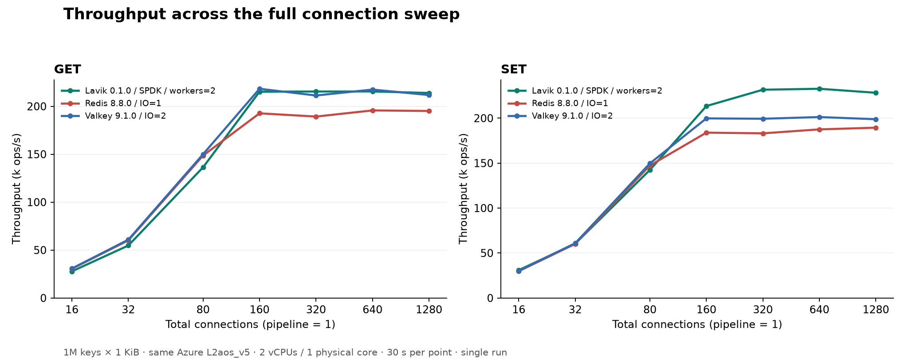
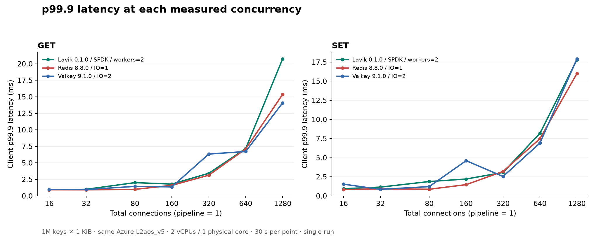
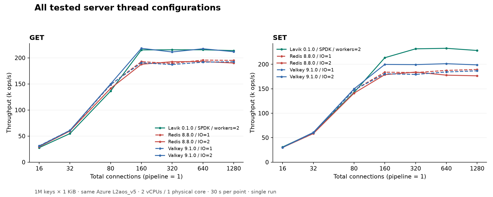

# Lavik v0.1.0：2 vCPU 上的 Redis / Valkey GET/SET 对比

[English](README.md) | **简体中文**

测试日期：2026-10-13。在同一台 Azure **L2aos_v5（2 vCPU / 16 GiB）** 上重新测量
**70 个正式点**。三个产品均使用相同的两个 vCPU；其拓扑为**同一物理核的两个 SMT
线程**。数据集为 **100 万条 key × 1 KiB value**，不人为限制内存。

Lavik 的实测 GET 峰值为 **21.55 万 QPS**，640 连接，
p99.9 为 **7.167 ms**；SET 峰值为 **23.27 万 QPS**，
640 连接，p99.9 为 **8.191 ms**。
相对 Redis / Valkey 各自最佳实测配置，GET 峰值差异为
**+10.1% / -1.3%**，SET 为
**+22.9% / +15.6%**。
这些是单次观察结果，没有置信区间。

Lavik GET 在 160 连接时已接近平台：215,230 QPS，p99.9 为 1.791 ms。
在 16–80 连接的 GET 中，两款对照产品更快。Lavik 的 SET 吞吐优势出现在
160 连接及以上，但 p99.9 并非始终最低。

## 吞吐与尾延迟



| 命令 | 产品 | 线程数¹ | 连接数 | QPS | 平均 ms | p50 ms | p99 ms | p99.9 ms | p99.99 ms |
|---|---|---:|---:|---:|---:|---:|---:|---:|---:|
| GET | Lavik 0.1.0 SPDK | 2 | 640 | 215,479 | 2.969 | 2.975 | 3.759 | 7.167 | 10.047 |
| GET | Redis 8.8.0 | 1 | 640 | 195,703 | 3.269 | 3.103 | 5.791 | 7.103 | 10.623 |
| GET | Valkey 9.1.0 | 2 | 160 | 218,285 | 0.733 | 0.735 | 0.831 | 1.367 | 2.783 |
| SET | Lavik 0.1.0 SPDK | 2 | 640 | 232,675 | 2.750 | 2.735 | 4.127 | 8.191 | 12.927 |
| SET | Redis 8.8.0 | 1 | 1280 | 189,382 | 6.757 | 6.495 | 12.671 | 15.999 | 22.271 |
| SET | Valkey 9.1.0 | 2 | 640 | 201,209 | 3.180 | 3.167 | 3.759 | 6.911 | 9.599 |



对每种命令，分别选择 Redis/Valkey **实测峰值最高的一个 I/O 线程配置**，整条吞吐和
延迟曲线均固定使用这一配置。峰值表列出各产品自己的最佳点，连接数可能不同。
¹ Lavik 为数据 worker 数，Redis/Valkey 为 I/O 线程数；总服务端 CPU 预算均为两个 vCPU。

## 相同连接数对比

继续使用上面选定的固定线程配置。每个单元格为 **千 QPS / p99.9 ms**。

| 命令 | 连接数 | Lavik | Redis | Valkey |
|---|---:|---:|---:|---:|
| GET | 16 | 27.8 / 0.927 | 30.4 / 0.927 | 30.7 / 0.975 |
| GET | 32 | 54.7 / 0.999 | 60.1 / 0.919 | 60.8 / 0.959 |
| GET | 80 | 136.3 / 2.007 | 148.6 / 0.991 | 149.9 / 1.439 |
| GET | 160 | 215.2 / 1.791 | 192.7 / 1.599 | 218.3 / 1.367 |
| GET | 320 | 215.4 / 3.423 | 189.3 / 3.135 | 211.3 / 6.335 |
| GET | 640 | 215.5 / 7.167 | 195.7 / 7.103 | 217.5 / 6.719 |
| GET | 1280 | 213.9 / 20.735 | 195.1 / 15.359 | 211.7 / 14.079 |
| SET | 16 | 30.9 / 0.943 | 29.8 / 0.831 | 30.1 / 1.535 |
| SET | 32 | 60.4 / 1.151 | 60.2 / 0.919 | 60.8 / 0.855 |
| SET | 80 | 142.4 / 1.879 | 147.3 / 0.871 | 149.7 / 1.215 |
| SET | 160 | 213.4 / 2.207 | 183.9 / 1.471 | 199.7 / 4.607 |
| SET | 320 | 231.6 / 3.071 | 183.1 / 3.199 | 199.3 / 2.543 |
| SET | 640 | 232.7 / 8.191 | 187.5 / 7.487 | 201.2 / 6.911 |
| SET | 1280 | 228.2 / 17.791 | 189.4 / 15.999 | 198.8 / 17.919 |

## 完整 I/O 线程扫描



| 产品 | I/O 线程 | GET 峰值 QPS @ 连接数 | SET 峰值 QPS @ 连接数 |
|---|---:|---:|---:|
| Redis 8.8.0 | 1 | 195,703 @ 640 | 189,382 @ 1280 |
| Redis 8.8.0 | 2 | 192,909 @ 640 | 184,093 @ 320 |
| Valkey 9.1.0 | 1 | 192,523 @ 1280 | 186,607 @ 1280 |
| Valkey 9.1.0 | 2 | 218,285 @ 160 | 201,209 @ 640 |

## 机器与配置

| 项目 | 配置 |
|---|---|
| 服务端 | 一台 Azure Standard_L2aos_v5，East US 可用区 3；标称 2 vCPU / 16 GiB；Linux 可见内存 15.62 GiB |
| CPU 拓扑 | AMD EPYC 9V45；**同一物理核的两个 SMT 线程**，三个产品均可使用 |
| 压测端 | 同区独立 Standard_F16as_v7；AMD EPYC 9V45，16 个物理核；memtier 绑定 CPU 0–15 |
| 操作系统 | 两端均为 Ubuntu 24.04、Linux 6.17.0-1022-azure |
| 网络 | 同 VNet、同可用区的私网；MANA VF 加速网络；kernel TCP |
| Lavik 存储 | 一块独占本地 NVMe，1,439,887,785,984 B；SPDK/VFIO；临时预留 2 GiB hugepages |
| Redis/Valkey 存储 | 测量期间数据在 DRAM 中；关闭 AOF 和自动 RDB 快照；只在切换配置时加载基线 RDB |
| 服务端 CPU/内存限制 | 所有产品进程及线程限制在 CPU 0–1，网卡中断也共享这两个 CPU；不设置 cgroup 内存上限 |
| 主机策略 | THP `never`、`vm.overcommit_memory=1`、无 swap；所有产品保持一致 |

初始机器清单采集于主机策略调整之前；实际策略记录在 `evidence/config.json`
和 `evidence/post-run.json`。

三个产品在**同一台 L2aos_v5** 上依次运行，保持 CPU、内存、网络和宿主机位置一致。
Redis/Valkey 的计时操作不使用本地 NVMe。这是统一硬件条件下的 2 vCPU 对比，
没有比较各产品最便宜的机型或等成本部署，也没有制造内存压力、淘汰或低内存限制。

## 测试方法

场景沿用 [16 vCPU 的 v0.1.0 Redis/Valkey 报告](https://github.com/thweetkomputer/lavik/blob/34eb4259bbdc954dd5c0b0f41c7e7f3f17caf9d7/perf_reports/lavik-v0.1.0-redis-valkey-2026-10-13/README.zh-CN.md)。
数据量从 1,000 万缩为 **100 万条**，服务端从 16 缩为 **2 vCPU**。
在原来的 80/160/320/640/1280 连接之外增加 16 和 32 连接；SPDK 大页预留从
8 GiB 缩为 2 GiB；Redis/Valkey 的 I/O 线程扫描范围为 1 和 2。
所有对照数据均重新测量，没有引用历史 Redis/Valkey 成绩。

- key 为 `1..1000000` 的十进制字符串，无前缀；value 为 1,024 B，无 TTL。纯 value 总量约 0.954 GiB，不含 key 和元数据。每个产品独立加载全新数据集。
- memtier 2.5.1，16 个客户端线程，pipeline=1，不限速；分别测试均匀随机 GET 和覆盖已有 key 的 SET。每个正式点持续 30 秒，每种服务端配置先进行 10 秒 GET 预热。保留原内存对照场景的默认相关客户端随机种子。
- 顺序为 Lavik、Redis IO=1、Redis IO=2、Valkey IO=1、Valkey IO=2。每种配置先 GET 后 SET，连接数递增；编译在测量前全部完成。每个正式点测量一次。
- Lavik 使用官方标准 x86_64 v0.1.0 发布包，源码版本 `feb61224e414c5653fd09560e20c9d214db1e3ac`，不重新编译、不打补丁。发布包与二进制校验和见 [binaries.json](binaries.json)。
- Lavik：2 个绑定 CPU 的数据 worker，kernel TCP + SPDK；busy-poll 20 µs，foreground/background budget 为 1000/10 µs，background warrant 1%，SPDK 每次最多处理 16 个完成事件、前台 pre-poll 5 µs；关闭 metrics 监听。
- 加载、预热与正式测量全程开启 defrag：`defrag-paused=no`、每盘最大并行数 8、block/record sleep 为 0。Tomb Raider interval=0 沿用原场景，只关闭 tombstone 扫描，不关闭 defrag。每个正式点前后核对状态。
- 清空本地 NVMe 前按序列号、PCI 地址、namespace、容量及未挂载状态核对；Lavik 正常退出后将 NVMe 交还内核，恢复 hugepages 和 VFIO 设置，再开始 Redis/Valkey。
- Redis 8.8.0、Valkey 9.1.0 使用对应发布源码、默认 release 构建和 jemalloc 5.3.0；均设为 `save ""`、`appendonly no`、`maxmemory 0`。首次加载后执行一次手动 `SAVE`，位于所有正式计时窗口之外；每个 I/O 线程配置从同一基线 RDB 启动。测量中的写入是纯内存写入，其余设置保持产品默认。
- 每种配置前后核对精确 `DBSIZE` 和五个样本的 `STRLEN`。校验脚本逐点检查 GET miss、连接错误、请求量/时长与 QPS、延迟分位数、CPU 亲和性和正常退出状态。

启动、加载基线 RDB 时，就绪探测可能收到连接拒绝或 `LOADING`；这些发生在预热前。
所有正式测量外围窗口内，命令拒绝/失败计数均未增加。memtier 各窗口平均 CPU 用量的最大值为
3.564 个核当量（共 16 核可用），服务端观测到的 steal 为 0%。

## 结果适用范围

这是**小实例上的单节点 GET/SET 对比**。未测试低内存压力、等持久化配置、复制、
故障切换、TTL、混合命令、大型数据结构、pipeline 扩展，也不是长时间 SSD/defrag
稳态测试。本地 NVMe 是临时存储，本次测试不证明数据可跨 VM 释放或宿主机故障保留。

每个点只测一次、持续 30 秒，没有重复测量、置信区间或随机化产品顺序，小幅差异不能
证明统计显著性。默认相关种子会影响缓存局部性和重复 key 竞争，与各客户端独立随机
序列不同。各自吞吐峰值处的负载并不相同，不能将这些延迟直接解释为固定请求速率下的 SLA 对比。

线程数含义不同：Lavik 是数据 worker，Redis/Valkey 是 I/O 线程；**服务端总预算始终
是两个 vCPU**。客户端 CPU 和服务端外围采样窗口的 CPU/steal/RSS 见
[results.csv](results.csv)。服务端采样包含 INFO/SSH 开销，不是严格计时窗口的 CPU
利用率。单看进程 RSS 不能覆盖完整 SPDK 大页预留，不能据此推导整机内存节省比例。

之前的 16 vCPU 报告使用另一代 VM、CPU 型号、网络、存储布局和数据量，因此不能
把两个报告当成受控的 2→16 vCPU 扩展性实验。

## 原始证据与复现

[全部 70 个点](results.csv) · [校验结果](validation.json) · [二进制版本](binaries.json) · [服务端信息](server-inventory.json) · [客户端信息](client-inventory.json) · [复现说明](REPRODUCE.md) · [SHA-256 清单](SHA256SUMS)

`evidence/` 保存采集脚本、有效配置、memtier 原始 JSON/文本、命令、服务端日志、
客户端 CPU 记录、服务端与 INFO 采样、数据检查、正常退出和 SPDK 恢复记录。
不包含二进制、生成的数据库、SSH 私钥或云凭据。

```sh
python3 verify_results.py
python3 build_assets.py  # Matplotlib 3.11.2
shasum -a 256 -c SHA256SUMS
```

离线校验只需 Python 3.11+，图表同时输出 SVG 和 PNG。采集脚本保留了原私网地址
和明确的临时磁盘白名单；在其他机器上改用前，请阅读 [REPRODUCE.md](REPRODUCE.md)。
