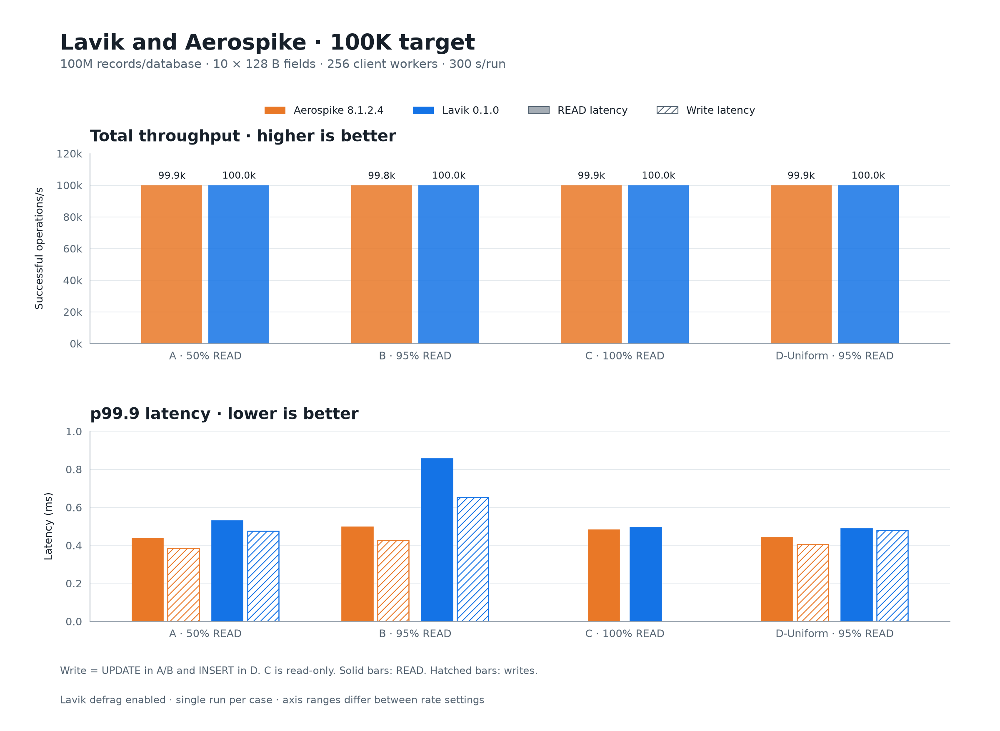
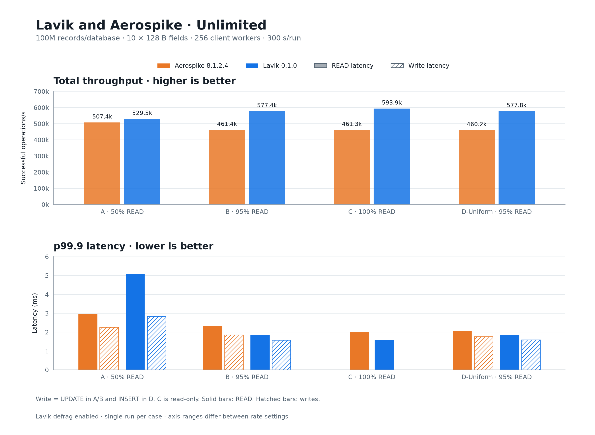

# Lavik v0.1.0 与 Aerospike：YCSB 吞吐及尾延迟

[English](README.md) | **简体中文**

两库独立新灌 **1 亿条记录，每条 10 × 128 B 字段**。完整 **A/B/C/D × 100K/不限速** 矩阵包含 16 个正式测量窗口，每个 300 秒；所有预热与正式阶段错误为零。**Lavik defrag 全程开启**。

Aerospike 使用默认性能配置及原始宿主策略；Lavik 使用 12 workers 加 4 核系统/IRQ 隔离，io_uring 接入 RAID0 裸分区。两者 CPU 分配与数据库配置不同。

不限速总吞吐相对 Aerospike 的实测差异：A **+4.36%**, B **+25.13%**, C **+28.76%**, D **+25.56%**.

每张图上栏为总 QPS，下栏为各操作 p99.9 延迟（ms），均使用柱状图。颜色区分数据库，实心为 READ，斜纹为写操作；C 没有写操作。两种限速条件分别设置坐标范围。结果表的操作单元格为 **操作 QPS；p99 / p99.9（ms）**。

## 100K 限速



| Workload | 操作 | Aerospike | Lavik |
|---|---|---:|---:|
| A | 总 QPS | 99,883 | 99,966 |
| A | READ | 49,932; 0.342 / 0.437 | 49,987; 0.372 / 0.530 |
| A | UPDATE | 49,951; 0.292 / 0.385 | 49,979; 0.337 / 0.474 |
| B | 总 QPS | 99,827 | 99,967 |
| B | READ | 94,829; 0.374 / 0.498 | 94,968; 0.482 / 0.856 |
| B | UPDATE | 4,998; 0.321 / 0.426 | 4,999; 0.410 / 0.653 |
| C | 总 QPS | 99,902 | 99,970 |
| C | READ | 99,902; 0.379 / 0.481 | 99,970; 0.406 / 0.495 |
| D-Uniform | 总 QPS | 99,901 | 99,961 |
| D-Uniform | READ | 94,906; 0.351 / 0.442 | 94,962; 0.368 / 0.488 |
| D-Uniform | INSERT | 4,995; 0.311 / 0.404 | 4,999; 0.354 / 0.479 |

## 不限速



| Workload | 操作 | Aerospike | Lavik |
|---|---|---:|---:|
| A | 总 QPS | 507,401 | 529,501 |
| A | READ | 253,704; 1.407 / 2.953 | 264,758; 2.105 / 5.083 |
| A | UPDATE | 253,697; 1.196 / 2.255 | 264,743; 1.532 / 2.831 |
| B | 总 QPS | 461,404 | 577,373 |
| B | READ | 438,351; 1.274 / 2.313 | 548,492; 0.776 / 1.818 |
| B | UPDATE | 23,053; 1.087 / 1.853 | 28,881; 0.702 / 1.578 |
| C | 总 QPS | 461,251 | 593,911 |
| C | READ | 461,251; 1.253 / 1.982 | 593,911; 0.707 / 1.556 |
| D-Uniform | 总 QPS | 460,167 | 577,808 |
| D-Uniform | READ | 437,177; 1.246 / 2.055 | 548,915; 0.790 / 1.824 |
| D-Uniform | INSERT | 22,991; 1.077 / 1.754 | 28,893; 0.724 / 1.589 |

## 硬件与存储

- **服务端**：Azure Standard_L16aos_v4，Japan West / zone 2；AMD EPYC 9V74；16 逻辑核 / 8 物理核；Linux 内存 125.8 GiB
- **客户端**：Azure Standard_F32als_v6；AMD EPYC 9V74；32 物理核、62.8 GiB 内存；Java 17；YCSB 进程限制到 CPU 0–15
- **系统**：两端均为 Ubuntu 24.04、Linux 6.17.0-1022-azure；未重启
- **网络**：单客户端 10.84.0.5 → 服务端 10.84.1.4；kernel TCP、mlx5 加速路径
- **物理盘**：六张本地 NVMe，每张 1,919,850,381,312 B；Linux RAID0，chunk=512 KiB
- **分区**：两个独立裸分区，各 1,099,494,850,560 B；24 MiB 对齐；无文件系统；灌入前全量写零
- **监测**：每 phase 的有效配置、进程、IRQ、存储、客户端计数；开启 Lavik metrics

## 数据与工作负载

- **A**：READ: 50%；UPDATE: 50%；INSERT: 0；读取分布: 均匀随机
- **B**：READ: 95%；UPDATE: 5%；INSERT: 0；读取分布: 均匀随机
- **C**：READ: 100%；UPDATE: 0；INSERT: 0；读取分布: 均匀随机
- **D-Uniform**：READ: 95%；UPDATE: 0；INSERT: 5%；读取分布: 固定初始 1 亿条 key

两库均从 100,000,000 条记录开始；矩阵完成后 Aerospike 为 108,497,069 条，Lavik 为 110,271,711 条。

## 数据库与宿主配置

- **版本**：Aerospike: Community Edition 8.1.2.4-4；Lavik: v0.1.0 标准 x86_64 正式包
- **存储**：Aerospike: storage-engine device，RAID0 裸分区；Lavik: --storage=uring，RAID0 裸分区
- **CPU**：Aerospike: 原始宿主策略，CPU 0–15；默认 service-threads=80、auto-pin=none；Lavik: CPU 0–11 上 12 个固定 worker；系统任务、workqueue、NIC IRQ 使用 CPU 12–15
- **systemd**：Aerospike: 默认 system.slice，不额外限制 affinity；Lavik: lavik-bench.slice，AllowedCPUs/CPUAffinity=0–11
- **Flush**：Aerospike: 默认 1 MiB、1000 ms；Lavik: 128 KiB 写块，100 ms
- **缓存**：Aerospike: 默认 max-write-cache=64 MiB、post-write-cache=256 MiB、read-page-cache=false；Lavik: 正式包默认值
- **索引预算**：Aerospike: 默认 indexes-memory-budget=0；Lavik: 正式包默认值
- **GC / defrag**：Aerospike: 默认值；Lavik: 开启；每设备最多 8 任务；block/record sleep=0
- **READ**：Aerospike: 全部 10 个 bin；Lavik: HGETALL，全部 10 个字段
- **UPDATE**：Aerospike: REPLACE_ONLY，全部 10 个 bin；Lavik: LAVIK.HREPLACE，全部 10 个字段
- **INSERT**：Aerospike: CREATE_ONLY；Lavik: HMSET，redis.scanindex=none
- **客户端 binding**：Aerospike: YCSB Aerospike，Java client 3.1.2；Lavik: YCSB Redis，Jedis 3.9.0
- **复制 / TTL**：Aerospike: 单节点 RF=1、namespace ycsb；默认 TTL 0；Lavik: 单实例 DB0、无副本、无 TTL

Lavik 为未改动的标准正式包：`v0.1.0 / feb61224e414c5653fd09560e20c9d214db1e3ac`; SHA-256 `7bf8d204a137678cee0e1a621b02661181373fbbfe1366bc1c201942b9dcf420`. Aerospike SHA-256 `6e1b2bd6deebd5816f4f369ac1db4151217ed0be3b66578bdd6f15c24e6af8d0`.

## 测量方法与边界

- 两库独立新灌 1 亿条记录，按 C/A/B/D 顺序，每个 workload 先限速 100K 再不限速；先 Aerospike 后 Lavik。同一 RAID0 顺序使用，数据库不同时运行。正式矩阵各 case 之间不清库、不重启。
- 每个 case 使用 256 个 YCSB worker，单独 JVM 预热 100 万次操作，再用新的 JVM 正式测量 300 秒。`-target 100000` 是所有线程、所有操作合计限速；正式 `operationcount=2000000000` 仅作宽松上限，以计时器结束。JIT/启动爬坡没有从测量窗口剔除。
- 10 个字段，每字段固定 128 B；readallfields/writeallfields=true；hashed key、uniform 读取；SCAN 与 read-modify-write 关闭；客户端超时 10,000 ms。字段值原始载荷共 128 GB（119.21 GiB），不含 key、字段名、索引和记录格式开销。
- D 只读取最初的 1 亿条 key，因此标为 D-Uniform。100K 预热/测量 INSERT 起点为 2B/4B；不限速为 6B/8B，互不重叠。两库起始规模相同；最终记录数随 D 的成功插入吞吐而不同。
- 两库均核验恰好 1 亿次成功 INSERT 与服务端记录数一致；灌入后干净停止并恢复。对八个分布式样本核验全部十个字段长度及 SHA-256，比较恢复前后的一致性。每个 phase 核对客户端成功数、服务端命令计数和记录数增量，错误必须为零。
- Aerospike 仅配置必需的集群/监听/namespace/RF/设备选项；CPU 调度、IRQ、线程、缓存、flush、索引预算和回收保留默认值，每阶段前后记录有效配置。Aerospike 停止后才应用 Lavik 的 12+4 CPU/IRQ 隔离，结束后恢复宿主策略。核验 completion IRQ 的实际 CPU 及中断增量，确认它们在测试阶段不落到 Lavik worker 核。
- Lavik 在灌入、恢复、预热和测量全程开启 defrag，每设备最多 8 个任务，不加额外 sleep。每阶段记录 CONFIG GET defrag-paused 与 DEFRAG STATUS。本 YCSB 组的 Tomb Raider、active expiration 保留正式包默认值。100 ms 周期 flush 不代表逐写同步持久化承诺。
- CPU 编号为逻辑核：worker 0–11 占六个物理核，系统/IRQ 12–15 占另外两个物理核（SMT2）。源地址策略路由将 10.84.1.4 的回复经 eth1/table 101 发出，压测回复不走管理网卡。
- QPS=成功操作数/实际 YCSB RunTime；总 QPS 包含成功读写。各操作 p99/p99.9 取完整窗口 ordinary HDR histogram，不平均区间分位数；intended histogram 保存在原始日志中。相同 worker 数不意味着相同 TCP 连接数。
- 客户端使用 [eloqdata/YCSB](https://github.com/eloqdata/YCSB) 的 `a47bf01c4f197d2ff2eecbbebd9743da5a1cae47` 提交。构建前，在 RedisClient.java、RedisClientTest.java 中将 `KEYLANE.HREPLACE` 改为 `LAVIK.HREPLACE`，将 `keylane.hreplace` 改为 `lavik.hreplace`。Binding 使用 Aerospike Java client 3.1.2、Jedis 3.9.0。
- 每个 cell 只有一次 5 分钟测量，未估计运行间波动或置信区间，产品顺序固定。两种指定部署的 CPU 分配、宿主策略、缓存、持久化保证不同，不是单变量实验。

- Aerospike: 2026-10-13T09:54:41Z – 2026-10-13T10:35:42Z (UTC), 8 个正式窗口.
- Lavik: 2026-10-13T10:39:09Z – 2026-10-13T11:20:04Z (UTC), 8 个正式窗口.

## 运行命令

以下 Bash 命令对应本次参数；路径、地址、网卡 PCI 身份需按部署环境调整。开始前准备两个独立、已全量写零的空白 RAID0 裸分区，分别由 `aerospike-device` 和 `lavik-device` 指向。两库顺序运行，每库只灌入一次。宿主策略在 Aerospike 阶段保持原样，完成后才应用 Lavik 的隔离设置；测试完成后恢复原值。

### Aerospike 配置

保存为 `/mnt/dev/benchmark/release010/ycsb/aerospike.conf`：

```conf
# Single-node YCSB device namespace. Performance settings use server defaults.
service {
    cluster-name ycsb-default-20261013
}
logging {
    console {
        context any info
    }
}
network {
    service {
        address 10.84.1.4
        port 3000
    }
    heartbeat {
        address 127.0.0.1
        mode mesh
        port 3002
    }
    fabric {
        address 127.0.0.1
        port 3001
    }
    admin {
        address 127.0.0.1
        port 3003
    }
}
namespace ycsb {
    replication-factor 1
    storage-engine device {
        device /mnt/dev/benchmark/release010/ycsb/aerospike-device
    }
}
```

### 数据库启动

先执行 Aerospike 命令。完成其全部测试后停止 Aerospike，应用下一节的 CPU/IRQ 隔离，再执行 Lavik 命令。启动前确保配置中的日志与运行目录已创建。

```bash
sudo systemd-run \
  --unit aerospike-ycsb-default-20261013.service \
  --collect \
  -p TimeoutStopSec=300 \
  -p StandardOutput=append:/mnt/dev/benchmark/release010/ycsb/aerospike-server.stdout \
  -p StandardError=inherit \
  -p SendSIGKILL=no \
  -p LimitNOFILE=100000 /mnt/dev/benchmark/release010/aerospike-package/usr/bin/asd \
  --config-file /mnt/dev/benchmark/release010/ycsb/aerospike.conf \
  --foreground
```

```bash
sudo systemd-run \
  --unit lavik-ycsb-tuned-20261013.service \
  --collect \
  -p TimeoutStopSec=300 \
  -p StandardOutput=append:/mnt/dev/benchmark/release010/ycsb/hreplace-server.stdout \
  -p StandardError=inherit \
  -p SendSIGKILL=no \
  --slice=lavik-bench.slice \
  -p AllowedCPUs=0-11 \
  -p CPUAffinity=0-11 \
  -p LimitNOFILE=20000 /mnt/dev/benchmark/release010/downloads/lavik-v0.1.0-linux-x86_64/lavik \
  --bind 10.84.1.4 \
  --port 16379 \
  --metrics-port 19100 \
  --threads 12 \
  --pin-workers \
  --shutdown-checkpoint \
  --network kernel \
  --storage uring \
  --data-file /mnt/dev/benchmark/release010/ycsb/lavik-device \
  --flush-max-ms 100 \
  --defrag-max-active-per-device 8 \
  --defrag-sleep-ms 0 \
  --defrag-record-sleep-us 0 \
  --log-dir /mnt/dev/benchmark/release010/ycsb/lavik-server-logs
```

### Lavik CPU/IRQ 隔离

irqbalance 在本机未运行。以下操作与前述服务启动参数共同实现 12+4 隔离。

```bash
# Server, only after Aerospike has stopped; dedicated 16-logical-CPU test host.
sudo systemctl set-property --runtime system.slice AllowedCPUs=12-15
sudo systemctl set-property --runtime user.slice AllowedCPUs=12-15
sudo systemctl set-property --runtime init.scope AllowedCPUs=12-15
printf 'f000\n' | sudo tee /sys/devices/virtual/workqueue/cpumask

# This PCI identity must match the benchmark NIC on the current boot.
sudo python3 - <<'PYCODE'
from pathlib import Path
import os
pci = '67bf:00:02.0'
irqs = [line.split(':', 1)[0].strip()
        for line in Path('/proc/interrupts').read_text().splitlines() if pci in line]
assert len(irqs) == 17, irqs
for i, irq in enumerate(irqs):
    Path('/proc/irq', irq, 'smp_affinity_list').write_text(str(12 + i % 4) + '\n')
# Migrate existing userspace threads; leave kernel threads to their own policy.
for stat in Path('/proc').glob('[0-9]*/task/[0-9]*/stat'):
    try:
        raw = stat.read_text()
        comm = raw[raw.index('(')+1:raw.rindex(')')]
        flags = int(raw[raw.rindex(')')+2:].split()[6])
        if flags & 0x04000000 or comm.startswith('kworker/'):
            continue
        os.sched_setaffinity(int(stat.parent.name), {12, 13, 14, 15})
    except (OSError, ProcessLookupError):
        pass
PYCODE
```

### YCSB 灌入、预热和正式测量

```bash
# On the client: Java 17 and the custom YCSB distribution are installed.
# Run the complete load/recovery/matrix for Aerospike first, then for Lavik.
DB=aerospike                       # use DB=lavik for the second database
if [ "$DB" = aerospike ]; then
  YCSB_ROOT=/opt/benchmark/release010/ycsb-aerospike-dist
  BINDING=aerospike
  DB_ARGS=(-p as.host=10.84.1.4 -p as.port=3000 -p as.namespace=ycsb -p as.timeout=10000)
else
  YCSB_ROOT=/opt/benchmark/ycsb-pr318-dist
  BINDING=redis
  DB_ARGS=(-p redis.host=10.84.1.4 -p redis.port=16379 -p redis.scanindex=none
           -p redis.timeout=10000 -p redis.cluster=false)
fi
mkdir -p results
COMMON=(-s -threads 256 -P "$YCSB_ROOT/workloads/workloada"
  -p fieldcount=10 -p fieldlength=128 -p fieldlengthdistribution=constant
  -p readallfields=true -p writeallfields=true -p insertorder=hashed
  -p measurementtype=hdrhistogram -p measurement.interval=both
  -p hdrhistogram.percentiles=50,95,99,99.9,99.99 -p status.interval=10)

# Fresh load: run once on an empty database.
taskset -c 0-15 "$YCSB_ROOT/bin/ycsb" load "$BINDING" "${COMMON[@]}" "${DB_ARGS[@]}" \
  -p recordcount=100000000 -p insertstart=0 -p insertcount=100000000 \
  > "results/$DB-load.log" 2>&1
```

灌入完成后核验恰好 100,000,000 次成功 INSERT、服务端记录数及字段长度，干净停止再用同一启动命令恢复，核验样本内容一致后运行下方矩阵。Aerospike 使用 `sudo systemctl stop aerospike-ycsb-default-20261013.service`，Lavik 使用 `sudo systemctl stop lavik-ycsb-tuned-20261013.service`；不要重建或清零分区。恢复就绪需确认 Aerospike 全部 4096 个主分区可用，Lavik 恢复完成且 DBSIZE 正确。

```bash
# Run after load/recovery verification; retain this client shell's variables.
if [ "$DB" = lavik ]; then
  DB_ARGS+=(-p redis.updatecommand=lavik.hreplace)
fi
for workload in C A B D; do
  case "$workload" in
    A) READ=0.5;  UPDATE=0.5;  INSERT=0 ;;
    B) READ=0.95; UPDATE=0.05; INSERT=0 ;;
    C) READ=1;    UPDATE=0;    INSERT=0 ;;
    D) READ=0.95; UPDATE=0;    INSERT=0.05 ;;
  esac
  for target in 100000 0; do
    RATE=()
    if [ "$target" -gt 0 ]; then RATE=(-target "$target"); fi
    for phase in warmup measured; do
      LIMIT=(-p operationcount=1000000)
      if [ "$phase" = measured ]; then
        LIMIT=(-p operationcount=2000000000 -p maxexecutiontime=300)
      fi
      RECORDS=(-p recordcount=100000000)
      if [ "$workload" = D ]; then
        if [ "$target" -gt 0 ]; then start=2000000000; else start=6000000000; fi
        if [ "$phase" = measured ]; then start=$((start + 2000000000)); fi
        RECORDS=(-p "recordcount=$start" -p insertstart=0 -p insertcount=100000000)
      fi
      taskset -c 0-15 "$YCSB_ROOT/bin/ycsb" run "$BINDING" \
        "${COMMON[@]}" "${DB_ARGS[@]}" "${RATE[@]}" "${LIMIT[@]}" "${RECORDS[@]}" \
        -p requestdistribution=uniform -p "readproportion=$READ" \
        -p "updateproportion=$UPDATE" -p "insertproportion=$INSERT" \
        -p scanproportion=0 -p readmodifywriteproportion=0 \
        > "results/$DB-$workload-$target-$phase.log" 2>&1
    done
  done
done
```
