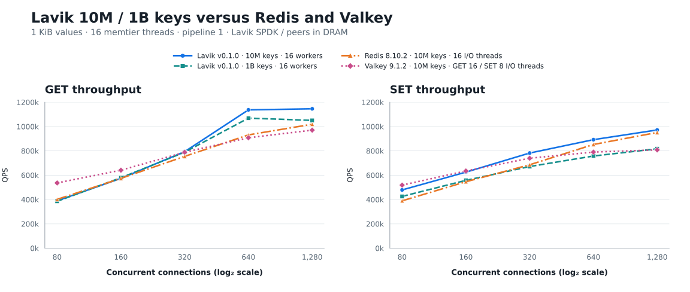
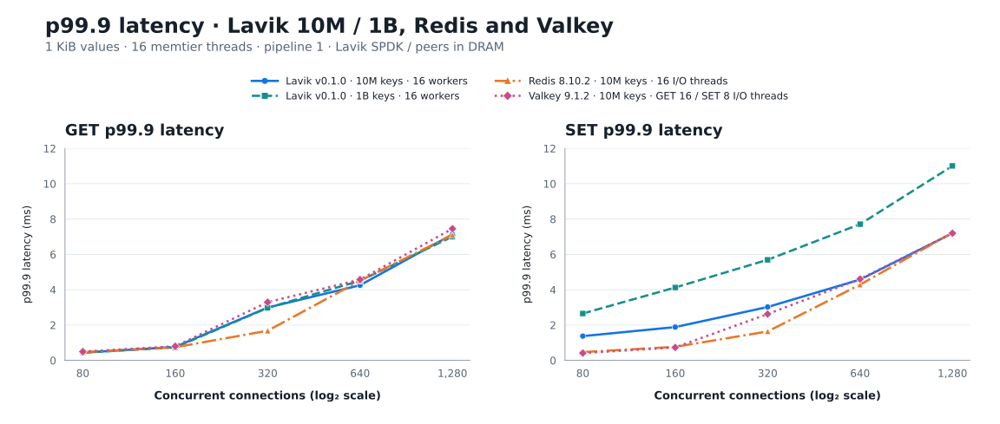

# Lavik v0.1.0: latest Redis / Valkey and a 1TB dataset

**English** | [简体中文](README.zh-CN.md)

Test date: 2026-10-13. The downloaded **Lavik v0.1.0 standard x86_64 release** was tested against freshly measured Redis 8.10.2 and Valkey 9.1.2 controls. This report presents **120 formal points**: 110 with 10 million keys and 10 Lavik-only points with one billion keys; values are 1,024 bytes. Lavik defrag stayed enabled throughout loading, warmup and measurement. No historical control results are reused.

In the 10M group, Lavik's peak GET was **1145.8k QPS** at 1280 connections (p99.9 **7.135 ms**); peak SET was **972.0k QPS** at 1280 connections (p99.9 **7.199 ms**). These are single-run observations. The charts show throughput and p99.9 latency across connection counts.

## Throughput: Lavik 10M / 1B versus Redis / Valkey



All four series cover 80–1280 connections. The 10M group uses 30 seconds per point and default client seeds; the 1B group uses 60 seconds and distinct client seeds. Dataset size, duration and seed settings differ.

## p99.9 latency comparison



Latency is client-observed p99.9 over each full measurement window, in milliseconds; lower is better. The I/O-thread configurations match the throughput chart. The connection axis uses a log₂ scale.

The 1B GET peak is 1,069,126 QPS at 640 connections; SET peaks at 817,113 QPS with 1280 connections. These are observations from this single sweep.

Full-batch acquisition span (including per-point setup/snapshots): 2026-10-13 11:33:05 UTC – 2026-10-13 13:12:17 UTC


## Hardware and deployment

| Item | Configuration |
|---|---|
| Server | Azure Standard_L16aos_v4, Japan West zone 2; AMD EPYC 9V74; 16 logical CPUs / 8 physical cores; 125.8 GiB Linux RAM |
| Client | Azure Standard_F32als_v6; AMD EPYC 9V74; 32 physical cores; 62.8 GiB Linux RAM; benchmark process restricted to CPUs 0–15 |
| OS | Ubuntu 24.04; Linux 6.17.0-1022-azure on both hosts; no reboot during this batch |
| Network | Client 10.84.0.5 → server 10.84.1.4:6379, accelerated mlx5 path, kernel TCP |
| Server CPUs | 0–15 for all products; 16 Lavik workers; Redis/Valkey 1/2/4/8/16 I/O threads |
| Lavik storage | Six dedicated local NVMe, 1,919,850,381,312 B each; SPDK/VFIO; 8 GiB hugepages |
| Redis/Valkey storage | Dataset in DRAM; AOF and automatic snapshots disabled; validated RDB used only for configuration resets |

## Method and limits

- Method follows the [beta.1 peer report](../lavik-v0.1.0-beta.1-spdk-vs-peers-2026-09-18/README.md), covering its Redis/Valkey 10M group and Lavik 1B storage group. Dragonfly and Garnet are outside this batch. Latest stable peer versions were selected on 2026-10-13: [Redis 8.10.2](https://github.com/redis/redis/releases/tag/8.10.2), [Valkey 9.1.2](https://valkey.io/download/releases/v9-1-2/).
- Order: Lavik SPDK 10M, Lavik SPDK 1B, Redis, Valkey. One database and one load generator run at a time. Server CPU/IRQ policy is not changed during this group. Builds finish before measurement.
- Standard package `lavik-v0.1.0-linux-x86_64.tar.gz`; source `feb61224e414c5653fd09560e20c9d214db1e3ac`; executable SHA-256 `7bf8d204a137678cee0e1a621b02661181373fbbfe1366bc1c201942b9dcf420`; GCC 13 release / x86-64-v2. No Lavik rebuild or source patch. Archive checksum matches the published checksum.
- Lavik uses `spdk-max-completions-per-poll=16` (v0.1.0 default: 8). Defrag remains enabled and is verified before and after each formal point.
- The six disks are matched by serial, PCI address, namespace and capacity before clearing. OS and workspace disks are excluded. Independent 10M and 1B Lavik datasets are loaded, clearing the six scratch devices between them. SPDK controllers are returned to the kernel after the clean Lavik stop; the hugepage reservation is released before subsequent tests.
- Redis/Valkey are built from their pinned 8.10.2 / 9.1.2 release commits with jemalloc 5.3.0. Each product loads a fresh 10M dataset and saves a hash-verified RDB. Each I/O-thread configuration starts from that baseline, with AOF and scheduled snapshots disabled. Other settings retain product defaults.
- 10M group: memtier 2.5.1, 16 client threads, pipeline 1, no rate limit; decimal keys 1..10,000,000 without prefixes; uniform random GET or overwriting SET, 1,024 B values. Connections 80/160/320/640/1280; 30 seconds per point; 10-second GET warmup per server configuration. The original 10M method's default correlated client seeds are retained.
- The 1B group uses decimal keys 1..1,000,000,000, uniformly random GET or overwriting SET, and 80/160/320/640/1280 connections, 60 seconds per point, distinct client seeds, and no extra GET warmup, following the original storage-group method. Shutdown checkpoint is enabled. The 1.024 TB raw value payload excludes keys and storage/index overhead.
- Exact DBSIZE and five sampled value lengths are checked before and after each server configuration. All measured GETs have zero misses; all formal points have zero connection errors. The latency percentiles are whole-window client measurements.
- Each point is measured once; confidence intervals and run-to-run variability are not estimated. Products run sequentially, not interleaved. Thread roles differ, and Lavik persistence differs from the memory-only peer configurations. The new client CPU/model and release build differ from historical reports, so historical performance changes cannot be attributed solely to Lavik code.

## Redis / Valkey persistence configuration

Periodic RDB snapshots and AOF are disabled throughout loading, warmup and measurement. Configuration: [redis-valkey-persistence.conf](redis-valkey-persistence.conf).

```conf
save ""
appendonly no
```

One manual `SAVE` runs after each product’s initial 10M fill, outside measured windows, so every I/O-thread configuration restarts from the same baseline. Reading the RDB does not enable periodic snapshots. Measured writes are memory-only.

## Run commands

These Bash commands use the measured settings; adapt paths, addresses and PCI identities to the deployment. Run one database and one load generator at a time. Use a separate result directory for each configuration.

### Lavik SPDK

Follow the [SPDK storage guide](../../docs/operations/spdk-storage.md) to verify six dedicated scratch NVMe devices and prepare VFIO and 8 GiB hugepages. Independently load the 10M and 1B groups on empty media; do not overwrite system disks or existing application data. After a clean Lavik stop, restore kernel drivers and hugepage reservations before testing the memory databases. The 10M launch command is:

```bash
sudo env 'BYCORF_EAL_ARGS=-a 2401:00:00.0 -a 221c:00:00.0 -a 7f10:00:00.0 -a 399c:00:00.0 -a c0ef:00:00.0 -a 6319:00:00.0' BYCORF_DPDK_MEMORY_MB=8192 taskset \
  -c 0-15 /mnt/dev/benchmark/release010/downloads/lavik-v0.1.0-linux-x86_64/lavik \
  --network=kernel \
  --storage=spdk \
  --bind=10.84.1.4 \
  --port=6379 \
  --metrics-port=0 \
  --threads=16 \
  --pin-workers \
  --maxclients=10000 \
  --busy-poll-us=20 \
  --foreground-budget-us=1000 \
  --background-budget-us=10 \
  --background-warrant-percent=1 \
  --tomb-raider-interval-ms=0 \
  --spdk-max-completions-per-poll=16 \
  --spdk-foreground-pre-poll-us=5 \
  --defrag-max-active-per-device=8 \
  --defrag-sleep-ms=0 \
  --defrag-record-sleep-us=0 \
  --log-dir=/mnt/dev/benchmark/release010-latest/suite/memory/lavik-spdk/logs \
  --data-file=spdk://2401:00:00.0/1 \
  --data-file=spdk://221c:00:00.0/1 \
  --data-file=spdk://7f10:00:00.0/1 \
  --data-file=spdk://399c:00:00.0/1 \
  --data-file=spdk://c0ef:00:00.0/1 \
  --data-file=spdk://6319:00:00.0/1
```

For 1B, use the same settings, add `--shutdown-checkpoint`, and change the log directory to `suite/storage/lavik-spdk/logs`. Wait for startup and background initialization, then check that `CONFIG GET defrag-paused` returns `no`; repeat this check before and after each measured point.

### Redis / Valkey

Build with jemalloc 5.3.0 using `make -j16 BUILD_TLS=no`. Redis 8.10.2 uses commit `498ecd0d6d007db11ddb3aea9428552598a78622`; Valkey 9.1.2 uses `7f1dffedff6de73058b2c2a389422b6ecd56c8fb`. Use 16 I/O threads for the initial fill.

```bash
# On the server; start one product/configuration at a time.
PRODUCT=redis                    # redis or valkey
IO_THREADS=16                    # tested: 1, 2, 4, 8, 16
DATA_DIR=/mnt/dev/benchmark/release010-latest/suite/data/$PRODUCT
mkdir -p "$DATA_DIR"
ulimit -n 65535
taskset -c 0-15 "/mnt/dev/benchmark/release010-latest/downloads/$PRODUCT/src/$PRODUCT-server" \
  --bind 10.84.1.4 --protected-mode no --port 6379 --daemonize no \
  --dir "$DATA_DIR" --dbfilename dump.rdb --save "" --appendonly no \
  --maxmemory 0 --maxclients 10000 --io-threads "$IO_THREADS"
```

The figures use Redis 16 I/O threads for GET/SET, Valkey 16 for GET and 8 for SET. Each command selects one peak-QPS configuration from the complete 1/2/4/8/16-thread sweep.

### Load, warmup and connection sweep

```bash
# On the client: memtier_benchmark 2.5.1.
KEYS=10000000                    # 1000000000 only for the Lavik 1B group
SECONDS_PER_POINT=30
SEED=()
if [ "$KEYS" -eq 1000000000 ]; then
  SECONDS_PER_POINT=60
  SEED=(--distinct-client-seed)
fi
mkdir -p results
ulimit -n 65535
COMMON=(--server=10.84.1.4 --port=6379 --protocol=redis
  --threads=16 --pipeline=1 --key-minimum=1 --key-maximum="$KEYS"
  --key-prefix= --data-size=1024 --hide-histogram
  --print-percentiles=50,99,99.9,99.99 --show-config)

# Once per fresh dataset; each key is written once across 640 clients.
taskset -c 0-15 memtier_benchmark "${COMMON[@]}" --clients=40 \
  --json-out-file=results/fill.json --requests="$((KEYS / 640))" \
  --ratio=1:0 --key-pattern=P:P
redis-cli -h 10.84.1.4 -p 6379 --raw DBSIZE
redis-cli -h 10.84.1.4 -p 6379 STRLEN 1
```

For Redis/Valkey, run the baseline commands below after the initial fill. Restart in turn with 1, 2, 4, 8 and 16 I/O threads; wait for RDB loading and DBSIZE=10000000, verify persistence settings, then run the warmup and measurement block. End each configuration with `SHUTDOWN NOSAVE` so the same `dump.rdb` remains unchanged. Do not refill or run SAVE during measurement. Skip these RDB baseline commands for Lavik.

```bash
redis-cli -h 10.84.1.4 -p 6379 SAVE
redis-cli -h 10.84.1.4 -p 6379 SHUTDOWN NOSAVE
# On the server, record/check the unchanged RDB baseline hash:
sha256sum "$DATA_DIR/dump.rdb"
# After each restart, run these checks from the client:
redis-cli -h 10.84.1.4 -p 6379 CONFIG GET save
redis-cli -h 10.84.1.4 -p 6379 CONFIG GET appendonly
redis-cli -h 10.84.1.4 -p 6379 INFO persistence
```

```bash
# Run once for Lavik 10M and once per Redis/Valkey I/O-thread configuration.
# The Lavik 1B group has no additional GET warmup.
if [ "$KEYS" -eq 10000000 ]; then
  taskset -c 0-15 memtier_benchmark "${COMMON[@]}" --clients=40 \
    --json-out-file=results/warmup.json --test-time=10 \
    --command='GET __key__' --command-key-pattern=R --command-is-read
fi
for OP in GET SET; do
  COMMAND=(--command='GET __key__' --command-key-pattern=R --command-is-read)
  if [ "$OP" = SET ]; then
    COMMAND=(--command='SET __key__ __data__' --command-key-pattern=R)
  fi
  for CONNECTIONS in 80 160 320 640 1280; do
    taskset -c 0-15 memtier_benchmark "${COMMON[@]}" \
      --clients="$((CONNECTIONS / 16))" \
      --json-out-file="results/$OP-c$CONNECTIONS.json" \
      --test-time="$SECONDS_PER_POINT" "${COMMAND[@]}" "${SEED[@]}" \
      > "results/$OP-c$CONNECTIONS.txt" 2>&1
  done
done
redis-cli -h 10.84.1.4 -p 6379 --raw DBSIZE
```
