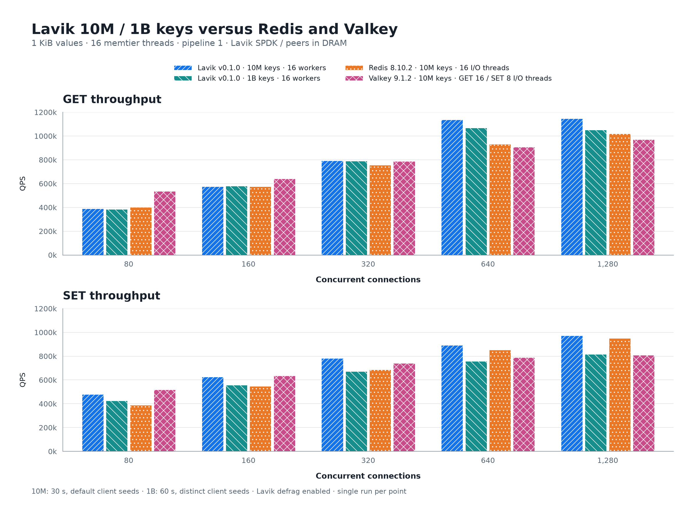
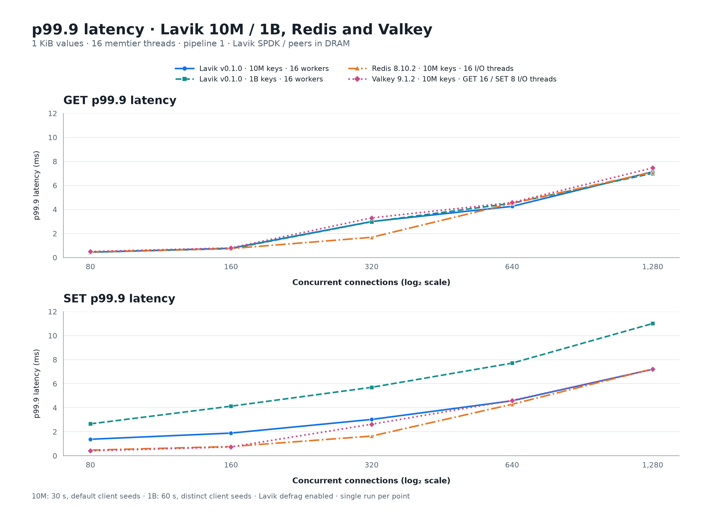

# Lavik v0.1.0：最新版 Redis / Valkey 对比与 1TB 数据测试

[English](README.md) | **简体中文**

测试日期：2026-10-13。使用下载的 **Lavik v0.1.0 标准 x86_64 正式包**，重新测量 Redis 8.10.2、Valkey 9.1.2 对照。本报告的 **120 个正式测量点**包含 110 个 1,000 万 key 对比点，以及 10 个 Lavik 单独运行的 10 亿 key 点；每条 value 均为 1,024 B。Lavik 在灌入、预热、测量期间始终开启 defrag；没有复用历史对照数据。

10M 组的 Lavik GET 峰值为 **1145.8k QPS**（1280 连接，p99.9 **7.135 ms**）；SET 峰值为 **972.0k QPS**（1280 连接，p99.9 **7.199 ms**）。这些是单次测量结果。图中展示吞吐和 p99.9 延迟随连接数的变化。

## 吞吐对比：Lavik 10M / 1B 与 Redis / Valkey



四组均展示 80–1280 连接。10M 组每点 30 秒，使用默认客户端随机种子；1B 组每点 60 秒，使用独立客户端随机种子。数据规模、时长及随机种子设置存在差异。

## p99.9 延迟对比



延迟为客户端完整测量窗口的 p99.9，单位为毫秒，越低越好。使用与吞吐图相同的 I/O 线程配置；横轴为 log₂ 连接数刻度。

1B GET 峰值为 1,069,126 QPS（640 连接），SET 峰值为 817,113 QPS（1280 连接）。这些仅描述本次单轮扫描。

整批正式测量采集时间（含每点准备/快照开销）：2026-10-13 11:33:05 UTC – 2026-10-13 13:12:17 UTC


## 硬件与部署

| 项目 | 配置 |
|---|---|
| 服务端 | Azure Standard_L16aos_v4，Japan West / zone 2；AMD EPYC 9V74；16 逻辑核 / 8 物理核；Linux 内存 125.8 GiB |
| 客户端 | Azure Standard_F32als_v6；AMD EPYC 9V74；32 物理核；Linux 内存 62.8 GiB；压测进程限制到 CPU 0–15 |
| 系统 | 两端均为 Ubuntu 24.04、Linux 6.17.0-1022-azure；本批未重启 |
| 网络 | 客户端 10.84.0.5 → 服务端 10.84.1.4:6379；mlx5 加速路径；kernel TCP |
| 服务端 CPU | 全产品使用 CPU 0–15；Lavik 16 workers；Redis/Valkey 1/2/4/8/16 I/O 线程 |
| Lavik 存储 | 六张专用本地 NVMe，每张 1,919,850,381,312 B；SPDK/VFIO；8 GiB hugepages |
| Redis/Valkey 存储 | 数据驻 DRAM；关闭 AOF、自动快照；校验后的 RDB 仅用于各线程配置间重置基线 |

## 方法与边界

- 方法沿用 [beta.1 对比报告](../lavik-v0.1.0-beta.1-spdk-vs-peers-2026-09-18/README.zh-CN.md)中的 Redis/Valkey 10M 组，以及 Lavik 的 1B 存储组；本批不包含 Dragonfly 或 Garnet。按 2026-10-13 官方稳定版选择 [Redis 8.10.2](https://github.com/redis/redis/releases/tag/8.10.2)、[Valkey 9.1.2](https://valkey.io/download/releases/v9-1-2/)。
- 顺序为 Lavik SPDK 10M → Lavik SPDK 1B → Redis → Valkey。任一时刻只运行一个被测数据库和一个压测客户端；本组不改变服务端 CPU/IRQ 策略。编译在正式测量前完成。
- 使用 `lavik-v0.1.0-linux-x86_64.tar.gz`；源码 `feb61224e414c5653fd09560e20c9d214db1e3ac`；可执行文件 SHA-256 `7bf8d204a137678cee0e1a621b02661181373fbbfe1366bc1c201942b9dcf420`；GCC 13 Release / x86-64-v2。未重新编译 Lavik，也未添加源码补丁。压缩包校验与发布的 SHA-256 一致。
- Lavik 使用 `spdk-max-completions-per-poll=16`（v0.1.0 默认 8）。Defrag 保持开启，每个正式点前后均核验。
- 清盘前按序列号、PCI、namespace、容量核验六张临时盘，排除系统盘和开发盘。分别独立灌入 10M 与 1B Lavik 数据集，两次灌入之间重新清理六张临时盘；Lavik 干净停止后，盘交还内核并释放 hugepage 预留。
- Redis/Valkey 使用发布的 8.10.2 / 9.1.2 固定 commit 编译，分配器为 jemalloc 5.3.0。各自新灌数据并生成 SHA 校验的 RDB；每档 I/O 线程从该基线启动。AOF、自动快照关闭，其他配置保留产品默认值。
- 10M 组：memtier 2.5.1，16 线程、pipeline=1、不限速；十进制 key 1..10,000,000、无前缀；均匀随机 GET 或覆盖 SET；value=1,024 B。连接数 80/160/320/640/1280，每点 30 秒，每档服务端配置先 GET 预热 10 秒。按原 10M 方法保留默认相关客户端随机种子。
- 1B 组使用十进制 key 1..1,000,000,000、均匀随机 GET 或覆盖 SET；80/160/320/640/1280 连接，每点 60 秒，各客户端使用 distinct seed，不额外 GET 预热；沿用原报告存储组方法，并启用 shutdown checkpoint。1.024 TB 为 value 原始载荷，不包含 key、索引与存储格式开销。
- 每档服务端配置前后核验精确 DBSIZE 和五个样本 value 长度。全部正式 GET miss=0，全部正式点连接错误=0。延迟为完整测量窗口的客户端分位数；服务端 CPU 采样包围额外的准备/INFO 工作，只作诊断。
- 每点仅测一次，未估计置信区间或运行间波动；产品按顺序而非交错执行。线程职责不同，Lavik 持久化与纯内存对照的保证也不同。此次客户端型号、CPU 以及 Lavik 构建与历史报告存在差异，不能将跨报告的变化全部归因于 Lavik 代码。

## 证据与离线复现

[全部 120 个测量点](results.csv) · [校验结果](validation.json) · [发布元数据](release.json) · [对照构建身份](evidence/builds.json) · [版本选择](latest-release-selection.json) · [服务端清单](server-inventory.json) · [客户端清单](client-inventory.json) · [网络路径](network-path.json) · [原始证据清单](SHA256SUMS)

`evidence/` 包含采集脚本、每点命令数组、memtier JSON/文本、测量前后宿主/INFO 快照、配置前后精确记录数及样本长度、驱动切换和干净停止状态。不包含私钥、下载的可执行文件或生成的数据库。

```sh
python3 perf_reports/lavik-v0.1.0-spdk-vs-latest-2026-10-13/verify_results.py
python3 perf_reports/lavik-v0.1.0-spdk-vs-latest-2026-10-13/build_assets.py
```

校验脚本使用 Python 3.11+，可离线执行；绘图需要 Matplotlib 3.11.2，导出 SVG、PNG。采集脚本针对这批宿主，包含对六张白名单临时盘的清理步骤，不可对任意磁盘直接运行。

## Redis / Valkey 持久化配置

灌入、预热和正式测量期间均关闭周期性 RDB 与 AOF。显式配置已保存为 [redis-valkey-persistence.conf](redis-valkey-persistence.conf)：

```conf
save ""
appendonly no
```

采集命令通过等效参数 `--save "" --appendonly no` 应用配置；完整命令见 `evidence/memory/{redis,valkey}/io*/server-command.json`。每个产品首次灌入 10M 数据后，仅在正式窗口之外手动执行一次 `SAVE`，生成经校验的 RDB 基线，供切换 I/O 线程数时重启恢复。启动时读取该基线不会开启周期性快照。每档 I/O 线程扫描前后，CONFIG GET 核验 save 为空、appendonly=no；INFO persistence 核验没有后台保存、AOF 未开启，返回值保存在 persistence-before.json 和 persistence-after.json。正式测量期间的写入仅在内存中完成。
