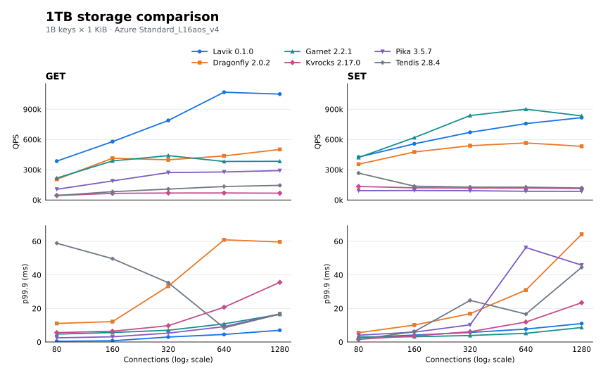

# Lavik v0.1.0: 1TB versus storage-backed Redis-compatible systems

**English** | [简体中文](README.zh-CN.md)

Test dates: October 13–14, 2026. All systems serve **1 billion keys with 1 KiB values (1TB)** on an Azure Standard_L16aos_v4 server. The comparison covers pure GET and overwriting SET at **80, 160, 320, 640 and 1280 connections**, with a separate load-generator VM.

## Throughput and p99.9 latency



The horizontal axis is total connections on a log₂ scale. Top panels show QPS; bottom panels show client-observed p99.9 latency in milliseconds. At 80 connections, Lavik records 385,514 GET QPS with 0.439 ms p99.9 and 425,907 SET QPS with 2.655 ms p99.9. Across the full sweep, Lavik has the highest GET peak (1,069,126 QPS), while Garnet has the highest SET peak (900,794 QPS).

## Environment and method

| Item | Configuration |
|---|---|
| Server | Azure Standard_L16aos_v4, Japan West zone 2; 16 vCPUs, 128 GiB nominal RAM |
| Client | Separate Azure Standard_F32als_v6; memtier restricted to CPUs 0–15 |
| OS | Ubuntu 24.04, Linux 6.17.0-1022-azure on both VMs |
| Network | Private VNet, client → 10.84.1.4:6379, kernel TCP with accelerated NIC |
| Storage | Six local NVMe devices, approximately 1.92 TB each; Lavik SPDK; other systems on RAID0/XFS with noatime |
| Client workload | memtier 2.5.1; 16 threads; one outstanding request per connection; uniform random access and distinct client seeds |
| Dataset | Decimal keys 1…1,000,000,000, no prefix, 1,024-byte values; keys and storage overhead are additional |
| Measurement | 60 seconds per point, GET followed by SET; increasing connections within each sweep |

Each system starts with an independently loaded dataset. Dragonfly and Garnet receive a 180-second GET warmup at 80 connections using eight client threads; the other systems begin the sweep after loading and sampled-value checks. Products run sequentially on the same server, restricted to CPUs 0–15. The charts show one measurement per point.

Lavik defrag stays enabled. Garnet uses Lookup compaction, and RocksDB automatic compaction remains enabled for Kvrocks, Pika and Tendis. Memory allocation differs by product: Dragonfly uses a 96 GiB limit; Garnet uses a 64 GiB log, 32 GiB read cache and 16 GiB index; Kvrocks uses an 80 GiB block cache; Pika uses a 24 GiB block cache and 32 GiB application cache; Tendis uses a shared 72 GiB cache. These are configured budgets, not measured total resident memory.

Persistence is not identical: Lavik uses its SPDK storage engine; Dragonfly uses its tiered file without periodic snapshots; Garnet uses its storage log without AOF; Kvrocks and Tendis disable WAL, while Pika disables binlog. Successful responses are not compared as equal synchronous durability guarantees. All formal GET points have zero misses and all points have zero connection errors; loading completes one billion SET requests per product. Value lengths are sampled before and after the sweeps.

## Versions

| System | Tested release |
|---|---|
| Lavik | [v0.1.0](https://github.com/eloqdata/lavik/releases/tag/v0.1.0), standard x86_64 package |
| Dragonfly | [v2.0.2](https://github.com/dragonflydb/dragonfly/releases/tag/v2.0.2) |
| Garnet | [v2.2.1](https://github.com/microsoft/garnet/releases/tag/v2.2.1) |
| Apache Kvrocks | [v2.17.0](https://github.com/apache/kvrocks/releases/tag/v2.17.0) |
| Pika / PikiwiDB | [v3.5.7](https://github.com/OpenAtomFoundation/pikiwidb/releases/tag/v3.5.7) |
| Tendis | [2.8.4-rocksdb-v8.5.3](https://github.com/Tencent/Tendis/releases/tag/2.8.4-rocksdb-v8.5.3) |

Garnet runs with .NET 10.0.12. Kvrocks is built from its release tag with GCC 13. Pika uses the official v3.5.7 Ubuntu archive; its embedded version string reports 3.5.6, with revision `62a57f85534198e0d1033c32f1215c958bef8a5e`.

## Run commands

Use Bash and adjust addresses and installation paths. Install the release packages above and memtier 2.5.1. Run one server at a time; each startup command below stays in the foreground. Stop it cleanly before starting the next product. The filesystem setup uses only six verified empty scratch devices. For Lavik, use the [SPDK storage guide](../../docs/operations/spdk-storage.md) to prepare its dedicated devices and 8 GiB hugepages before its independent load.

The configuration blocks contain overrides to the tested release templates. Save each block as the named `.overrides` file, then apply it with the supplied overlay script. The client workload is the same for all products.

### Storage and paths

```bash
# Filesystem peers: six verified, empty local NVMe devices, kernel driver bound.
# These names are placeholders: replace each with a verified scratch device.
DEVICES=(/dev/TEST_NVME1 /dev/TEST_NVME2 /dev/TEST_NVME3
         /dev/TEST_NVME4 /dev/TEST_NVME5 /dev/TEST_NVME6)
sudo mdadm --create /dev/md/bench --level=0 --raid-devices=6 "${DEVICES[@]}"
sudo mkfs.xfs /dev/md/bench
sudo mkdir -p /mnt/bench
sudo mount -o noatime /dev/md/bench /mnt/bench
sudo mkdir -p /mnt/bench/{dragonfly,garnet,kvrocks,pika/{db,log,dump,dbsync},tendis/{db,log,dump}}
sudo chown -R "$(id -u):$(id -g)" /mnt/bench
ulimit -n 65535
```

### Lavik SPDK

```bash
# Prepare the six verified SPDK namespaces using the SPDK storage guide.
# Use the actual PCI addresses after binding the empty scratch devices to VFIO.
BDFS=(2401:00:00.0 221c:00:00.0 7f10:00:00.0 399c:00:00.0 c0ef:00:00.0 6319:00:00.0)
FILES=(); EAL=''
for bdf in "${BDFS[@]}"; do
  FILES+=(--data-file="spdk://${bdf}/1")
  EAL+=" -a ${bdf}"
done
sudo env BYCORF_EAL_ARGS="$EAL" BYCORF_DPDK_MEMORY_MB=8192 \
  taskset -c 0-15 /opt/lavik-v0.1.0-linux-x86_64/lavik \
  --storage=spdk --bind=10.84.1.4 --shutdown-checkpoint \
  --spdk-max-completions-per-poll=16 --log-dir=/mnt/dev/bench-lavik-logs \
  "${FILES[@]}"
```

### Dragonfly 2.0.2

```bash
taskset -c 0-15 /opt/dragonfly/dragonfly-x86_64 \
  --logtostderr --bind=10.84.1.4 --proactor_threads=16 --maxmemory=96GB \
  --dir=/mnt/bench/dragonfly --dbfilename= \
  --tiered_prefix=/mnt/bench/dragonfly/tier \
  --tiering_disk_storage_initial_size=64GB --tiered_max_file_size=2TB \
  --backing_file_direct=false --tiered_offload_threshold=1.0 \
  --tiered_experimental_cooling=false --tiered_max_pending_stash_bytes=16MB
```

### Garnet 2.2.1

```bash
cd /opt/garnet/net10.0
export DOTNET_ROOT=/opt/dotnet
export LD_LIBRARY_PATH="$PWD${LD_LIBRARY_PATH:+:$LD_LIBRARY_PATH}"
# The release archive places its native device library at the package root.
mkdir -p runtimes/linux-x64/native
ln -sf ../../../libnative_device.so runtimes/linux-x64/native/libnative_device.so
ln -sf /lib/x86_64-linux-gnu/libaio.so.1t64 libaio.so.1

taskset -c 0-15 ./GarnetServer \
  --bind 10.84.1.4 --protected-mode false --memory 64g --page 4m \
  --index 16g --index-max-size 16g --storage-tier \
  --logdir /mnt/bench/garnet/log --checkpointdir /mnt/bench/garnet/checkpoints \
  --readcache --readcache-memory 32g --no-obj --no-pubsub \
  --device-type Native --device-io-backend Libaio --device-throttle-limit 512 \
  --initial-io-record-size 8k --compaction-freq 300 --compaction-type Lookup \
  --compaction-force-delete --minthreads 16 --miniothreads 16
```

### Kvrocks

```conf
# kvrocks.overrides
bind 10.84.1.4
port 6379
workers 16
tcp-backlog 8192
db-name kvrocks-perf
dir /mnt/bench/kvrocks
log-dir stdout:warning
log-level warning
slowlog-log-slower-than -1
slowlog-max-len 0
persist-cluster-nodes-enabled no
enable-blob-cache yes
rocksdb.block_cache_size 81920
rocksdb.max_open_files -1
rocksdb.write_buffer_size 512
rocksdb.target_file_size_base 512
rocksdb.max_write_buffer_number 8
rocksdb.min_write_buffer_number_to_merge 2
rocksdb.max_background_jobs 16
rocksdb.max_subcompactions 4
rocksdb.max_total_wal_size 8192
rocksdb.wal_ttl_seconds 3600
rocksdb.wal_size_limit_mb 65536
rocksdb.compression no
rocksdb.compression_start_level 0
rocksdb.enable_pipelined_write yes
rocksdb.level0_file_num_compaction_trigger 16
rocksdb.level0_slowdown_writes_trigger 128
rocksdb.level0_stop_writes_trigger 256
rocksdb.enable_blob_files yes
rocksdb.min_blob_size 1000
rocksdb.blob_file_size 1073741824
rocksdb.level_compaction_dynamic_level_bytes no
rocksdb.max_bytes_for_level_base 68719476736
rocksdb.write_options.disable_wal yes
rocksdb.rate_limiter_auto_tuned no
```

### Pika

```conf
# pika.overrides
port : 6379
thread-num : 16
thread-pool-size : 32
log-path : /mnt/bench/pika/log/
db-path : /mnt/bench/pika/db/
dump-path : /mnt/bench/pika/dump/
pidfile : /mnt/bench/pika/pika.pid
db-sync-path : /mnt/bench/pika/dbsync/
max-subcompactions : 4
write-binlog : no
max-write-buffer-size : 8G
compression : none
max-background-jobs : 12
max-background-flushes : 4
max-background-compactions : 8
block-cache : 24G
num-shard-bits : 6
share-block-cache : yes
cache-index-and-filter-blocks : yes
pin_l0_filter_and_index_blocks_in_cache : yes
optimize-filters-for-hits : yes
cache-maxmemory : 34359738368
```

### Tendis

```conf
# tendis.overrides
bind 10.84.1.4
port 6379
daemon off
logLevel warning
logdir /mnt/bench/tendis/log
dumpdir /mnt/bench/tendis/dump
dir /mnt/bench/tendis/db
pidfile /mnt/bench/tendis/tendisplus.pid
slowlog /mnt/bench/tendis/log/slowlog
tcp-backlog 8192
netIoThreadNum 4
executorThreadNum 16
executorWorkPoolSize 4
binlog-enabled no
binlog-save-logs no
rocks.blockcachemb 73728
rocks.blockcache_num_shard_bits 8
rocks.blobcache_in_blockcache yes
rocks.disable_wal yes
rocks.compress_type none
rocks.write_buffer_size 268435456
rocks.target_file_size_base 536870912
rocks.max_bytes_for_level_base 68719476736
rocks.level0_file_num_compaction_trigger 16
rocks.level0_slowdown_writes_trigger 128
rocks.level0_stop_writes_trigger 256
rocks.max_background_jobs 16
rocks.max_subcompactions 4
rocks.compaction_readahead_size 2097152
rocks.enable_pipelined_write 1
rocks.cache_index_and_filter_blocks 1
rocks.pin_l0_filter_and_index_blocks_in_cache 1
rocks.partition_filters 1
rocks.enable_blob_files 1
rocks.min_blob_size 1000
rocks.blob_file_size 1073741824
rocks.enable_blob_garbage_collection 1
rocks.blob_garbage_collection_force_threshold 0.5
```

```bash
# Overlay the changes above on the tested release's configuration template.
# Paths: /opt/kvrocks/kvrocks.conf, /opt/pika/conf/pika.conf, /opt/tendis/tendisplus.conf.
python3 - <<'CONFIG'
from pathlib import Path
import re
for product, template in [('kvrocks', '/opt/kvrocks/kvrocks.conf'),
                          ('pika', '/opt/pika/conf/pika.conf'),
                          ('tendis', '/opt/tendis/tendisplus.conf')]:
    separator = r'\s*:\s*' if product == 'pika' else r'\s+'
    changes = {}
    for line in Path(product + '.overrides').read_text().splitlines():
        if line.strip() and not line.lstrip().startswith('#'):
            key = re.split(separator, line.strip(), maxsplit=1)[0].lower()
            changes[key] = line
    lines = []
    for line in Path(template).read_text().splitlines():
        stripped = line.strip()
        key = re.split(separator, stripped, maxsplit=1)[0].lower() if stripped else ''
        if stripped.startswith('#') or key not in changes:
            lines.append(line)
    Path(product + '.conf').write_text('\n'.join(lines + list(changes.values())) + '\n')
CONFIG

# Start only the selected product, with an empty data directory.
taskset -c 0-15 /opt/kvrocks/build/kvrocks -c kvrocks.conf
taskset -c 0-15 /opt/pika/bin/pika -c pika.conf
taskset -c 0-15 /opt/tendis/bin/tendisplus tendis.conf
```

### Client: load, warm up and measure

```bash
# Run on the separate client. Use a new OUT directory for each server.
SERVER=10.84.1.4
PRODUCT=dragonfly  # lavik, dragonfly, garnet, kvrocks, pika, tendis
OUT="results/$PRODUCT"
mkdir -p "$OUT"
ulimit -n 65535
COMMON=(--server="$SERVER" --threads=16 --key-minimum=1
        --key-maximum=1000000000 --key-prefix= --data-size=1024)

taskset -c 0-15 memtier_benchmark "${COMMON[@]}" --clients=40 \
  --requests=1562500 --ratio=1:0 --key-pattern=P:P \
  --json-out-file="$OUT/fill.json"

# Check sampled value lengths; do not scan the full keyspace.
for key in 1 2 500000000 999999999 1000000000; do
  test "$(redis-cli -h "$SERVER" --raw STRLEN "$key")" = 1024
done

if [[ "$PRODUCT" == dragonfly || "$PRODUCT" == garnet ]]; then
  taskset -c 0-15 memtier_benchmark "${COMMON[@]}" --threads=8 --clients=10 \
    --test-time=180 --distinct-client-seed --command='GET __key__' \
    --command-is-read --json-out-file="$OUT/warmup.json"
fi

for op in GET SET; do
  if [[ "$op" == GET ]]; then
    COMMAND=(--command='GET __key__' --command-is-read)
  else
    COMMAND=(--command='SET __key__ __data__')
  fi
  for connections in 80 160 320 640 1280; do
    taskset -c 0-15 memtier_benchmark "${COMMON[@]}" \
      --clients="$((connections / 16))" --test-time=60 --distinct-client-seed \
      "${COMMAND[@]}" --json-out-file="$OUT/$op-c$connections.json"
  done
done
```
