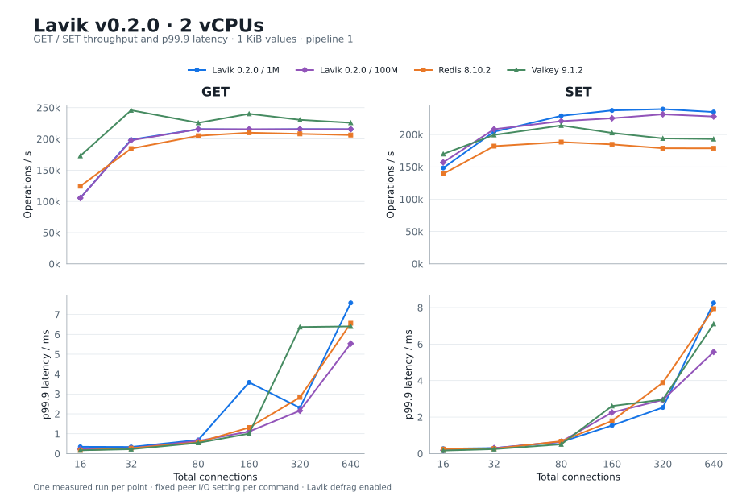
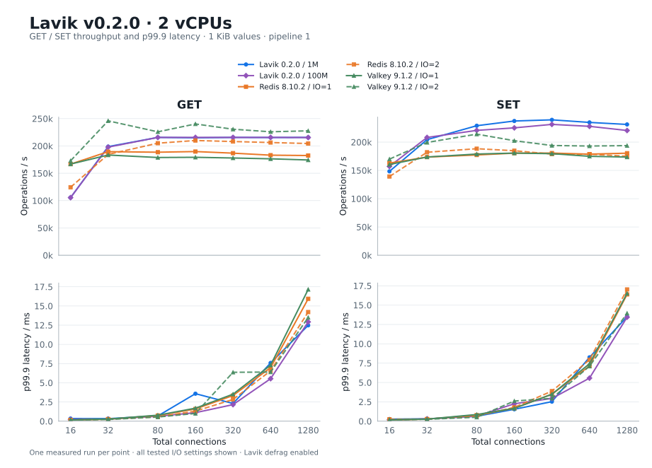

# Lavik v0.2.0 on 2 vCPUs: Redis / Valkey and 100M-key capacity

**English** | [简体中文](README.zh-CN.md)

Test dates: 2026-10-21 (UTC). All **84 formal points** were freshly measured on newly provisioned Azure hosts. Lavik’s 100M-key dataset contains **95.37 GiB of logical value payload**, 100 times the 1M dataset.

At 100M keys, peak GET / SET throughput is **215,644 / 231,361 ops/s**, retaining **100.0% / 96.6%** of the smaller dataset’s peaks. Peaks may occur at different connection counts; matched-concurrency results follow below. In the 1M baseline, the highest GET peak is Valkey 9.1.2 (245,955 ops/s), while the highest SET peak is Lavik 0.2.0 / 1M (239,405 ops/s).

## Throughput and p99.9 latency



| Command | Product / keys | Workers / I/O threads | Connections | Peak ops/s | p99.9 ms |
| --- | --- | --- | --- | --- | --- |
| GET | Lavik 0.2.0 / 1M | 2 | 80 | 215,640 | 0.687 |
| GET | Lavik 0.2.0 / 100M | 2 | 640 | 215,644 | 5.535 |
| GET | Redis 8.10.2 | 2 | 160 | 209,958 | 1.311 |
| GET | Valkey 9.1.2 | 2 | 32 | 245,955 | 0.223 |
| SET | Lavik 0.2.0 / 1M | 2 | 320 | 239,405 | 2.527 |
| SET | Lavik 0.2.0 / 100M | 2 | 320 | 231,361 | 2.943 |
| SET | Redis 8.10.2 | 2 | 80 | 188,371 | 0.679 |
| SET | Valkey 9.1.2 | 2 | 80 | 214,117 | 0.511 |

For each command, each peer uses the **single I/O-thread setting with its highest peak** for the entire throughput and latency curve; settings are not spliced point by point. Main plots show 16–640 connections; the tables and all-configuration chart retain 1280.

## Matched-concurrency comparison

Cells show **ops/s / p99.9 ms**.

| Command | Connections | Lavik 0.2.0 / 1M | Lavik 0.2.0 / 100M | Redis 8.10.2 | Valkey 9.1.2 |
| --- | --- | --- | --- | --- | --- |
| GET | 16 | 105,536 / 0.343 | 105,464 / 0.223 | 124,422 / 0.167 | 172,900 / 0.167 |
| GET | 32 | 198,832 / 0.335 | 197,851 / 0.271 | 184,549 / 0.271 | 245,955 / 0.223 |
| GET | 80 | 215,640 / 0.687 | 215,643 / 0.639 | 205,073 / 0.567 | 225,845 / 0.543 |
| GET | 160 | 214,971 / 3.583 | 215,639 / 1.111 | 209,958 / 1.311 | 240,260 / 1.007 |
| GET | 320 | 215,632 / 2.303 | 215,644 / 2.159 | 208,124 / 2.831 | 230,637 / 6.367 |
| GET | 640 | 215,452 / 7.583 | 215,644 / 5.535 | 206,284 / 6.559 | 225,932 / 6.399 |
| GET | 1280 | 215,620 / 12.479 | 215,439 / 12.927 | 204,466 / 14.207 | 227,679 / 13.503 |
| SET | 16 | 148,361 / 0.271 | 157,101 / 0.183 | 139,237 / 0.247 | 169,978 / 0.167 |
| SET | 32 | 204,416 / 0.303 | 208,295 / 0.303 | 182,105 / 0.271 | 199,425 / 0.247 |
| SET | 80 | 229,009 / 0.639 | 220,759 / 0.655 | 188,371 / 0.679 | 214,117 / 0.511 |
| SET | 160 | 237,336 / 1.543 | 225,243 / 2.255 | 184,826 / 1.791 | 202,535 / 2.607 |
| SET | 320 | 239,405 / 2.527 | 231,361 / 2.943 | 178,853 / 3.887 | 194,044 / 2.959 |
| SET | 640 | 234,839 / 8.255 | 227,927 / 5.567 | 178,734 / 7.935 | 193,103 / 7.103 |
| SET | 1280 | 231,271 / 13.503 | 220,561 / 13.439 | 175,050 / 17.023 | 193,829 / 13.951 |

## Complete I/O-thread sweep

| Product | I/O threads | GET peak ops/s (connections) | SET peak ops/s (connections) |
| --- | --- | --- | --- |
| Redis 8.10.2 | 1 | 189,749 (160) | 180,645 (320) |
| Redis 8.10.2 | 2 | 209,958 (160) | 188,371 (80) |
| Valkey 9.1.2 | 1 | 183,408 (32) | 180,624 (160) |
| Valkey 9.1.2 | 2 | 245,955 (32) | 214,117 (80) |



## Memory and client diagnostics

| Product / keys | INFO used_memory (MiB) | Process RSS (MiB) |
| --- | --- | --- |
| Lavik 0.2.0 / 1M | 96.0–96.0 | 739.2–748.6 |
| Lavik 0.2.0 / 100M | 5,069.4–5,069.4 | 5,513.4–5,521.7 |
| Redis 8.10.2 | 1,264.7–1,265.0 | 1,287.9–1,978.4 |
| Valkey 9.1.2 | 1,268.1–1,268.6 | 1,290.6–2,223.3 |

Ranges use post-point snapshots. INFO memory follows each product’s accounting; RSS is OS-reported resident process memory. Lavik also reserves **2,048 MiB of hugepages**. Maximum average client CPU usage is **3.718 cores**; the largest individual client thread average is **0.249 cores**; maximum server CPU steal in enclosing sampled windows is **0.0000%**.

## Versions and hardware

| Item | Configuration |
| --- | --- |
| Server | Standard_L2aos_v5; 2 vCPU (1 physical core) / 16 GiB nominal RAM; AMD EPYC 9V45 96-Core Processor |
| Client | Standard_F16as_v7; separate VM; CPUs 0–15 |
| Region | East US, zone 3 |
| OS | Ubuntu 24.04; Linux 6.17.0-1022-azure on both hosts |
| Storage | 1 × 1,439,887,785,984-byte dedicated local NVMe; SPDK/VFIO |
| Network | Kernel TCP; same VNet and availability zone; accelerated networking |
| Lavik | Official standard x86_64 v0.2.0 package; 2908f86f2770e9c6e8acc6585b3bedb4b44d1cd5 |

## Test method

- Fresh decimal keys `1..N`, no prefix, 1,024-byte values, no TTL. Independently load Lavik 1M and 100M; Redis and Valkey each use 1M.
- memtier 2.5.1 on 16 pinned client CPUs, pipeline 1, uniform random GET or overwriting SET. Connections: 16, 32, 80, 160, 320, 640, 1280. One run per point, 30 seconds for the baseline and 100M-key group. Every timed run uses independent client seeds.
- Ten-second GET warmup per configuration. GET precedes SET and concurrency increases within each sweep. Products run sequentially on the same server; builds finish before measurement.
- Lavik uses 2 workers and dedicated NVMe via SPDK. Overrides: `--tomb-raider-interval-ms=0`, `--spdk-max-completions-per-poll=16`, and 2 GiB EAL/hugepage memory. Defrag remains enabled and is checked around every point.
- Redis 8.10.2 and Valkey 9.1.2 use the same releases as the v0.1.0 report, default optimized builds with jemalloc, and I/O threads 1, 2. `save ""` disables scheduled snapshots; AOF remains disabled. A manual SAVE after initial fill provides the unchanged RDB baseline for each I/O setting; measured writes are memory-only.
- THP is `never`, overcommit is 1, no added cgroup memory cap. Exact DBSIZE and five value lengths are verified before/after configurations. Fill operation counts, zero GET misses, connection errors, versions and CPU affinity are checked.

## Evidence and measurement limits

[Complete point data](results.csv) · [Version, hardware and validation provenance](provenance.json)

Each point has one measured run; no confidence interval is claimed. Successful responses do not imply equal synchronous durability guarantees. New hosts can differ from the historical run in physical placement, network latency and timing. [Raw logs and receipts](raw-results.tar.gz) includes a per-file SHA-256 manifest; its archive hash is recorded in provenance.

## Reproduction commands

Use the L2aos_v5 server and an F16as_v7 client in the same availability zone over the private network. Prepare the standard x86_64 Lavik v0.2.0 binary, Redis 8.10.2, Valkey 9.1.2 and memtier 2.5.1. Redis and Valkey use default optimized builds with jemalloc 5.3.0 and `make -j12 BUILD_TLS=yes`. The commands below use Bash.

### Start the servers

```bash
# Run on the server; replace the address and binary paths for your hosts.
SERVER_IP=10.96.0.4
LAVIK_BIN=/opt/bench020/downloads/lavik-v0.2.0-linux-x86_64/lavik
REDIS_BIN=/opt/bench020/bin/redis-server
VALKEY_BIN=/opt/bench020/bin/valkey-server
ulimit -n 65535
sudo sysctl -w vm.overcommit_memory=1
printf 'never\n' | sudo tee /sys/kernel/mm/transparent_hugepage/enabled
```

Lavik uses an empty, dedicated NVMe namespace. Identify and bind the test device to VFIO using the [SPDK storage guide](../../docs/operations/spdk-storage.md), with `HUGEMEM=2048` and `BYCORF_DPDK_MEMORY_MB=2048`. This VM did not expose an IOMMU and used the guide's dedicated-test-host no-IOMMU configuration. Load 1M and 100M keys separately. Between them, stop Lavik cleanly, restore the NVMe driver, clear the verified scratch namespace, and rebind it before the independent load.

```bash
# Use the verified PCI address and namespace ID of your empty test NVMe.
NVME_BDF=YOUR_NVME_PCI_ADDRESS
NVME_NSID=1
sudo prlimit --memlock=unlimited:unlimited --nofile=65535:65535 \
  env BYCORF_EAL_ARGS="-a ${NVME_BDF}" BYCORF_DPDK_MEMORY_MB=2048 \
  taskset -c 0-1 "$LAVIK_BIN" \
  --storage=spdk --bind="$SERVER_IP" \
  --tomb-raider-interval-ms=0 --spdk-max-completions-per-poll=16 \
  --log-dir="$PWD/lavik-logs" \
  --data-file="spdk://${NVME_BDF}/${NVME_NSID}"
```

The command omits v0.2.0 defaults; under `taskset -c 0-1`, Lavik automatically starts two pinned workers. `BYCORF_DPDK_MEMORY_MB=2048` sets the EAL memory used by SPDK to 2 GiB; networking remains the default kernel TCP. The retained tuning options disable the default daily tombstone sweep and raise the SPDK completion cap from 8 to 16.

Test Redis and Valkey with one and two I/O threads, running only one server at a time:

```bash
# Run one product/configuration at a time. Repeat with IO_THREADS=2.
IO_THREADS=1
IO_ARGS=(); if ((IO_THREADS > 1)); then IO_ARGS=(--io-threads "$IO_THREADS"); fi
mkdir -p "$PWD/bench-data/redis" "$PWD/bench-data/valkey"

# Redis 8.10.2
taskset -c 0-1 "$REDIS_BIN" \
  --bind "$SERVER_IP" --protected-mode no \
  --dir "$PWD/bench-data/redis" \
  --save "" \
  "${IO_ARGS[@]}"

# Valkey 9.1.2 (after stopping Redis)
taskset -c 0-1 "$VALKEY_BIN" \
  --bind "$SERVER_IP" --protected-mode no \
  --dir "$PWD/bench-data/valkey" \
  --save "" \
  "${IO_ARGS[@]}"
```

### Load data and run memtier

Run Lavik 1M, Lavik 100M, Redis IO=1/2 and Valkey IO=1/2 in that order. Set `N` and `RUN` for each configuration. Confirm `DBSIZE=0` before each product's first fill. For Redis and Valkey, issue one `SAVE` after the initial fill and exit with `SHUTDOWN NOSAVE`. Start each I/O configuration from the same baseline RDB. Skip the fill on restart, validate the data, and repeat warmup and measurement. Both Lavik datasets start with an empty scratch namespace.

```bash
# Bash, on the separate client, CPUs 0–15; memtier_benchmark 2.5.1.
set -euo pipefail
SERVER_IP=10.96.0.4
N=1000000 # Use 100000000 for the large Lavik dataset.
RUN=lavik-1m # lavik-100m, redis-io1, redis-io2, valkey-io1, valkey-io2
mkdir -p "$RUN"
ulimit -n 65535
COMMON=(--server="$SERVER_IP" \
  --threads=16 --key-minimum=1 --key-maximum="$N" \
  --key-prefix= --data-size=1024 --hide-histogram \
  --print-percentiles=50,99,99.9,99.99 --show-config)

# Fill an empty dataset using disjoint sequential key streams: exactly N writes.
taskset -c 0-15 memtier_benchmark "${COMMON[@]}" --clients=10 \
  --requests="$((N / 160))" --ratio=1:0 --key-pattern=P:P \
  --json-out-file="$RUN/fill.json" > "$RUN/fill.txt" 2>&1

check_data() {
  test "$(redis-cli -h "$SERVER_IP" --raw DBSIZE)" = "$N"
  for key in 1 2 "$((N / 2))" "$((N - 1))" "$N"; do
    test "$(redis-cli -h "$SERVER_IP" --raw STRLEN "$key")" = 1024
  done
}
check_data

# For each memory peer only: create its baseline RDB once after the first fill.
# redis-cli -h "$SERVER_IP" SAVE

# Warmup, then GET and SET sweeps. Reuse this part after loading a baseline RDB.
taskset -c 0-15 memtier_benchmark "${COMMON[@]}" --clients=10 \
  --distinct-client-seed --test-time=10 \
  --command='GET __key__' --command-is-read \
  --json-out-file="$RUN/warmup.json" > "$RUN/warmup.txt" 2>&1

for kind in GET SET; do
  if [ "$kind" = GET ]; then
    COMMAND='GET __key__'; READ_FLAG=(--command-is-read)
  else
    COMMAND='SET __key__ __data__'; READ_FLAG=()
  fi
  for connections in 16 32 80 160 320 640 1280; do
    taskset -c 0-15 memtier_benchmark "${COMMON[@]}" \
      --clients="$((connections / 16))" --distinct-client-seed --test-time=30 \
      --command="$COMMAND" "${READ_FLAG[@]}" \
      --json-out-file="$RUN/${kind}-c${connections}.json" \
      > "$RUN/${kind}-c${connections}.txt" 2>&1
  done
done
check_data
```

After each configuration, check that all GETs hit, connection errors are zero, and DBSIZE is unchanged.
