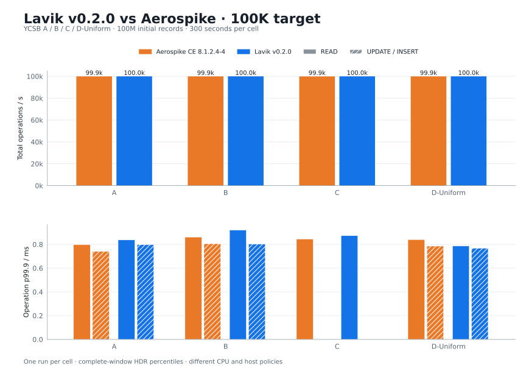
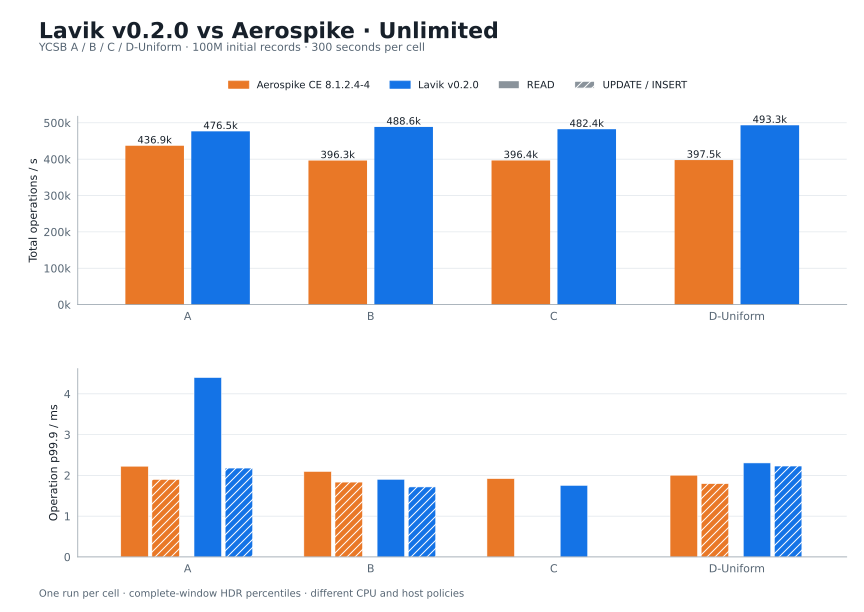

# Lavik v0.2.0 and Aerospike: YCSB throughput and tail latency

**English** | [简体中文](README.zh-CN.md)

The complete **A/B/C/D × 100K/unlimited** matrix was rerun on newly provisioned Azure hosts: **16 formal 300-second windows**. Each database was independently loaded with **100M records of 10 × 128 B fields**. All measured and warmup phases have zero errors.

Measured unlimited total-throughput differences relative to Aerospike: A **+9.06%**, B **+23.30%**, C **+21.67%**, D **+24.08%**.

Throughput and tail latency trade off: Lavik has **higher p99.9 in 4 of seven unlimited operation cells**. The largest relative difference is **A / READ: 4.399 ms versus 2.225 ms (1.98×)**. These are single-window observations.

CPU allocation and host policy differ: Aerospike retains the original host policy, while Lavik uses 12 workers and 4 CPUs for system-task and benchmark-NIC IRQ policy. Operation cells show **operation QPS; p99 / p99.9 (ms)**.

## 100K target



| Workload | Operation | Aerospike | Lavik |
| --- | --- | --- | --- |
| A | Total QPS | 99,916 | 99,959 |
| A | READ | 49,954; 0.700 / 0.797 | 49,974; 0.695 / 0.837 |
| A | UPDATE | 49,962; 0.646 / 0.741 | 49,985; 0.655 / 0.797 |
| B | Total QPS | 99,932 | 99,976 |
| B | READ | 94,931; 0.731 / 0.861 | 94,980; 0.704 / 0.920 |
| B | UPDATE | 5,001; 0.681 / 0.805 | 4,996; 0.674 / 0.803 |
| C | Total QPS | 99,909 | 99,968 |
| C | READ | 99,909; 0.724 / 0.845 | 99,968; 0.745 / 0.873 |
| D-Uniform | Total QPS | 99,934 | 99,973 |
| D-Uniform | READ | 94,937; 0.709 / 0.840 | 94,971; 0.695 / 0.786 |
| D-Uniform | INSERT | 4,997; 0.662 / 0.785 | 5,002; 0.676 / 0.768 |

## Unlimited



| Workload | Operation | Aerospike | Lavik |
| --- | --- | --- | --- |
| A | Total QPS | 436,866 | 476,454 |
| A | READ | 218,424; 1.164 / 2.225 | 238,229; 1.140 / 4.399 |
| A | UPDATE | 218,442; 1.037 / 1.900 | 238,225; 0.903 / 2.179 |
| B | Total QPS | 396,293 | 488,622 |
| B | READ | 376,491; 1.178 / 2.095 | 464,203; 0.895 / 1.902 |
| B | UPDATE | 19,802; 1.061 / 1.835 | 24,418; 0.831 / 1.716 |
| C | Total QPS | 396,447 | 482,358 |
| C | READ | 396,447; 1.105 / 1.919 | 482,358; 0.933 / 1.754 |
| D-Uniform | Total QPS | 397,541 | 493,262 |
| D-Uniform | READ | 377,664; 1.150 / 2.004 | 468,616; 0.928 / 2.305 |
| D-Uniform | INSERT | 19,876; 1.040 / 1.797 | 24,646; 0.865 / 2.229 |

## Environment and method

| Item | Configuration |
| --- | --- |
| Server | Azure Standard_L16aos_v4; Japan East zone 2; AMD EPYC 9V74; 8 physical / 16 logical CPUs; 128 GiB nominal RAM |
| Client | Standard_F32als_v6; Java 17; YCSB pinned to CPUs 0–15 |
| OS | Ubuntu 24.04; Linux 6.17.0-1022-azure on both VMs |
| Storage | 6 × 1,919,850,381,312 B local NVMe; RAID0, 512 KiB chunk; two fully zeroed 1,099,494,850,560 B raw partitions |
| Database | Lavik v0.2.0 standard x86_64; Aerospike CE 8.1.2.4-4 |
| YCSB | eloqdata/YCSB a47bf01c4f197d2ff2eecbbebd9743da5a1cae47; KEYLANE.HREPLACE renamed LAVIK.HREPLACE |
| A / B / C / D | 50% read + 50% update / 95% read + 5% update / 100% read / 95% read + 5% insert |
| Final records | Aerospike 107,563,558; Lavik 108,996,321 |

- Each database loads 100M records once, stops cleanly and recovers before measurement. Eight distributed records with all field hashes are checked across recovery. The initial field payload is 119.21 GiB, excluding keys and metadata.
- Aerospike runs first, then Lavik; workloads run C/A/B/D, 100K then unlimited. Each cell has a separate 1M-operation warmup JVM and a new 256-worker measurement JVM. A non-binding 2B-operation cap lets the 300-second timer end the run. Initial JIT/ramp-up remains included.
- Reads use a uniform distribution. D reads only the original 100M keys; warmup/measured inserts use disjoint 2B/4B (100K) and 6B/8B (unlimited) starting IDs. D changes final dataset sizes according to achieved throughput.
- All ten fields are read and written. Lavik uses HGETALL / LAVIK.HREPLACE / HMSET; Aerospike uses all-bin reads / REPLACE_ONLY / CREATE_ONLY. Both bindings use 10,000 ms timeouts; Aerospike Java client 3.1.2 and Jedis 3.9.0 are unchanged.
- Aerospike changes only required cluster/listener/namespace/replication/device settings. Lavik uses io_uring, shutdown checkpointing, metrics, and the separate 12+4 host policy. Defrag is verified enabled throughout. CPU/IRQ policy is restored after the run.
- Every phase reconciles client success counts, server command counters and record-count deltas. Lavik NIC completion IRQs are checked for zero worker-CPU interrupts during each phase. Exact commands, effective settings, counters and logs are retained.
- QPS is successful operations divided by actual YCSB runtime. Per-operation percentiles come from complete-window ordinary HDR histograms, never averaged interval percentiles. Intended histograms remain in logs. Equal worker counts do not imply equal TCP connection counts.
- One measurement per cell; no confidence intervals. CPU allocation, caches, flushing and persistence differ, and successful responses do not imply equal synchronous durability. This rerun uses Japan East; the historical run used Japan West, so region, host placement and time also differ.

- Aerospike CE 8.1.2.4-4: 2026-10-21T15:00:19Z – 2026-10-21T15:41:22Z (UTC).
- Lavik v0.2.0: 2026-10-21T15:46:26Z – 2026-10-21T16:27:24Z (UTC).

[Point data](https://github.com/eloqdata/lavik-agent/blob/bb061b97e9836281e71c219f21570d742313fb8c/perf_reports/lavik-v0.2.0-aerospike-ycsb-2026-10-21/metadata/results.csv) · [Provenance](https://github.com/eloqdata/lavik-agent/blob/bb061b97e9836281e71c219f21570d742313fb8c/perf_reports/lavik-v0.2.0-aerospike-ycsb-2026-10-21/metadata/provenance.json) · [Validation](https://github.com/eloqdata/lavik-agent/blob/bb061b97e9836281e71c219f21570d742313fb8c/perf_reports/lavik-v0.2.0-aerospike-ycsb-2026-10-21/metadata/validation.json) · [Raw logs and receipts](https://github.com/eloqdata/lavik-agent/tree/bb061b97e9836281e71c219f21570d742313fb8c/perf_reports/lavik-v0.2.0-aerospike-ycsb-2026-10-21)

## Run commands

These Bash commands use the measured settings; adapt paths, addresses and NIC PCI identity to the deployment. Start with two independent, fully zeroed empty raw RAID0 partitions, exposed as `aerospike-device` and `lavik-device`. Run databases sequentially and load each once. Preserve the original host policy for Aerospike, then apply Lavik isolation; restore the original values afterward.

### Aerospike configuration

Save as `/opt/bench020/ycsb/aerospike.conf`:

```conf
# Single-node YCSB device namespace. Performance settings use server defaults.
service {
    cluster-name ycsb-default-20261021
}
logging {
    console {
        context any info
    }
}
network {
    service {
        address 10.96.1.4
        port 3000
    }
    heartbeat {
        address 127.0.0.1
        mode mesh
        port 3002
    }
    fabric {
        address 127.0.0.1
        port 3001
    }
    admin {
        address 127.0.0.1
        port 3003
    }
}
namespace ycsb {
    replication-factor 1
    storage-engine device {
        device /opt/bench020/ycsb/aerospike-device
    }
}
```

### Start the databases

Start Aerospike first. After its complete matrix, stop Aerospike, apply the CPU/IRQ isolation below, then start Lavik. Create the required log and runtime directories before starting.

```bash
sudo mkdir -p /opt/aerospike
sudo cp -a /opt/bench020/aerospike-package/opt/aerospike/usr /opt/aerospike/

sudo systemd-run \
  --unit aerospike-ycsb-default-20261021.service \
  --collect \
  -p TimeoutStopSec=300 \
  -p StandardOutput=append:/opt/bench020/ycsb/aerospike-server.stdout \
  -p StandardError=inherit \
  -p SendSIGKILL=no \
  -p LimitNOFILE=100000 /opt/bench020/aerospike-package/usr/bin/asd \
  --config-file /opt/bench020/ycsb/aerospike.conf \
  --foreground
```

```bash
sudo systemd-run \
  --unit lavik-ycsb-tuned-20261021.service \
  --collect \
  -p TimeoutStopSec=300 \
  -p StandardOutput=append:/opt/bench020/ycsb/hreplace-server.stdout \
  -p StandardError=inherit \
  -p SendSIGKILL=no \
  --slice=lavik-bench.slice \
  -p AllowedCPUs=0-11 \
  -p CPUAffinity=0-11 \
  -p LimitNOFILE=20000 /opt/bench020/downloads/lavik-v0.2.0-linux-x86_64/lavik \
  --bind 10.96.1.4 \
  --port 16379 \
  --metrics-port 19100 \
  --threads 12 \
  --shutdown-checkpoint \
  --data-file /opt/bench020/ycsb/lavik-device \
  --log-dir /opt/bench020/ycsb/lavik-server-logs
```

### Lavik CPU/IRQ isolation

irqbalance was inactive on this host. These commands combine with the service settings above to implement 12+4 isolation.

```bash
# Server, only after Aerospike has stopped; dedicated 16-logical-CPU test host.
sudo systemctl set-property --runtime system.slice AllowedCPUs=12-15
sudo systemctl set-property --runtime user.slice AllowedCPUs=12-15
sudo systemctl set-property --runtime init.scope AllowedCPUs=12-15
printf 'f000\n' | sudo tee /sys/devices/virtual/workqueue/cpumask

# This PCI identity must match the benchmark NIC on the current boot.
sudo python3 - <<'PYCODE'
from pathlib import Path
import os
vfs = list(Path('/sys/class/net/eth1').glob('lower_*'))
assert len(vfs) == 1
pci = (vfs[0].resolve() / 'device').resolve().name
irqs = [line.split(':', 1)[0].strip()
        for line in Path('/proc/interrupts').read_text().splitlines() if pci in line]
assert len(irqs) == 17, irqs
for i, irq in enumerate(irqs):
    Path('/proc/irq', irq, 'smp_affinity_list').write_text(str(12 + i % 4) + '\n')
# Migrate existing userspace threads; leave kernel threads to their own policy.
for stat in Path('/proc').glob('[0-9]*/task/[0-9]*/stat'):
    try:
        raw = stat.read_text()
        comm = raw[raw.index('(')+1:raw.rindex(')')]
        flags = int(raw[raw.rindex(')')+2:].split()[6])
        if flags & 0x04000000 or comm.startswith('kworker/'):
            continue
        os.sched_setaffinity(int(stat.parent.name), {12, 13, 14, 15})
    except (OSError, ProcessLookupError):
        pass
PYCODE
```

### YCSB load, warmup and measurement

```bash
# On the client: Java 17 and the custom YCSB distribution are installed.
# Run the complete load/recovery/matrix for Aerospike first, then for Lavik.
DB=aerospike                       # use DB=lavik for the second database
if [ "$DB" = aerospike ]; then
  YCSB_ROOT=/opt/bench020/ycsb-aerospike-dist
  BINDING=aerospike
  DB_ARGS=(-p as.host=10.96.1.4 -p as.port=3000 -p as.namespace=ycsb -p as.timeout=10000)
else
  YCSB_ROOT=/opt/bench020/ycsb-redis-dist
  BINDING=redis
  DB_ARGS=(-p redis.host=10.96.1.4 -p redis.port=16379 -p redis.scanindex=none
           -p redis.timeout=10000 -p redis.cluster=false)
fi
mkdir -p results
COMMON=(-s -threads 256 -P "$YCSB_ROOT/workloads/workloada"
  -p fieldcount=10 -p fieldlength=128 -p fieldlengthdistribution=constant
  -p readallfields=true -p writeallfields=true -p insertorder=hashed
  -p measurementtype=hdrhistogram -p measurement.interval=both
  -p hdrhistogram.percentiles=50,95,99,99.9,99.99 -p status.interval=10)

# Fresh load: run once on an empty database.
taskset -c 0-15 /usr/bin/python3 "$YCSB_ROOT/bin/ycsb" load "$BINDING" "${COMMON[@]}" "${DB_ARGS[@]}" \
  -p recordcount=100000000 -p insertstart=0 -p insertcount=100000000 \
  > "results/$DB-load.log" 2>&1
```

After loading, verify exactly 100,000,000 successful INSERTs, server record counts and field lengths. Stop cleanly, restart with the same launch command, and confirm recovered samples before running the matrix below. Stop with `sudo systemctl stop aerospike-ycsb-default-20261021.service` or `sudo systemctl stop lavik-ycsb-tuned-20261021.service`; do not recreate or zero the partitions. Wait until all 4096 Aerospike master partitions are ready, or Lavik recovery is complete with the expected DBSIZE.

```bash
# Run after load/recovery verification; retain this client shell's variables.
if [ "$DB" = lavik ]; then
  DB_ARGS+=(-p redis.updatecommand=lavik.hreplace)
fi
for workload in C A B D; do
  case "$workload" in
    A) READ=0.5;  UPDATE=0.5;  INSERT=0 ;;
    B) READ=0.95; UPDATE=0.05; INSERT=0 ;;
    C) READ=1;    UPDATE=0;    INSERT=0 ;;
    D) READ=0.95; UPDATE=0;    INSERT=0.05 ;;
  esac
  for target in 100000 0; do
    RATE=()
    if [ "$target" -gt 0 ]; then RATE=(-target "$target"); fi
    for phase in warmup measured; do
      LIMIT=(-p operationcount=1000000)
      if [ "$phase" = measured ]; then
        LIMIT=(-p operationcount=2000000000 -p maxexecutiontime=300)
      fi
      RECORDS=(-p recordcount=100000000)
      if [ "$workload" = D ]; then
        if [ "$target" -gt 0 ]; then start=2000000000; else start=6000000000; fi
        if [ "$phase" = measured ]; then start=$((start + 2000000000)); fi
        RECORDS=(-p "recordcount=$start" -p insertstart=0 -p insertcount=100000000)
      fi
      taskset -c 0-15 /usr/bin/python3 "$YCSB_ROOT/bin/ycsb" run "$BINDING" \
        "${COMMON[@]}" "${DB_ARGS[@]}" "${RATE[@]}" "${LIMIT[@]}" "${RECORDS[@]}" \
        -p requestdistribution=uniform -p "readproportion=$READ" \
        -p "updateproportion=$UPDATE" -p "insertproportion=$INSERT" \
        -p scanproportion=0 -p readmodifywriteproportion=0 \
        > "results/$DB-$workload-$target-$phase.log" 2>&1
    done
  done
done
```
