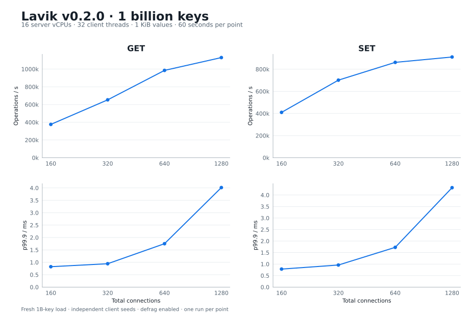

# Lavik v0.2.0：1B key，32 个客户端线程

[English](README.md) | **简体中文**

在新建 Azure 16 vCPU 服务器上独立装载 **10 亿条 key × 1 KiB value**，使用 **32 个 memtier 线程（客户端 CPU 0–31）** 测量 **160/320/640/1280 总连接**。共 **8 个正式点**，全部零连接错误，GET 零未命中。只报告 1B 数据集，不包含 10M 基准或容量保留率。

GET / SET 实测峰值为 **1,129,597 / 910,356 ops/s**，分别出现在 **1280 / 1280 总连接**。

UTC: 2026-10-21T16:55:31.378000+00:00 – 2026-10-21T17:03:39.576000+00:00.



| Command | Connections | Client threads | Ops/s | p50 ms | p99 ms | p99.9 ms | p99.99 ms |
| --- | --- | --- | --- | --- | --- | --- | --- |
| GET | 160 | 32 | 375,966 | 0.423 | 0.743 | 0.823 | 0.927 |
| GET | 320 | 32 | 652,881 | 0.495 | 0.815 | 0.943 | 1.471 |
| GET | 640 | 32 | 985,019 | 0.631 | 1.247 | 1.751 | 3.743 |
| GET | 1280 | 32 | 1,129,597 | 1.095 | 2.159 | 4.015 | 8.575 |
| SET | 160 | 32 | 409,886 | 0.391 | 0.687 | 0.783 | 1.055 |
| SET | 320 | 32 | 701,241 | 0.447 | 0.815 | 0.959 | 1.519 |
| SET | 640 | 32 | 861,911 | 0.735 | 1.271 | 1.727 | 3.839 |
| SET | 1280 | 32 | 910,356 | 1.391 | 2.239 | 4.319 | 8.575 |

## 环境与方法

| Item | Configuration |
| --- | --- |
| Server | Standard_L16aos_v4; Japan East zone 2; AMD EPYC 9V74; 8 physical cores / 16 vCPUs; 128 GiB nominal RAM |
| Client | Standard_F32als_v6; 32 physical CPUs; memtier 2.5.1; 32 threads pinned to CPUs 0–31 |
| OS | Ubuntu 24.04; Linux 6.17.0-1022-azure on both VMs |
| Storage | 6 × 1,919,850,381,312-byte dedicated NVMe; SPDK/VFIO; 8 GiB EAL/hugepage reservation |
| Network | Private VNet; kernel TCP; accelerated networking |
| Lavik | Official standard x86_64 v0.2.0; 2908f86f2770e9c6e8acc6585b3bedb4b44d1cd5 |

- key 为十进制 1..1,000,000,000，无前缀、无 TTL，value 为 1,024 字节。逻辑 value 净载荷为 953.67 GiB，不含 key、索引与存储开销。
- 从空盘顺序装载精确 10 亿次 SET，使用 32 线程、640 总连接。正式扫描使用独立客户端随机种子、全范围均匀随机 GET 或覆盖 SET、pipeline 1，每点 60 秒。先 GET 后 SET，连接数递增；不额外预热 GET。
- Lavik 使用 16 个服务端 worker、SPDK、停机 checkpoint、tomb-raider interval 0、SPDK completion cap 16，其余继承已核验默认值。每点前后检查 defrag 保持启用；扫描前后核验精确 DBSIZE 与五个 value 长度。
- 每格仅测一次，不给置信区间；吞吐和分位数来自完整窗口。这八个点会复用于存储引擎对比报告，不算作独立重复测量。
- 历史报告使用 16 个客户端线程并包含 80 连接；本次改为 32 线程且取消该档。区域也由 Japan West 改为 Japan East。

装载客户端调用耗时 **21.6 分钟**，memtier 装载吞吐 **940,654 ops/s**。正式点最大平均客户端 CPU 使用 **17.971 核**，最大单线程平均 **0.579 核**，包围测量窗口内服务端 CPU steal 最大 **0.0000%**。

[Point data](results.csv) · [Provenance](provenance.json) · [Validation](validation.json) · [原始日志与测量凭据](raw-results.tar.gz)

## 复现命令

按 [SPDK 操作指南](../../docs/operations/spdk-storage.md) 核验六块专用测试盘、准备 VFIO 与 8 GiB 大页。仅在空的测试介质上装载；启动后等待 PING，检查 defrag-paused 为 no。测量完成后干净停机，并按指南恢复内核驱动和大页预留。

```bash
sudo prlimit --memlock=unlimited:unlimited --nofile=65535:65535 env \
  BYCORF_EAL_ARGS='-a 7133:00:00.0 -a 10fc:00:00.0 -a 9c4a:00:00.0 -a ef09:00:00.0 -a fa44:00:00.0 -a 9816:00:00.0' \
  BYCORF_DPDK_MEMORY_MB=8192 \
  taskset -c 0-15 /opt/bench020/downloads/lavik-v0.2.0-linux-x86_64/lavik \
  --storage=spdk --bind=10.96.1.4 --shutdown-checkpoint \
  --tomb-raider-interval-ms=0 --spdk-max-completions-per-poll=16 \
  --log-dir=/opt/bench020/results/large/storage/lavik-1b/logs \
  --data-file=spdk://7133:00:00.0/1 \
  --data-file=spdk://10fc:00:00.0/1 \
  --data-file=spdk://9c4a:00:00.0/1 \
  --data-file=spdk://ef09:00:00.0/1 \
  --data-file=spdk://fa44:00:00.0/1 \
  --data-file=spdk://9816:00:00.0/1
```

在独立客户端运行：

```bash
SERVER=10.96.1.4
mkdir -p results
ulimit -n 65535
COMMON=(--server="$SERVER" --threads=32 --key-minimum=1
  --key-maximum=1000000000 --key-prefix= --data-size=1024
  --hide-histogram --print-percentiles=50,99,99.9,99.99 --show-config)
# 32 threads × 20 connections × 1,562,500 requests = 1,000,000,000 SETs.
taskset -c 0-31 memtier_benchmark "${COMMON[@]}" --clients=20 \
  --requests=1562500 --ratio=1:0 --key-pattern=P:P --json-out-file=results/fill.json
redis-cli -h "$SERVER" --raw DBSIZE
for key in 1 2 500000000 999999999 1000000000; do
  test "$(redis-cli -h "$SERVER" --raw STRLEN "$key")" = 1024
done
# No additional GET warmup for Lavik 1B.
for op in GET SET; do
  COMMAND=(--command='GET __key__' --command-is-read)
  if [[ "$op" == SET ]]; then COMMAND=(--command='SET __key__ __data__'); fi
  for connections in 160 320 640 1280; do
    redis-cli -h "$SERVER" CONFIG GET defrag-paused
    taskset -c 0-31 memtier_benchmark "${COMMON[@]}" \
      --clients="$((connections / 32))" --test-time=60 --distinct-client-seed \
      "${COMMAND[@]}" --json-out-file="results/$op-c$connections.json" \
      > "results/$op-c$connections.txt" 2>&1
    redis-cli -h "$SERVER" CONFIG GET defrag-paused
  done
done
redis-cli -h "$SERVER" --raw DBSIZE
```
