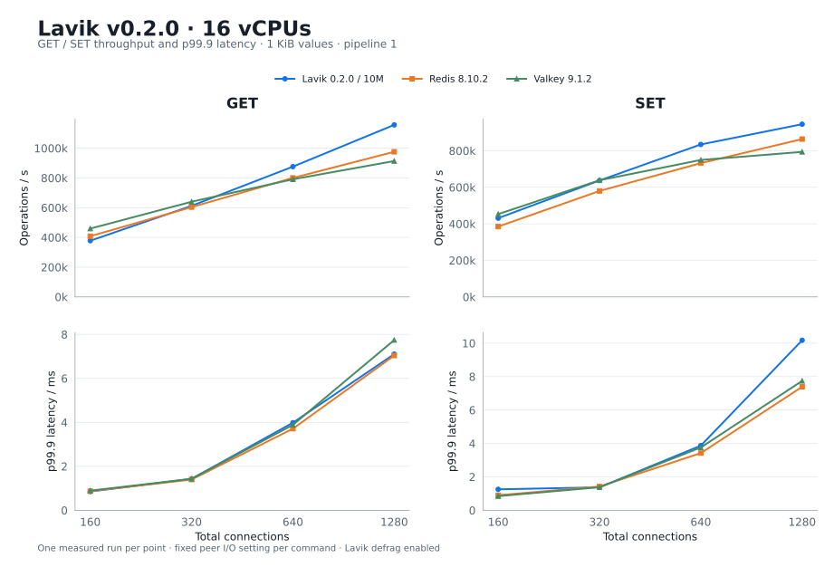
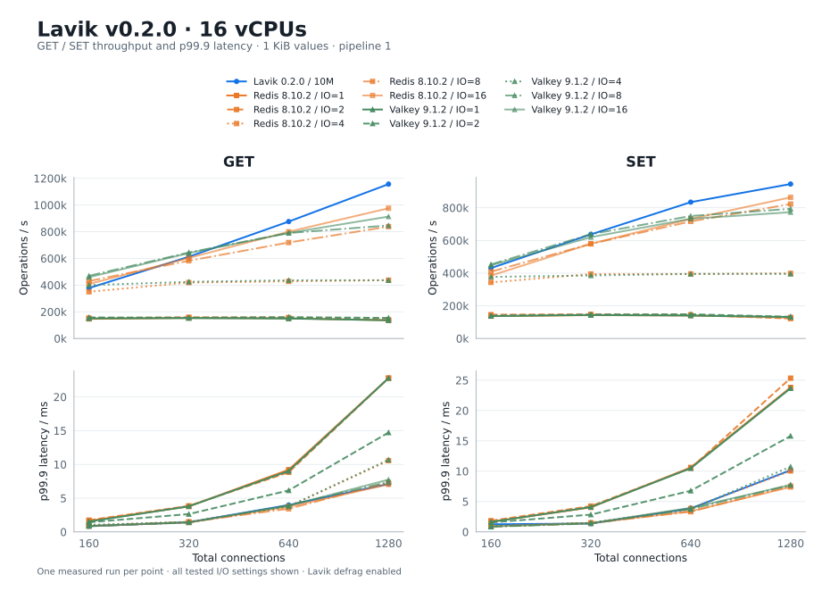

# Lavik v0.2.0 on 16 vCPUs: 10M-key Redis / Valkey comparison

**English** | [简体中文](README.zh-CN.md)

Retains **88 formal points from the 10M-key suite**: Lavik, Redis and Valkey at 160/320/640/1280 total connections; only the 80-connection points are excluded. Values are 1 KiB, totaling 9.54 GiB logical value payload. This 10M suite uses **16 memtier threads on client CPUs 0–15**; the 32-thread 1B test is in its [separate report](../lavik-v0.2.0-spdk-1b-2026-10-21/README.md).

UTC: 2026-10-21T13:01:41.211000+00:00 – 2026-10-21T14:41:58.874000+00:00.

This restoration uses the saved measurements without a new benchmark run. The original sweep included 80 connections; the charts, tables, CSV and formal measurement reproduction loop in this report exclude that count.

## Throughput and p99.9 latency



For each command and product, the main chart uses the fixed I/O-thread setting with the highest throughput among retained points, holding that setting across the sweep. Peaks and configuration selections were recomputed after excluding 80 connections.

| Command | Product | Workers / I/O threads | Connections | Peak ops/s | p99.9 ms |
| --- | --- | --- | --- | --- | --- |
| GET | Lavik 0.2.0 / 10M | 16 | 1280 | 1,156,956 | 7.103 |
| GET | Redis 8.10.2 | 16 | 1280 | 976,087 | 7.039 |
| GET | Valkey 9.1.2 | 16 | 1280 | 913,756 | 7.743 |
| SET | Lavik 0.2.0 / 10M | 16 | 1280 | 945,384 | 10.175 |
| SET | Redis 8.10.2 | 16 | 1280 | 863,860 | 7.391 |
| SET | Valkey 9.1.2 | 8 | 1280 | 793,809 | 7.743 |

Matched-concurrency **ops/s / p99.9 ms**:

| Command | Connections | Lavik 0.2.0 / 10M | Redis 8.10.2 | Valkey 9.1.2 |
| --- | --- | --- | --- | --- |
| GET | 160 | 377,857 / 0.855 | 408,159 / 0.871 | 459,449 / 0.895 |
| GET | 320 | 612,513 / 1.431 | 603,866 / 1.399 | 640,091 / 1.431 |
| GET | 640 | 876,217 / 3.983 | 800,217 / 3.711 | 791,161 / 3.887 |
| GET | 1280 | 1,156,956 / 7.103 | 976,087 / 7.039 | 913,756 / 7.743 |
| SET | 160 | 431,054 / 1.255 | 384,939 / 0.903 | 453,171 / 0.847 |
| SET | 320 | 637,287 / 1.375 | 579,902 / 1.423 | 638,517 / 1.383 |
| SET | 640 | 834,508 / 3.871 | 732,342 / 3.423 | 749,664 / 3.759 |
| SET | 1280 | 945,384 / 10.175 | 863,860 / 7.391 | 793,809 / 7.743 |

## Complete I/O-thread sweep



| Product | I/O threads | GET peak ops/s (connections) | SET peak ops/s (connections) |
| --- | --- | --- | --- |
| Redis 8.10.2 | 1 | 154,244 (320) | 142,910 (320) |
| Redis 8.10.2 | 2 | 158,908 (320) | 147,806 (320) |
| Redis 8.10.2 | 4 | 437,073 (1280) | 398,372 (1280) |
| Redis 8.10.2 | 8 | 838,330 (1280) | 822,820 (1280) |
| Redis 8.10.2 | 16 | 976,087 (1280) | 863,860 (1280) |
| Valkey 9.1.2 | 1 | 152,804 (320) | 143,996 (320) |
| Valkey 9.1.2 | 2 | 159,958 (640) | 148,287 (640) |
| Valkey 9.1.2 | 4 | 436,332 (640) | 395,389 (1280) |
| Valkey 9.1.2 | 8 | 846,926 (1280) | 793,809 (1280) |
| Valkey 9.1.2 | 16 | 913,756 (1280) | 773,060 (1280) |

## Versions and hardware

| Item | Configuration |
| --- | --- |
| Server | Standard_L16aos_v4; 16 vCPU (8 physical cores) / 128 GiB nominal RAM; AMD EPYC 9V74 80-Core Processor |
| Client | Standard_F32als_v6; separate VM; CPUs 0–15 |
| Region | Japan East, zone 2 |
| OS | Ubuntu 24.04; Linux 6.17.0-1022-azure on both hosts |
| Storage | 6 × 1,919,850,381,312-byte dedicated local NVMe; SPDK/VFIO |
| Network | Kernel TCP; same VNet and availability zone; accelerated networking |
| Lavik | Official standard x86_64 v0.2.0 package; 2908f86f2770e9c6e8acc6585b3bedb4b44d1cd5 |

## Test method

- Fresh decimal keys `1..N`, no prefix, 1,024-byte values, no TTL. Independently load 10M keys for each product.
- memtier 2.5.1 on 16 pinned client CPUs, pipeline 1, uniform random GET or overwriting SET. Retained connections: 160, 320, 640, 1280. One 30-second run per point, keeping the original default client seeds.
- Ten-second GET warmup per configuration. GET precedes SET and concurrency increases within each sweep. Products run sequentially on the same server; builds finish before measurement.
- Lavik uses 16 workers and dedicated NVMe via SPDK. Overrides: `--tomb-raider-interval-ms=0`, `--spdk-max-completions-per-poll=16`, and 8 GiB EAL/hugepage memory. Defrag remains enabled and is checked around every point.
- Redis 8.10.2 and Valkey 9.1.2 use the same releases as the v0.1.0 report, default optimized builds with jemalloc, and I/O threads 1, 2, 4, 8, 16. `save ""` disables scheduled snapshots; AOF remains disabled. A manual SAVE after initial fill provides the unchanged RDB baseline for each I/O setting; measured writes are memory-only.
- THP is `never`, overcommit is 1, no added cgroup memory cap. Exact DBSIZE and five value lengths are verified before/after configurations. Fill operation counts, zero GET misses, connection errors, versions and CPU affinity are checked.

## Memory and client diagnostics

| Product | Max average client CPU / cores | Max thread average / cores | Max server steal / % | INFO used_memory / MiB | Process RSS / MiB |
| --- | --- | --- | --- | --- | --- |
| Lavik 0.2.0 / 10M | 15.066 | 0.948 | 0.0000 | 716.6–716.6 | 1,486.1–1,499.8 |
| Redis 8.10.2 | 13.187 | 0.840 | 0.0000 | 12,677.9–12,681.3 | 12,797.9–12,877.8 |
| Valkey 9.1.2 | 12.515 | 0.801 | 0.0000 | 12,654.7–12,655.8 | 12,773.3–13,065.9 |

Some points approach the client CPU budget; observed peaks do not establish a server-capacity ceiling.

## Evidence and measurement limits

[Complete point data](results.csv) · [Version, hardware and validation provenance](provenance.json)

Each point has one measured run; no confidence interval is claimed. Successful responses do not imply equal synchronous durability guarantees. New hosts can differ from the historical run in physical placement, network latency and timing. [Raw logs and receipts](raw-results.tar.gz) includes a per-file SHA-256 manifest; its archive hash is recorded in provenance.

This large-host rerun uses Japan East; the historical v0.1.0 run used Japan West.

[Validation](validation.json)

## Run commands

These Bash commands use the measured settings; adapt paths, addresses and PCI identities to the deployment. Run one database and one load generator at a time. Use a separate result directory for each configuration.

### Lavik SPDK

Follow the [SPDK storage guide](../../docs/operations/spdk-storage.md) to verify six dedicated scratch NVMe devices and prepare VFIO and 8 GiB hugepages. Load the 10M dataset on empty media; do not overwrite system disks or existing application data. After a clean Lavik stop, restore kernel drivers and hugepage reservations before testing the memory databases. The 10M launch command is:

```bash
sudo prlimit --memlock=unlimited:unlimited --nofile=65535:65535 env 'BYCORF_EAL_ARGS=-a 7133:00:00.0 -a 10fc:00:00.0 -a 9c4a:00:00.0 -a ef09:00:00.0 -a fa44:00:00.0 -a 9816:00:00.0' BYCORF_DPDK_MEMORY_MB=8192 taskset \
  -c 0-15 /opt/bench020/downloads/lavik-v0.2.0-linux-x86_64/lavik \
  --storage=spdk \
  --bind=10.96.1.4 \
  --tomb-raider-interval-ms=0 \
  --spdk-max-completions-per-poll=16 \
  --log-dir=/opt/bench020/results/large/memory/lavik-10m/logs \
  --data-file=spdk://7133:00:00.0/1 \
  --data-file=spdk://10fc:00:00.0/1 \
  --data-file=spdk://9c4a:00:00.0/1 \
  --data-file=spdk://ef09:00:00.0/1 \
  --data-file=spdk://fa44:00:00.0/1 \
  --data-file=spdk://9816:00:00.0/1
```

Wait for startup and background initialization, then check that `CONFIG GET defrag-paused` returns `no`; repeat this check before and after each measured point.

### Redis / Valkey

Build with jemalloc 5.3.0 using `make -j12 BUILD_TLS=no`. Redis 8.10.2 uses commit `498ecd0d6d007db11ddb3aea9428552598a78622`; Valkey 9.1.2 uses `7f1dffedff6de73058b2c2a389422b6ecd56c8fb`. Use 16 I/O threads for the initial fill.

```bash
# On the server; start one product/configuration at a time.
PRODUCT=redis # redis or valkey
IO_THREADS=16 # tested: 1, 2, 4, 8, 16
IO_ARGS=(); if ((IO_THREADS > 1)); then IO_ARGS=(--io-threads "$IO_THREADS"); fi
DATA_DIR=/opt/bench020/results/large/data/$PRODUCT
mkdir -p "$DATA_DIR"
ulimit -n 65535
taskset -c 0-15 "/opt/bench020/bin/$PRODUCT-server" \
  --bind 10.96.1.4 --protected-mode no \
  --dir "$DATA_DIR" --save "" \
    "${IO_ARGS[@]}"
```

### Load, warmup and connection sweep

```bash
# On the client: memtier_benchmark 2.5.1.
KEYS=10000000
SECONDS_PER_POINT=30
SEED=()
mkdir -p results
ulimit -n 65535
COMMON=(--server=10.96.1.4
  --threads=16 --key-minimum=1 --key-maximum="$KEYS"
  --key-prefix= --data-size=1024 --hide-histogram
  --print-percentiles=50,99,99.9,99.99 --show-config)

# Once per fresh dataset; each key is written once across 640 clients.
taskset -c 0-15 memtier_benchmark "${COMMON[@]}" --clients=40 \
  --json-out-file=results/fill.json --requests="$((KEYS / 640))" \
  --ratio=1:0 --key-pattern=P:P
redis-cli -h 10.96.1.4 --raw DBSIZE
redis-cli -h 10.96.1.4 STRLEN 1
```

For Redis/Valkey, run the baseline commands below after the initial fill. Restart in turn with 1, 2, 4, 8 and 16 I/O threads; wait for RDB loading and DBSIZE=10000000, verify persistence settings, then run the warmup and measurement block. End each configuration with `SHUTDOWN NOSAVE` so the same `dump.rdb` remains unchanged. Do not refill or run SAVE during measurement. Skip these RDB baseline commands for Lavik.

```bash
redis-cli -h 10.96.1.4 SAVE
redis-cli -h 10.96.1.4 SHUTDOWN NOSAVE
# On the server, record/check the unchanged RDB baseline hash:
sha256sum "$DATA_DIR/dump.rdb"
# After each restart, run these checks from the client:
redis-cli -h 10.96.1.4 CONFIG GET save
redis-cli -h 10.96.1.4 CONFIG GET appendonly
redis-cli -h 10.96.1.4 INFO persistence
```

```bash
# Run once for Lavik 10M and once per Redis/Valkey I/O-thread configuration.
if [ "$KEYS" -eq 10000000 ]; then
  taskset -c 0-15 memtier_benchmark "${COMMON[@]}" --clients=40 \
    --json-out-file=results/warmup.json --test-time=10 \
    --command='GET __key__' --command-is-read
fi
for OP in GET SET; do
  COMMAND=(--command='GET __key__' --command-is-read)
  if [ "$OP" = SET ]; then
    COMMAND=(--command='SET __key__ __data__' )
  fi
  for CONNECTIONS in 160 320 640 1280; do
    taskset -c 0-15 memtier_benchmark "${COMMON[@]}" \
      --clients="$((CONNECTIONS / 16))" \
      --json-out-file="results/$OP-c$CONNECTIONS.json" \
      --test-time="$SECONDS_PER_POINT" "${COMMAND[@]}" "${SEED[@]}" \
      > "results/$OP-c$CONNECTIONS.txt" 2>&1
  done
done
redis-cli -h 10.96.1.4 --raw DBSIZE
```
