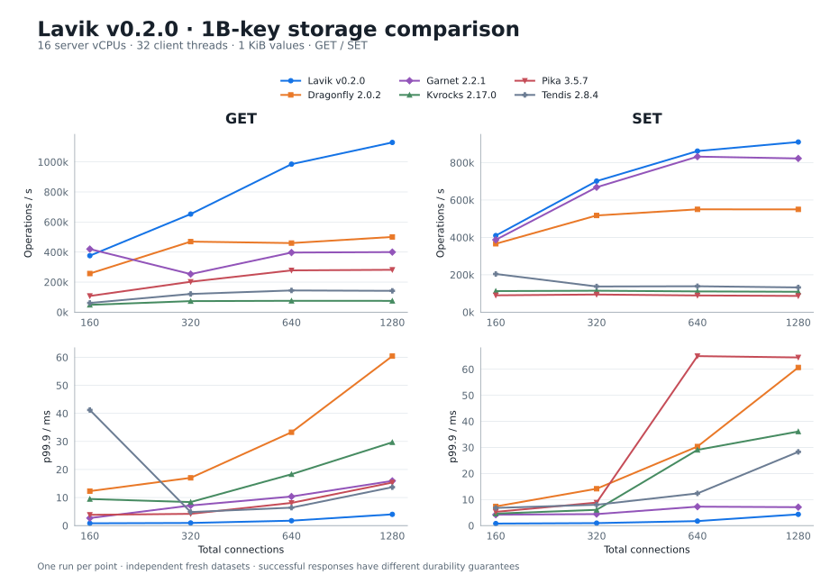

# Lavik v0.2.0：1TB 数据与 Redis 兼容存储系统对比

[English](README.md) | **简体中文**

在新建 Azure Standard_L16aos_v4 上重新测量 Lavik、Dragonfly、Garnet、Kvrocks、Pika、Tendis。每种产品独立装载 **10 亿条 key × 1 KiB value（953.67 GiB 逻辑 value 净载荷）**，完成 **48 个正式测量点**。Lavik 的八个点与同批[内存数据库对比报告](../lavik-v0.2.0-vs-memory-databases-2026-10-21/README.zh-CN.md)共用，其余五种数据库重新独立装载、测量。

UTC: 2026-10-21T16:55:31.378000+00:00 – 2026-10-22T01:26:24.735000+00:00.

本轮 Lavik 的 GET、SET 扫描峰值均最高，但 160 连接时 Garnet 的 GET 吞吐更高（419,982 对 375,966 ops/s）。在全部相同连接数的 GET/SET 点上，Lavik 的 p99.9 均最低；160 连接 GET 为 0.823 ms，Garnet 为 2.687 ms。上述结论仅描述本轮单次测量及所列配置。

## 吞吐与 p99.9 延迟



| Command | Product | Peak connections | Peak ops/s | p99.9 ms |
| --- | --- | --- | --- | --- |
| GET | Lavik v0.2.0 | 1280 | 1,129,597 | 4.015 |
| GET | Dragonfly 2.0.2 | 1280 | 500,682 | 60.415 |
| GET | Garnet 2.2.1 | 160 | 419,982 | 2.687 |
| GET | Kvrocks 2.17.0 | 640 | 75,639 | 18.303 |
| GET | Pika 3.5.7 | 1280 | 281,975 | 15.359 |
| GET | Tendis 2.8.4 | 640 | 144,571 | 6.399 |
| SET | Lavik v0.2.0 | 1280 | 910,356 | 4.319 |
| SET | Dragonfly 2.0.2 | 640 | 550,147 | 30.335 |
| SET | Garnet 2.2.1 | 640 | 832,135 | 7.263 |
| SET | Kvrocks 2.17.0 | 320 | 114,683 | 6.047 |
| SET | Pika 3.5.7 | 320 | 94,438 | 8.831 |
| SET | Tendis 2.8.4 | 160 | 204,258 | 6.783 |

峰值可能来自不同连接数；以下为相同连接数的 **ops/s / p99.9 ms**。

| Command | Connections | Lavik v0.2.0 | Dragonfly 2.0.2 | Garnet 2.2.1 | Kvrocks 2.17.0 | Pika 3.5.7 | Tendis 2.8.4 |
| --- | --- | --- | --- | --- | --- | --- | --- |
| GET | 160 | 375,966 / 0.823 | 257,252 / 12.287 | 419,982 / 2.687 | 48,895 / 9.471 | 107,938 / 3.839 | 61,462 / 41.215 |
| GET | 320 | 652,881 / 0.943 | 469,604 / 17.023 | 253,433 / 7.167 | 73,587 / 8.383 | 202,391 / 4.191 | 121,240 / 4.831 |
| GET | 640 | 985,019 / 1.751 | 459,905 / 33.279 | 396,838 / 10.367 | 75,639 / 18.303 | 278,178 / 8.095 | 144,571 / 6.399 |
| GET | 1280 | 1,129,597 / 4.015 | 500,682 / 60.415 | 399,895 / 15.935 | 75,255 / 29.695 | 281,975 / 15.359 | 141,987 / 13.695 |
| SET | 160 | 409,886 / 0.783 | 366,038 / 7.359 | 387,296 / 4.191 | 112,843 / 4.607 | 90,218 / 5.279 | 204,258 / 6.783 |
| SET | 320 | 701,241 / 0.959 | 517,357 / 14.143 | 668,406 / 4.415 | 114,683 / 6.047 | 94,438 / 8.831 | 137,471 / 7.999 |
| SET | 640 | 861,911 / 1.727 | 550,147 / 30.335 | 832,135 / 7.263 | 111,034 / 29.055 | 89,450 / 65.023 | 138,691 / 12.351 |
| SET | 1280 | 910,356 / 4.319 | 549,937 / 60.671 | 822,427 / 7.071 | 109,065 / 36.095 | 86,950 / 64.511 | 132,374 / 28.287 |

## 客户端与内存诊断

| Product | Max average client CPU / cores | Max thread average / cores | Post-point RSS / MiB | Max server steal / % |
| --- | --- | --- | --- | --- |
| Lavik v0.2.0 | 17.971 | 0.579 | 47,998–48,012 | 0.0000 |
| Dragonfly 2.0.2 | 12.166 | 0.450 | 86,260–95,177 | 0.0000 |
| Garnet 2.2.1 | 15.661 | 0.511 | 115,481–115,830 | 0.0000 |
| Kvrocks 2.17.0 | 2.598 | 0.134 | 35,740–50,235 | 0.0000 |
| Pika 3.5.7 | 6.455 | 0.349 | 34,770–58,832 | 0.0000 |
| Tendis 2.8.4 | 4.456 | 0.164 | 45,683–79,879 | 0.0000 |

客户端预算为 32 个 CPU；RSS 为正式点之后的进程快照范围，Lavik 另有 8 GiB 大页预留。

## 环境、配置与方法

| Item | Configuration |
| --- | --- |
| Server | Standard_L16aos_v4; Japan East zone 2; AMD EPYC 9V74; 8 physical / 16 logical CPUs; 128 GiB nominal RAM |
| Client | Standard_F32als_v6; memtier 2.5.1; 32 threads on CPUs 0–31 |
| OS | Ubuntu 24.04; Linux 6.17.0-1022-azure on both hosts |
| Storage | 6 × 1,919,850,381,312 B local NVMe; Lavik SPDK; peers RAID0/XFS/noatime |
| Network | Private VNet; kernel TCP; accelerated networking; data address 10.96.1.4 |
| Workload | Decimal keys 1..1,000,000,000; 1,024-byte values; random GET or overwriting SET; independent client seeds |
| Window | 60 seconds per point; 32 client threads; 160 / 320 / 640 / 1280 connections |

各产品在同一服务器串行运行，分别独立装载数据。先 GET、后 SET，每组按连接数递增测量。Dragonfly 和 Garnet 额外用 32 个客户端线程、160 连接预热 GET 180 秒；其他产品沿用原方法，不额外预热。所有构建在测量前完成。正式点均零连接错误，正式 GET 均零未命中；每次装载完成精确 10 亿次 SET，扫描前后抽样检查 value 长度。

Lavik defrag 全程启用；Garnet 使用 Lookup compaction，RocksDB 自动压缩保持启用。配置内存预算不同：Dragonfly 96 GiB；Garnet 64 GiB log、32 GiB read cache、16 GiB index；Kvrocks 80 GiB block cache；Pika 24 GiB block cache 与 32 GiB 应用缓存；Tendis 72 GiB 共享缓存。这些是预算，不是实测总 RSS。

持久化路径不同：Lavik 使用 SPDK 存储；Dragonfly 使用分层文件，不做周期快照；Garnet 使用 storage log，不启用 AOF；Kvrocks、Tendis 关闭 WAL，Pika 关闭 binlog。成功响应不代表相同同步持久性。每点只测一次，不给置信区间。历史 1B 测试使用 16 个客户端线程并包含 80 连接；本次使用 32 线程、四档连接数，Dragonfly/Garnet 额外预热也改为 32 线程、160 连接；本次在 Japan East、旧测试在 Japan West。

对比产品版本与 0.1.0 报告一致：Dragonfly 2.0.2、Garnet 2.2.1（.NET 10.0.12）、Kvrocks 2.17.0、Pika 3.5.7、Tendis 2.8.4-rocksdb-v8.5.3。Pika 官方包内嵌版本显示 3.5.6，revision 为 `62a57f85534198e0d1033c32f1215c958bef8a5e`。

## 装载记录

| Product | Client invocation wall time / min | Reported fill ops/s |
| --- | --- | --- |
| Lavik v0.2.0 | 21.6 | 940,654 |
| Dragonfly 2.0.2 | 24.4 | 820,369 |
| Garnet 2.2.1 | 25.3 | 798,058 |
| Kvrocks 2.17.0 | 112.8 | 163,321 |
| Pika 3.5.7 | 208.5 | 82,423 |
| Tendis 2.8.4 | 82.6 | 209,462 |

[All points](https://github.com/eloqdata/lavik-agent/blob/bb061b97e9836281e71c219f21570d742313fb8c/perf_reports/lavik-v0.2.0-storage-peers-1tb-2026-10-21/metadata/results.csv) · [Provenance](https://github.com/eloqdata/lavik-agent/blob/bb061b97e9836281e71c219f21570d742313fb8c/perf_reports/lavik-v0.2.0-storage-peers-1tb-2026-10-21/metadata/provenance.json) · [Validation](https://github.com/eloqdata/lavik-agent/blob/bb061b97e9836281e71c219f21570d742313fb8c/perf_reports/lavik-v0.2.0-storage-peers-1tb-2026-10-21/metadata/validation.json) · [原始日志与测量凭据](https://github.com/eloqdata/lavik-agent/tree/bb061b97e9836281e71c219f21570d742313fb8c/perf_reports/lavik-v0.2.0-storage-peers-1tb-2026-10-21)

装载墙钟耗时包含连接建立、客户端统计汇总及结果回传。

## 运行命令

以下使用 Bash，按实际环境替换地址和安装路径。安装上述发布包及 memtier 2.5.1。每次只运行一个数据库，启动命令保持前台运行，干净停止后再启动下一个。文件系统步骤只使用经过核验的六块空临时盘。Lavik 独立灌入前，按 [SPDK 存储指南](../../docs/operations/spdk-storage.md)准备专用设备和 8 GiB hugepages。

配置块仅包含相对测试版本配置模板的覆盖项。分别保存为注释指定的 `.overrides` 文件，再执行覆盖脚本；各系统使用同一套客户端负载。

### Storage and paths

```bash
# Filesystem peers: six verified, empty local NVMe devices, kernel driver bound.
# These names are placeholders: replace each with a verified scratch device.
DEVICES=(/dev/TEST_NVME1 /dev/TEST_NVME2 /dev/TEST_NVME3
         /dev/TEST_NVME4 /dev/TEST_NVME5 /dev/TEST_NVME6)
sudo mdadm --create /dev/md/bench --level=0 --raid-devices=6 "${DEVICES[@]}"
sudo mkfs.xfs /dev/md/bench
sudo mkdir -p /mnt/bench020
sudo mount -o noatime /dev/md/bench /mnt/bench020
sudo mkdir -p /mnt/bench020/{dragonfly,garnet,kvrocks,pika/{db,log,dump,dbsync},tendis/{db,log,dump}}
sudo chown -R "$(id -u):$(id -g)" /mnt/bench020
ulimit -n 65535
```

### Lavik SPDK

```bash
# Prepare the six verified SPDK namespaces using the SPDK storage guide.
# Use the actual PCI addresses after binding the empty scratch devices to VFIO.
BDFS=(7133:00:00.0 10fc:00:00.0 9c4a:00:00.0 ef09:00:00.0 fa44:00:00.0 9816:00:00.0)
FILES=(); EAL=''
for bdf in "${BDFS[@]}"; do
  FILES+=(--data-file="spdk://${bdf}/1")
  EAL+=" -a ${bdf}"
done
sudo prlimit --memlock=unlimited:unlimited --nofile=65535:65535 env BYCORF_EAL_ARGS="$EAL" BYCORF_DPDK_MEMORY_MB=8192 \
  taskset -c 0-15 /opt/lavik-v0.2.0-linux-x86_64/lavik \
  --storage=spdk --bind=10.96.1.4 --shutdown-checkpoint --tomb-raider-interval-ms=0 \
  --spdk-max-completions-per-poll=16 --log-dir=/mnt/dev/bench-lavik-logs \
  "${FILES[@]}"
```

### Dragonfly 2.0.2

```bash
taskset -c 0-15 /opt/dragonfly/dragonfly-x86_64 \
  --logtostderr --bind=10.96.1.4 --proactor_threads=16 --maxmemory=96GB \
  --dir=/mnt/bench020/dragonfly --dbfilename= \
  --tiered_prefix=/mnt/bench020/dragonfly/tier \
  --tiering_disk_storage_initial_size=64GB --tiered_max_file_size=2TB \
  --backing_file_direct=false --tiered_offload_threshold=1.0 \
  --tiered_experimental_cooling=false --tiered_max_pending_stash_bytes=16MB
```

### Garnet 2.2.1

```bash
cd /opt/garnet/net10.0
export DOTNET_ROOT=/opt/dotnet
export LD_LIBRARY_PATH="$PWD${LD_LIBRARY_PATH:+:$LD_LIBRARY_PATH}"
# The release archive places its native device library at the package root.
mkdir -p runtimes/linux-x64/native
ln -sf ../../../libnative_device.so runtimes/linux-x64/native/libnative_device.so
ln -sf /lib/x86_64-linux-gnu/libaio.so.1t64 libaio.so.1

taskset -c 0-15 ./GarnetServer \
  --bind 10.96.1.4 --protected-mode false --memory 64g --page 4m \
  --index 16g --index-max-size 16g --storage-tier \
  --logdir /mnt/bench020/garnet/log --checkpointdir /mnt/bench020/garnet/checkpoints \
  --readcache --readcache-memory 32g --no-obj --no-pubsub \
  --device-type Native --device-io-backend Libaio --device-throttle-limit 512 \
  --initial-io-record-size 8k --compaction-freq 300 --compaction-type Lookup \
  --compaction-force-delete --minthreads 16 --miniothreads 16
```

### Kvrocks

```conf
# kvrocks.overrides
bind 10.96.1.4
port 6379
workers 16
tcp-backlog 8192
db-name kvrocks-perf
dir /mnt/bench020/kvrocks
log-dir stdout:warning
log-level warning
slowlog-log-slower-than -1
slowlog-max-len 0
persist-cluster-nodes-enabled no
enable-blob-cache yes
rocksdb.block_cache_size 81920
rocksdb.max_open_files -1
rocksdb.write_buffer_size 512
rocksdb.target_file_size_base 512
rocksdb.max_write_buffer_number 8
rocksdb.min_write_buffer_number_to_merge 2
rocksdb.max_background_jobs 16
rocksdb.max_subcompactions 4
rocksdb.max_total_wal_size 8192
rocksdb.wal_ttl_seconds 3600
rocksdb.wal_size_limit_mb 65536
rocksdb.compression no
rocksdb.compression_start_level 0
rocksdb.enable_pipelined_write yes
rocksdb.level0_file_num_compaction_trigger 16
rocksdb.level0_slowdown_writes_trigger 128
rocksdb.level0_stop_writes_trigger 256
rocksdb.enable_blob_files yes
rocksdb.min_blob_size 1000
rocksdb.blob_file_size 1073741824
rocksdb.level_compaction_dynamic_level_bytes no
rocksdb.max_bytes_for_level_base 68719476736
rocksdb.write_options.disable_wal yes
rocksdb.rate_limiter_auto_tuned no
```

### Pika

```conf
# pika.overrides
port : 6379
thread-num : 16
thread-pool-size : 32
log-path : /mnt/bench020/pika/log/
db-path : /mnt/bench020/pika/db/
dump-path : /mnt/bench020/pika/dump/
pidfile : /mnt/bench020/pika/pika.pid
db-sync-path : /mnt/bench020/pika/dbsync/
max-subcompactions : 4
write-binlog : no
max-write-buffer-size : 8G
compression : none
max-background-jobs : 12
max-background-flushes : 4
max-background-compactions : 8
block-cache : 24G
num-shard-bits : 6
share-block-cache : yes
cache-index-and-filter-blocks : yes
pin_l0_filter_and_index_blocks_in_cache : yes
optimize-filters-for-hits : yes
cache-maxmemory : 34359738368
```

### Tendis

```conf
# tendis.overrides
bind 10.96.1.4
port 6379
daemon off
logLevel warning
logdir /mnt/bench020/tendis/log
dumpdir /mnt/bench020/tendis/dump
dir /mnt/bench020/tendis/db
pidfile /mnt/bench020/tendis/tendisplus.pid
slowlog /mnt/bench020/tendis/log/slowlog
tcp-backlog 8192
netIoThreadNum 4
executorThreadNum 16
executorWorkPoolSize 4
binlog-enabled no
binlog-save-logs no
rocks.blockcachemb 73728
rocks.blockcache_num_shard_bits 8
rocks.blobcache_in_blockcache yes
rocks.disable_wal yes
rocks.compress_type none
rocks.write_buffer_size 268435456
rocks.target_file_size_base 536870912
rocks.max_bytes_for_level_base 68719476736
rocks.level0_file_num_compaction_trigger 16
rocks.level0_slowdown_writes_trigger 128
rocks.level0_stop_writes_trigger 256
rocks.max_background_jobs 16
rocks.max_subcompactions 4
rocks.compaction_readahead_size 2097152
rocks.enable_pipelined_write 1
rocks.cache_index_and_filter_blocks 1
rocks.pin_l0_filter_and_index_blocks_in_cache 1
rocks.partition_filters 1
rocks.enable_blob_files 1
rocks.min_blob_size 1000
rocks.blob_file_size 1073741824
rocks.enable_blob_garbage_collection 1
rocks.blob_garbage_collection_force_threshold 0.5
```

```bash
# Overlay the changes above on the tested release's configuration template.
# Paths: /opt/kvrocks/kvrocks.conf, /opt/pika/conf/pika.conf, /opt/tendis/tendisplus.conf.
python3 - <<'CONFIG'
from pathlib import Path
import re
for product, template in [('kvrocks', '/opt/kvrocks/kvrocks.conf'),
                          ('pika', '/opt/pika/conf/pika.conf'),
                          ('tendis', '/opt/tendis/tendisplus.conf')]:
    separator = r'\s*:\s*' if product == 'pika' else r'\s+'
    changes = {}
    for line in Path(product + '.overrides').read_text().splitlines():
        if line.strip() and not line.lstrip().startswith('#'):
            key = re.split(separator, line.strip(), maxsplit=1)[0].lower()
            changes[key] = line
    lines = []
    for line in Path(template).read_text().splitlines():
        stripped = line.strip()
        key = re.split(separator, stripped, maxsplit=1)[0].lower() if stripped else ''
        if stripped.startswith('#') or key not in changes:
            lines.append(line)
    Path(product + '.conf').write_text('\n'.join(lines + list(changes.values())) + '\n')
CONFIG

# Start only the selected product, with an empty data directory.
taskset -c 0-15 /opt/kvrocks/build/kvrocks -c kvrocks.conf
taskset -c 0-15 /opt/pika/bin/pika -c pika.conf
taskset -c 0-15 /opt/tendis/bin/tendisplus tendis.conf
```

### Client: load, warm up and measure

```bash
# Run on the separate client. Use a new OUT directory for each server.
SERVER=10.96.1.4
PRODUCT=dragonfly  # lavik, dragonfly, garnet, kvrocks, pika, tendis
OUT="results/$PRODUCT"
mkdir -p "$OUT"
ulimit -n 65535
COMMON=(--server="$SERVER" --threads=32 --key-minimum=1
        --key-maximum=1000000000 --key-prefix= --data-size=1024)

taskset -c 0-31 memtier_benchmark "${COMMON[@]}" --clients=20 \
  --requests=1562500 --ratio=1:0 --key-pattern=P:P \
  --json-out-file="$OUT/fill.json"

# Check sampled value lengths; do not scan the full keyspace.
for key in 1 2 500000000 999999999 1000000000; do
  test "$(redis-cli -h "$SERVER" --raw STRLEN "$key")" = 1024
done

if [[ "$PRODUCT" == dragonfly || "$PRODUCT" == garnet ]]; then
  taskset -c 0-31 memtier_benchmark "${COMMON[@]}" --clients=5 \
    --test-time=180 --distinct-client-seed --command='GET __key__' \
    --command-is-read --json-out-file="$OUT/warmup.json"
fi

for op in GET SET; do
  if [[ "$op" == GET ]]; then
    COMMAND=(--command='GET __key__' --command-is-read)
  else
    COMMAND=(--command='SET __key__ __data__')
  fi
  for connections in 160 320 640 1280; do
    taskset -c 0-31 memtier_benchmark "${COMMON[@]}" \
      --clients="$((connections / 32))" --test-time=60 --distinct-client-seed \
      "${COMMAND[@]}" --json-out-file="$OUT/$op-c$connections.json"
  done
done
```
