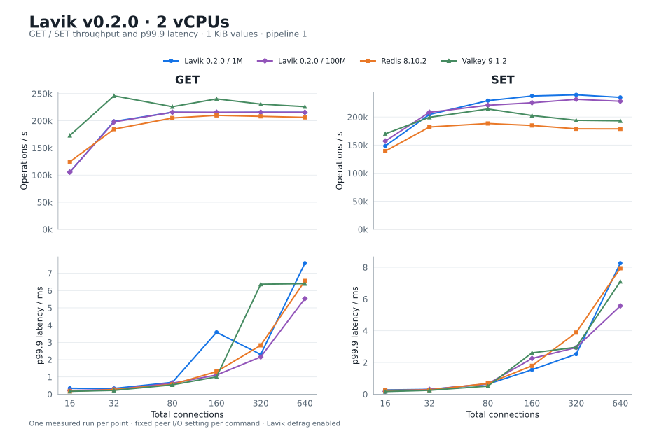
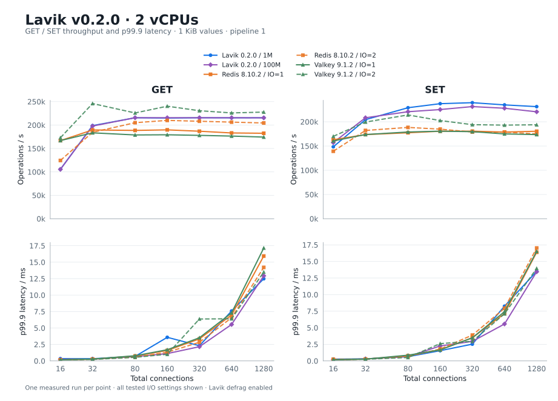
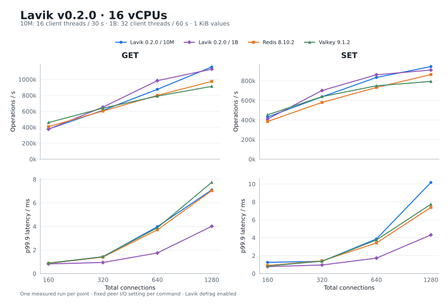

# Lavik v0.2.0 versus in-memory databases: 2 and 16 vCPUs

**English** | [简体中文](README.zh-CN.md)

Compare Lavik, Redis 8.10.2 and Valkey 9.1.2 on two server sizes, including Lavik’s 100M- and 1B-key capacity results. The report contains **180 formal points**, all with **1 KiB values**, measured on **2026-10-21 (UTC)**.

| Server vCPUs | Datasets | Client threads / CPUs | Total connections | Seconds / point | Points |
| --- | --- | --- | --- | --- | --- |
| 2 | Lavik 1M / 100M; Redis / Valkey 1M | 16 / 0–15 | 16 / 32 / 80 / 160 / 320 / 640 / 1280 | 30 | 84 |
| 16 | Lavik / Redis / Valkey 10M | 16 / 0–15 | 160 / 320 / 640 / 1280 | 30 | 88 |
| 16 | Lavik 1B | 32 / 0–31 | 160 / 320 / 640 / 1280 | 60 | 8 |

[All measured points](https://github.com/eloqdata/lavik-agent/blob/bb061b97e9836281e71c219f21570d742313fb8c/perf_reports/lavik-v0.2.0-vs-memory-databases-2026-10-21/metadata/results.csv) · [Provenance](https://github.com/eloqdata/lavik-agent/blob/bb061b97e9836281e71c219f21570d742313fb8c/perf_reports/lavik-v0.2.0-vs-memory-databases-2026-10-21/metadata/provenance.json) · [Validation](https://github.com/eloqdata/lavik-agent/blob/bb061b97e9836281e71c219f21570d742313fb8c/perf_reports/lavik-v0.2.0-vs-memory-databases-2026-10-21/metadata/validation.json) · [Raw logs and receipts](https://github.com/eloqdata/lavik-agent/tree/bb061b97e9836281e71c219f21570d742313fb8c/perf_reports/lavik-v0.2.0-vs-memory-databases-2026-10-21)

## 2 vCPUs: 1M and 100M keys

At 100M keys, peak GET / SET throughput is **215,644 / 231,361 ops/s**, retaining **100.0% / 96.6%** of the smaller dataset’s peaks. Peaks may occur at different connection counts; matched-concurrency results follow below. In the 1M baseline, the highest GET peak is Valkey 9.1.2 (245,955 ops/s), while the highest SET peak is Lavik 0.2.0 / 1M (239,405 ops/s).

### Throughput and p99.9 latency



| Command | Product / keys | Workers / I/O threads | Connections | Peak ops/s | p99.9 ms |
| --- | --- | --- | --- | --- | --- |
| GET | Lavik 0.2.0 / 1M | 2 | 80 | 215,640 | 0.687 |
| GET | Lavik 0.2.0 / 100M | 2 | 640 | 215,644 | 5.535 |
| GET | Redis 8.10.2 | 2 | 160 | 209,958 | 1.311 |
| GET | Valkey 9.1.2 | 2 | 32 | 245,955 | 0.223 |
| SET | Lavik 0.2.0 / 1M | 2 | 320 | 239,405 | 2.527 |
| SET | Lavik 0.2.0 / 100M | 2 | 320 | 231,361 | 2.943 |
| SET | Redis 8.10.2 | 2 | 80 | 188,371 | 0.679 |
| SET | Valkey 9.1.2 | 2 | 80 | 214,117 | 0.511 |

For each command, each peer uses the **single I/O-thread setting with its highest peak** for the entire throughput and latency curve; settings are not spliced point by point. Main plots show 16–640 connections; the tables and all-configuration chart retain 1280.

### Matched-concurrency comparison

Cells show **ops/s / p99.9 ms**.

| Command | Connections | Lavik 0.2.0 / 1M | Lavik 0.2.0 / 100M | Redis 8.10.2 | Valkey 9.1.2 |
| --- | --- | --- | --- | --- | --- |
| GET | 16 | 105,536 / 0.343 | 105,464 / 0.223 | 124,422 / 0.167 | 172,900 / 0.167 |
| GET | 32 | 198,832 / 0.335 | 197,851 / 0.271 | 184,549 / 0.271 | 245,955 / 0.223 |
| GET | 80 | 215,640 / 0.687 | 215,643 / 0.639 | 205,073 / 0.567 | 225,845 / 0.543 |
| GET | 160 | 214,971 / 3.583 | 215,639 / 1.111 | 209,958 / 1.311 | 240,260 / 1.007 |
| GET | 320 | 215,632 / 2.303 | 215,644 / 2.159 | 208,124 / 2.831 | 230,637 / 6.367 |
| GET | 640 | 215,452 / 7.583 | 215,644 / 5.535 | 206,284 / 6.559 | 225,932 / 6.399 |
| GET | 1280 | 215,620 / 12.479 | 215,439 / 12.927 | 204,466 / 14.207 | 227,679 / 13.503 |
| SET | 16 | 148,361 / 0.271 | 157,101 / 0.183 | 139,237 / 0.247 | 169,978 / 0.167 |
| SET | 32 | 204,416 / 0.303 | 208,295 / 0.303 | 182,105 / 0.271 | 199,425 / 0.247 |
| SET | 80 | 229,009 / 0.639 | 220,759 / 0.655 | 188,371 / 0.679 | 214,117 / 0.511 |
| SET | 160 | 237,336 / 1.543 | 225,243 / 2.255 | 184,826 / 1.791 | 202,535 / 2.607 |
| SET | 320 | 239,405 / 2.527 | 231,361 / 2.943 | 178,853 / 3.887 | 194,044 / 2.959 |
| SET | 640 | 234,839 / 8.255 | 227,927 / 5.567 | 178,734 / 7.935 | 193,103 / 7.103 |
| SET | 1280 | 231,271 / 13.503 | 220,561 / 13.439 | 175,050 / 17.023 | 193,829 / 13.951 |

### Complete I/O-thread sweep

| Product | I/O threads | GET peak ops/s (connections) | SET peak ops/s (connections) |
| --- | --- | --- | --- |
| Redis 8.10.2 | 1 | 189,749 (160) | 180,645 (320) |
| Redis 8.10.2 | 2 | 209,958 (160) | 188,371 (80) |
| Valkey 9.1.2 | 1 | 183,408 (32) | 180,624 (160) |
| Valkey 9.1.2 | 2 | 245,955 (32) | 214,117 (80) |



### Memory and client diagnostics

| Product / keys | INFO used_memory (MiB) | Process RSS (MiB) |
| --- | --- | --- |
| Lavik 0.2.0 / 1M | 96.0–96.0 | 739.2–748.6 |
| Lavik 0.2.0 / 100M | 5,069.4–5,069.4 | 5,513.4–5,521.7 |
| Redis 8.10.2 | 1,264.7–1,265.0 | 1,287.9–1,978.4 |
| Valkey 9.1.2 | 1,268.1–1,268.6 | 1,290.6–2,223.3 |

Ranges use post-point snapshots. INFO memory follows each product’s accounting; RSS is OS-reported resident process memory. Lavik also reserves **2,048 MiB of hugepages**. Maximum average client CPU usage is **3.718 cores**; the largest individual client thread average is **0.249 cores**; maximum server CPU steal in enclosing sampled windows is **0.0000%**.

## 16 vCPUs: 10M and 1B keys

Lavik 10M / 1B and Redis / Valkey 10M use the same 160/320/640/1280 total connection counts. The 10M tests use **16 client threads and 30-second windows**; 1B uses **32 client threads and 60-second windows**. The eight 1B points are also used in the storage-peer report.

The 10M results retain saved measurements with the original 80-connection points excluded. Peaks and fixed I/O-thread selections are recomputed over retained points. Each command/product curve uses one fixed configuration throughout.



| Command | Product / keys | Workers / I/O threads | Client threads | Peak connections | Peak ops/s | p99.9 ms |
| --- | --- | --- | --- | --- | --- | --- |
| GET | Lavik 0.2.0 / 10M | 16 | 16 | 1280 | 1,156,956 | 7.103 |
| GET | Lavik 0.2.0 / 1B | 16 | 32 | 1280 | 1,129,597 | 4.015 |
| GET | Redis 8.10.2 | 16 | 16 | 1280 | 976,087 | 7.039 |
| GET | Valkey 9.1.2 | 16 | 16 | 1280 | 913,756 | 7.743 |
| SET | Lavik 0.2.0 / 10M | 16 | 16 | 1280 | 945,384 | 10.175 |
| SET | Lavik 0.2.0 / 1B | 16 | 32 | 1280 | 910,356 | 4.319 |
| SET | Redis 8.10.2 | 16 | 16 | 1280 | 863,860 | 7.391 |
| SET | Valkey 9.1.2 | 8 | 16 | 1280 | 793,809 | 7.743 |

### Matched-concurrency comparison

**ops/s / p99.9 ms**:

| Command | Connections | Lavik 0.2.0 / 10M | Lavik 0.2.0 / 1B | Redis 8.10.2 | Valkey 9.1.2 |
| --- | --- | --- | --- | --- | --- |
| GET | 160 | 377,857 / 0.855 | 375,966 / 0.823 | 408,159 / 0.871 | 459,449 / 0.895 |
| GET | 320 | 612,513 / 1.431 | 652,881 / 0.943 | 603,866 / 1.399 | 640,091 / 1.431 |
| GET | 640 | 876,217 / 3.983 | 985,019 / 1.751 | 800,217 / 3.711 | 791,161 / 3.887 |
| GET | 1280 | 1,156,956 / 7.103 | 1,129,597 / 4.015 | 976,087 / 7.039 | 913,756 / 7.743 |
| SET | 160 | 431,054 / 1.255 | 409,886 / 0.783 | 384,939 / 0.903 | 453,171 / 0.847 |
| SET | 320 | 637,287 / 1.375 | 701,241 / 0.959 | 579,902 / 1.423 | 638,517 / 1.383 |
| SET | 640 | 834,508 / 3.871 | 861,911 / 1.727 | 732,342 / 3.423 | 749,664 / 3.759 |
| SET | 1280 | 945,384 / 10.175 | 910,356 / 4.319 | 863,860 / 7.391 | 793,809 / 7.743 |

### Redis / Valkey I/O-thread sweep (10M)


| Product | I/O threads | GET peak ops/s (connections) | SET peak ops/s (connections) |
| --- | --- | --- | --- |
| Redis 8.10.2 | 1 | 154,244 (320) | 142,910 (320) |
| Redis 8.10.2 | 2 | 158,908 (320) | 147,806 (320) |
| Redis 8.10.2 | 4 | 437,073 (1280) | 398,372 (1280) |
| Redis 8.10.2 | 8 | 838,330 (1280) | 822,820 (1280) |
| Redis 8.10.2 | 16 | 976,087 (1280) | 863,860 (1280) |
| Valkey 9.1.2 | 1 | 152,804 (320) | 143,996 (320) |
| Valkey 9.1.2 | 2 | 159,958 (640) | 148,287 (640) |
| Valkey 9.1.2 | 4 | 436,332 (640) | 395,389 (1280) |
| Valkey 9.1.2 | 8 | 846,926 (1280) | 793,809 (1280) |
| Valkey 9.1.2 | 16 | 913,756 (1280) | 773,060 (1280) |

### 1B latency details

| Command | Connections | Client threads | Ops/s | p50 ms | p99 ms | p99.9 ms | p99.99 ms |
| --- | --- | --- | --- | --- | --- | --- | --- |
| GET | 160 | 32 | 375,966 | 0.423 | 0.743 | 0.823 | 0.927 |
| GET | 320 | 32 | 652,881 | 0.495 | 0.815 | 0.943 | 1.471 |
| GET | 640 | 32 | 985,019 | 0.631 | 1.247 | 1.751 | 3.743 |
| GET | 1280 | 32 | 1,129,597 | 1.095 | 2.159 | 4.015 | 8.575 |
| SET | 160 | 32 | 409,886 | 0.391 | 0.687 | 0.783 | 1.055 |
| SET | 320 | 32 | 701,241 | 0.447 | 0.815 | 0.959 | 1.519 |
| SET | 640 | 32 | 861,911 | 0.735 | 1.271 | 1.727 | 3.839 |
| SET | 1280 | 32 | 910,356 | 1.391 | 2.239 | 4.319 | 8.575 |

### Memory and client diagnostics

| Product | Max average client CPU / cores | Max thread average / cores | Max server steal / % | INFO used_memory / MiB | Process RSS / MiB |
| --- | --- | --- | --- | --- | --- |
| Lavik 0.2.0 / 10M | 15.066 | 0.948 | 0.0000 | 716.6–716.6 | 1,486.1–1,499.8 |
| Redis 8.10.2 | 13.187 | 0.840 | 0.0000 | 12,677.9–12,681.3 | 12,797.9–12,877.8 |
| Valkey 9.1.2 | 12.515 | 0.801 | 0.0000 | 12,654.7–12,655.8 | 12,773.3–13,065.9 |

Some points approach the client CPU budget; observed peaks do not establish a server-capacity ceiling.

## Environment and test method

### 2 vCPUs

#### Versions and hardware

| Item | Configuration |
| --- | --- |
| Server | Standard_L2aos_v5; 2 vCPU (1 physical core) / 16 GiB nominal RAM; AMD EPYC 9V45 96-Core Processor |
| Client | Standard_F16as_v7; separate VM; CPUs 0–15 |
| Region | East US, zone 3 |
| OS | Ubuntu 24.04; Linux 6.17.0-1022-azure on both hosts |
| Storage | 1 × 1,439,887,785,984-byte dedicated local NVMe; SPDK/VFIO |
| Network | Kernel TCP; same VNet and availability zone; accelerated networking |
| Lavik | Official standard x86_64 v0.2.0 package; 2908f86f2770e9c6e8acc6585b3bedb4b44d1cd5 |

#### Test method

- Fresh decimal keys `1..N`, no prefix, 1,024-byte values, no TTL. Independently load Lavik 1M and 100M; Redis and Valkey each use 1M.
- memtier 2.5.1 on 16 pinned client CPUs, pipeline 1, uniform random GET or overwriting SET. Connections: 16, 32, 80, 160, 320, 640, 1280. One run per point, 30 seconds for the baseline and 100M-key group. Every timed run uses independent client seeds.
- Ten-second GET warmup per configuration. GET precedes SET and concurrency increases within each sweep. Products run sequentially on the same server; builds finish before measurement.
- Lavik uses 2 workers and dedicated NVMe via SPDK. Overrides: `--tomb-raider-interval-ms=0`, `--spdk-max-completions-per-poll=16`, and 2 GiB EAL/hugepage memory. Defrag remains enabled and is checked around every point.
- Redis 8.10.2 and Valkey 9.1.2 use the same releases as the v0.1.0 report, default optimized builds with jemalloc, and I/O threads 1, 2. `save ""` disables scheduled snapshots; AOF remains disabled. A manual SAVE after initial fill provides the unchanged RDB baseline for each I/O setting; measured writes are memory-only.
- THP is `never`, overcommit is 1, no added cgroup memory cap. Exact DBSIZE and five value lengths are verified before/after configurations. Fill operation counts, zero GET misses, connection errors, versions and CPU affinity are checked.

### 16 vCPUs: 10M

#### Versions and hardware

| Item | Configuration |
| --- | --- |
| Server | Standard_L16aos_v4; 16 vCPU (8 physical cores) / 128 GiB nominal RAM; AMD EPYC 9V74 80-Core Processor |
| Client | Standard_F32als_v6; separate VM; CPUs 0–15 |
| Region | Japan East, zone 2 |
| OS | Ubuntu 24.04; Linux 6.17.0-1022-azure on both hosts |
| Storage | 6 × 1,919,850,381,312-byte dedicated local NVMe; SPDK/VFIO |
| Network | Kernel TCP; same VNet and availability zone; accelerated networking |
| Lavik | Official standard x86_64 v0.2.0 package; 2908f86f2770e9c6e8acc6585b3bedb4b44d1cd5 |

#### Test method

- Fresh decimal keys `1..N`, no prefix, 1,024-byte values, no TTL. Independently load 10M keys for each product.
- memtier 2.5.1 on 16 pinned client CPUs, pipeline 1, uniform random GET or overwriting SET. Retained connections: 160, 320, 640, 1280. One 30-second run per point, keeping the original default client seeds.
- Ten-second GET warmup per configuration. GET precedes SET and concurrency increases within each sweep. Products run sequentially on the same server; builds finish before measurement.
- Lavik uses 16 workers and dedicated NVMe via SPDK. Overrides: `--tomb-raider-interval-ms=0`, `--spdk-max-completions-per-poll=16`, and 8 GiB EAL/hugepage memory. Defrag remains enabled and is checked around every point.
- Redis 8.10.2 and Valkey 9.1.2 use the same releases as the v0.1.0 report, default optimized builds with jemalloc, and I/O threads 1, 2, 4, 8, 16. `save ""` disables scheduled snapshots; AOF remains disabled. A manual SAVE after initial fill provides the unchanged RDB baseline for each I/O setting; measured writes are memory-only.
- THP is `never`, overcommit is 1, no added cgroup memory cap. Exact DBSIZE and five value lengths are verified before/after configurations. Fill operation counts, zero GET misses, connection errors, versions and CPU affinity are checked.

### 16 vCPUs: 1B

| Item | Configuration |
| --- | --- |
| Server | Standard_L16aos_v4; Japan East zone 2; AMD EPYC 9V74; 8 physical cores / 16 vCPUs; 128 GiB nominal RAM |
| Client | Standard_F32als_v6; 32 physical CPUs; memtier 2.5.1; 32 threads pinned to CPUs 0–31 |
| OS | Ubuntu 24.04; Linux 6.17.0-1022-azure on both VMs |
| Storage | 6 × 1,919,850,381,312-byte dedicated NVMe; SPDK/VFIO; 8 GiB EAL/hugepage reservation |
| Network | Private VNet; kernel TCP; accelerated networking |
| Lavik | Official standard x86_64 v0.2.0; 2908f86f2770e9c6e8acc6585b3bedb4b44d1cd5 |

- Decimal keys 1..1,000,000,000, no prefix or TTL, 1,024-byte values: 953.67 GiB logical value payload, excluding keys, index and storage overhead.
- Fresh sequential fill: exactly 1B SETs, 32 threads and 640 total connections. Formal sweeps use independent client seeds, uniform random GET or overwriting SET, pipeline 1, and 60 seconds per point. GET precedes SET; concurrency increases within each sweep. No additional GET warmup.
- Lavik uses 16 server workers, SPDK, shutdown checkpointing, tomb-raider interval 0 and SPDK completion cap 16. Other tested defaults are inherited. Defrag stays enabled and is checked around every measured point. Exact DBSIZE and five value lengths are verified before and after the sweep.
- Each cell has one run; no confidence intervals. Throughput and percentiles come from the complete measurement window. These eight points are reused in the storage-peer report, not counted as independent repeats.
- The historical report used 16 client threads and included 80 connections. This run uses 32 threads and omits that point. Region also changed from Japan West to Japan East.

Load invocation wall time: **21.6 minutes**; reported fill throughput: **940,654 ops/s**. Across formal points, maximum average client CPU use is **17.971 cores**, maximum individual thread average is **0.579 cores**, and maximum server steal in enclosing sampled windows is **0.0000%**.

## Evidence and measurement limits

[Complete point data](https://github.com/eloqdata/lavik-agent/blob/bb061b97e9836281e71c219f21570d742313fb8c/perf_reports/lavik-v0.2.0-vs-memory-databases-2026-10-21/metadata/results.csv) · [Version, hardware and validation provenance](https://github.com/eloqdata/lavik-agent/blob/bb061b97e9836281e71c219f21570d742313fb8c/perf_reports/lavik-v0.2.0-vs-memory-databases-2026-10-21/metadata/provenance.json)

Each point has one measured run; no confidence interval is claimed. Successful responses do not imply equal synchronous durability guarantees. New hosts can differ from the historical run in physical placement, network latency and timing. [Raw logs and receipts](https://github.com/eloqdata/lavik-agent/tree/bb061b97e9836281e71c219f21570d742313fb8c/perf_reports/lavik-v0.2.0-vs-memory-databases-2026-10-21) are stored in `eloqdata/lavik-agent` with a per-file SHA-256 manifest.

Raw evidence is namespaced by `2vcpu`, `16vcpu-10m` and `16vcpu-1b`, with one per-file SHA-256 manifest. The CSV `suite` and `source` fields identify each measurement.

## Reproduction commands

### 2 vCPU

Use the L2aos_v5 server and an F16as_v7 client in the same availability zone over the private network. Prepare the standard x86_64 Lavik v0.2.0 binary, Redis 8.10.2, Valkey 9.1.2 and memtier 2.5.1. Redis and Valkey use default optimized builds with jemalloc 5.3.0 and `make -j12 BUILD_TLS=yes`. The commands below use Bash.

#### Start the servers

```bash
# Run on the server; replace the address and binary paths for your hosts.
SERVER_IP=10.96.0.4
LAVIK_BIN=/opt/bench020/downloads/lavik-v0.2.0-linux-x86_64/lavik
REDIS_BIN=/opt/bench020/bin/redis-server
VALKEY_BIN=/opt/bench020/bin/valkey-server
ulimit -n 65535
sudo sysctl -w vm.overcommit_memory=1
printf 'never\n' | sudo tee /sys/kernel/mm/transparent_hugepage/enabled
```

Lavik uses an empty, dedicated NVMe namespace. Identify and bind the test device to VFIO using the [SPDK storage guide](../../docs/operations/spdk-storage.md), with `HUGEMEM=2048` and `BYCORF_DPDK_MEMORY_MB=2048`. This VM did not expose an IOMMU and used the guide's dedicated-test-host no-IOMMU configuration. Load 1M and 100M keys separately. Between them, stop Lavik cleanly, restore the NVMe driver, clear the verified scratch namespace, and rebind it before the independent load.

```bash
# Use the verified PCI address and namespace ID of your empty test NVMe.
NVME_BDF=YOUR_NVME_PCI_ADDRESS
NVME_NSID=1
sudo prlimit --memlock=unlimited:unlimited --nofile=65535:65535 \
  env BYCORF_EAL_ARGS="-a ${NVME_BDF}" BYCORF_DPDK_MEMORY_MB=2048 \
  taskset -c 0-1 "$LAVIK_BIN" \
  --storage=spdk --bind="$SERVER_IP" \
  --tomb-raider-interval-ms=0 --spdk-max-completions-per-poll=16 \
  --log-dir="$PWD/lavik-logs" \
  --data-file="spdk://${NVME_BDF}/${NVME_NSID}"
```

The command omits v0.2.0 defaults; under `taskset -c 0-1`, Lavik automatically starts two pinned workers. `BYCORF_DPDK_MEMORY_MB=2048` sets the EAL memory used by SPDK to 2 GiB; networking remains the default kernel TCP. The retained tuning options disable the default daily tombstone sweep and raise the SPDK completion cap from 8 to 16.

Test Redis and Valkey with one and two I/O threads, running only one server at a time:

```bash
# Run one product/configuration at a time. Repeat with IO_THREADS=2.
IO_THREADS=1
IO_ARGS=(); if ((IO_THREADS > 1)); then IO_ARGS=(--io-threads "$IO_THREADS"); fi
mkdir -p "$PWD/bench-data/redis" "$PWD/bench-data/valkey"

# Redis 8.10.2
taskset -c 0-1 "$REDIS_BIN" \
  --bind "$SERVER_IP" --protected-mode no \
  --dir "$PWD/bench-data/redis" \
  --save "" \
  "${IO_ARGS[@]}"

# Valkey 9.1.2 (after stopping Redis)
taskset -c 0-1 "$VALKEY_BIN" \
  --bind "$SERVER_IP" --protected-mode no \
  --dir "$PWD/bench-data/valkey" \
  --save "" \
  "${IO_ARGS[@]}"
```

#### Load data and run memtier

Run Lavik 1M, Lavik 100M, Redis IO=1/2 and Valkey IO=1/2 in that order. Set `N` and `RUN` for each configuration. Confirm `DBSIZE=0` before each product's first fill. For Redis and Valkey, issue one `SAVE` after the initial fill and exit with `SHUTDOWN NOSAVE`. Start each I/O configuration from the same baseline RDB. Skip the fill on restart, validate the data, and repeat warmup and measurement. Both Lavik datasets start with an empty scratch namespace.

```bash
# Bash, on the separate client, CPUs 0–15; memtier_benchmark 2.5.1.
set -euo pipefail
SERVER_IP=10.96.0.4
N=1000000 # Use 100000000 for the large Lavik dataset.
RUN=lavik-1m # lavik-100m, redis-io1, redis-io2, valkey-io1, valkey-io2
mkdir -p "$RUN"
ulimit -n 65535
COMMON=(--server="$SERVER_IP" \
  --threads=16 --key-minimum=1 --key-maximum="$N" \
  --key-prefix= --data-size=1024 --hide-histogram \
  --print-percentiles=50,99,99.9,99.99 --show-config)

# Fill an empty dataset using disjoint sequential key streams: exactly N writes.
taskset -c 0-15 memtier_benchmark "${COMMON[@]}" --clients=10 \
  --requests="$((N / 160))" --ratio=1:0 --key-pattern=P:P \
  --json-out-file="$RUN/fill.json" > "$RUN/fill.txt" 2>&1

check_data() {
  test "$(redis-cli -h "$SERVER_IP" --raw DBSIZE)" = "$N"
  for key in 1 2 "$((N / 2))" "$((N - 1))" "$N"; do
    test "$(redis-cli -h "$SERVER_IP" --raw STRLEN "$key")" = 1024
  done
}
check_data

# For each memory peer only: create its baseline RDB once after the first fill.
# redis-cli -h "$SERVER_IP" SAVE

# Warmup, then GET and SET sweeps. Reuse this part after loading a baseline RDB.
taskset -c 0-15 memtier_benchmark "${COMMON[@]}" --clients=10 \
  --distinct-client-seed --test-time=10 \
  --command='GET __key__' --command-is-read \
  --json-out-file="$RUN/warmup.json" > "$RUN/warmup.txt" 2>&1

for kind in GET SET; do
  if [ "$kind" = GET ]; then
    COMMAND='GET __key__'; READ_FLAG=(--command-is-read)
  else
    COMMAND='SET __key__ __data__'; READ_FLAG=()
  fi
  for connections in 16 32 80 160 320 640 1280; do
    taskset -c 0-15 memtier_benchmark "${COMMON[@]}" \
      --clients="$((connections / 16))" --distinct-client-seed --test-time=30 \
      --command="$COMMAND" "${READ_FLAG[@]}" \
      --json-out-file="$RUN/${kind}-c${connections}.json" \
      > "$RUN/${kind}-c${connections}.txt" 2>&1
  done
done
check_data
```

After each configuration, check that all GETs hit, connection errors are zero, and DBSIZE is unchanged.

### 16 vCPU / 10M

These Bash commands use the measured settings; adapt paths, addresses and PCI identities to the deployment. Run one database and one load generator at a time. Use a separate result directory for each configuration.

#### Lavik SPDK

Follow the [SPDK storage guide](../../docs/operations/spdk-storage.md) to verify six dedicated scratch NVMe devices and prepare VFIO and 8 GiB hugepages. Load the 10M dataset on empty media; do not overwrite system disks or existing application data. After a clean Lavik stop, restore kernel drivers and hugepage reservations before testing the memory databases. The 10M launch command is:

```bash
sudo prlimit --memlock=unlimited:unlimited --nofile=65535:65535 env 'BYCORF_EAL_ARGS=-a 7133:00:00.0 -a 10fc:00:00.0 -a 9c4a:00:00.0 -a ef09:00:00.0 -a fa44:00:00.0 -a 9816:00:00.0' BYCORF_DPDK_MEMORY_MB=8192 taskset \
  -c 0-15 /opt/bench020/downloads/lavik-v0.2.0-linux-x86_64/lavik \
  --storage=spdk \
  --bind=10.96.1.4 \
  --tomb-raider-interval-ms=0 \
  --spdk-max-completions-per-poll=16 \
  --log-dir=/opt/bench020/results/large/memory/lavik-10m/logs \
  --data-file=spdk://7133:00:00.0/1 \
  --data-file=spdk://10fc:00:00.0/1 \
  --data-file=spdk://9c4a:00:00.0/1 \
  --data-file=spdk://ef09:00:00.0/1 \
  --data-file=spdk://fa44:00:00.0/1 \
  --data-file=spdk://9816:00:00.0/1
```

Wait for startup and background initialization, then check that `CONFIG GET defrag-paused` returns `no`; repeat this check before and after each measured point.

#### Redis / Valkey

Build with jemalloc 5.3.0 using `make -j12 BUILD_TLS=no`. Redis 8.10.2 uses commit `498ecd0d6d007db11ddb3aea9428552598a78622`; Valkey 9.1.2 uses `7f1dffedff6de73058b2c2a389422b6ecd56c8fb`. Use 16 I/O threads for the initial fill.

```bash
# On the server; start one product/configuration at a time.
PRODUCT=redis # redis or valkey
IO_THREADS=16 # tested: 1, 2, 4, 8, 16
IO_ARGS=(); if ((IO_THREADS > 1)); then IO_ARGS=(--io-threads "$IO_THREADS"); fi
DATA_DIR=/opt/bench020/results/large/data/$PRODUCT
mkdir -p "$DATA_DIR"
ulimit -n 65535
taskset -c 0-15 "/opt/bench020/bin/$PRODUCT-server" \
  --bind 10.96.1.4 --protected-mode no \
  --dir "$DATA_DIR" --save "" \
    "${IO_ARGS[@]}"
```

#### Load, warmup and connection sweep

```bash
# On the client: memtier_benchmark 2.5.1.
KEYS=10000000
SECONDS_PER_POINT=30
SEED=()
mkdir -p results
ulimit -n 65535
COMMON=(--server=10.96.1.4
  --threads=16 --key-minimum=1 --key-maximum="$KEYS"
  --key-prefix= --data-size=1024 --hide-histogram
  --print-percentiles=50,99,99.9,99.99 --show-config)

# Once per fresh dataset; each key is written once across 640 clients.
taskset -c 0-15 memtier_benchmark "${COMMON[@]}" --clients=40 \
  --json-out-file=results/fill.json --requests="$((KEYS / 640))" \
  --ratio=1:0 --key-pattern=P:P
redis-cli -h 10.96.1.4 --raw DBSIZE
redis-cli -h 10.96.1.4 STRLEN 1
```

For Redis/Valkey, run the baseline commands below after the initial fill. Restart in turn with 1, 2, 4, 8 and 16 I/O threads; wait for RDB loading and DBSIZE=10000000, verify persistence settings, then run the warmup and measurement block. End each configuration with `SHUTDOWN NOSAVE` so the same `dump.rdb` remains unchanged. Do not refill or run SAVE during measurement. Skip these RDB baseline commands for Lavik.

```bash
redis-cli -h 10.96.1.4 SAVE
redis-cli -h 10.96.1.4 SHUTDOWN NOSAVE
# On the server, record/check the unchanged RDB baseline hash:
sha256sum "$DATA_DIR/dump.rdb"
# After each restart, run these checks from the client:
redis-cli -h 10.96.1.4 CONFIG GET save
redis-cli -h 10.96.1.4 CONFIG GET appendonly
redis-cli -h 10.96.1.4 INFO persistence
```

```bash
# Run once for Lavik 10M and once per Redis/Valkey I/O-thread configuration.
if [ "$KEYS" -eq 10000000 ]; then
  taskset -c 0-15 memtier_benchmark "${COMMON[@]}" --clients=40 \
    --json-out-file=results/warmup.json --test-time=10 \
    --command='GET __key__' --command-is-read
fi
for OP in GET SET; do
  COMMAND=(--command='GET __key__' --command-is-read)
  if [ "$OP" = SET ]; then
    COMMAND=(--command='SET __key__ __data__' )
  fi
  for CONNECTIONS in 160 320 640 1280; do
    taskset -c 0-15 memtier_benchmark "${COMMON[@]}" \
      --clients="$((CONNECTIONS / 16))" \
      --json-out-file="results/$OP-c$CONNECTIONS.json" \
      --test-time="$SECONDS_PER_POINT" "${COMMAND[@]}" "${SEED[@]}" \
      > "results/$OP-c$CONNECTIONS.txt" 2>&1
  done
done
redis-cli -h 10.96.1.4 --raw DBSIZE
```

### 16 vCPU / 1B

Use the [SPDK operations guide](../../docs/operations/spdk-storage.md) to verify six dedicated test devices and prepare VFIO with 8 GiB hugepages. Load only empty test media; wait for PING and check defrag-paused is no. Stop cleanly after measurement, then restore kernel drivers and hugepage reservations using the guide.

```bash
sudo prlimit --memlock=unlimited:unlimited --nofile=65535:65535 env \
  BYCORF_EAL_ARGS='-a 7133:00:00.0 -a 10fc:00:00.0 -a 9c4a:00:00.0 -a ef09:00:00.0 -a fa44:00:00.0 -a 9816:00:00.0' \
  BYCORF_DPDK_MEMORY_MB=8192 \
  taskset -c 0-15 /opt/bench020/downloads/lavik-v0.2.0-linux-x86_64/lavik \
  --storage=spdk --bind=10.96.1.4 --shutdown-checkpoint \
  --tomb-raider-interval-ms=0 --spdk-max-completions-per-poll=16 \
  --log-dir=/opt/bench020/results/large/storage/lavik-1b/logs \
  --data-file=spdk://7133:00:00.0/1 \
  --data-file=spdk://10fc:00:00.0/1 \
  --data-file=spdk://9c4a:00:00.0/1 \
  --data-file=spdk://ef09:00:00.0/1 \
  --data-file=spdk://fa44:00:00.0/1 \
  --data-file=spdk://9816:00:00.0/1
```

Run on the separate client:

```bash
SERVER=10.96.1.4
mkdir -p results
ulimit -n 65535
COMMON=(--server="$SERVER" --threads=32 --key-minimum=1
  --key-maximum=1000000000 --key-prefix= --data-size=1024
  --hide-histogram --print-percentiles=50,99,99.9,99.99 --show-config)
# 32 threads × 20 connections × 1,562,500 requests = 1,000,000,000 SETs.
taskset -c 0-31 memtier_benchmark "${COMMON[@]}" --clients=20 \
  --requests=1562500 --ratio=1:0 --key-pattern=P:P --json-out-file=results/fill.json
redis-cli -h "$SERVER" --raw DBSIZE
for key in 1 2 500000000 999999999 1000000000; do
  test "$(redis-cli -h "$SERVER" --raw STRLEN "$key")" = 1024
done
# No additional GET warmup for Lavik 1B.
for op in GET SET; do
  COMMAND=(--command='GET __key__' --command-is-read)
  if [[ "$op" == SET ]]; then COMMAND=(--command='SET __key__ __data__'); fi
  for connections in 160 320 640 1280; do
    redis-cli -h "$SERVER" CONFIG GET defrag-paused
    taskset -c 0-31 memtier_benchmark "${COMMON[@]}" \
      --clients="$((connections / 32))" --test-time=60 --distinct-client-seed \
      "${COMMAND[@]}" --json-out-file="results/$op-c$connections.json" \
      > "results/$op-c$connections.txt" 2>&1
    redis-cli -h "$SERVER" CONFIG GET defrag-paused
  done
done
redis-cli -h "$SERVER" --raw DBSIZE
```
