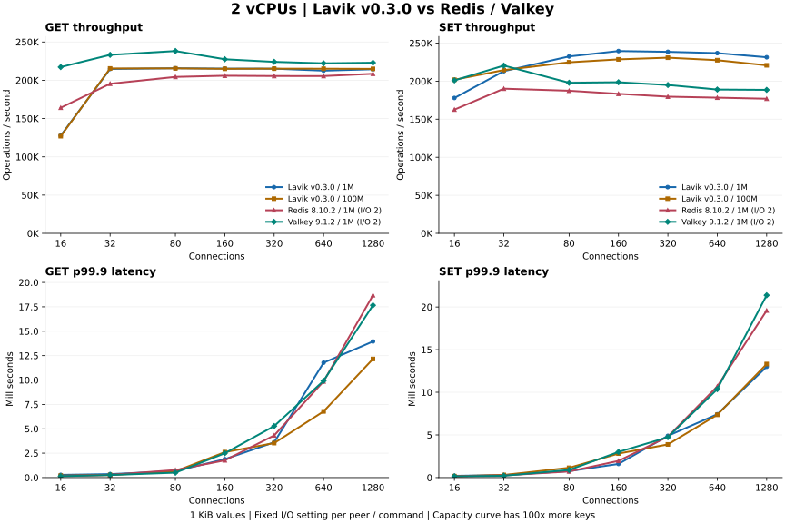
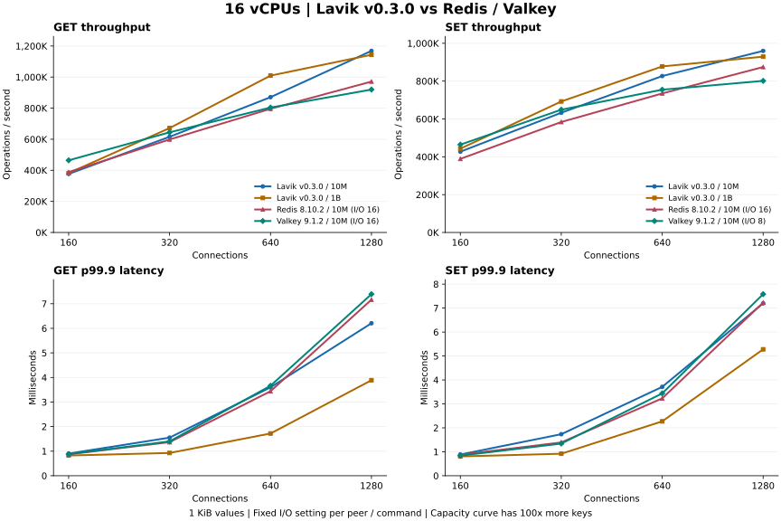

# Lavik v0.3.0 versus in-memory Redis and Valkey

[简体中文](README.zh-CN.md) · Measured November 15, 2026 (UTC)

## Summary

At 16 vCPUs and 10M keys, Lavik reached **1,168,681 GET ops/s and 959,837 SET ops/s**, above both peers’ measured peaks. At 2 vCPUs and 1M keys, Lavik’s **215,689 GET ops/s** was below Valkey’s **238,151**, while its **239,535 SET ops/s** exceeded both peers. Lavik also served 100M / 1B keys from NVMe; those capacity curves use **100× more keys** than the in-memory peers. [Point data](https://github.com/eloqdata/lavik-agent/blob/f96e385dea7e6a1857291b5ddf4cb9c9cd1bf13b/perf_reports/lavik-v0.3.0-vs-memory-databases-2026-11-15/metadata/memtier-points.csv).

The same-host v0.2.0 rerun found no persistent material regression in the tested matrix. Short-window tail outliers and their follow-ups are retained separately below; this is not a statistical equivalence claim.

The tested source commit is [`dcb2dda96452`](https://github.com/eloqdata/lavik/commit/dcb2dda96452610b9aa2625ff2a26abb3303f9b5), also the target of [v0.3.0](https://github.com/eloqdata/lavik/releases/tag/v0.3.0). The standard x86-64-v2/SPDK package was built before release and reports `0.3.0-dev`; these measurements did **not** use the subsequently uploaded release asset. Binary SHA-256: `c442735274c7bcbfaa8b59268b1f5f0f45ac36782ef48314e3b8e49f1857bf10`. CSV labels `main` refer to this exact commit.

## 2 vCPU

Each peer/command uses the single I/O-thread setting with the highest peak over the **entire** connection sweep. That setting is fixed for both curves; points are never spliced across settings. Tables include all connections, including 1280. Latency in the peak table is from the **same window** as that throughput peak.

| Command | Product / keys | Workers / I/O threads | Connections | Peak ops/s | p99.9 ms |
| --- | --- | --- | --- | --- | --- |
| GET | Lavik v0.3.0 / 1M | 2 | 80 | 215,689 | 0.671 |
| GET | Lavik v0.3.0 / 100M | 2 | 80 | 215,536 | 0.647 |
| GET | Redis 8.10.2 / 1M | 2 | 1280 | 208,441 | 18.687 |
| GET | Valkey 9.1.2 / 1M | 2 | 80 | 238,151 | 0.503 |
| SET | Lavik v0.3.0 / 1M | 2 | 160 | 239,535 | 1.599 |
| SET | Lavik v0.3.0 / 100M | 2 | 320 | 230,794 | 3.887 |
| SET | Redis 8.10.2 / 1M | 2 | 32 | 190,106 | 0.255 |
| SET | Valkey 9.1.2 / 1M | 2 | 32 | 220,455 | 0.215 |

### Matched connections

Cells are **ops/s / p99.9 ms**.

| Command | Connections | Lavik v0.3.0 / 1M | Lavik v0.3.0 / 100M | Redis 8.10.2 / 1M | Valkey 9.1.2 / 1M |
| --- | --- | --- | --- | --- | --- |
| GET | 16 | 127,675 / 0.279 | 126,953 / 0.199 | 164,117 / 0.167 | 217,251 / 0.143 |
| GET | 32 | 214,755 / 0.359 | 215,425 / 0.263 | 195,499 / 0.279 | 233,187 / 0.263 |
| GET | 80 | 215,689 / 0.671 | 215,536 / 0.647 | 204,387 / 0.775 | 238,151 / 0.503 |
| GET | 160 | 215,227 / 1.887 | 214,951 / 2.607 | 205,932 / 1.767 | 227,427 / 2.495 |
| GET | 320 | 215,142 / 3.615 | 215,166 / 3.535 | 205,515 / 4.319 | 224,037 / 5.279 |
| GET | 640 | 212,536 / 11.775 | 215,056 / 6.783 | 205,496 / 9.855 | 222,142 / 9.919 |
| GET | 1280 | 214,363 / 13.951 | 214,874 / 12.159 | 208,441 / 18.687 | 222,936 / 17.663 |
| SET | 16 | 177,915 / 0.207 | 201,847 / 0.167 | 162,613 / 0.167 | 201,029 / 0.151 |
| SET | 32 | 213,108 / 0.295 | 214,558 / 0.311 | 190,106 / 0.255 | 220,455 / 0.215 |
| SET | 80 | 232,442 / 0.759 | 224,756 / 1.151 | 187,409 / 0.719 | 197,883 / 0.895 |
| SET | 160 | 239,535 / 1.599 | 228,609 / 2.815 | 183,348 / 1.959 | 198,552 / 3.007 |
| SET | 320 | 238,512 / 4.895 | 230,794 / 3.887 | 179,628 / 4.799 | 194,950 / 4.735 |
| SET | 640 | 236,808 / 7.423 | 227,535 / 7.359 | 178,303 / 10.687 | 188,992 / 10.367 |
| SET | 1280 | 231,358 / 12.991 | 220,792 / 13.311 | 176,903 / 19.583 | 188,545 / 21.375 |

### Complete peer I/O-thread sweep

| Product | I/O threads | GET peak ops/s (connections) | SET peak ops/s (connections) |
| --- | --- | --- | --- |
| Redis 8.10.2 | 1 | 192,048 (160) | 178,727 (160) |
| Redis 8.10.2 | 2 | 208,441 (1280) | 190,106 (32) |
| Valkey 9.1.2 | 1 | 186,115 (160) | 183,241 (1280) |
| Valkey 9.1.2 | 2 | 238,151 (80) | 220,455 (32) |

## 16 vCPU

Each peer/command uses the single I/O-thread setting with the highest peak over the **entire** connection sweep. That setting is fixed for both curves; points are never spliced across settings. Tables include all connections, including 1280. Latency in the peak table is from the **same window** as that throughput peak.

| Command | Product / keys | Workers / I/O threads | Connections | Peak ops/s | p99.9 ms |
| --- | --- | --- | --- | --- | --- |
| GET | Lavik v0.3.0 / 10M | 16 | 1280 | 1,168,681 | 6.207 |
| GET | Lavik v0.3.0 / 1B | 16 | 1280 | 1,143,839 | 3.887 |
| GET | Redis 8.10.2 / 10M | 16 | 1280 | 971,136 | 7.167 |
| GET | Valkey 9.1.2 / 10M | 16 | 1280 | 919,758 | 7.391 |
| SET | Lavik v0.3.0 / 10M | 16 | 1280 | 959,837 | 7.199 |
| SET | Lavik v0.3.0 / 1B | 16 | 1280 | 929,346 | 5.279 |
| SET | Redis 8.10.2 / 10M | 16 | 1280 | 874,635 | 7.231 |
| SET | Valkey 9.1.2 / 10M | 8 | 1280 | 801,428 | 7.583 |

### Matched connections

Cells are **ops/s / p99.9 ms**.

| Command | Connections | Lavik v0.3.0 / 10M | Lavik v0.3.0 / 1B | Redis 8.10.2 / 10M | Valkey 9.1.2 / 10M |
| --- | --- | --- | --- | --- | --- |
| GET | 160 | 376,725 / 0.903 | 382,250 / 0.823 | 388,562 / 0.871 | 464,368 / 0.879 |
| GET | 320 | 615,731 / 1.551 | 671,976 / 0.927 | 598,530 / 1.367 | 644,655 / 1.399 |
| GET | 640 | 870,897 / 3.599 | 1,009,460 / 1.719 | 796,158 / 3.439 | 803,926 / 3.663 |
| GET | 1280 | 1,168,681 / 6.207 | 1,143,839 / 3.887 | 971,136 / 7.167 | 919,758 / 7.391 |
| SET | 160 | 426,998 / 0.887 | 443,004 / 0.807 | 389,159 / 0.879 | 464,311 / 0.839 |
| SET | 320 | 632,927 / 1.735 | 692,511 / 0.919 | 583,883 / 1.391 | 648,985 / 1.343 |
| SET | 640 | 826,811 / 3.711 | 877,731 / 2.271 | 734,854 / 3.231 | 754,771 / 3.439 |
| SET | 1280 | 959,837 / 7.199 | 929,346 / 5.279 | 874,635 / 7.231 | 801,428 / 7.583 |

### Complete peer I/O-thread sweep

| Product | I/O threads | GET peak ops/s (connections) | SET peak ops/s (connections) |
| --- | --- | --- | --- |
| Redis 8.10.2 | 1 | 153,518 (320) | 144,395 (320) |
| Redis 8.10.2 | 2 | 160,279 (320) | 148,925 (320) |
| Redis 8.10.2 | 4 | 435,077 (1280) | 401,351 (1280) |
| Redis 8.10.2 | 8 | 839,976 (1280) | 828,286 (1280) |
| Redis 8.10.2 | 16 | 971,136 (1280) | 874,635 (1280) |
| Valkey 9.1.2 | 1 | 151,579 (320) | 145,922 (320) |
| Valkey 9.1.2 | 2 | 158,728 (160) | 147,252 (640) |
| Valkey 9.1.2 | 4 | 437,382 (1280) | 398,036 (1280) |
| Valkey 9.1.2 | 8 | 849,172 (1280) | 801,428 (1280) |
| Valkey 9.1.2 | 16 | 919,758 (1280) | 785,046 (1280) |

## Same-host v0.2.0 regression check

The baseline is the official v0.2.0 package at `2908f86f2770e9c6e8acc6585b3bedb4b44d1cd5`, rerun on the same hosts as v0.3.0. The 44 matched initial cells ranged from **−2.5% to +5.9% QPS**. The largest initial drop, 16 vCPU / 10M / SET / 160 connections, became **428,765 → 431,976 ops/s (+0.75%)** in three-window medians, with overlapping ranges.

Two short-window p99.9 rechecks increased by about 78% (2 vCPU / 1M / GET / 160) and 28% (2 vCPU / 100M / SET / 160). Fresh reloads and three 120-second windows per version gave medians **1.871 → 1.863 ms** and **2.063 → 2.063 ms**, with QPS changes −0.34% / +3.55%. The follow-ups do not replace the original observations. A median of window percentiles is not a pooled percentile.

[44 matched cells](https://github.com/eloqdata/lavik-agent/blob/f96e385dea7e6a1857291b5ddf4cb9c9cd1bf13b/perf_reports/lavik-v0.3.0-vs-memory-databases-2026-11-15/metadata/memtier-comparison.csv) · [Recheck medians and ranges](https://github.com/eloqdata/lavik-agent/blob/f96e385dea7e6a1857291b5ddf4cb9c9cd1bf13b/perf_reports/lavik-v0.3.0-vs-memory-databases-2026-11-15/metadata/memtier-recheck-summary.csv) · [All 272 windows](https://github.com/eloqdata/lavik-agent/blob/f96e385dea7e6a1857291b5ddf4cb9c9cd1bf13b/perf_reports/lavik-v0.3.0-vs-memory-databases-2026-11-15/metadata/memtier-points.csv).

## Hardware and method

| Item | 2 vCPU | 16 vCPU |
| --- | --- | --- |
| Server | Standard_L2aos_v5; EPYC 9V45; 1 physical / 2 logical CPUs; 16 GiB | Standard_L16aos_v4; EPYC 9V74; 8 physical / 16 logical CPUs; 128 GiB |
| Region | East US, zone 3 | Japan East, zone 2 |
| Client | Standard_L16aos_v5; CPUs 0–15 | Standard_F32als_v6; CPUs 0–15 (10M), 0–31 (1B) |
| NVMe | 1 × 1,439,887,785,984 bytes | 6 × 1,919,850,381,312 bytes |
| Hugepages | 2 GiB | 8 GiB |
| Client threads / window | 16 / 30s | 16 / 30s (10M); 32 / 60s (1B) |
| Connections | 16 / 32 / 80 / 160 / 320 / 640 / 1280 | 160 / 320 / 640 / 1280 |

Both hosts run Ubuntu 24.04 / Linux 7.0.0-1017-azure. Each server and its separate client share a VNet and availability zone, with accelerated networking. Products and versions run sequentially on the same server.

- memtier 2.5.1 uses decimal keys `1..N`, 1,024-byte values, uniform random GET and overwriting SET. Each dataset is independently loaded. GET precedes SET; connections increase within a sweep. A 10-second GET warmup precedes each configuration except 1B, which has no additional GET warmup. The 2-vCPU and 1B runs use `--distinct-client-seed`; 10M retains the historical seed strategy.
- Lavik uses SPDK with 2 / 16 workers. Non-default controls are `--tomb-raider-interval-ms=0`, `--spdk-max-completions-per-poll=16`, the hugepage reservations above, and `--shutdown-checkpoint` for 1B. The completion cap preserves the earlier report's configuration; these GET/SET results should not be confused with the default-cap SPDK YCSB experiment.
- Redis 8.10.2 and Valkey 9.1.2 use optimized jemalloc builds. `save ""` disables automatic RDB snapshots. A manual SAVE after load supplies the baseline reloaded for each I/O-thread setting. The full I/O sweep is shown above.
- THP is `never` and overcommit is 1. Exact key counts and five sampled value lengths are checked around each configuration. All 272 formal windows passed response/error checks, with zero GET misses and zero sampled server CPU steal. [Window telemetry](https://github.com/eloqdata/lavik-agent/blob/f96e385dea7e6a1857291b5ddf4cb9c9cd1bf13b/perf_reports/lavik-v0.3.0-vs-memory-databases-2026-11-15/metadata/memtier-telemetry.csv) includes RSS and client CPU; SPDK hugepages are additional to RSS. The 16-vCPU / 10M client reached about 14.3 of its 16 assigned CPUs, so the peaks are not proof of an absolute server limit.

Compared with the October report, the kernel changed from 6.17.0-1022-azure, the 2-vCPU client changed to L16aos_v5, and peer builds omit TLS support (all measured traffic was plaintext in both rounds). Regression conclusions therefore use the **same-host v0.2.0 rerun**, not subtraction from the old report.

## Evidence and reproduction

[Complete evidence](https://github.com/eloqdata/lavik-agent/tree/f96e385dea7e6a1857291b5ddf4cb9c9cd1bf13b/perf_reports/lavik-v0.3.0-vs-memory-databases-2026-11-15) is archived alongside the v0.2.0 data in **eloqdata/lavik-agent**, pinned to commit `f96e385dea7e`. [Metadata](https://github.com/eloqdata/lavik-agent/tree/f96e385dea7e6a1857291b5ddf4cb9c9cd1bf13b/perf_reports/lavik-v0.3.0-vs-memory-databases-2026-11-15/metadata) retains the complete I/O sweeps, initial measurements, follow-ups and telemetry. The CSV `source` field maps original receipts to paths in the [raw archives](https://github.com/eloqdata/lavik-agent/tree/f96e385dea7e6a1857291b5ddf4cb9c9cd1bf13b/perf_reports/lavik-v0.3.0-vs-memory-databases-2026-11-15/raw), which preserve measurement counters, latency histograms, console output, commands, fill/warmup records and host checks. [Provenance](https://github.com/eloqdata/lavik-agent/blob/f96e385dea7e6a1857291b5ddf4cb9c9cd1bf13b/perf_reports/lavik-v0.3.0-vs-memory-databases-2026-11-15/metadata/provenance.json) records binary identity, source-archive hashes and path mappings.

The data repository's [SHA-256 manifest](https://github.com/eloqdata/lavik-agent/blob/f96e385dea7e6a1857291b5ddf4cb9c9cd1bf13b/perf_reports/lavik-v0.3.0-vs-memory-databases-2026-11-15/SHA256SUMS) covers the archive and metadata files; its [raw manifest](https://github.com/eloqdata/lavik-agent/blob/f96e385dea7e6a1857291b5ddf4cb9c9cd1bf13b/perf_reports/lavik-v0.3.0-vs-memory-databases-2026-11-15/raw/MANIFEST.json) records every original file's hash. [verify.py](https://github.com/eloqdata/lavik-agent/blob/f96e385dea7e6a1857291b5ddf4cb9c9cd1bf13b/perf_reports/lavik-v0.3.0-vs-memory-databases-2026-11-15/verify.py) checks the archived bytes and reconciles all 272 measurements, 44 version comparisons and eight follow-up groups. Report files and figures remain in this repository; the datasets and helper scripts live in the evidence repository.

Use the hardware, versions, load sizes, ordering, affinities and non-default controls above to reproduce the experiment; follow the [SPDK storage guide](../../docs/operations/spdk-storage.md) for dedicated-device setup. From the pinned evidence directory, run `python3 plot.py` to regenerate the two SVGs ([plotting script](https://github.com/eloqdata/lavik-agent/blob/f96e385dea7e6a1857291b5ddf4cb9c9cd1bf13b/perf_reports/lavik-v0.3.0-vs-memory-databases-2026-11-15/plot.py), Matplotlib required). Default Lavik controls were verified against the tested commit's [`ServerOptions`](../../include/lavik/server.h); only overrides are listed above.

Most cells have one measured window; follow-up counts are explicit. There are no confidence intervals and runs were not randomized. Successful responses across products do not establish identical synchronous durability. Capacity comparisons intentionally use unequal key counts; use the 1M / 10M curves for equal-data comparisons. [Historical v0.2.0 report](../lavik-v0.2.0-vs-memory-databases-2026-10-21/README.md).
