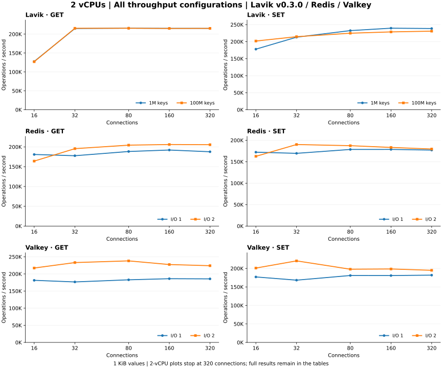
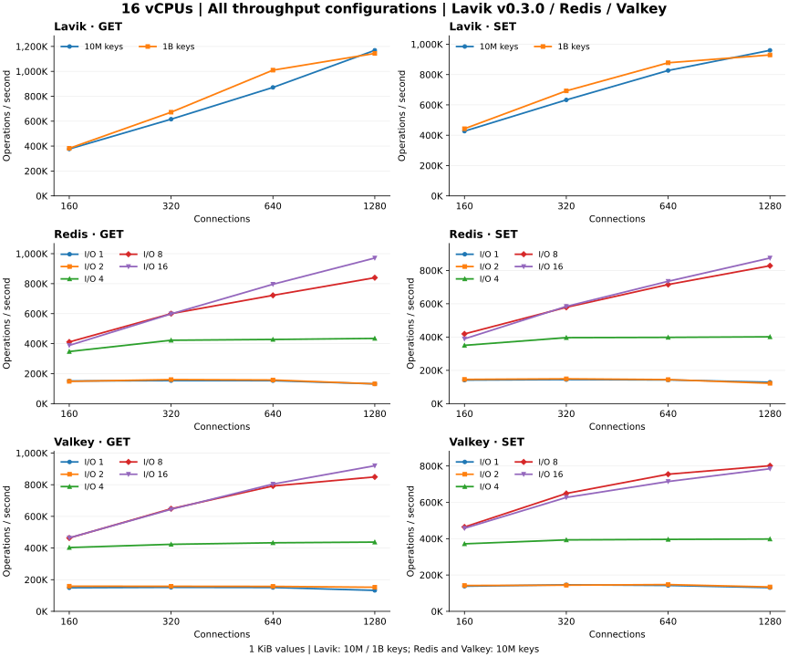

# Lavik v0.3.0 versus in-memory databases: 2 and 16 vCPUs

**English** | [简体中文](README.zh-CN.md)

Compare Lavik, Redis 8.10.2 and Valkey 9.1.2 on two server sizes, including Lavik’s 100M- and 1B-key capacity results. The report contains **180 formal comparison points**, all with **1 KiB values**, measured on **2026-11-15 (UTC)**.

| Server vCPUs | Datasets | Client threads / CPUs | Total connections | Seconds / point | Points |
| --- | --- | --- | --- | --- | --- |
| 2 | Lavik 1M / 100M; Redis / Valkey 1M | 16 / 0–15 | 16 / 32 / 80 / 160 / 320 / 640 / 1280 | 30 | 84 |
| 16 | Lavik / Redis / Valkey 10M | 16 / 0–15 | 160 / 320 / 640 / 1280 | 30 | 88 |
| 16 | Lavik 1B | 32 / 0–31 | 160 / 320 / 640 / 1280 | 60 | 8 |

Tested version: **Lavik v0.3.0**, commit `dcb2dda96452610b9aa2625ff2a26abb3303f9b5`.

## 2 vCPUs: 1M and 100M keys

At 100M keys, peak GET / SET throughput is **215,536 / 230,794 ops/s**, retaining **99.9% / 96.4%** of the smaller dataset’s peaks. At the same 1M keys, Valkey has the highest GET peak (238,151 ops/s), while Lavik has the highest SET peak (239,535 ops/s). Peaks may occur at different connection counts; matched-concurrency results follow below.

### Throughput and p99.9 latency


| Command | Product / keys | Workers / I/O threads | Connections | Peak ops/s | p99.9 ms |
| --- | --- | --- | --- | --- | --- |
| GET | Lavik 0.3.0 / 1M | 2 | 80 | 215,689 | 0.671 |
| GET | Lavik 0.3.0 / 100M | 2 | 80 | 215,536 | 0.647 |
| GET | Redis 8.10.2 / 1M | 2 | 1280 | 208,441 | 18.687 |
| GET | Valkey 9.1.2 / 1M | 2 | 80 | 238,151 | 0.503 |
| SET | Lavik 0.3.0 / 1M | 2 | 160 | 239,535 | 1.599 |
| SET | Lavik 0.3.0 / 100M | 2 | 320 | 230,794 | 3.887 |
| SET | Redis 8.10.2 / 1M | 2 | 32 | 190,106 | 0.255 |
| SET | Valkey 9.1.2 / 1M | 2 | 32 | 220,455 | 0.215 |

For each command, each peer uses the **single I/O-thread setting with its highest peak** over the full sweep for the entire throughput and latency curve; settings are not spliced point by point. Peak-table latency is from the same window. **The 2-vCPU charts show only 16–320 connections; tables retain 640 / 1280.**

### Matched-concurrency comparison

Cells show **ops/s / p99.9 ms**.

| Command | Connections | Lavik 0.3.0 / 1M | Lavik 0.3.0 / 100M | Redis 8.10.2 / 1M | Valkey 9.1.2 / 1M |
| --- | --- | --- | --- | --- | --- |
| GET | 16 | 127,675 / 0.279 | 126,953 / 0.199 | 164,117 / 0.167 | 217,251 / 0.143 |
| GET | 32 | 214,755 / 0.359 | 215,425 / 0.263 | 195,499 / 0.279 | 233,187 / 0.263 |
| GET | 80 | 215,689 / 0.671 | 215,536 / 0.647 | 204,387 / 0.775 | 238,151 / 0.503 |
| GET | 160 | 215,227 / 1.887 | 214,951 / 2.607 | 205,932 / 1.767 | 227,427 / 2.495 |
| GET | 320 | 215,142 / 3.615 | 215,166 / 3.535 | 205,515 / 4.319 | 224,037 / 5.279 |
| GET | 640 | 212,536 / 11.775 | 215,056 / 6.783 | 205,496 / 9.855 | 222,142 / 9.919 |
| GET | 1280 | 214,363 / 13.951 | 214,874 / 12.159 | 208,441 / 18.687 | 222,936 / 17.663 |
| SET | 16 | 177,915 / 0.207 | 201,847 / 0.167 | 162,613 / 0.167 | 201,029 / 0.151 |
| SET | 32 | 213,108 / 0.295 | 214,558 / 0.311 | 190,106 / 0.255 | 220,455 / 0.215 |
| SET | 80 | 232,442 / 0.759 | 224,756 / 1.151 | 187,409 / 0.719 | 197,883 / 0.895 |
| SET | 160 | 239,535 / 1.599 | 228,609 / 2.815 | 183,348 / 1.959 | 198,552 / 3.007 |
| SET | 320 | 238,512 / 4.895 | 230,794 / 3.887 | 179,628 / 4.799 | 194,950 / 4.735 |
| SET | 640 | 236,808 / 7.423 | 227,535 / 7.359 | 178,303 / 10.687 | 188,992 / 10.367 |
| SET | 1280 | 231,358 / 12.991 | 220,792 / 13.311 | 176,903 / 19.583 | 188,545 / 21.375 |

### Complete I/O-thread sweep

| Product | I/O threads | GET peak ops/s (connections) | SET peak ops/s (connections) |
| --- | --- | --- | --- |
| Redis 8.10.2 | 1 | 192,048 (160) | 178,727 (160) |
| Redis 8.10.2 | 2 | 208,441 (1280) | 190,106 (32) |
| Valkey 9.1.2 | 1 | 186,115 (160) | 183,241 (1280) |
| Valkey 9.1.2 | 2 | 238,151 (80) | 220,455 (32) |



### Memory and client diagnostics

| Product / keys | INFO used_memory (MiB) | Process RSS (MiB) | Max average client CPU / cores | Max server steal / % |
| --- | --- | --- | --- | --- |
| Lavik 0.3.0 / 1M | 318.8–318.8 | 186.9–197.2 | 2.095 | 0.0000 |
| Lavik 0.3.0 / 100M | 4,604.3–4,604.3 | 4,270.4–4,280.5 | 1.954 | 0.0000 |
| Redis 8.10.2 / 1M | 1,264.7–1,265.0 | 1,283.9–2,202.3 | 1.472 | 0.0000 |
| Valkey 9.1.2 / 1M | 1,268.1–1,268.6 | 1,286.5–2,111.2 | 1.464 | 0.0000 |

Ranges use post-point snapshots. INFO memory follows each product’s accounting; RSS excludes the SPDK hugepage reservation. Lavik reserves an additional 2,048 MiB of hugepages. Client CPU is the process average over each window, not a per-thread peak. Some 16-vCPU / 10M points approach the assigned client CPU budget, so these peaks do not establish an absolute server-capacity ceiling.

## 16 vCPUs: 10M and 1B keys

Lavik 10M / 1B and Redis / Valkey 10M use the same 160/320/640/1280 connection counts. The 10M tests use **16 client threads and 30-second windows**; 1B uses **32 client threads and 60-second windows**. All points were freshly measured in this round.

### Throughput and p99.9 latency


| Command | Product / keys | Workers / I/O threads | Client threads | Connections | Peak ops/s | p99.9 ms |
| --- | --- | --- | --- | --- | --- | --- |
| GET | Lavik 0.3.0 / 10M | 16 | 16 | 1280 | 1,168,681 | 6.207 |
| GET | Lavik 0.3.0 / 1B | 16 | 32 | 1280 | 1,143,839 | 3.887 |
| GET | Redis 8.10.2 / 10M | 16 | 16 | 1280 | 971,136 | 7.167 |
| GET | Valkey 9.1.2 / 10M | 16 | 16 | 1280 | 919,758 | 7.391 |
| SET | Lavik 0.3.0 / 10M | 16 | 16 | 1280 | 959,837 | 7.199 |
| SET | Lavik 0.3.0 / 1B | 16 | 32 | 1280 | 929,346 | 5.279 |
| SET | Redis 8.10.2 / 10M | 16 | 16 | 1280 | 874,635 | 7.231 |
| SET | Valkey 9.1.2 / 10M | 8 | 16 | 1280 | 801,428 | 7.583 |

For each command, each peer uses the **single I/O-thread setting with its highest peak** over the full sweep for the entire throughput and latency curve; settings are not spliced point by point. Peak-table latency is from the same window.

### Matched-concurrency comparison

Cells show **ops/s / p99.9 ms**.

| Command | Connections | Lavik 0.3.0 / 10M | Lavik 0.3.0 / 1B | Redis 8.10.2 / 10M | Valkey 9.1.2 / 10M |
| --- | --- | --- | --- | --- | --- |
| GET | 160 | 376,725 / 0.903 | 382,250 / 0.823 | 388,562 / 0.871 | 464,368 / 0.879 |
| GET | 320 | 615,731 / 1.551 | 671,976 / 0.927 | 598,530 / 1.367 | 644,655 / 1.399 |
| GET | 640 | 870,897 / 3.599 | 1,009,460 / 1.719 | 796,158 / 3.439 | 803,926 / 3.663 |
| GET | 1280 | 1,168,681 / 6.207 | 1,143,839 / 3.887 | 971,136 / 7.167 | 919,758 / 7.391 |
| SET | 160 | 426,998 / 0.887 | 443,004 / 0.807 | 389,159 / 0.879 | 464,311 / 0.839 |
| SET | 320 | 632,927 / 1.735 | 692,511 / 0.919 | 583,883 / 1.391 | 648,985 / 1.343 |
| SET | 640 | 826,811 / 3.711 | 877,731 / 2.271 | 734,854 / 3.231 | 754,771 / 3.439 |
| SET | 1280 | 959,837 / 7.199 | 929,346 / 5.279 | 874,635 / 7.231 | 801,428 / 7.583 |

### Complete I/O-thread sweep

| Product | I/O threads | GET peak ops/s (connections) | SET peak ops/s (connections) |
| --- | --- | --- | --- |
| Redis 8.10.2 | 1 | 153,518 (320) | 144,395 (320) |
| Redis 8.10.2 | 2 | 160,279 (320) | 148,925 (320) |
| Redis 8.10.2 | 4 | 435,077 (1280) | 401,351 (1280) |
| Redis 8.10.2 | 8 | 839,976 (1280) | 828,286 (1280) |
| Redis 8.10.2 | 16 | 971,136 (1280) | 874,635 (1280) |
| Valkey 9.1.2 | 1 | 151,579 (320) | 145,922 (320) |
| Valkey 9.1.2 | 2 | 158,728 (160) | 147,252 (640) |
| Valkey 9.1.2 | 4 | 437,382 (1280) | 398,036 (1280) |
| Valkey 9.1.2 | 8 | 849,172 (1280) | 801,428 (1280) |
| Valkey 9.1.2 | 16 | 919,758 (1280) | 785,046 (1280) |



### 1B latency details

| Command | Connections | Client threads | Ops/s | p50 ms | p99 ms | p99.9 ms | p99.99 ms |
| --- | --- | --- | --- | --- | --- | --- | --- |
| GET | 160 | 32 | 382,250 | 0.415 | 0.735 | 0.823 | 1.615 |
| GET | 320 | 32 | 671,976 | 0.479 | 0.799 | 0.927 | 1.231 |
| GET | 640 | 32 | 1,009,460 | 0.623 | 1.191 | 1.719 | 4.223 |
| GET | 1280 | 32 | 1,143,839 | 1.079 | 2.079 | 3.887 | 8.255 |
| SET | 160 | 32 | 443,004 | 0.367 | 0.671 | 0.807 | 4.799 |
| SET | 320 | 32 | 692,511 | 0.455 | 0.799 | 0.919 | 1.279 |
| SET | 640 | 32 | 877,731 | 0.719 | 1.223 | 2.271 | 13.759 |
| SET | 1280 | 32 | 929,346 | 1.359 | 2.175 | 5.279 | 18.943 |

### Memory and client diagnostics

| Product / keys | INFO used_memory (MiB) | Process RSS (MiB) | Max average client CPU / cores | Max server steal / % |
| --- | --- | --- | --- | --- |
| Lavik 0.3.0 / 10M | 2,177.2–2,177.2 | 952.1–958.9 | 14.332 | 0.0000 |
| Lavik 0.3.0 / 1B | 41,989.3–41,989.4 | 39,869.0–39,878.9 | 18.146 | 0.0000 |
| Redis 8.10.2 / 10M | 12,678.0–12,681.3 | 12,798.3–12,874.5 | 12.896 | 0.0000 |
| Valkey 9.1.2 / 10M | 12,654.7–12,655.8 | 12,773.6–13,020.3 | 11.970 | 0.0000 |

Ranges use post-point snapshots. INFO memory follows each product’s accounting; RSS excludes the SPDK hugepage reservation. Lavik reserves an additional 8,192 MiB of hugepages. Client CPU is the process average over each window, not a per-thread peak. Some 16-vCPU / 10M points approach the assigned client CPU budget, so these peaks do not establish an absolute server-capacity ceiling.

## Environment and test method

### 2 vCPUs

#### Versions and hardware

| Item | Configuration |
| --- | --- |
| Server | Standard_L2aos_v5; 2 vCPU (1 physical core) / 16 GiB nominal RAM; AMD EPYC 9V45 96-Core Processor |
| Client | Standard_L16aos_v5; separate VM; CPUs 0–15 |
| Region | East US, zone 3 |
| OS | Ubuntu 24.04; Linux 7.0.0-1017-azure on both hosts |
| Storage | 1 × 1,439,887,785,984-byte dedicated local NVMe; SPDK/VFIO |
| Network | Kernel TCP; same VNet and availability zone; accelerated networking |
| Lavik | Lavik v0.3.0, standard x86_64 build; dcb2dda96452610b9aa2625ff2a26abb3303f9b5 |

#### Test method

- Fresh decimal keys `1..N`, no prefix, 1,024-byte values, no TTL. Independently load Lavik 1M and 100M; Redis and Valkey each use 1M.
- memtier 2.5.1 on 16 pinned client CPUs, uniform random GET or overwriting SET. Connections: 16, 32, 80, 160, 320, 640, 1280. One run per point, 30 seconds for the baseline and 100M-key group. Every timed run uses independent client seeds.
- Ten-second GET warmup per configuration. GET precedes SET and concurrency increases within each sweep. Products run sequentially on the same server; builds finish before measurement.
- Lavik uses 2 workers and dedicated NVMe via SPDK. Overrides: `--tomb-raider-interval-ms=0`, `--spdk-max-completions-per-poll=16`, and 2 GiB EAL/hugepage memory. Defrag status is checked around every point.
- Redis 8.10.2 and Valkey 9.1.2 use optimized builds with jemalloc, and I/O threads 1, 2. `save ""` disables scheduled snapshots. A manual SAVE after initial fill provides the unchanged RDB baseline for each I/O setting; measured writes are memory-only.
- THP is `never`, overcommit is 1. Exact DBSIZE and five value lengths are verified before/after configurations. Fill operation counts, zero GET misses, connection errors, versions and CPU affinity are checked.

### 16 vCPUs: 10M

#### Versions and hardware

| Item | Configuration |
| --- | --- |
| Server | Standard_L16aos_v4; 16 vCPU (8 physical cores) / 128 GiB nominal RAM; AMD EPYC 9V74 80-Core Processor |
| Client | Standard_F32als_v6; separate VM; CPUs 0–15 |
| Region | Japan East, zone 2 |
| OS | Ubuntu 24.04; Linux 7.0.0-1017-azure on both hosts |
| Storage | 6 × 1,919,850,381,312-byte dedicated local NVMe; SPDK/VFIO |
| Network | Kernel TCP; same VNet and availability zone; accelerated networking |
| Lavik | Lavik v0.3.0, standard x86_64 build; dcb2dda96452610b9aa2625ff2a26abb3303f9b5 |

#### Test method

- Fresh decimal keys `1..N`, no prefix, 1,024-byte values, no TTL. Independently load 10M keys for each product.
- memtier 2.5.1 on 16 pinned client CPUs, uniform random GET or overwriting SET. Connections: 160, 320, 640, 1280. One 30-second run per point, keeping the original default client seeds.
- Ten-second GET warmup per configuration. GET precedes SET and concurrency increases within each sweep. Products run sequentially on the same server; builds finish before measurement.
- Lavik uses 16 workers and dedicated NVMe via SPDK. Overrides: `--tomb-raider-interval-ms=0`, `--spdk-max-completions-per-poll=16`, and 8 GiB EAL/hugepage memory. Defrag status is checked around every point.
- Redis 8.10.2 and Valkey 9.1.2 use optimized builds with jemalloc, and I/O threads 1, 2, 4, 8, 16. `save ""` disables scheduled snapshots. A manual SAVE after initial fill provides the unchanged RDB baseline for each I/O setting; measured writes are memory-only.
- THP is `never`, overcommit is 1. Exact DBSIZE and five value lengths are verified before/after configurations. Fill operation counts, zero GET misses, connection errors, versions and CPU affinity are checked.

### 16 vCPUs: 1B

| Item | Configuration |
| --- | --- |
| Server | Standard_L16aos_v4; Japan East zone 2; AMD EPYC 9V74; 8 physical cores / 16 vCPUs; 128 GiB nominal RAM |
| Client | Standard_F32als_v6; 32 vCPUs; memtier 2.5.1; 32 threads pinned to CPUs 0–31 |
| OS | Ubuntu 24.04; Linux 7.0.0-1017-azure on both VMs |
| Storage | 6 × 1,919,850,381,312-byte dedicated NVMe; SPDK/VFIO; 8 GiB EAL/hugepage reservation |
| Network | Private VNet; kernel TCP; accelerated networking |
| Lavik | Lavik v0.3.0, standard x86_64 build; dcb2dda96452610b9aa2625ff2a26abb3303f9b5 |

- Decimal keys 1..1,000,000,000, no prefix or TTL, 1,024-byte values: 953.67 GiB logical value payload, excluding keys, index and storage overhead.
- Fresh sequential fill: exactly 1B SETs, 32 threads and 640 total connections. Formal sweeps use independent client seeds, uniform random GET or overwriting SET, and 60 seconds per point. GET precedes SET; concurrency increases within each sweep. No additional GET warmup.
- Lavik uses 16 server workers, SPDK, shutdown checkpointing, tomb-raider interval 0 and SPDK completion cap 16. Other tested defaults are inherited. Defrag status is checked around every measured point. Exact DBSIZE and five value lengths are verified before and after the sweep.
- Each cell has one run; no confidence intervals. Throughput and percentiles come from the complete measurement window.

Load invocation wall time: **21.3 minutes**; reported fill throughput: **979,105 ops/s**. Across the eight 1B formal points, maximum average client CPU use is **18.146 cores**, and sampled server CPU steal is **0.0000%**.

## Evidence and measurement limits

All 180 formal comparison points passed operation-count, connection-error, GET-miss, key-count and sample-length checks. The campaign also completed 44 same-host v0.2.0 baseline points and 48 follow-up windows, for 272 valid measurement windows in total. Raw output, commands and SHA-256 manifests are archived separately; this report's tables use only the initial v0.3.0 / Redis / Valkey measurements.

Each point has one formal window; no confidence intervals are claimed. Successful responses do not imply equal synchronous durability guarantees. Capacity curves use 100 times the peers' key count; use 1M / 10M for equal-data comparisons. Compared with October, the kernel is now 7.0.0-1017-azure and the 2-vCPU client is L16aos_v5. Redis / Valkey builds omit TLS support; traffic was plaintext in both rounds. Changes in absolute results across rounds cannot be attributed to version alone.

## Reproduction commands

Replace placeholder addresses, PCI identities and binary paths with those of your test hosts. Build v0.3.0 as follows after installing dependencies from the [build guide](../../docs/operations/building-and-packaging.md).

```bash
git clone https://github.com/eloqdata/lavik.git lavik-build
cd lavik-build
git checkout dcb2dda96452610b9aa2625ff2a26abb3303f9b5
git submodule update --init bycorf third_party/mimalloc
git -C bycorf submodule update --init third_party/liburing third_party/abseil third_party/spdk third_party/dpdk
git -C bycorf/third_party/spdk submodule update --init isa-l isa-l-crypto
LAVIK_PACKAGE_KERNEL_BYPASS=ON ./scripts/package_release.sh
```

### 2 vCPU

Use the L2aos_v5 server and an L16aos_v5 client in the same availability zone over the private network. Prepare the standard x86_64 Lavik build described above, Redis 8.10.2, Valkey 9.1.2 and memtier 2.5.1. Redis and Valkey use default optimized builds with jemalloc 5.3.0 and `make -j12`. The commands below use Bash.

#### Start the servers

```bash
# Run on the server; replace the address and binary paths for your hosts.
SERVER_IP=YOUR_SERVER_PRIVATE_IP
LAVIK_BIN=/path/to/lavik-v0.3.0/lavik
REDIS_BIN=/opt/bench020/bin/redis-server
VALKEY_BIN=/opt/bench020/bin/valkey-server
ulimit -n 65535
sudo sysctl -w vm.overcommit_memory=1
printf 'never\n' | sudo tee /sys/kernel/mm/transparent_hugepage/enabled
```

Lavik uses an empty, dedicated NVMe namespace. Identify and bind the test device to VFIO using the [SPDK storage guide](../../docs/operations/spdk-storage.md), with `HUGEMEM=2048` and `BYCORF_DPDK_MEMORY_MB=2048`. Load 1M and 100M keys separately. Between them, stop Lavik cleanly, restore the NVMe driver, clear the verified scratch namespace, and rebind it before the independent load.

```bash
# Use the verified PCI address and namespace ID of your empty test NVMe.
NVME_BDF=YOUR_NVME_PCI_ADDRESS
NVME_NSID=1
sudo prlimit --memlock=unlimited:unlimited --nofile=65535:65535 \
  env BYCORF_EAL_ARGS="-a ${NVME_BDF}" BYCORF_DPDK_MEMORY_MB=2048 \
  taskset -c 0-1 "$LAVIK_BIN" \
  --storage=spdk --bind="$SERVER_IP" \
  --tomb-raider-interval-ms=0 --spdk-max-completions-per-poll=16 \
  --log-dir="$PWD/lavik-logs" \
  --data-file="spdk://${NVME_BDF}/${NVME_NSID}"
```

The command lists only non-default parameters. `taskset -c 0-1` selects two CPUs and Lavik starts two workers accordingly. EAL memory is reserved at 2 GiB; the periodic tombstone sweep is disabled and the SPDK completion cap is fixed at 16.

Test Redis and Valkey with one and two I/O threads, running only one server at a time:

```bash
# Initial fill: IO_THREADS=2. Then restart from the saved RDB with IO_THREADS=1 and 2.
IO_THREADS=2
IO_ARGS=(); if ((IO_THREADS > 1)); then IO_ARGS=(--io-threads "$IO_THREADS"); fi
mkdir -p "$PWD/bench-data/redis" "$PWD/bench-data/valkey"

# Redis 8.10.2
taskset -c 0-1 "$REDIS_BIN" \
  --bind "$SERVER_IP" --protected-mode no \
  --dir "$PWD/bench-data/redis" \
  --save "" \
  "${IO_ARGS[@]}"

# Valkey 9.1.2 (after stopping Redis)
taskset -c 0-1 "$VALKEY_BIN" \
  --bind "$SERVER_IP" --protected-mode no \
  --dir "$PWD/bench-data/valkey" \
  --save "" \
  "${IO_ARGS[@]}"
```

#### Load data and run memtier

Run Lavik 1M, Lavik 100M, Redis IO=1/2 and Valkey IO=1/2 in that order. Set `N` and `RUN` for each configuration. Confirm `DBSIZE=0` before each product's first fill. For Redis and Valkey, issue one `SAVE` after the initial fill and exit with `SHUTDOWN NOSAVE`. Start each I/O configuration from the same baseline RDB. Skip the fill on restart, validate the data, and repeat warmup and measurement. Both Lavik datasets start with an empty scratch namespace.

```bash
# Bash, on the separate client, CPUs 0–15; memtier_benchmark 2.5.1.
set -euo pipefail
SERVER_IP=YOUR_SERVER_PRIVATE_IP
N=1000000 # Use 100000000 for the large Lavik dataset.
RUN=lavik-1m # lavik-100m, redis-io1, redis-io2, valkey-io1, valkey-io2
mkdir -p "$RUN"
ulimit -n 65535
COMMON=(--server="$SERVER_IP" \
  --threads=16 --key-minimum=1 --key-maximum="$N" \
  --key-prefix= --data-size=1024 --hide-histogram \
  --print-percentiles=50,99,99.9,99.99 --show-config)

# Fill an empty dataset using disjoint sequential key streams: exactly N writes.
taskset -c 0-15 memtier_benchmark "${COMMON[@]}" --clients=10 \
  --requests="$((N / 160))" --ratio=1:0 --key-pattern=P:P \
  --json-out-file="$RUN/fill.json" > "$RUN/fill.txt" 2>&1

check_data() {
  test "$(redis-cli -h "$SERVER_IP" --raw DBSIZE)" = "$N"
  for key in 1 2 "$((N / 2))" "$((N - 1))" "$N"; do
    test "$(redis-cli -h "$SERVER_IP" --raw STRLEN "$key")" = 1024
  done
}
check_data

# For each memory peer only: create its baseline RDB once after the first fill.
# redis-cli -h "$SERVER_IP" SAVE

# Warmup, then GET and SET sweeps. Reuse this part after loading a baseline RDB.
taskset -c 0-15 memtier_benchmark "${COMMON[@]}" --clients=10 \
  --distinct-client-seed --test-time=10 \
  --command='GET __key__' --command-is-read \
  --json-out-file="$RUN/warmup.json" > "$RUN/warmup.txt" 2>&1

for kind in GET SET; do
  if [ "$kind" = GET ]; then
    COMMAND='GET __key__'; READ_FLAG=(--command-is-read)
  else
    COMMAND='SET __key__ __data__'; READ_FLAG=()
  fi
  for connections in 16 32 80 160 320 640 1280; do
    taskset -c 0-15 memtier_benchmark "${COMMON[@]}" \
      --clients="$((connections / 16))" --distinct-client-seed --test-time=30 \
      --command="$COMMAND" "${READ_FLAG[@]}" \
      --json-out-file="$RUN/${kind}-c${connections}.json" \
      > "$RUN/${kind}-c${connections}.txt" 2>&1
  done
done
check_data
```

After each configuration, check that all GETs hit, connection errors are zero, and DBSIZE is unchanged.

### 16 vCPU / 10M

These Bash commands use the measured settings; adapt paths, addresses and PCI identities to the deployment. Run one database and one load generator at a time. Use a separate result directory for each configuration.

#### Lavik SPDK

Follow the [SPDK storage guide](../../docs/operations/spdk-storage.md) to verify six dedicated scratch NVMe devices and prepare VFIO and 8 GiB hugepages. Load the 10M dataset on empty media; do not overwrite system disks or existing application data. After a clean Lavik stop, restore kernel drivers and hugepage reservations before testing the memory databases. The 10M launch command is:

```bash
sudo prlimit --memlock=unlimited:unlimited --nofile=65535:65535 env 'BYCORF_EAL_ARGS=-a NVME_1_PCI_ADDRESS -a NVME_2_PCI_ADDRESS -a NVME_3_PCI_ADDRESS -a NVME_4_PCI_ADDRESS -a NVME_5_PCI_ADDRESS -a NVME_6_PCI_ADDRESS' BYCORF_DPDK_MEMORY_MB=8192 taskset \
  -c 0-15 /path/to/lavik-v0.3.0/lavik \
  --storage=spdk \
  --bind=YOUR_SERVER_PRIVATE_IP \
  --tomb-raider-interval-ms=0 \
  --spdk-max-completions-per-poll=16 \
  --log-dir=/opt/bench020/results/large/memory/lavik-10m/logs \
  --data-file=spdk://NVME_1_PCI_ADDRESS/1 \
  --data-file=spdk://NVME_2_PCI_ADDRESS/1 \
  --data-file=spdk://NVME_3_PCI_ADDRESS/1 \
  --data-file=spdk://NVME_4_PCI_ADDRESS/1 \
  --data-file=spdk://NVME_5_PCI_ADDRESS/1 \
  --data-file=spdk://NVME_6_PCI_ADDRESS/1
```

Wait for startup and background initialization, then check that `CONFIG GET defrag-paused` returns `no`; repeat this check before and after each measured point.

#### Redis / Valkey

Build with jemalloc 5.3.0 using `make -j12`. Redis 8.10.2 uses commit `498ecd0d6d007db11ddb3aea9428552598a78622`; Valkey 9.1.2 uses `7f1dffedff6de73058b2c2a389422b6ecd56c8fb`. Use 16 I/O threads for the initial fill.

```bash
# On the server; start one product/configuration at a time.
PRODUCT=redis # redis or valkey
IO_THREADS=16 # tested: 1, 2, 4, 8, 16
IO_ARGS=(); if ((IO_THREADS > 1)); then IO_ARGS=(--io-threads "$IO_THREADS"); fi
DATA_DIR=/opt/bench020/results/large/data/$PRODUCT
mkdir -p "$DATA_DIR"
ulimit -n 65535
taskset -c 0-15 "/opt/bench020/bin/$PRODUCT-server" \
  --bind YOUR_SERVER_PRIVATE_IP --protected-mode no \
  --dir "$DATA_DIR" --save "" \
    "${IO_ARGS[@]}"
```

#### Load, warmup and connection sweep

```bash
# On the client: memtier_benchmark 2.5.1.
KEYS=10000000
SECONDS_PER_POINT=30
SEED=()
mkdir -p results
ulimit -n 65535
COMMON=(--server=YOUR_SERVER_PRIVATE_IP
  --threads=16 --key-minimum=1 --key-maximum="$KEYS"
  --key-prefix= --data-size=1024 --hide-histogram
  --print-percentiles=50,99,99.9,99.99 --show-config)

# Once per fresh dataset; each key is written once across 640 clients.
taskset -c 0-15 memtier_benchmark "${COMMON[@]}" --clients=40 \
  --json-out-file=results/fill.json --requests="$((KEYS / 640))" \
  --ratio=1:0 --key-pattern=P:P
redis-cli -h YOUR_SERVER_PRIVATE_IP --raw DBSIZE
redis-cli -h YOUR_SERVER_PRIVATE_IP STRLEN 1
```

For Redis/Valkey, run the baseline commands below after the initial fill. Restart in turn with 1, 2, 4, 8 and 16 I/O threads; wait for RDB loading and DBSIZE=10000000, verify persistence settings, then run the warmup and measurement block. End each configuration with `SHUTDOWN NOSAVE` so the same `dump.rdb` remains unchanged. Do not refill or run SAVE during measurement. Skip these RDB baseline commands for Lavik.

```bash
redis-cli -h YOUR_SERVER_PRIVATE_IP SAVE
redis-cli -h YOUR_SERVER_PRIVATE_IP SHUTDOWN NOSAVE
# On the server, record/check the unchanged RDB baseline hash:
sha256sum "$DATA_DIR/dump.rdb"
# After each restart, run these checks from the client:
redis-cli -h YOUR_SERVER_PRIVATE_IP CONFIG GET save
redis-cli -h YOUR_SERVER_PRIVATE_IP CONFIG GET appendonly
redis-cli -h YOUR_SERVER_PRIVATE_IP INFO persistence
```

```bash
# Run once for Lavik 10M and once per Redis/Valkey I/O-thread configuration.
if [ "$KEYS" -eq 10000000 ]; then
  taskset -c 0-15 memtier_benchmark "${COMMON[@]}" --clients=40 \
    --json-out-file=results/warmup.json --test-time=10 \
    --command='GET __key__' --command-is-read
fi
for OP in GET SET; do
  COMMAND=(--command='GET __key__' --command-is-read)
  if [ "$OP" = SET ]; then
    COMMAND=(--command='SET __key__ __data__' )
  fi
  for CONNECTIONS in 160 320 640 1280; do
    taskset -c 0-15 memtier_benchmark "${COMMON[@]}" \
      --clients="$((CONNECTIONS / 16))" \
      --json-out-file="results/$OP-c$CONNECTIONS.json" \
      --test-time="$SECONDS_PER_POINT" "${COMMAND[@]}" "${SEED[@]}" \
      > "results/$OP-c$CONNECTIONS.txt" 2>&1
  done
done
redis-cli -h YOUR_SERVER_PRIVATE_IP --raw DBSIZE
```

### 16 vCPU / 1B

Use the [SPDK operations guide](../../docs/operations/spdk-storage.md) to verify six dedicated test devices and prepare VFIO with 8 GiB hugepages. Load only empty test media; wait for PING and check defrag-paused is no. Stop cleanly after measurement, then restore kernel drivers and hugepage reservations using the guide.

```bash
sudo prlimit --memlock=unlimited:unlimited --nofile=65535:65535 env \
  BYCORF_EAL_ARGS='-a NVME_1_PCI_ADDRESS -a NVME_2_PCI_ADDRESS -a NVME_3_PCI_ADDRESS -a NVME_4_PCI_ADDRESS -a NVME_5_PCI_ADDRESS -a NVME_6_PCI_ADDRESS' \
  BYCORF_DPDK_MEMORY_MB=8192 \
  taskset -c 0-15 /path/to/lavik-v0.3.0/lavik \
  --storage=spdk --bind=YOUR_SERVER_PRIVATE_IP --shutdown-checkpoint \
  --tomb-raider-interval-ms=0 --spdk-max-completions-per-poll=16 \
  --log-dir=/opt/bench020/results/large/storage/lavik-1b/logs \
  --data-file=spdk://NVME_1_PCI_ADDRESS/1 \
  --data-file=spdk://NVME_2_PCI_ADDRESS/1 \
  --data-file=spdk://NVME_3_PCI_ADDRESS/1 \
  --data-file=spdk://NVME_4_PCI_ADDRESS/1 \
  --data-file=spdk://NVME_5_PCI_ADDRESS/1 \
  --data-file=spdk://NVME_6_PCI_ADDRESS/1
```

Run on the separate client:

```bash
SERVER=YOUR_SERVER_PRIVATE_IP
mkdir -p results
ulimit -n 65535
COMMON=(--server="$SERVER" --threads=32 --key-minimum=1
  --key-maximum=1000000000 --key-prefix= --data-size=1024
  --hide-histogram --print-percentiles=50,99,99.9,99.99 --show-config)
# 32 threads × 20 connections × 1,562,500 requests = 1,000,000,000 SETs.
taskset -c 0-31 memtier_benchmark "${COMMON[@]}" --clients=20 \
  --requests=1562500 --ratio=1:0 --key-pattern=P:P --json-out-file=results/fill.json
redis-cli -h "$SERVER" --raw DBSIZE
for key in 1 2 500000000 999999999 1000000000; do
  test "$(redis-cli -h "$SERVER" --raw STRLEN "$key")" = 1024
done
# No additional GET warmup for Lavik 1B.
for op in GET SET; do
  COMMAND=(--command='GET __key__' --command-is-read)
  if [[ "$op" == SET ]]; then COMMAND=(--command='SET __key__ __data__'); fi
  for connections in 160 320 640 1280; do
    redis-cli -h "$SERVER" CONFIG GET defrag-paused
    taskset -c 0-31 memtier_benchmark "${COMMON[@]}" \
      --clients="$((connections / 32))" --test-time=60 --distinct-client-seed \
      "${COMMAND[@]}" --json-out-file="results/$op-c$connections.json" \
      > "results/$op-c$connections.txt" 2>&1
    redis-cli -h "$SERVER" CONFIG GET defrag-paused
  done
done
redis-cli -h "$SERVER" --raw DBSIZE
```
