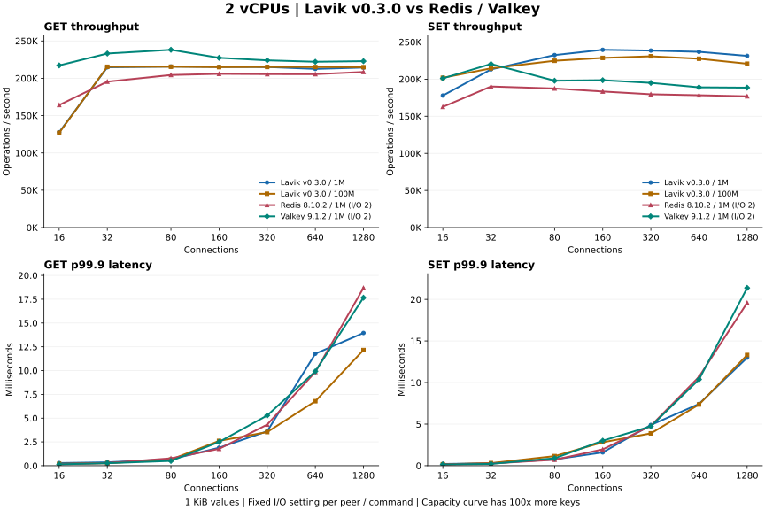
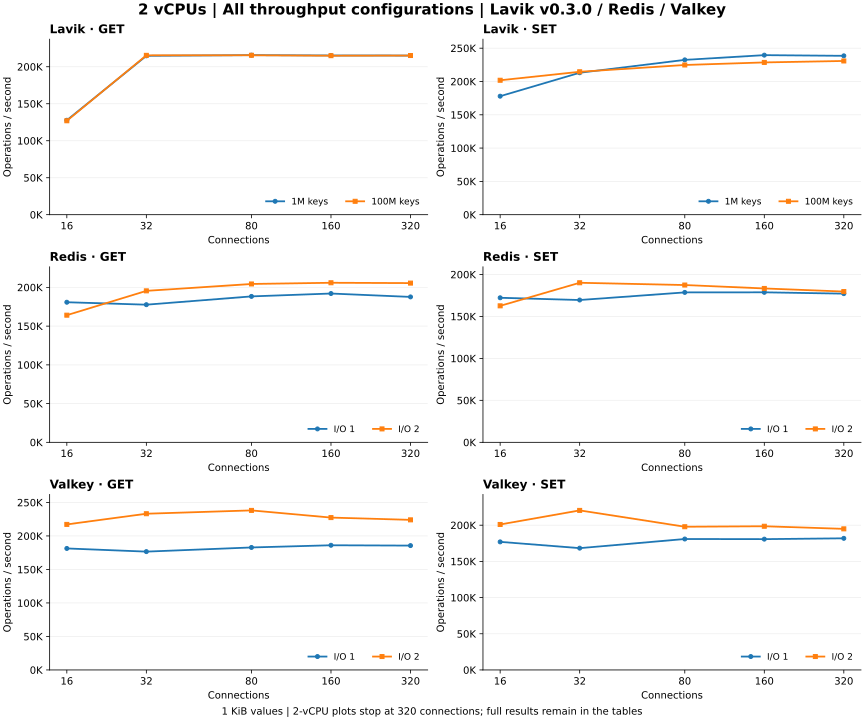
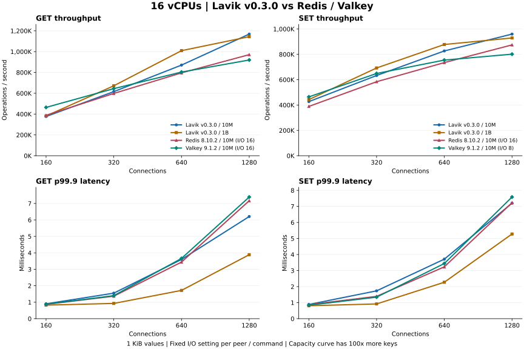
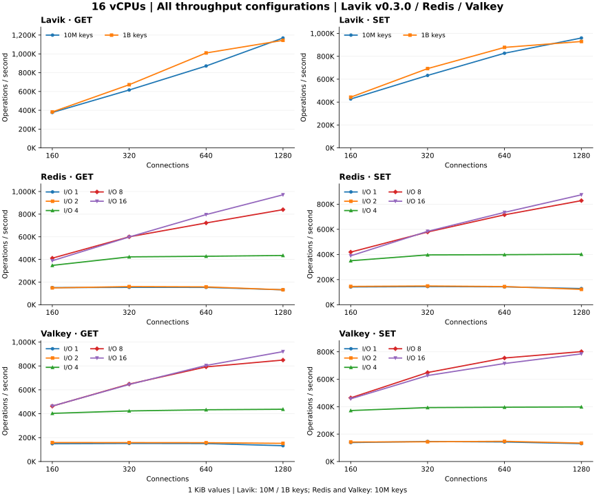

# Lavik v0.3.0 与内存数据库对比：2 vCPU / 16 vCPU

[English](README.md) | **简体中文**

在两种服务器规格上对比 Lavik、Redis 8.10.2 和 Valkey 9.1.2，包含 Lavik 的 100M / 1B key 容量测试。报告展示 **180 个正式对比点**，value 均为 **1 KiB**，测试日期为 **2026-11-15（UTC）**。

| Server vCPUs | Datasets | Client threads / CPUs | Total connections | Seconds / point | Points |
| --- | --- | --- | --- | --- | --- |
| 2 | Lavik 1M / 100M; Redis / Valkey 1M | 16 / 0–15 | 16 / 32 / 80 / 160 / 320 / 640 / 1280 | 30 | 84 |
| 16 | Lavik / Redis / Valkey 10M | 16 / 0–15 | 160 / 320 / 640 / 1280 | 30 | 88 |
| 16 | Lavik 1B | 32 / 0–31 | 160 / 320 / 640 / 1280 | 60 | 8 |

v0.3.0 tag 与实测提交 `dcb2dda96452610b9aa2625ff2a26abb3303f9b5` 一致；测试使用该提交发布前构建的标准 x86_64 包，版本输出为 `0.3.0-dev`。

## 2 vCPU：1M 与 100M key

100M key 的 GET / SET 峰值为 **215,536 / 230,794 ops/s**，分别保留 1M 数据集峰值的 **99.9% / 96.4%**。1M 同数据量对照中，Valkey GET 最高（238,151 ops/s），Lavik SET 最高（239,535 ops/s）。峰值可能对应不同连接数，下表另列同连接数结果。

### 吞吐与 p99.9 延迟



| Command | Product / keys | Workers / I/O threads | Connections | Peak ops/s | p99.9 ms |
| --- | --- | --- | --- | --- | --- |
| GET | Lavik 0.3.0 / 1M | 2 | 80 | 215,689 | 0.671 |
| GET | Lavik 0.3.0 / 100M | 2 | 80 | 215,536 | 0.647 |
| GET | Redis 8.10.2 / 1M | 2 | 1280 | 208,441 | 18.687 |
| GET | Valkey 9.1.2 / 1M | 2 | 80 | 238,151 | 0.503 |
| SET | Lavik 0.3.0 / 1M | 2 | 160 | 239,535 | 1.599 |
| SET | Lavik 0.3.0 / 100M | 2 | 320 | 230,794 | 3.887 |
| SET | Redis 8.10.2 / 1M | 2 | 32 | 190,106 | 0.255 |
| SET | Valkey 9.1.2 / 1M | 2 | 32 | 220,455 | 0.215 |

每种命令的每个对照产品，按完整扫描中的最高峰值选择**一个固定 I/O 线程配置**，整条吞吐和延迟曲线均使用它，不逐点拼接配置。峰值表的延迟来自相同窗口。 **2 vCPU 图仅展示 16–320 连接；表格保留 640 / 1280 连接。**

### 相同连接数对比

每格为 **ops/s / p99.9 ms**。

| Command | Connections | Lavik 0.3.0 / 1M | Lavik 0.3.0 / 100M | Redis 8.10.2 / 1M | Valkey 9.1.2 / 1M |
| --- | --- | --- | --- | --- | --- |
| GET | 16 | 127,675 / 0.279 | 126,953 / 0.199 | 164,117 / 0.167 | 217,251 / 0.143 |
| GET | 32 | 214,755 / 0.359 | 215,425 / 0.263 | 195,499 / 0.279 | 233,187 / 0.263 |
| GET | 80 | 215,689 / 0.671 | 215,536 / 0.647 | 204,387 / 0.775 | 238,151 / 0.503 |
| GET | 160 | 215,227 / 1.887 | 214,951 / 2.607 | 205,932 / 1.767 | 227,427 / 2.495 |
| GET | 320 | 215,142 / 3.615 | 215,166 / 3.535 | 205,515 / 4.319 | 224,037 / 5.279 |
| GET | 640 | 212,536 / 11.775 | 215,056 / 6.783 | 205,496 / 9.855 | 222,142 / 9.919 |
| GET | 1280 | 214,363 / 13.951 | 214,874 / 12.159 | 208,441 / 18.687 | 222,936 / 17.663 |
| SET | 16 | 177,915 / 0.207 | 201,847 / 0.167 | 162,613 / 0.167 | 201,029 / 0.151 |
| SET | 32 | 213,108 / 0.295 | 214,558 / 0.311 | 190,106 / 0.255 | 220,455 / 0.215 |
| SET | 80 | 232,442 / 0.759 | 224,756 / 1.151 | 187,409 / 0.719 | 197,883 / 0.895 |
| SET | 160 | 239,535 / 1.599 | 228,609 / 2.815 | 183,348 / 1.959 | 198,552 / 3.007 |
| SET | 320 | 238,512 / 4.895 | 230,794 / 3.887 | 179,628 / 4.799 | 194,950 / 4.735 |
| SET | 640 | 236,808 / 7.423 | 227,535 / 7.359 | 178,303 / 10.687 | 188,992 / 10.367 |
| SET | 1280 | 231,358 / 12.991 | 220,792 / 13.311 | 176,903 / 19.583 | 188,545 / 21.375 |

### 完整 I/O 线程扫描

| Product | I/O threads | GET peak ops/s (connections) | SET peak ops/s (connections) |
| --- | --- | --- | --- |
| Redis 8.10.2 | 1 | 192,048 (160) | 178,727 (160) |
| Redis 8.10.2 | 2 | 208,441 (1280) | 190,106 (32) |
| Valkey 9.1.2 | 1 | 186,115 (160) | 183,241 (1280) |
| Valkey 9.1.2 | 2 | 238,151 (80) | 220,455 (32) |



### 内存与客户端诊断

| Product / keys | INFO used_memory (MiB) | Process RSS (MiB) | Max average client CPU / cores | Max server steal / % |
| --- | --- | --- | --- | --- |
| Lavik 0.3.0 / 1M | 318.8–318.8 | 186.9–197.2 | 2.095 | 0.0000 |
| Lavik 0.3.0 / 100M | 4,604.3–4,604.3 | 4,270.4–4,280.5 | 1.954 | 0.0000 |
| Redis 8.10.2 / 1M | 1,264.7–1,265.0 | 1,283.9–2,202.3 | 1.472 | 0.0000 |
| Valkey 9.1.2 / 1M | 1,268.1–1,268.6 | 1,286.5–2,111.2 | 1.464 | 0.0000 |

范围来自正式点后的快照。INFO 内存使用各产品自身统计口径；RSS 不含 SPDK 大页预留。Lavik 另预留 2,048 MiB 大页。客户端 CPU 为整个测量进程的平均占用，不是单线程峰值。部分 16 vCPU / 10M 测量接近客户端分配 CPU 上限，因此这些峰值不代表服务端的绝对容量上限。

## 16 vCPU：10M 与 1B key

Lavik 10M / 1B 与 Redis / Valkey 10M 均扫描 160/320/640/1280 总连接。10M 使用 **16 客户端线程、30 秒窗口**；1B 使用 **32 客户端线程、60 秒窗口**。各条件均为本轮新测数据。

### 吞吐与 p99.9 延迟



| Command | Product / keys | Workers / I/O threads | Client threads | Connections | Peak ops/s | p99.9 ms |
| --- | --- | --- | --- | --- | --- | --- |
| GET | Lavik 0.3.0 / 10M | 16 | 16 | 1280 | 1,168,681 | 6.207 |
| GET | Lavik 0.3.0 / 1B | 16 | 32 | 1280 | 1,143,839 | 3.887 |
| GET | Redis 8.10.2 / 10M | 16 | 16 | 1280 | 971,136 | 7.167 |
| GET | Valkey 9.1.2 / 10M | 16 | 16 | 1280 | 919,758 | 7.391 |
| SET | Lavik 0.3.0 / 10M | 16 | 16 | 1280 | 959,837 | 7.199 |
| SET | Lavik 0.3.0 / 1B | 16 | 32 | 1280 | 929,346 | 5.279 |
| SET | Redis 8.10.2 / 10M | 16 | 16 | 1280 | 874,635 | 7.231 |
| SET | Valkey 9.1.2 / 10M | 8 | 16 | 1280 | 801,428 | 7.583 |

每种命令的每个对照产品，按完整扫描中的最高峰值选择**一个固定 I/O 线程配置**，整条吞吐和延迟曲线均使用它，不逐点拼接配置。峰值表的延迟来自相同窗口。

### 相同连接数对比

每格为 **ops/s / p99.9 ms**。

| Command | Connections | Lavik 0.3.0 / 10M | Lavik 0.3.0 / 1B | Redis 8.10.2 / 10M | Valkey 9.1.2 / 10M |
| --- | --- | --- | --- | --- | --- |
| GET | 160 | 376,725 / 0.903 | 382,250 / 0.823 | 388,562 / 0.871 | 464,368 / 0.879 |
| GET | 320 | 615,731 / 1.551 | 671,976 / 0.927 | 598,530 / 1.367 | 644,655 / 1.399 |
| GET | 640 | 870,897 / 3.599 | 1,009,460 / 1.719 | 796,158 / 3.439 | 803,926 / 3.663 |
| GET | 1280 | 1,168,681 / 6.207 | 1,143,839 / 3.887 | 971,136 / 7.167 | 919,758 / 7.391 |
| SET | 160 | 426,998 / 0.887 | 443,004 / 0.807 | 389,159 / 0.879 | 464,311 / 0.839 |
| SET | 320 | 632,927 / 1.735 | 692,511 / 0.919 | 583,883 / 1.391 | 648,985 / 1.343 |
| SET | 640 | 826,811 / 3.711 | 877,731 / 2.271 | 734,854 / 3.231 | 754,771 / 3.439 |
| SET | 1280 | 959,837 / 7.199 | 929,346 / 5.279 | 874,635 / 7.231 | 801,428 / 7.583 |

### 完整 I/O 线程扫描

| Product | I/O threads | GET peak ops/s (connections) | SET peak ops/s (connections) |
| --- | --- | --- | --- |
| Redis 8.10.2 | 1 | 153,518 (320) | 144,395 (320) |
| Redis 8.10.2 | 2 | 160,279 (320) | 148,925 (320) |
| Redis 8.10.2 | 4 | 435,077 (1280) | 401,351 (1280) |
| Redis 8.10.2 | 8 | 839,976 (1280) | 828,286 (1280) |
| Redis 8.10.2 | 16 | 971,136 (1280) | 874,635 (1280) |
| Valkey 9.1.2 | 1 | 151,579 (320) | 145,922 (320) |
| Valkey 9.1.2 | 2 | 158,728 (160) | 147,252 (640) |
| Valkey 9.1.2 | 4 | 437,382 (1280) | 398,036 (1280) |
| Valkey 9.1.2 | 8 | 849,172 (1280) | 801,428 (1280) |
| Valkey 9.1.2 | 16 | 919,758 (1280) | 785,046 (1280) |



### 1B 延迟明细

| Command | Connections | Client threads | Ops/s | p50 ms | p99 ms | p99.9 ms | p99.99 ms |
| --- | --- | --- | --- | --- | --- | --- | --- |
| GET | 160 | 32 | 382,250 | 0.415 | 0.735 | 0.823 | 1.615 |
| GET | 320 | 32 | 671,976 | 0.479 | 0.799 | 0.927 | 1.231 |
| GET | 640 | 32 | 1,009,460 | 0.623 | 1.191 | 1.719 | 4.223 |
| GET | 1280 | 32 | 1,143,839 | 1.079 | 2.079 | 3.887 | 8.255 |
| SET | 160 | 32 | 443,004 | 0.367 | 0.671 | 0.807 | 4.799 |
| SET | 320 | 32 | 692,511 | 0.455 | 0.799 | 0.919 | 1.279 |
| SET | 640 | 32 | 877,731 | 0.719 | 1.223 | 2.271 | 13.759 |
| SET | 1280 | 32 | 929,346 | 1.359 | 2.175 | 5.279 | 18.943 |

### 内存与客户端诊断

| Product / keys | INFO used_memory (MiB) | Process RSS (MiB) | Max average client CPU / cores | Max server steal / % |
| --- | --- | --- | --- | --- |
| Lavik 0.3.0 / 10M | 2,177.2–2,177.2 | 952.1–958.9 | 14.332 | 0.0000 |
| Lavik 0.3.0 / 1B | 41,989.3–41,989.4 | 39,869.0–39,878.9 | 18.146 | 0.0000 |
| Redis 8.10.2 / 10M | 12,678.0–12,681.3 | 12,798.3–12,874.5 | 12.896 | 0.0000 |
| Valkey 9.1.2 / 10M | 12,654.7–12,655.8 | 12,773.6–13,020.3 | 11.970 | 0.0000 |

范围来自正式点后的快照。INFO 内存使用各产品自身统计口径；RSS 不含 SPDK 大页预留。Lavik 另预留 8,192 MiB 大页。客户端 CPU 为整个测量进程的平均占用，不是单线程峰值。部分 16 vCPU / 10M 测量接近客户端分配 CPU 上限，因此这些峰值不代表服务端的绝对容量上限。

## 环境与测试方法

### 2 vCPU

#### 版本与硬件

| 项目 | 配置 |
| --- | --- |
| Server | Standard_L2aos_v5; 2 vCPU (1 physical core) / 16 GiB nominal RAM; AMD EPYC 9V45 96-Core Processor |
| Client | Standard_L16aos_v5; separate VM; CPUs 0–15 |
| Region | East US, zone 3 |
| OS | Ubuntu 24.04; Linux 7.0.0-1017-azure on both hosts |
| Storage | 1 × 1,439,887,785,984-byte dedicated local NVMe; SPDK/VFIO |
| Network | Kernel TCP; same VNet and availability zone; accelerated networking |
| Lavik | Pre-release standard x86_64 build at v0.3.0; dcb2dda96452610b9aa2625ff2a26abb3303f9b5 |

#### 测试方法

- key 为十进制 `1..N`，无前缀，value 为 1,024 字节，无 TTL。Lavik 1M 和 100M 分别独立装载；Redis、Valkey 各使用 1M。
- memtier 2.5.1 固定在客户端 16 个 CPU 上，全 key 范围均匀随机 GET 或覆盖 SET。连接数为 16, 32, 80, 160, 320, 640, 1280；每点测一次，基准与 1 亿条组 30 秒。全部定时测量均使用独立客户端随机种子。
- 每个配置先预热 GET 10 秒，然后 GET、SET 各按连接数递增测量。所有产品在同一服务器串行运行，测量前已完成所有构建。
- Lavik 使用 2 个 worker 和独占 NVMe/SPDK。非默认设置为 `--tomb-raider-interval-ms=0`、`--spdk-max-completions-per-poll=16` 和 2 GiB EAL/大页内存。每个测量点前后检查 defrag 状态。
- Redis 8.10.2、Valkey 9.1.2 与旧报告版本一致，使用默认优化构建与 jemalloc，分别扫描 1, 2 个 I/O 线程。`save ""` 禁用定时快照；初次装载后手动 SAVE，各线程配置从相同 RDB 基线恢复。正式写入只进入内存。
- THP 为 `never`，overcommit 为 1，每个配置前后核验精确 DBSIZE 和五个 value 长度，并检查装载请求数、零 GET 未命中、连接错误、版本和 CPU 亲和性。

### 16 vCPU：10M

#### 版本与硬件

| 项目 | 配置 |
| --- | --- |
| Server | Standard_L16aos_v4; 16 vCPU (8 physical cores) / 128 GiB nominal RAM; AMD EPYC 9V74 80-Core Processor |
| Client | Standard_F32als_v6; separate VM; CPUs 0–15 |
| Region | Japan East, zone 2 |
| OS | Ubuntu 24.04; Linux 7.0.0-1017-azure on both hosts |
| Storage | 6 × 1,919,850,381,312-byte dedicated local NVMe; SPDK/VFIO |
| Network | Kernel TCP; same VNet and availability zone; accelerated networking |
| Lavik | Pre-release standard x86_64 build at v0.3.0; dcb2dda96452610b9aa2625ff2a26abb3303f9b5 |

#### 测试方法

- key 为十进制 `1..N`，无前缀，value 为 1,024 字节，无 TTL。各产品分别独立装载 10M 条。
- memtier 2.5.1 固定在客户端 16 个 CPU 上，全 key 范围均匀随机 GET 或覆盖 SET。保留的连接数为 160, 320, 640, 1280；每点测一次、30 秒，沿用原报告的默认客户端种子。
- 每个配置先预热 GET 10 秒，然后 GET、SET 各按连接数递增测量。所有产品在同一服务器串行运行，测量前已完成所有构建。
- Lavik 使用 16 个 worker 和独占 NVMe/SPDK。非默认设置为 `--tomb-raider-interval-ms=0`、`--spdk-max-completions-per-poll=16` 和 8 GiB EAL/大页内存。每个测量点前后检查 defrag 状态。
- Redis 8.10.2、Valkey 9.1.2 与旧报告版本一致，使用默认优化构建与 jemalloc，分别扫描 1, 2, 4, 8, 16 个 I/O 线程。`save ""` 禁用定时快照；初次装载后手动 SAVE，各线程配置从相同 RDB 基线恢复。正式写入只进入内存。
- THP 为 `never`，overcommit 为 1，每个配置前后核验精确 DBSIZE 和五个 value 长度，并检查装载请求数、零 GET 未命中、连接错误、版本和 CPU 亲和性。

### 16 vCPU：1B

| Item | Configuration |
| --- | --- |
| Server | Standard_L16aos_v4; Japan East zone 2; AMD EPYC 9V74; 8 physical cores / 16 vCPUs; 128 GiB nominal RAM |
| Client | Standard_F32als_v6; 32 vCPUs; memtier 2.5.1; 32 threads pinned to CPUs 0–31 |
| OS | Ubuntu 24.04; Linux 7.0.0-1017-azure on both VMs |
| Storage | 6 × 1,919,850,381,312-byte dedicated NVMe; SPDK/VFIO; 8 GiB EAL/hugepage reservation |
| Network | Private VNet; kernel TCP; accelerated networking |
| Lavik | Pre-release standard x86_64 build at v0.3.0; dcb2dda96452610b9aa2625ff2a26abb3303f9b5 |

- key 为十进制 1..1,000,000,000，无前缀、无 TTL，value 为 1,024 字节。逻辑 value 净载荷为 953.67 GiB，不含 key、索引与存储开销。
- 从空盘顺序装载精确 10 亿次 SET，使用 32 线程、640 总连接。正式扫描使用独立客户端随机种子、全范围均匀随机 GET 或覆盖 SET，每点 60 秒。先 GET 后 SET，连接数递增；不额外预热 GET。
- Lavik 使用 16 个服务端 worker、SPDK、停机 checkpoint、tomb-raider interval 0、SPDK completion cap 16，其余继承已核验默认值。每点前后检查 defrag 状态；扫描前后核验精确 DBSIZE 与五个 value 长度。
- 每格仅测一次，不给置信区间；吞吐和分位数来自完整窗口。

装载客户端调用耗时 **21.3 分钟**，装载吞吐 **979,105 ops/s**。八个 1B 正式点最大平均客户端 CPU 使用 **18.146 核**，采样服务端 CPU steal 为 **0.0000%**。

## 证据与测量限制

本报告的 180 个正式对比点均完成了请求数、连接错误、GET miss、键数与样本长度核验。本轮另完成 44 个同机 v0.2.0 基线点和 48 个复测窗口，共 272 个有效测量窗口；原始输出、运行命令和 SHA-256 清单已单独归档，本文结果表仅使用首轮 v0.3.0 / Redis / Valkey 数据。

每点仅一次正式测量，不提供置信区间。不同产品的成功响应不代表相同的同步持久化保证。容量组使用内存对照的 100 倍键数；同数据量请看 1M / 10M 组。相对十月报告，本轮内核更新至 7.0.0-1017-azure，2 vCPU 客户端改为 L16aos_v5；Redis / Valkey 均未启用 TLS 构建，两轮测试流量均为明文。跨轮绝对值差异不能直接归因于版本。

## 复现命令

以下命令使用占位地址、PCI 标识和二进制路径，请按测试机替换。实测构建方式如下；先按[构建指南](../../docs/operations/building-and-packaging.md)安装依赖。`LAVIK_PACKAGE_VERSION=regression` 对应实测包名。

```bash
git clone https://github.com/eloqdata/lavik.git lavik-build
cd lavik-build
git checkout dcb2dda96452610b9aa2625ff2a26abb3303f9b5
git submodule update --init bycorf third_party/mimalloc
git -C bycorf submodule update --init third_party/liburing third_party/abseil third_party/spdk third_party/dpdk
git -C bycorf/third_party/spdk submodule update --init isa-l isa-l-crypto
LAVIK_PACKAGE_KERNEL_BYPASS=ON LAVIK_PACKAGE_VERSION=regression ./scripts/package_release.sh
```

### 2 vCPU

服务端使用上述 L2aos_v5，客户端使用同可用区的 L16aos_v5；两端通过私网连接。准备上文构建的 Lavik 标准 x86_64 二进制、Redis 8.10.2、Valkey 9.1.2 和 memtier 2.5.1。Redis / Valkey 使用默认优化构建、jemalloc 5.3.0，编译参数为 `make -j12`。以下命令使用 Bash。

#### 启动服务端

```bash
# Run on the server; replace the address and binary paths for your hosts.
SERVER_IP=YOUR_SERVER_PRIVATE_IP
LAVIK_BIN=/path/to/lavik-v0.3.0/lavik
REDIS_BIN=/opt/bench020/bin/redis-server
VALKEY_BIN=/opt/bench020/bin/valkey-server
ulimit -n 65535
sudo sysctl -w vm.overcommit_memory=1
printf 'never\n' | sudo tee /sys/kernel/mm/transparent_hugepage/enabled
```

Lavik 使用空的专用 NVMe namespace。启动前按 [SPDK 存储指南](../../docs/operations/spdk-storage.md) 识别测试盘并绑定 VFIO，本测试设置 `HUGEMEM=2048`、`BYCORF_DPDK_MEMORY_MB=2048`。分别加载 100 万条和 1 亿条；两次之间正常退出 Lavik、恢复 NVMe 驱动，再清空已确认的测试 namespace 并重新绑定，独立加载数据。

```bash
# Use the verified PCI address and namespace ID of your empty test NVMe.
NVME_BDF=YOUR_NVME_PCI_ADDRESS
NVME_NSID=1
sudo prlimit --memlock=unlimited:unlimited --nofile=65535:65535 \
  env BYCORF_EAL_ARGS="-a ${NVME_BDF}" BYCORF_DPDK_MEMORY_MB=2048 \
  taskset -c 0-1 "$LAVIK_BIN" \
  --storage=spdk --bind="$SERVER_IP" \
  --tomb-raider-interval-ms=0 --spdk-max-completions-per-poll=16 \
  --log-dir="$PWD/lavik-logs" \
  --data-file="spdk://${NVME_BDF}/${NVME_NSID}"
```

以上仅列出非默认参数；`taskset -c 0-1` 选择两个 CPU，Lavik 据此启动两个 worker。EAL 内存预留为 2 GiB，另外关闭周期 tombstone 扫描、将 SPDK completion cap 固定为 16。

Redis 和 Valkey 分别测试 1、2 个 I/O 线程，每次只运行一个服务端：

```bash
# Initial fill: IO_THREADS=2. Then restart from the saved RDB with IO_THREADS=1 and 2.
IO_THREADS=2
IO_ARGS=(); if ((IO_THREADS > 1)); then IO_ARGS=(--io-threads "$IO_THREADS"); fi
mkdir -p "$PWD/bench-data/redis" "$PWD/bench-data/valkey"

# Redis 8.10.2
taskset -c 0-1 "$REDIS_BIN" \
  --bind "$SERVER_IP" --protected-mode no \
  --dir "$PWD/bench-data/redis" \
  --save "" \
  "${IO_ARGS[@]}"

# Valkey 9.1.2 (after stopping Redis)
taskset -c 0-1 "$VALKEY_BIN" \
  --bind "$SERVER_IP" --protected-mode no \
  --dir "$PWD/bench-data/valkey" \
  --save "" \
  "${IO_ARGS[@]}"
```

#### 客户端灌数与测试

按 Lavik 100 万、Lavik 1 亿、Redis IO=1/2、Valkey IO=1/2 的顺序运行。切换配置时修改 `N` 和 `RUN`。每个产品首次灌数前确认 `DBSIZE=0`。Redis / Valkey 首次灌数后执行一次 `SAVE`，再用 `SHUTDOWN NOSAVE` 退出；每组 I/O 线程配置都从同一基线 RDB 重启，跳过再次灌数，重新检查数据后执行预热与扫描。Lavik 两组均从空的测试 namespace 独立灌数。

```bash
# Bash, on the separate client, CPUs 0–15; memtier_benchmark 2.5.1.
set -euo pipefail
SERVER_IP=YOUR_SERVER_PRIVATE_IP
N=1000000 # Use 100000000 for the large Lavik dataset.
RUN=lavik-1m # lavik-100m, redis-io1, redis-io2, valkey-io1, valkey-io2
mkdir -p "$RUN"
ulimit -n 65535
COMMON=(--server="$SERVER_IP" \
  --threads=16 --key-minimum=1 --key-maximum="$N" \
  --key-prefix= --data-size=1024 --hide-histogram \
  --print-percentiles=50,99,99.9,99.99 --show-config)

# Fill an empty dataset using disjoint sequential key streams: exactly N writes.
taskset -c 0-15 memtier_benchmark "${COMMON[@]}" --clients=10 \
  --requests="$((N / 160))" --ratio=1:0 --key-pattern=P:P \
  --json-out-file="$RUN/fill.json" > "$RUN/fill.txt" 2>&1

check_data() {
  test "$(redis-cli -h "$SERVER_IP" --raw DBSIZE)" = "$N"
  for key in 1 2 "$((N / 2))" "$((N - 1))" "$N"; do
    test "$(redis-cli -h "$SERVER_IP" --raw STRLEN "$key")" = 1024
  done
}
check_data

# For each memory peer only: create its baseline RDB once after the first fill.
# redis-cli -h "$SERVER_IP" SAVE

# Warmup, then GET and SET sweeps. Reuse this part after loading a baseline RDB.
taskset -c 0-15 memtier_benchmark "${COMMON[@]}" --clients=10 \
  --distinct-client-seed --test-time=10 \
  --command='GET __key__' --command-is-read \
  --json-out-file="$RUN/warmup.json" > "$RUN/warmup.txt" 2>&1

for kind in GET SET; do
  if [ "$kind" = GET ]; then
    COMMAND='GET __key__'; READ_FLAG=(--command-is-read)
  else
    COMMAND='SET __key__ __data__'; READ_FLAG=()
  fi
  for connections in 16 32 80 160 320 640 1280; do
    taskset -c 0-15 memtier_benchmark "${COMMON[@]}" \
      --clients="$((connections / 16))" --distinct-client-seed --test-time=30 \
      --command="$COMMAND" "${READ_FLAG[@]}" \
      --json-out-file="$RUN/${kind}-c${connections}.json" \
      > "$RUN/${kind}-c${connections}.txt" 2>&1
  done
done
check_data
```

每组结束后检查 GET 全部命中、连接错误为零，且 DBSIZE 保持不变。

### 16 vCPU / 10M

以下 Bash 命令对应实测参数；请按部署环境调整路径、地址和 PCI 身份。一次只运行一个数据库和一个压测客户端。每轮使用独立结果目录。

#### Lavik SPDK

按 [SPDK 存储指南](../../docs/operations/spdk-storage.md)核验六张专用临时 NVMe、准备 VFIO 和 8 GiB hugepages。10M 组从空盘独立灌入；不得覆盖系统盘或已有业务数据。完成后干净停止 Lavik、恢复内核驱动及 hugepage 预留，再测试内存数据库。以下为 10M 启动命令：

```bash
sudo prlimit --memlock=unlimited:unlimited --nofile=65535:65535 env 'BYCORF_EAL_ARGS=-a NVME_1_PCI_ADDRESS -a NVME_2_PCI_ADDRESS -a NVME_3_PCI_ADDRESS -a NVME_4_PCI_ADDRESS -a NVME_5_PCI_ADDRESS -a NVME_6_PCI_ADDRESS' BYCORF_DPDK_MEMORY_MB=8192 taskset \
  -c 0-15 /path/to/lavik-v0.3.0/lavik \
  --storage=spdk \
  --bind=YOUR_SERVER_PRIVATE_IP \
  --tomb-raider-interval-ms=0 \
  --spdk-max-completions-per-poll=16 \
  --log-dir=/opt/bench020/results/large/memory/lavik-10m/logs \
  --data-file=spdk://NVME_1_PCI_ADDRESS/1 \
  --data-file=spdk://NVME_2_PCI_ADDRESS/1 \
  --data-file=spdk://NVME_3_PCI_ADDRESS/1 \
  --data-file=spdk://NVME_4_PCI_ADDRESS/1 \
  --data-file=spdk://NVME_5_PCI_ADDRESS/1 \
  --data-file=spdk://NVME_6_PCI_ADDRESS/1
```

启动后等待恢复及后台初始化完成，使用 `CONFIG GET defrag-paused` 核验为 `no`；各正式点前后再次核验。

#### Redis / Valkey

使用 jemalloc 5.3.0，构建命令为 `make -j12`。Redis 8.10.2 对应提交 `498ecd0d6d007db11ddb3aea9428552598a78622`，Valkey 9.1.2 对应 `7f1dffedff6de73058b2c2a389422b6ecd56c8fb`。首次灌入使用 16 I/O 线程。

```bash
# On the server; start one product/configuration at a time.
PRODUCT=redis # redis or valkey
IO_THREADS=16 # tested: 1, 2, 4, 8, 16
IO_ARGS=(); if ((IO_THREADS > 1)); then IO_ARGS=(--io-threads "$IO_THREADS"); fi
DATA_DIR=/opt/bench020/results/large/data/$PRODUCT
mkdir -p "$DATA_DIR"
ulimit -n 65535
taskset -c 0-15 "/opt/bench020/bin/$PRODUCT-server" \
  --bind YOUR_SERVER_PRIVATE_IP --protected-mode no \
  --dir "$DATA_DIR" --save "" \
    "${IO_ARGS[@]}"
```

#### 灌入、预热和连接数扫描

```bash
# On the client: memtier_benchmark 2.5.1.
KEYS=10000000
SECONDS_PER_POINT=30
SEED=()
mkdir -p results
ulimit -n 65535
COMMON=(--server=YOUR_SERVER_PRIVATE_IP
  --threads=16 --key-minimum=1 --key-maximum="$KEYS"
  --key-prefix= --data-size=1024 --hide-histogram
  --print-percentiles=50,99,99.9,99.99 --show-config)

# Once per fresh dataset; each key is written once across 640 clients.
taskset -c 0-15 memtier_benchmark "${COMMON[@]}" --clients=40 \
  --json-out-file=results/fill.json --requests="$((KEYS / 640))" \
  --ratio=1:0 --key-pattern=P:P
redis-cli -h YOUR_SERVER_PRIVATE_IP --raw DBSIZE
redis-cli -h YOUR_SERVER_PRIVATE_IP STRLEN 1
```

对于 Redis/Valkey，首次灌入后执行下列基线命令；然后以 1、2、4、8、16 I/O 线程依次启动，每档等待 RDB 加载结束、DBSIZE=10000000，核验持久化配置，再执行下一段预热及测量。每档结束使用 `SHUTDOWN NOSAVE`，保持同一 `dump.rdb` 不变；不要重新灌入或在测量中执行 SAVE。Lavik 不执行这些 RDB 基线命令。

```bash
redis-cli -h YOUR_SERVER_PRIVATE_IP SAVE
redis-cli -h YOUR_SERVER_PRIVATE_IP SHUTDOWN NOSAVE
# On the server, record/check the unchanged RDB baseline hash:
sha256sum "$DATA_DIR/dump.rdb"
# After each restart, run these checks from the client:
redis-cli -h YOUR_SERVER_PRIVATE_IP CONFIG GET save
redis-cli -h YOUR_SERVER_PRIVATE_IP CONFIG GET appendonly
redis-cli -h YOUR_SERVER_PRIVATE_IP INFO persistence
```

```bash
# Run once for Lavik 10M and once per Redis/Valkey I/O-thread configuration.
if [ "$KEYS" -eq 10000000 ]; then
  taskset -c 0-15 memtier_benchmark "${COMMON[@]}" --clients=40 \
    --json-out-file=results/warmup.json --test-time=10 \
    --command='GET __key__' --command-is-read
fi
for OP in GET SET; do
  COMMAND=(--command='GET __key__' --command-is-read)
  if [ "$OP" = SET ]; then
    COMMAND=(--command='SET __key__ __data__' )
  fi
  for CONNECTIONS in 160 320 640 1280; do
    taskset -c 0-15 memtier_benchmark "${COMMON[@]}" \
      --clients="$((CONNECTIONS / 16))" \
      --json-out-file="results/$OP-c$CONNECTIONS.json" \
      --test-time="$SECONDS_PER_POINT" "${COMMAND[@]}" "${SEED[@]}" \
      > "results/$OP-c$CONNECTIONS.txt" 2>&1
  done
done
redis-cli -h YOUR_SERVER_PRIVATE_IP --raw DBSIZE
```

### 16 vCPU / 1B

按 [SPDK 操作指南](../../docs/operations/spdk-storage.md) 核验六块专用测试盘、准备 VFIO 与 8 GiB 大页。仅在空的测试介质上装载；启动后等待 PING，检查 defrag-paused 为 no。测量完成后干净停机，并按指南恢复内核驱动和大页预留。

```bash
sudo prlimit --memlock=unlimited:unlimited --nofile=65535:65535 env \
  BYCORF_EAL_ARGS='-a NVME_1_PCI_ADDRESS -a NVME_2_PCI_ADDRESS -a NVME_3_PCI_ADDRESS -a NVME_4_PCI_ADDRESS -a NVME_5_PCI_ADDRESS -a NVME_6_PCI_ADDRESS' \
  BYCORF_DPDK_MEMORY_MB=8192 \
  taskset -c 0-15 /path/to/lavik-v0.3.0/lavik \
  --storage=spdk --bind=YOUR_SERVER_PRIVATE_IP --shutdown-checkpoint \
  --tomb-raider-interval-ms=0 --spdk-max-completions-per-poll=16 \
  --log-dir=/opt/bench020/results/large/storage/lavik-1b/logs \
  --data-file=spdk://NVME_1_PCI_ADDRESS/1 \
  --data-file=spdk://NVME_2_PCI_ADDRESS/1 \
  --data-file=spdk://NVME_3_PCI_ADDRESS/1 \
  --data-file=spdk://NVME_4_PCI_ADDRESS/1 \
  --data-file=spdk://NVME_5_PCI_ADDRESS/1 \
  --data-file=spdk://NVME_6_PCI_ADDRESS/1
```

在独立客户端运行：

```bash
SERVER=YOUR_SERVER_PRIVATE_IP
mkdir -p results
ulimit -n 65535
COMMON=(--server="$SERVER" --threads=32 --key-minimum=1
  --key-maximum=1000000000 --key-prefix= --data-size=1024
  --hide-histogram --print-percentiles=50,99,99.9,99.99 --show-config)
# 32 threads × 20 connections × 1,562,500 requests = 1,000,000,000 SETs.
taskset -c 0-31 memtier_benchmark "${COMMON[@]}" --clients=20 \
  --requests=1562500 --ratio=1:0 --key-pattern=P:P --json-out-file=results/fill.json
redis-cli -h "$SERVER" --raw DBSIZE
for key in 1 2 500000000 999999999 1000000000; do
  test "$(redis-cli -h "$SERVER" --raw STRLEN "$key")" = 1024
done
# No additional GET warmup for Lavik 1B.
for op in GET SET; do
  COMMAND=(--command='GET __key__' --command-is-read)
  if [[ "$op" == SET ]]; then COMMAND=(--command='SET __key__ __data__'); fi
  for connections in 160 320 640 1280; do
    redis-cli -h "$SERVER" CONFIG GET defrag-paused
    taskset -c 0-31 memtier_benchmark "${COMMON[@]}" \
      --clients="$((connections / 32))" --test-time=60 --distinct-client-seed \
      "${COMMAND[@]}" --json-out-file="results/$op-c$connections.json" \
      > "results/$op-c$connections.txt" 2>&1
    redis-cli -h "$SERVER" CONFIG GET defrag-paused
  done
done
redis-cli -h "$SERVER" --raw DBSIZE
```
